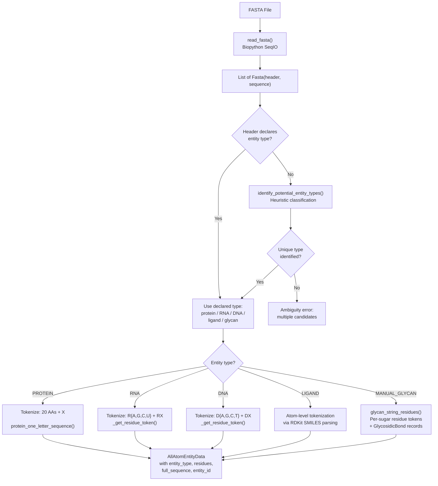

Chai1 accepts a **FASTA-like input format** that extends traditional bioinformatics FASTA with entity type declarations, SMILES-encoded ligands, and glycan notation. This page explains how raw FASTA strings are parsed into typed, tokenized entities — the foundational step that determines every downstream feature, embedding, and structural prediction. Understanding this system is essential for constructing valid inputs and reasoning about model behavior when ambiguous sequences arise.

## FASTA Input Format

Chai1 uses a custom FASTA dialect where each entry's header declares both the **entity type** and a **unique name**, separated by a pipe character. The general pattern is `>entity_type|name=identifier`, followed by the sequence on the next line. This convention allows the pipeline to disambiguate entities that share similar sequence alphabets — for instance, a short string like `AGTC` could plausibly be protein or DNA without an explicit type hint.

```
>protein|name=my-protein
AGSHSMRYFSTSVSRPGRGEPRFIAVGYVDDTQFVR
>ligand|name=my-ligand
CCCCCCCCCCCCCC(=O)O
>RNA|name=my-rna
AGUGGCUA
```

The supported entity type keywords in FASTA headers are `protein`, `RNA`, `DNA`, `ligand`, and `glycan`. Ligands are encoded as **SMILES strings** rather than residue sequences, which is the most significant departure from standard FASTA conventions. Glycans use a specialized parenthetical notation described in the [Glycan Parsing](#glycan-parsing) section below. At the parsing layer, raw FASTA files are read using Biopython's `SeqIO` parser, producing a list of `Fasta(header, sequence)` named tuples that preserve the full header string and raw sequence for downstream type resolution.

Sources: [fasta.py](chai_lab/data/parsing/fasta.py#L25-L37), [predict_structure.py](examples/predict_structure.py#L20-L31)

## Entity Type Classification

The `EntityType` enum defines eight possible entity categories that the pipeline recognizes. These types govern tokenization rules, feature generation paths, and how the model represents each entity internally.

| EntityType | Value | Input Encoding | Tokenization Alphabet |
|---|---|---|---|
| **PROTEIN** | 0 | 1-letter amino acid codes | 20 standard AAs + X |
| **RNA** | 1 | 1-letter nucleotide codes (A/U/G/C) | RA, RC, RG, RU + RX |
| **DNA** | 2 | 1-letter nucleotide codes (A/T/G/C) | DA, DC, DG, DT + DX |
| **LIGAND** | 3 | SMILES string | Atom-level (per-atom tokens) |
| **POLYMER_HYBRID** | 4 | Mixed DNA/RNA | Combined nucleotide alphabet |
| **WATER** | 5 | Automatic (from structure files) | N/A |
| **UNKNOWN** | 6 | Unresolvable input | X |
| **MANUAL_GLYCAN** | 7 | Glycan notation (e.g. `NAG(4-1 FUC)`) | Per-sugar CCD codes |

The enum is defined with explicit integer values to ensure stable serialization across model checkpoints. `MANUAL_GLYCAN` is separated from `LIGAND` because glycans undergo **residue-level tokenization** (each sugar monomer becomes a token) while standard ligands undergo **atom-level tokenization** (each heavy atom becomes a token). This distinction profoundly affects how the diffusion module generates coordinates — glycan tokens predict residue-frame positions, while ligand tokens predict individual atom positions.

Sources: [entity_type.py](chai_lab/data/parsing/structure/entity_type.py#L12-L20)

## Entity Type Inference and Ambiguity Resolution

When a FASTA header does not explicitly declare an entity type, or when validating user-provided types, the pipeline applies heuristic rules through `identify_potential_entity_types`. This function returns a **list of plausible types** rather than a single type, because certain sequences are genuinely ambiguous.

The disambiguation logic operates in two stages. First, `constituents_of_modified_fasta` attempts to decompose the sequence into individual residue tokens, handling both single-character codes and bracket-enclosed modified residues like `(SEP)` or `[NH2]`. If this decomposition succeeds, the one-letter constituents are checked against known alphabets:

- If all one-letter codes are in `{A, G, T, C}` → candidate for **DNA**
- If all one-letter codes are in `{A, G, U, C}` → candidate for **RNA**
- If `U` is absent from one-letter codes → candidate for **PROTEIN**

Note that `AGTC` satisfies both the DNA and protein criteria simultaneously — it appears in both candidate lists. This is precisely why the FASTA header's entity type declaration is critical for disambiguation. Second, if the sequence contains characters outside the modified-FASTA grammar (brackets and letters), it is checked against an extended ASCII symbol set; if valid, it becomes a candidate for **LIGAND** or **MANUAL_GLYCAN** (since SMILES strings and glycan notation share similar character sets).

```
Sequence: "AGUGGCUA"  →  [RNA]           # U present, rules out DNA and protein
Sequence: "AGTGGCTA"  →  [DNA, PROTEIN]  # No U, fits both alphabets
Sequence: "CCCCCCCC"  →  [DNA, RNA, PROTEIN, LIGAND, MANUAL_GLYCAN]  # Fully ambiguous
```

> [!TIP]
> When constructing FASTA inputs, always provide explicit entity type declarations in the header. The heuristic can return multiple candidate types for short sequences composed only of `{A, G, C, T}`, and the wrong type will produce incorrect tokenization and invalid structural predictions.

Sources: [input_validation.py](chai_lab/data/parsing/input_validation.py#L12-L79)

## Sequence Tokenization and the Residue Alphabet

Once an entity type is established, sequences must be tokenized into the model's internal residue alphabet. The tokenization system defines a **32-symbol alphabet** that unifies proteins, RNA, DNA, gaps, and padding:

| Category | Tokens | Count |
|---|---|---|
| Standard amino acids | A, R, N, D, C, Q, E, G, H, I, L, K, M, F, P, S, T, W, Y, V | 20 |
| Unknown protein | X | 1 |
| RNA bases | RA, RC, RG, RU | 4 |
| Unknown RNA | RX | 1 |
| DNA bases | DA, DC, DG, DT | 4 |
| Unknown DNA | DX | 1 |
| Gap | `-` | 1 |
| Non-existent (masked) | `:` | 1 |
| **Total** | | **33** |

The prefix convention (`R` for RNA, `D` for DNA) disambiguates nucleotide tokens from amino acid tokens at the feature level. For example, `A` alone always means alanine; an RNA adenine is encoded as `RA` and a DNA adenine as `DA`. The `get_residue_name` function in the FASTA parsing module performs the reverse mapping from single-letter FASTA codes to three-letter PDB residue names, applying the same prefix logic: RNA `A` → `A`, DNA `A` → `DA`, Protein `A` → `ALA`.

Non-standard residues are collapsed to the unknown token for their entity type: D-amino acids (like DAL, DAR) become `X`; unknown nucleotides become `RX` or `DX`. However, a secondary representation — `protein_one_letter_sequence_with_mods` — preserves modification information by encoding non-standard residues as bracketed three-letter codes (e.g., `[SEP]` for phosphoserine), which is used for documentation and debugging but not for model input.

Sources: [residue_constants.py](chai_lab/data/residue_constants.py#L522-L543), [fasta.py](chai_lab/data/parsing/fasta.py#L40-L68), [residue.py](chai_lab/data/parsing/structure/residue.py#L84-L112)

## Modified Residue Syntax

The FASTA input format supports **bracket-enclosed modified residues** using parentheses or square brackets. The `constituents_of_modified_fasta` parser handles both `(...)` and `[...]` delimiters, extracting multi-character residue codes that represent post-translational modifications or chemically modified nucleotides. For example:

```
Input:  (KCJ)(SEP)(PPN)(B3S)(BAL)(PPN)K(NH2)
Parsed: ["KCJ", "SEP", "PPN", "B3S", "BAL", "PPN", "K", "NH2"]
```

Single-character tokens outside brackets must be ASCII letters; digits are only permitted inside bracketed modifications (e.g., `[NH2]`). Nested brackets are rejected. This syntax allows users to specify exact chemical identities for modified residues while keeping the overall FASTA structure linear and human-readable.

Sources: [input_validation.py](chai_lab/data/parsing/input_validation.py#L14-L46), [test_parsing.py](tests/test_parsing.py#L15-L21)

## Glycan Parsing

Glycans occupy a unique position in the entity type system. They are parsed using a **tree-structured notation** where each sugar is a three-letter CCD (Chemical Component Dictionary) code and glycosidic bonds are specified in parentheses with the pattern `(src_atom-dst_atom SUGAR)`. The parser in `glycans.py` converts this string into a flat list of sugar residues and a list of `GlycosidicBond` objects that record which atoms of which sugars are linked.

```
Input:  MAN(6-1 FUC)(4-1 MAN)
Sugars: ["MAN", "FUC", "MAN"]
Bonds:  [GlycosidicBond(src=0, dst=1, O6→C1),
         GlycosidicBond(src=0, dst=2, O4→C1)]
```

The parsing algorithm maintains a **parent stack** that tracks which sugar is currently the attachment point. Opening a parenthesis pushes the current sugar onto the stack; closing it pops. Bond specifications like `6-1` appear immediately after an opening parenthesis and before the child sugar code, indicating that the `src_atom` (O6) of the parent sugar bonds to the `dst_atom` (C1) of the child. Each sugar becomes a `Residue` object with `is_covalent_bonded=True`, ensuring that the covalent bond graph correctly represents the branched glycan topology.

In FASTA files, glycans are declared with the `glycan` entity type keyword:

```fasta
>glycan|two-sugar
NAG(4-1 NAG)
>glycan|one-sugar
NAG
```

> [!TIP]
> Multi-sugar glycans must use the parenthetical bond notation. A bare sequence like `NAG NAG` without bond specification will not parse correctly — each bond must be explicitly declared as `(src_atom-dst_atom SUGAR)` attached to its parent.

Sources: [glycans.py](chai_lab/data/parsing/glycans.py#L1-L111), [1ac5.fasta](examples/covalent_bonds/1ac5.fasta#L1-L6)

## Entity Type Resolution from Structure Files

When parsing PDB/mmCIF structure files (as opposed to FASTA inputs), entity types are resolved through gemmi's entity metadata using `get_entity_type`. This function maps gemmi's `EntityType` and `PolymerType` enums to chai1's `EntityType` using pattern matching:

| gemmi EntityType | gemmi PolymerType | chai1 EntityType |
|---|---|---|
| Polymer | PeptideL / PeptideD | PROTEIN |
| Polymer | Dna | DNA |
| Polymer | Rna | RNA |
| Polymer | DnaRnaHybrid | POLYMER_HYBRID |
| NonPolymer | * | LIGAND |
| Branched | * | LIGAND |
| Water | * | WATER |

Note that gemmi's `Branched` type (used for branched oligosaccharides in mmCIF files) maps to `LIGAND` rather than `MANUAL_GLYCAN`. The `MANUAL_GLYCAN` type is exclusively reserved for user-provided glycan strings in FASTA input — it signals to the pipeline that the glycan-specific parser should be invoked. This bifurcation exists because structure files already contain atom-level coordinates for branched entities, whereas FASTA glycans require de novo coordinate generation through the sugar-level tokenization path.

Sources: [entity_type.py](chai_lab/data/parsing/structure/entity_type.py#L23-L49)

## FASTA Parsing Pipeline Architecture

The following diagram illustrates how raw FASTA input flows through the parsing and type resolution system:



The terminal node `AllAtomEntityData` is the unified data structure that carries all parsed information into the feature assembly stage. Each entity receives a unique `entity_id` (starting from 0), its resolved `EntityType`, the full residue sequence, and per-residue metadata including `ConformerData` for atom positions when available from structure files.

Sources: [all_atom_entity_data.py](chai_lab/data/parsing/structure/all_atom_entity_data.py#L31-L62), [all_atom_entity_data.py](chai_lab/data/parsing/structure/all_atom_entity_data.py#L138-L199)

## Putting It All Together: A Complete FASTA Example

The following example demonstrates all five user-facing entity types in a single input file, combining protein chains, nucleic acids, a small-molecule ligand, and a glycan:

```fasta
>protein|name=heavy-chain
AGSHSMRYFSTSVSRPGRGEPRFIAVGYVDDTQFVRFDSDAASPRGEPRAPWVEQEGPEYW
>protein|name=light-chain
AIQRTPKIQVYSRHPAENGKSNFLNCYVSGFHPSDIEVDLLKNGERIEKVEHSDLSFSKDW
>RNA|name=ribo-switch
AGUGGCUAAGCUC
>DNA|name=template-strand
AGTGGCTAAGCTC
>ligand|name=inhibitor
Cc1cc2nc3c(=O)[nH]c(=O)nc-3n(C[C@H](O)[C@H](O)[C@H](O)CO)c2cc1C
>glycan|name=n-linked-glycan
NAG(4-1 NAG)(4-1 BMA)(3-1 MAN)(6-1 MAN)
```

Each entity will be tokenized according to its declared type, assigned a monotonically increasing `entity_id`, and embedded into the model's unified token sequence. The protein residues produce one token per amino acid; the RNA and DNA sequences produce one token per nucleotide (with `R`/`D` prefixes internally); the ligand produces one token per heavy atom; and the glycan produces one token per sugar monomer with covalent bond metadata linking them.

To understand how these parsed entities feed into MSA generation and template retrieval, continue to [MSA Generation and Loading](14-msa-generation-and-loading) and [Template Processing Pipeline](16-template-processing-pipeline). For details on how entity types influence feature vectors, see [Token and Atom Feature Generators](19-token-and-atom-feature-generators).
