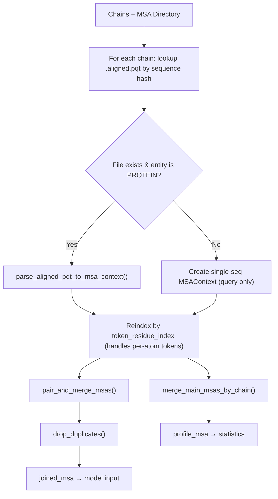

Multiple sequence alignments (MSAs) encode the evolutionary constraints on a protein sequence—information that is critical for accurate structure prediction. Chai-1 can operate in single-sequence mode with strong baseline performance, but when evolutionary information is available, MSA integration yields measurable improvements. This page covers the **complete MSA lifecycle** in Chai-1: how alignments are generated externally, persisted in the `.aligned.pqt` format, loaded and preprocessed into `MSAContext` objects, and ultimately featurized for model consumption.

## The .aligned.pqt File Format

Chai-1 uses a custom **`.aligned.pqt`** file format as the canonical representation of MSAs on disk. Conceptually it is an enriched A3M file stored as a Parquet dataframe with four required columns:

| Column | Type | Purpose |
|---|---|---|
| `sequence` | `str` | Alignment hits in A3M sequence format (uppercase = aligned, lowercase = insertion, `-` = gap) |
| `source_database` | `str` | Origin database — must be one of `uniprot`, `uniref90`, `bfd_uniclust`, `mgnify`, or `query` |
| `pairing_key` | `str` | Species/taxonomy key for cross-chain pairing; empty string means unpaired |
| `comment` | `str` | Free-form metadata; ignored by the pipeline |

The first row must always be the query sequence with `source_database="query"`. Filename is determined by the SHA-256 hash of the uppercase query sequence: `{sha256_hex}.aligned.pqt`. This design offers two key advantages over raw `.a3m` files: alignments from different databases are tracked without losing provenance, and cross-chain pairing keys can be explicitly specified rather than inferred.

The schema is enforced at load time by a `pandera` model (`AlignedParquetModel`) that validates column types and restricts `source_database` to recognized values. A toy example of the table structure:

| sequence | source_database | pairing_key | comment |
|---|---|---|---|
| `RKDSS...` | query | | query sequence |
| `RKDES...` | uniref90 | | A hit from uniref90 |
| `RKSES...` | uniprot | Mus musculus | A mouse sequence from uniprot |

Sources: [aligned_pqt.py](/chai_lab/data/parsing/msas/aligned_pqt.py#L30-L52), [README.md](/examples/msas/README.md#L1-L30)

## MSA Generation Strategies

Chai-1 does not include a built-in sequence search engine. Instead, it supports two strategies for obtaining MSAs, both of which ultimately produce `.aligned.pqt` files.

### ColabFold MMseqs2 Server

The most straightforward approach is the integrated **ColabFold MMseqs2 API** client. When `use_msa_server=True` is passed to `run_inference`, the pipeline calls `generate_colabfold_msas()`, which submits protein sequences to the ColabFold server and receives paired + unpaired A3M results. The flow is:

1. For multi-chain complexes, a **paired search** (`pairgreedy` mode) is submitted first, returning A3M rows where hits across chains share the same species.
2. A separate **unpaired search** (`env` mode) retrieves deeper per-chain alignments from UniRef90 + BFD/MGNIFY databases.
3. Paired rows are indexed by their position in the paired A3M (excluding all-gap padding rows); this index becomes the `pairing_key`.
4. Unpaired rows not already present in the paired set are appended with empty pairing keys.
5. Source databases are heuristically assigned (`UniRef` headers → `uniref90`, others → `bfd_uniclust`).
6. The combined dataframe is written as `.aligned.pqt` into the output MSA directory.

> [!TIP]
> The ColabFold integration also optionally retrieves template hits (`.m8` files) when `use_templates_server=True`. These are saved as `all_chain_templates.m8` alongside the MSA directory and consumed by the template processing pipeline.

### Pre-generated MSA Files

For reproducibility or when using alternative search tools (e.g., jackhmmer against custom databases), users can pre-generate `.aligned.pqt` files and point the pipeline to the directory via `msa_directory=Path(...)`. The helper function `merge_multi_a3m_to_aligned_dataframe()` converts multiple A3M files (one per source database) into a single aligned parquet, automatically extracting pairing keys from UniProt headers (species names via `OS=` pattern) and UniRef90 headers (TaxID via `TaxID=` pattern).

The CLI command `chai a3m-to-pqt` wraps this conversion for convenience. Additionally, the script `scripts/stage_colabfold_outputs_for_chai.py` can convert an existing ColabFold output directory into the Chai-1 format.

Sources: [colabfold.py](/chai_lab/data/dataset/msas/colabfold.py#L213-L459), [aligned_pqt.py](/chai_lab/data/parsing/msas/aligned_pqt.py#L150-L200), [species.py](/chai_lab/data/parsing/msas/species.py#L1-L31)

## The MSAContext Data Structure

At the heart of the MSA pipeline is `MSAContext`, a typed dataclass that represents an MSA as a collection of 2D tensors with shape `[msa_depth, n_tokens]`:

| Field | Dtype | Meaning |
|---|---|---|
| `tokens` | `uint8` | Tokenized residue indices (same vocabulary as the rest of the model) |
| `pairing_key_hash` | `int32` | Stable hash of pairing key string; `NO_PAIRING_KEY = -999991` for unpaired |
| `deletion_matrix` | `uint8` | Count of lowercase insertions preceding each aligned position (capped at 255) |
| `mask` | `bool` | True for valid positions; False for padding |
| `sequence_source` | `uint8` | Integer-encoded database source (e.g., 0=BFD_UNICLUST, 2=UNIREF90, 3=UNIPROT) |

Key operations on `MSAContext` include **`pad()`** (extends both depth and token dimensions with sentinel values), **`cat()`** (concatenates along a specified dimension), **`apply_mask()`** (fills masked positions with gap tokens and null pairing keys), and **`take_rows_with_padding()`** (selects specific rows, inserting empty padding rows where indices are `None`). The class also provides `create_single_seq()` for building a single-row MSA from a query, and `create_empty()` for constructing zero-depth placeholders.

Sources: [msa_context.py](/chai_lab/data/dataset/msas/msa_context.py#L1-L168)

## Loading Pipeline: From Disk to MSAContext

The loading pipeline is orchestrated by `get_msa_contexts()`, which transforms a list of `Chain` objects and an MSA directory into two `MSAContext` instances—one for model input and one for profile statistics.



The loading step applies **per-source quotas** during parsing: UniRef90 is capped at 10,000 rows, UniProt at 50,000, and BFD_UNICLUST is effectively unlimited (1,000,000). After quota enforcement, rows are sorted by database priority (query first, then BFD_UNICLUST → MGNIFY → UNIREF90 → UNIPROT). Non-protein entities (RNA, DNA, ligands) automatically receive empty MSAs containing only the query sequence.

Sources: [load.py](/chai_lab/data/dataset/msas/load.py#L1-L83), [aligned_pqt.py](/chai_lab/data/parsing/msas/aligned_pqt.py#L74-L148)

## A3M Tokenization

The bridge between raw A3M text and `MSAContext` tensors is the tokenization module. A3M format encodes three classes of characters: **uppercase letters** (aligned residues), **lowercase letters** (insertions relative to the query, counted but not aligned), and **dashes** (gaps). The tokenizer maps each character through a 256-entry lookup table:

- Uppercase amino acid letters → residue type indices (unknown letters default to `X`)
- Lowercase letters → `MAPPED_TOKEN_INSERTION` (increment deletion counter, skip output)
- Dashes → gap token index
- Dots → `MAPPED_TOKEN_SKIP` (ignored entirely)

The core loop is JIT-compiled with **Numba** for performance, processing concatenated byte strings in a single pass. For each aligned position, it emits the token index and the accumulated deletion count (capped at 255 to fit `uint8`).

Sources: [a3m.py](/chai_lab/data/parsing/msas/a3m.py#L1-L134)

## Pairing and Merging Algorithm

For multi-chain complexes, cross-chain MSA pairing captures co-evolutionary signals. The `pair_and_merge_msas()` function implements a greedy pairing strategy:

1. **Compute edit distances** between each MSA row and the query row (Hamming distance over tokens).
2. **Build unique keys (ukeys)** from `(pairing_key_hash, rank_within_key)` pairs, where rank is determined by sorting rows sharing the same pairing key by edit distance. This disambiguates non-unique pairing keys.
3. **Select paired ukeys** that appear in all chains with non-empty MSAs (intersection), up to `MAX_PAIRED_DEPTH = 8,192`.
4. **Reorder each chain's MSA**: paired rows first (with `None` placeholders for missing pairs), then unpaired rows, up to `FULL_DEPTH = 16,384` total.
5. **Merge across chains** by padding to equal depth and concatenating along the token dimension.

After merging, `drop_duplicates()` removes duplicate rows (sorted by first appearance to preserve paired-unpaired ordering). A separate `profile_msa` is also produced by simply concatenating deduplicated per-chain MSAs along the token dimension—this is used for MSA profile statistics, not for the paired input.

Sources: [preprocess.py](/chai_lab/data/dataset/msas/preprocess.py#L1-L134)

## MSA Subsampling

At inference time, the full MSA depth (up to 16,384) may exceed memory constraints. The `subsample_and_reorder_msa_feats_n_mask()` function stochastically subsamples to a configurable target depth (default 4,096 rows). The sampling strategy is **size-biased**: each row's selection probability is proportional to `coverage × random_noise`, favoring hits that cover more positions while maintaining stochasticity. Selected rows are moved to the top of the feature tensor while preserving order; the mask tensor is truncated and zero-padded to maintain the original depth dimension.

Sources: [utils.py](/chai_lab/data/dataset/msas/utils.py#L1-L87)

## Feature Generation from MSA

Seven feature generators consume `MSAContext` fields and produce model inputs. They are registered in the global `feature_factory` and organized by feature type:

| Generator | Type | Input | Output | Description |
|---|---|---|---|---|
| `MSAFeatureGenerator` | MSA | `msa_tokens` | One-hot (32 classes) | Token identity in MSA rows |
| `MSAHasDeletionGenerator` | MSA | `msa_deletion_matrix` | Binary | Whether deletion count > 0 at each position |
| `MSADeletionValueGenerator` | MSA | `msa_deletion_matrix` | Scaled float | `2/π · arctan(d/3)` of deletion count |
| `MSAProfileGenerator` | TOKEN | `main_msa_tokens` + `main_msa_mask` | Float vector (32) | Per-position residue frequency profile from profile MSA |
| `MSADeletionMeanGenerator` | TOKEN | `main_msa_deletion_matrix` + `main_msa_mask` | Float scalar | Mean deletions per position across profile MSA |
| `IsPairedMSAGenerator` | MSA | `msa_pairkey` + `msa_mask` | Binary | Whether token shares pairing key with first chain |
| `MSADataSourceGenerator` | MSA | `msa_sequence_source` + `msa_mask` | One-hot (6 classes) | Database provenance encoding |

> [!TIP]
> The `MSAProfileGenerator` uses an optimized `torch.scatter_add` implementation to compute the per-position residue frequency distribution in a single vectorized operation, avoiding explicit Python loops over MSA depth. The `MSADataSourceGenerator` remaps `QUERY` source to `NONE` (a Chai-1-specific design choice), and uses `NONE` as the mask value for padded positions.

The distinction between **MSA-type** and **TOKEN-type** generators is architecturally significant: MSA-type features retain the full `[batch, depth, tokens, dim]` shape and are consumed by the MSA attention stack, while TOKEN-type features (profile, deletion mean) are depth-averaged into `[batch, tokens, dim]` and merged with per-token embeddings.

Sources: [msa.py](/chai_lab/data/features/generators/msa.py#L1-L247), [chai1.py](/chai_lab/chai1.py#L219-L254)

## End-to-End Data Flow

```mermaid
flowchart LR
    subgraph Generation
        CF["ColabFold MMseqs2 API"] --> A3M["A3M Files (paired + unpaired)"]
        ALT["jackhmmer / custom"] --> A3M2["A3M Files (per DB)"]
    end
    subgraph Persistence
        A3M --> PQ["aligned.pqt (Parquet)"]
        A3M2 --> PQ
    end
    subgraph Loading
        PQ --> PARSE["parse_aligned_pqt_to_msa_context()"]
        PARSE --> MC["MSAContext per chain"]
    end
    subgraph Preprocessing
        MC --> PAIR["pair_and_merge_msas()"]
        MC --> PROF["merge_main_msas_by_chain()"]
        PAIR --> DEDUP["drop_duplicates()"]
        DEDUP --> JOINED["joined_msa (model input)"]
        PROF --> PROFILE["profile_msa (statistics)"]
    end
    subgraph Featurization
        JOINED --> FEATS["7 MSA Feature Generators"]
        PROFILE --> FEATS
        FEATS --> BATCH["Collated Batch Tensors"]
    end
```



The `AllAtomFeatureContext` dataclass holds both the `msa_context` (joined) and `profile_msa_context`, and its `to_dict()` method expands all MSA fields into the flat dictionary format expected by the collator. After collation and padding, the batch tensors are consumed by the feature generators listed above.

Sources: [all_atom_feature_context.py](/chai_lab/data/dataset/all_atom_feature_context.py#L1-L96), [chai1.py](/chai_lab/chai1.py#L283-L350)

## Practical Usage

To run inference with pre-generated MSAs, point `msa_directory` to a folder containing `.aligned.pqt` files:

```python
from chai_lab.chai1 import run_inference
from pathlib import Path

candidates = run_inference(
    fasta_file=Path("input.fasta"),
    output_dir=Path("outputs"),
    msa_directory=Path("examples/msas"),  # Folder with .aligned.pqt files
    use_msa_server=False,                 # Don't generate MSAs via server
)
```

To generate MSAs on-the-fly via the ColabFold server:

```python
candidates = run_inference(
    fasta_file=Path("input.fasta"),
    output_dir=Path("outputs"),
    use_msa_server=True,                  # Generate MSAs via MMseqs2 API
    msa_server_url="https://api.colabfold.com",
)
```

To inspect an existing `.aligned.pqt` file:

```python
import pandas as pd
df = pd.read_parquet("examples/msas/703adc2c74b8d7e613549b6efcf37126da7963522dc33852ad3c691eef1da06f.aligned.pqt")
print(df.head())
```

The `use_msa_server` and `msa_directory` options are mutually exclusive. Non-protein entities automatically receive empty MSAs regardless of the chosen strategy.

Sources: [predict_with_msas.py](/examples/msas/predict_with_msas.py#L1-L46), [chai1.py](/chai_lab/chai1.py#L283-L370)

## Data Source Quotas and Priority

When loading `.aligned.pqt` files, per-source quotas control how many rows from each database are retained. This prevents disproportionately large sources from drowning out others:

| Source | Quota | Priority |
|---|---|---|
| QUERY | — (always first) | -1 (highest) |
| BFD_UNICLUST | 1,000,000 | 0 |
| MGNIFY | 5,000 | 1 |
| UNIREF90 | 10,000 | 2 |
| UNIPROT | 50,000 | 3 |
| BFD | 5,000 | 4 |
| PDB70 | 5,000 | 5 |

Rows are sorted by priority after quota enforcement, ensuring the query always occupies row 0 and high-quality sources appear earlier in the MSA stack.

Sources: [data_source.py](/chai_lab/data/parsing/msas/data_source.py#L1-L81)

## What Comes Next

After MSA loading and featurization, the resulting feature tensors flow into the model's embedding and attention layers. For a deeper understanding of the surrounding systems, explore:

- **[FASTA Parsing and Entity Types](13-fasta-parsing-and-entity-types)** — how input sequences become `Chain` objects that feed into MSA loading
- **[ESM Embeddings Integration](15-esm-embeddings-integration)** — the complementary single-sequence embedding pathway
- **[Feature Generator Base Design](18-feature-generator-base-design)** — the abstract framework that all seven MSA feature generators inherit from
- **[Token and Atom Feature Generators](19-token-and-atom-feature-generators)** — how MSA features are combined with structural features