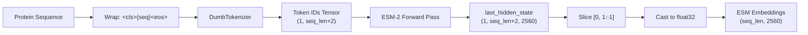
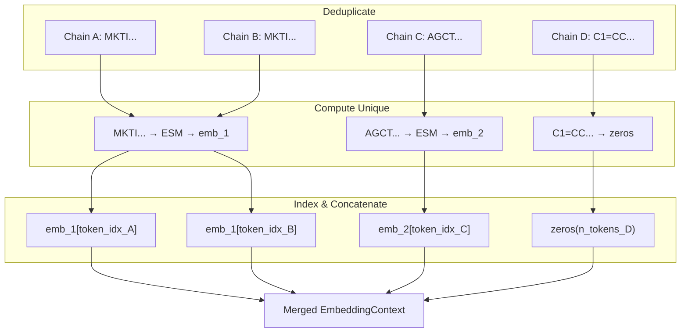

Chai1 leverages **ESM-2** (Evolutionary Scale Modeling) protein language model embeddings as a token-level input feature, providing the model with rich pre-trained semantic representations of protein sequences. This integration replaces the need for evolutionary information from MSAs in many scenarios — when MSA depth is shallow or unavailable, ESM embeddings carry sufficient contextual signal about residue identity, local structure propensity, and evolutionary constraints. For non-protein entities (DNA, RNA, ligands, glycans), the system gracefully falls back to zero-valued embeddings, ensuring uniform tensor shapes across heterogeneous inputs without requiring special branching logic.

Sources: [esm.py](chai_lab/data/dataset/embeddings/esm.py#L1-L181), [embedding_context.py](chai_lab/data/dataset/embeddings/embedding_context.py#L1-L52)

## Architecture Overview

The ESM integration follows a four-stage pipeline: **model loading → per-chain embedding computation → context assembly → feature generation**. Each stage has distinct responsibilities and ownership boundaries, making the system modular and testable.

```mermaid
flowchart TD
    A["Input Chains<br/>(from FASTA parsing)"] --> B{"Entity Type?"}
    B -->|Protein| C["ESM-2 3B Model<br/>Forward Pass"]
    B -->|Non-Protein| D["Zero Embeddings<br/>d_emb = 2560"]

    C --> E["EmbeddingContext<br/>per-chain"]
    D --> E

    E --> F["Token Residue Index<br/>Selection"]
    F --> G["Chain Concatenation<br/>along token dim"]
    G --> H["Merged EmbeddingContext<br/>&#40;num_tokens, 2560&#41;"]

    H --> I["AllAtomFeatureContext<br/>.embedding_context"]
    I --> J["Collation & Padding"]
    J --> K["Batch tensor<br/>esm_embeddings<br/>&#40;batch, num_tokens, 2560&#41;"]

    K --> L["ESMEmbeddings<br/>FeatureGenerator"]
    L --> M["FeatureFactory<br/>.generate()"]
    M --> N["TOKEN features<br/>→ Feature Embedder"]

    style C fill:#4a90d9,color:#fff
    style D fill:#999,color:#fff
    style L fill:#e67e22,color:#fff
    style N fill:#27ae60,color:#fff
```



Sources: [esm.py](chai_lab/data/dataset/embeddings/esm.py#L1-L181), [esm_generator.py](chai_lab/data/features/generators/esm_generator.py#L1-L35), [all_atom_feature_context.py](chai_lab/data/dataset/all_atom_feature_context.py#L1-L96)

## ESM-2 Model Loading and Device Management

The ESM model is a **traced TorchScript** variant of `esm2_t36_3B_UR50D` — the 3-billion parameter ESM-2 model — quantized to fp16 for efficient inference. The model is hosted remotely and lazily downloaded on first use.

The `esm_model()` context manager implements a **transient device-placement** strategy: the model is loaded into an in-process singleton list (`_esm_model`), moved to the requested device for the duration of the `with` block, then returned to CPU when the block exits. This pattern ensures GPU memory is freed immediately after embedding computation, which is critical in the broader inference pipeline where the trunk and diffusion modules also compete for GPU VRAM.

> [!TIP]
> The `os.register_at_fork(after_in_child=lambda: _esm_model.clear())` call is essential for multi-process data loading: when Python forks a worker process, the parent's CUDA tensors become invalid in the child. Clearing the singleton forces a fresh model load in each worker, preventing stale CUDA references.

| Property | Value |
|---|---|
| Model | ESM-2 t36 3B UR50D |
| Precision | fp16 (traced) |
| Download URL | `https://chaiassets.com/chai1-inference-depencencies/esm2/...` |
| Cache Location | `{downloads_path}/esm/traced_sdpa_esm2_t36_3B_UR50D_fp16.pt` |
| Embedding Dimension | 2560 |
| Loading Strategy | Lazy singleton, context-managed device transfer |

Sources: [esm.py](chai_lab/data/dataset/embeddings/esm.py#L11-L55)

## Tokenization and Embedding Computation

The system implements a lightweight **`DumbTokenizer`** rather than depending on the full `esm` Python package. This tokenizer maps single amino acid characters and special tokens (`<cls>`, `<eos>`, `<pad>`, etc.) to integer IDs using a priority-matching loop — multi-character tokens (like `<cls>`) are matched before single characters, preventing ambiguity.

The embedding computation flow for each protein sequence proceeds as follows:

1. **Wrap with special tokens**: The raw sequence is wrapped as `<cls>{seq}<eos>` before tokenization
2. **Forward pass**: Token IDs are passed through the traced ESM model, producing `last_hidden_state`
3. **Strip special tokens**: BOS (`<cls>`) and EOS (`<eos>`) embeddings are removed via slicing `[0, 1:-1]`
4. **Upcast to float32**: The fp16 hidden states are converted to float32 for downstream numerical stability
5. **Assert length**: A runtime assertion confirms `seq_len == len(seq)`, catching any tokenization misalignment



> [!TIP]
> The `DumbTokenizer` uses a greedy longest-match strategy via `text.startswith(token, i)`. This means multi-character special tokens like `<mask>` are correctly matched before the `<` character. If you extend the token map, ensure longer tokens appear before shorter prefixes in iteration order — though Python 3.7+ dict ordering guarantees insertion order, so list the multi-character tokens first.

Sources: [esm.py](chai_lab/data/dataset/embeddings/esm.py#L57-L125)

## EmbeddingContext: Data Contract

`EmbeddingContext` is the central data structure carrying ESM embeddings through the pipeline. It is a typed dataclass with a single tensor field of shape `(num_tokens, 2560)`, providing three key operations:

| Method | Purpose | Behavior |
|---|---|---|
| `pad(max_tokens)` | Align to batch dimensions | Zero-pads along token dimension to `max_tokens` |
| `to_dict()` | Serialize for batching | Returns `{"esm_embeddings": tensor}` |
| `empty(n_tokens)` | Create zero placeholder | Non-protein entities get 2560-dim zero vectors |

The `empty()` class method is the critical fallback for non-protein chains — DNA, RNA, ligands, and glycans all receive zero-valued embeddings of the same dimensionality. This design avoids conditional logic downstream: the feature generator and model simply consume a uniform tensor regardless of entity type.

Sources: [embedding_context.py](chai_lab/data/dataset/embeddings/embedding_context.py#L1-L52)

## Chain-Level Assembly: get_esm_embedding_context

The `get_esm_embedding_context()` function is the orchestration point that bridges raw chain data to a single merged `EmbeddingContext`. Its logic follows a **deduplicate → compute → index → concatenate** pattern:

1. **Deduplicate**: Extract the set of unique protein sequences from all chains. Multiple chains with identical sequences share a single ESM forward pass — a significant optimization for homomeric complexes.
2. **Compute**: Call `_get_esm_contexts_for_sequences()` which runs ESM on each unique sequence, producing a `dict[str, EmbeddingContext]` mapping.
3. **Index**: For each chain, select embeddings at `chain.structure_context.token_residue_index` positions. This handles cases where the token structure differs from the raw sequence (e.g., modified residues that occupy multiple token positions).
4. **Concatenate**: All chain embeddings are merged along the token dimension via `torch.cat`, producing a single `EmbeddingContext` for the entire input.



The code includes a comment about cropping logic that is currently not exercised during inference (`# don't crop any chains during inference`), with a stub showing how cropped indices would slice into the exploded embeddings if training-time cropping were needed.

Sources: [esm.py](chai_lab/data/dataset/embeddings/esm.py#L127-L181)

## Feature Generation Pipeline

Once the `EmbeddingContext` is assembled into `AllAtomFeatureContext` and batched through the collator, the `ESMEmbeddings` feature generator extracts the raw tensor from the batch and passes it through as a feature:

```python
class ESMEmbeddings(FeatureGenerator):
    def __init__(self, ty=FeatureType.TOKEN):
        super().__init__(
            ty=ty,
            encoding_ty=EncodingType.ESM,
            can_mask=False,  # ESM embeddings are always present (zeros for non-protein)
            mult=1,
        )
```

The `EncodingType.ESM` is a distinct encoding type that passes the tensor through unchanged — no one-hot encoding, no RBF transformation, no Fourier features. The `can_mask=False` flag signals that this feature never needs a mask channel appended (unlike `EncodingType.IDENTITY` features which add a mask bit as the last channel). When values are missing, the mask value is simply `0.0`, which aligns with the zero-embedding strategy for non-protein entities.

The feature is registered in the global `feature_factory` dictionary as `"ESMEmbeddings"`, and is generated alongside all other features when `FeatureFactory.generate(batch)` is called during collation post-processing.

Sources: [esm_generator.py](chai_lab/data/features/generators/esm_generator.py#L1-L35), [base.py](chai_lab/data/features/generators/base.py#L1-L114), [chai1.py](chai_lab/chai1.py#L174-L177)

## Integration in the Inference Pipeline

The `make_all_atom_feature_context()` function in `chai1.py` controls whether ESM embeddings are computed or skipped:

```python
# Load ESM embeddings
if use_esm_embeddings:
    embedding_context = get_esm_embedding_context(chains, device=esm_device)
else:
    embedding_context = EmbeddingContext.empty(n_tokens=n_actual_tokens)
```

The `use_esm_embeddings` parameter defaults to `True` in `run_inference()`, meaning ESM embeddings are computed by default. The `esm_device` parameter controls which device the ESM model runs on — it is set to the same device as the main inference device, ensuring the ESM forward pass benefits from GPU acceleration when available.

After embedding computation, the `EmbeddingContext` is stored in `AllAtomFeatureContext.embedding_context` (typed as `EmbeddingContext | None`). During collation, if the context is non-None, it is padded and included in the batch dictionary via `to_dict()`; this adds `esm_embeddings` to the `inputs` dict. The `ESMEmbeddings` generator then retrieves it from `batch["inputs"]["esm_embeddings"]` during feature generation.

The downstream flow continues through the **feature embedder** (which processes all TOKEN-type features, including ESM, into a unified embedding space) and then the **token embedder** (which combines token single, pair, atom, and block-atom-pair features into initial representations for the trunk). For the complete picture of how ESM features flow into the model's attention layers, see [Feature Embedding and Token Embedding](9-feature-embedding-and-token-embedding).

Sources: [chai1.py](chai_lab/chai1.py#L350-L475), [all_atom_feature_context.py](chai_lab/data/dataset/all_atom_feature_context.py#L57-L96), [collate.py](chai_lab/data/collate/collate.py#L1-L98)

## Key Design Decisions

| Decision | Rationale |
|---|---|
| **Zero-embeddings for non-proteins** | Uniform tensor shape eliminates branching in model code; zeros carry no information, so the model learns to ignore them |
| **Lazy singleton model loading** | Avoids ~6GB memory overhead on import; model loaded only when first needed |
| **Context-managed device transfer** | GPU memory is scarce during inference; ESM model is moved to CPU immediately after use |
| **Sequence deduplication** | Homomeric complexes (common in protein structure) share a single ESM pass, saving compute |
| **Custom DumbTokenizer** | Removes runtime dependency on the `esm` package; the traced model only needs token IDs |
| **TorchScript traced model** | Enables optimized inference without Python overhead; SDPA attention kernels for speed |
| **float32 upcast after inference** | fp16 embeddings can lose precision; float32 ensures numerical stability in downstream feature processing |

Sources: [esm.py](chai_lab/data/dataset/embeddings/esm.py#L1-L181), [embedding_context.py](chai_lab/data/dataset/embeddings/embedding_context.py#L1-L52), [esm_generator.py](chai_lab/data/features/generators/esm_generator.py#L1-L35)

## Next Steps

- To understand how ESM embeddings are combined with other token features before entering the trunk, see [Feature Embedding and Token Embedding](9-feature-embedding-and-token-embedding).
- To see how MSA features provide complementary evolutionary information, see [MSA Generation and Loading](14-msa-generation-and-loading).
- For the full feature generator taxonomy including how `EncodingType.ESM` compares to other encoding strategies, see [Feature Generator Base Design](18-feature-generator-base-design).