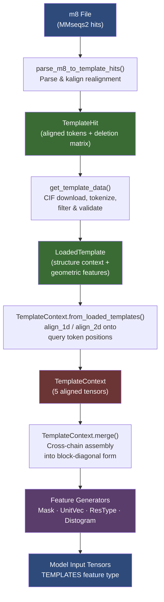

The Template Processing Pipeline transforms structural homologs discovered via sequence search into geometrically-aligned, tensorized features that the Chai-1 model consumes during inference. Templates provide the model with coarse structural priors—backbone frames, inter-residue distances, and unit vectors—derived from known PDB structures that share evolutionary similarity with the query. The pipeline spans four architectural layers: **hit discovery** from MMseqs2-formatted m8 files, **structural loading** and coordinate extraction from CIF files, **alignment** of template features onto query token positions, and **feature generation** that produces the five template-specific input tensors consumed by the trunk. Templates are exclusively available for protein entities; non-protein chains receive zeroed-out placeholder contexts to preserve tensor alignment during multi-chain merging.

Sources: [template_hit.py](chai_lab/data/parsing/templates/template_hit.py#L1-L136), [context.py](chai_lab/data/dataset/templates/context.py#L1-L420), [load.py](chai_lab/data/dataset/templates/load.py#L1-L411), [templates.py](chai_lab/data/features/generators/templates.py#L1-L167)

## Pipeline Architecture

The template pipeline operates as a sequential transformation from raw search hits to model-consumable feature tensors. Each stage refines the representation, progressively narrowing from an unbounded set of potential hits to a fixed-shape `(n_templates, n_tokens, …)` tensor block that the feature generators encode.



The pipeline is invoked through `get_template_context()`, which orchestrates the full sequence per chain and then merges results across all chains in the input. The entry point is triggered when `use_templates_server=True` is passed to [run_inference](chai_lab/chai1.py), which causes the inference dataset to pass the m8 file path into the template subsystem.

Sources: [context.py](chai_lab/data/dataset/templates/context.py#L334-L419), [predict_with_templates.py](examples/templates/predict_with_templates.py#L23-L30)

## Stage 1: Hit Parsing and Realignment

The pipeline begins by parsing an **m8 file**—a tab-delimited format produced by MMseqs2 that lists sequence alignments between query entities and PDB structures. The `parse_m8_file()` function reads 14 columns including query/subject identifiers, alignment boundaries, percent identity, e-value, and bitscore, then sorts hits by e-value within each query group.

The `parse_m8_to_template_hits()` generator function transforms each row into a `TemplateHit` object through a multi-step process: (1) the subject identifier is split into PDB ID and chain ID, (2) the corresponding CIF file is downloaded from RCSB via `download_cif_file()`, (3) the template's polymer sequence is extracted from the gemmi structure (with gap markers stripped), (4) the hit subregion is sliced from the template sequence, and (5) **kalign** is used to realign the query sequence against the template subregion, producing a fresh alignment that supersedes the m8's original alignment. This realignment step is critical because the m8 format may not preserve the precise residue correspondence needed for structural feature mapping.

The realigned output is tokenized via `tokenize_sequences_to_arrays()`, converting the A3M-formatted alignment (where lowercase residues indicate insertions) into integer token arrays and deletion matrices. The resulting `TemplateHit` is a frozen dataclass carrying the tokenized alignment, deletion matrix, boundary indices, and an optional path to the cached CIF file. Post-initialization validation asserts that the token-derived indices match the metadata-derived boundaries and that no negative indices exist.

Sources: [m8.py](chai_lab/data/parsing/templates/m8.py#L22-L130), [template_hit.py](chai_lab/data/parsing/templates/template_hit.py#L16-L136), [rcsb.py](chai_lab/data/io/rcsb.py#L9-L18)

### TemplateHit Index Calculus

The `TemplateHit` class implements non-trivial index arithmetic to map between query positions and hit positions in the presence of insertions and deletions. Three computed properties form the core of this system:

| Property | Shape | Description |
|---|---|---|
| `indices_query` | `(m,)` | Query residue indices corresponding to the hit alignment, derived by locating non-gap tokens |
| `indices_hit_within_subregion` | `(n,)` | Hit residue indices *relative to the hit subregion start*, accounting for insertions (deletion_matrix increments) and gaps (gap tokens decrement) |
| `indices_hit` | `(n,)` | Absolute hit indices within the full template sequence: `indices_hit_within_subregion + hit_start` |
| `hit_valid_mask` | `(n,)` | Boolean mask that is `False` for hit positions that are gaps in the alignment (i.e., where the query has a residue but the template does not) |

The `indices_hit_within_subregion` computation is particularly nuanced: a cumulative sum over an increment vector that adds deletion counts (to skip positions absent from the alignment) and subtracts gap indicators (to avoid double-counting positions where the template lacks a residue). This ensures that the indices correctly reference back into the full template structure even when the alignment introduces discontinuities.

> [!TIP]
> The `hit_valid_mask` distinguishes two types of alignment asymmetry: a gap in the hit (`"-"` in the hit, residue in the query) produces `False` and means "no structural data at this query position," whereas an insertion in the hit (hit has extra residues not in the query) is handled by the deletion matrix and does not affect the mask. The mask is essential for correctly zeroing out `template_restype` and `template_pseudo_beta_mask` at gap positions during `LoadedTemplate` feature computation.

Sources: [template_hit.py](chai_lab/data/parsing/templates/template_hit.py#L70-L136)

## Stage 2: Structural Loading and Feature Extraction

The `get_template_data()` function consumes the `TemplateHit` iterator and produces a list of `LoadedTemplate` objects, each pairing a hit with its full structural context. For each hit, the pipeline:

1. **Loads entity data** via `_get_entity_data()`, which downloads the CIF file (if not already cached), reads the gemmi structure, and converts it to `AllAtomEntityData` filtered to protein entities only
2. **Rejects hits with modified residues** because per-atom tokenization of modifications creates a token count mismatch with the per-residue query sequence
3. **Tokenizes** the entity using `AllAtomResidueTokenizer` to produce an `AllAtomStructureContext` containing ground-truth atom coordinates, existence masks, backbone frame indices, and residue type information
4. **Drops unresolved residues** when `drop_unresolved_from_hits=True`, filtering to only atoms with valid centre positions

The `LoadedTemplate` dataclass then computes five geometric features from the structure context, all indexed by `template_hit_indices` to select only the hit-relevant subregion:

| Feature | Property | Computation |
|---|---|---|
| `template_restype` | Residue type per token | Index into `token_residue_type` at hit positions; gaps set to `"-"` token |
| `template_pseudo_beta_mask` | Boolean per token | Reference atom existence mask AND `hit_valid_mask` |
| `template_pseudo_beta_distances` | Pairwise distances `(n, n)` | `cdist` on pseudo-beta coordinates; masked positions filled with 100.0 (pushes them to the last distogram bin) |
| `template_backbone_frame_mask` | Boolean per token | Backbone frame completeness AND `hit_valid_mask` |
| `template_unit_vector` | 3D vectors `(n, n, 3)` | N-Cα-C backbone frames → `Rigid` transforms → inverse-rotated translation vectors, normalized |

The unit vector computation is the most architecturally significant: it constructs `Rigid` objects from the N, Cα, and C backbone atoms at each position, then computes the rotation-invariant representation `R_i^T (t_j - t_i) / ||R_i^T (t_j - t_i)||` for all pairs. This SE(3)-equivariant encoding captures the *relative orientation and distance* between backbone frames in a way that is invariant to global rotation and translation.

Sources: [load.py](chai_lab/data/dataset/templates/load.py#L58-L411), [rigid.py](chai_lab/tools/rigid.py)

### Overlap and Containment Filtering

The `get_template_data()` function applies two levels of spatial filtering before loading a hit's structure. First, it checks that the hit's query indices overlap with the `query_crop_indices` (the token positions remaining after any cropping). The `fully_contained_only` flag controls whether the hit must be entirely within the crop (`issubset`) or merely have nonzero intersection. Second, after structural loading, a `strict_subsequence_check` validates that the loaded `template_restype` sequence is a subsequence of the original alignment's query sequence—this catches cases where gemmi's residue numbering diverges from the alignment's assumptions. Hits failing either check are silently dropped. The pipeline loads up to `max_loaded_templates=4` hits by default, taking the first valid ones in e-value order.

Sources: [load.py](chai_lab/data/dataset/templates/load.py#L262-L410)

## Stage 3: Alignment onto Query Token Space

Once `LoadedTemplate` objects are produced, they must be mapped from their native coordinate space (indexed by hit positions) into the query's token space. The `TemplateContext.from_loaded_templates()` class method orchestrates this using two alignment primitives in [align.py](chai_lab/data/dataset/templates/align.py):

**`align_1d`** maps per-token features (`template_restype`, `template_pseudo_beta_mask`, `template_backbone_frame_mask`) from hit-indexed positions into a `(n_templates, n_tokens)` tensor by scattering values at the alignment indices. Unmapped positions receive a fill value (the gap token `"-"` for restype, `False` for masks).

**`align_2d`** maps pairwise features (`template_distances`, `template_unit_vector`) from hit-indexed pairs into a `(n_templates, n_tokens, n_tokens, ...)` tensor. For each template, it constructs a boolean mask from the alignment indices, then uses the outer product of this mask to identify which entries in the `(n_tokens, n_tokens)` grid correspond to the template's data, writing the flattened template values into those positions.

The `apply_crop` flag in `from_loaded_templates()` controls whether alignment indices are computed relative to the cropped query (`cropped_template_query_match_indices`, via `torch.searchsorted`) or the original query (`template_query_match_indices`). During inference, `apply_crop=False` is used because the full query is available.

```
Crop indices:               |-------------------------------------|
Query:      --------------------------------------------------------
Hit on 1B2D:                       |--------------------------|
                                    ↑ hit_start        hit_end ↑

LoadedTemplate maps:
  template_hit_indices  → indices within the full hit structure
  template_query_match_indices → indices within the full query
  cropped_template_query_match_indices → indices within the cropped query
```

Sources: [context.py](chai_lab/data/dataset/templates/context.py#L243-L331), [align.py](chai_lab/data/dataset/templates/align.py#L17-L67), [load.py](chai_lab/data/dataset/templates/load.py#L1-L17)

## Stage 4: Cross-Chain Merging

For multi-chain inputs, each chain independently produces its own `TemplateContext`. The `TemplateContext.merge()` class method combines these into a single unified context by:

1. **Padding** each per-chain context to the same number of templates (the maximum across chains)
2. **Concatenating** 1D features (`template_restype`, `template_pseudo_beta_mask`, `template_backbone_frame_mask`) along the token dimension
3. **Assembling** 2D features (`template_distances`, `template_unit_vector`) into a block-diagonal structure, where each chain's `(n_i, n_i)` pairwise matrix occupies its corresponding diagonal block in the merged `(N, N)` matrix (where `N = Σ n_i`)

The block-diagonal construction reflects the biological reality that template hits are per-chain: a hit against chain A provides no distance information about chain B, so cross-chain entries remain zeroed. The `same_asym` masking applied by feature generators later ensures that only intra-chain template information is used.

For chains with no template hits (non-protein entities or proteins with no passing hits), an empty `TemplateContext` with gap-filled `template_restype` and zeroed masks/distances is inserted to preserve alignment dimensions.

Sources: [context.py](chai_lab/data/dataset/templates/context.py#L118-L186), [context.py](chai_lab/data/dataset/templates/context.py#L334-L419)

## Stage 5: Feature Generation

The final stage converts the `TemplateContext` tensors into model-ready features via four feature generators, all classified under `FeatureType.TEMPLATES`:

| Generator | Input Tensor | Output Shape | Encoding | Key Logic |
|---|---|---|---|---|
| `TemplateMaskGenerator` | `template_backbone_frame_mask`, `template_pseudo_beta_mask` | `(b, t, n, n, 2)` | IDENTITY | Outer product of masks × `same_asym` mask; concatenates backbone and pseudo-beta masks |
| `TemplateUnitVectorGenerator` | `template_unit_vector` | `(b, t, n, n, 3)` | IDENTITY | Multiplied by `same_asym` to zero out inter-chain vectors |
| `TemplateResTypeGenerator` | `template_restype` | `(b, t, n, n, 32)` | OUTERSUM | Outer sum of one-hot residue types; 32-dim embedded |
| `TemplateDistogramGenerator` | `template_distances` | `(b, t, n, n, 38)` | ONE_HOT | Distance discretized into 38 bins (3.25Å–50.75Å); inter-chain masked |

> [!TIP]
> The `same_asym` mask is computed in every generator by comparing `token_asym_id` values: `rearrange(asym_ids, "b t -> b 1 t 1 1") == rearrange(asym_ids, "b t -> b 1 1 t 1")`. This ensures that template features are strictly intra-chain—inter-chain positions receive zero (for unit vectors) or the mask value (for distograms), preventing cross-chain template signal from leaking into the model. The distogram bins are defined as `torch.linspace(3.25, 50.75, 38)[1:]`, and `torch.searchsorted` maps continuous distances into these bins, with the masked fill value of 100.0 guaranteed to land in the last "everything too far" bin.

The `TemplateResTypeGenerator` uses `EncodingType.OUTERSUM`, meaning the outer sum of two one-hot residue type vectors is computed, producing a `(n_res_types, n_res_types)` pairwise feature that captures which residue types appear at each pair of positions. The embedding dimension of 32 compresses this high-dimensional outer sum representation. The `TemplateDistogramGenerator` uses `EncodingType.ONE_HOT` with `can_mask=True`, allowing the mask value to replace inter-chain distances.

Sources: [templates.py](chai_lab/data/features/generators/templates.py#L28-L167), [feature_type.py](chai_lab/data/features/feature_type.py#L8-L16)

## Integration with the Inference Pipeline

The template system plugs into the broader inference pipeline through `AllAtomFeatureContext`, which holds a `TemplateContext` alongside structure, MSA, embedding, and restraint contexts. During inference, `get_template_context()` is called per chain with the m8 file path and the CIF cache folder (configurable via the `CHAI_TEMPLATE_CIF_FOLDER` environment variable, defaulting to `~/.chai_downloads/template_cifs`). The resulting `TemplateContext` is padded to `MAX_NUM_TEMPLATES=4` templates and the full token count during the `AllAtomFeatureContext.pad()` call.

The `to_dict()` method on `TemplateContext` adds both the five core tensors and derived metadata (`num_templates`, `template_mask`) to the batch dictionary, making them available to the feature generators via the `batch["inputs"]` key convention. The template feature tensors are then consumed by the trunk's template attention layers alongside MSA and pairwise features.

```python
# Simplified invocation path during inference
candidates = run_inference(
    fasta_file=fasta_path,
    use_templates_server=True,  # Enables template search & loading
    ...
)
```

Sources: [all_atom_feature_context.py](chai_lab/data/dataset/all_atom_feature_context.py#L20-L95), [predict_with_templates.py](examples/templates/predict_with_templates.py#L23-L30), [context.py](chai_lab/data/dataset/templates/context.py#L36-L38)

## Template Context Tensor Summary

The `TemplateContext` dataclass holds five frozen tensors that collectively encode structural templates:

| Field | Type | Shape | Default (empty) | Purpose |
|---|---|---|---|---|
| `template_restype` | `Int32` | `(T, N)` | Gap token `"-"` | Residue identity at each template position |
| `template_pseudo_beta_mask` | `Bool` | `(T, N)` | `False` | Whether Cβ (or Cα for Gly) coordinates exist |
| `template_backbone_frame_mask` | `Bool` | `(T, N)` | `False` | Whether all N-Cα-C backbone atoms exist for frame computation |
| `template_distances` | `Float32` | `(T, N, N)` | `0.0` | Pseudo-beta pairwise distances; 100.0 for masked pairs |
| `template_unit_vector` | `Float32` | `(T, N, N, 3)` | `0.0` | Rotation-invariant relative position vectors between backbone frames |

Where `T` = number of templates (up to 4), `N` = number of tokens. The `template_mask` property (`template_restype != gap_token`) provides a convenient boolean for determining which template positions carry actual structural information versus padding.

Sources: [context.py](chai_lab/data/dataset/templates/context.py#L41-L107)

## Key Design Decisions

**Template scope is protein-only.** The `_get_entity_data()` function explicitly filters for `EntityType.PROTEIN`, and `get_template_context()` only attempts template loading for protein chains. This is because the m8 hit format and the backbone frame / unit vector computations assume polymer backbone geometry.

**Realignment via kalign supersedes m8 coordinates.** Rather than trusting the m8 file's alignment boundaries, the pipeline re-aligns the query against the template subregion using kalign. This ensures correctness when the m8 alignment boundaries don't perfectly correspond to gemmi's residue numbering, at the cost of an additional alignment computation per hit.

**Modified residues are rejected.** Template structures containing modified residues (PTMs, non-standard amino acids) are dropped because per-atom tokenization creates a token count mismatch with the per-residue query sequence. This is a deliberate trade-off: structural coverage is sacrificed to maintain index alignment integrity.

**Distogram masking uses large sentinel values.** Rather than storing a separate mask for the distance matrix, masked positions are filled with 100.0Å, which is guaranteed to exceed the maximum distogram bin edge (50.75Å) and thus land in the "everything too far" bin during `torch.searchsorted`. This avoids an extra mask tensor but couples the masking logic to the binning parameters.

Sources: [load.py](chai_lab/data/dataset/templates/load.py#L234-L258), [load.py](chai_lab/data/dataset/templates/load.py#L324-L330), [m8.py](chai_lab/data/parsing/templates/m8.py#L97-L101), [templates.py](chai_lab/data/features/generators/templates.py#L147-L166)

## Next Steps

The template features produced by this pipeline are consumed alongside MSA and pairwise features in the trunk's attention layers. To understand how these template features are integrated into the model's attention mechanism, see [Trunk Recycling and Attention](10-trunk-recycling-and-attention). For the broader context of how template features are generated alongside other feature types, see [Pairwise and Restraint Feature Generators](20-pairwise-and-restraint-feature-generators). For the upstream input that triggers template discovery, see [Feature Context Assembly](8-feature-context-assembly).