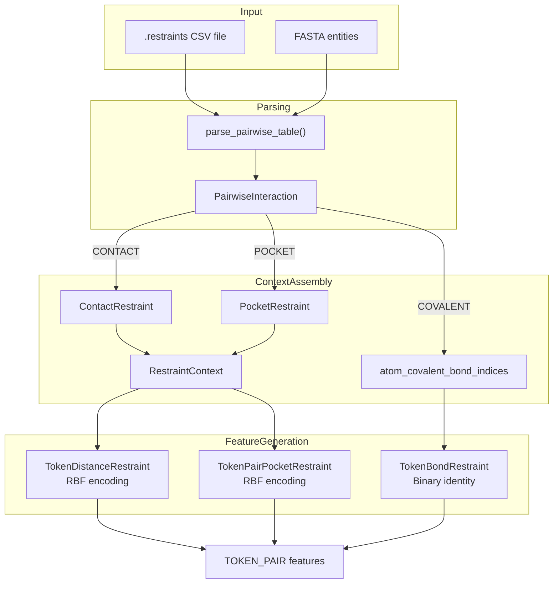

The Chai-1 restraint and covalent bond system provides a unified CSV-based interface for encoding three distinct types of prior structural knowledge into the model's feature space: **contact** restraints (residue–residue proximity), **pocket** restraints (residue–chain proximity), and **covalent** bonds (inter-entity chemical linkages). Each type follows a different path through parsing, context assembly, and feature generation, ultimately producing distinct TOKEN_PAIR features that bias the diffusion denoising process toward structurally consistent outputs. Understanding this system is essential for guiding predictions when experimental evidence or domain knowledge about intermolecular contacts is available.

Sources: [restraints.py](chai_lab/data/parsing/restraints.py#L1-L205), [restraint_context.py](chai_lab/data/dataset/constraints/restraint_context.py#L1-L137)

## Architecture Overview

The restraint system operates as a three-stage pipeline: **parsing** (CSV → typed interaction objects), **context assembly** (interaction objects → typed restraint groups), and **feature generation** (restraint groups → token-pair tensors). Covalent bonds diverge after parsing — they bypass the `RestraintContext` entirely and instead feed into atom-level bond indices that are resolved to token-pair features by `TokenBondRestraint`. Contact and pocket restraints share the `RestraintContext` pathway but produce asymmetric, structurally distinct feature matrices.



> [!TIP]
> Covalent bonds are intentionally excluded from `RestraintContext` — the `load_manual_restraints_for_chai1` function explicitly passes through `COVALENT` interactions with a no-op comment "Covalent bonds are handled elsewhere, not as a constraint." This means covalent bonds follow a completely separate data path through `bond_utils.get_atom_covalent_bond_pairs_from_constraints` rather than the restraint context pipeline.

Sources: [restraints.py](chai_lab/data/parsing/restraints.py#L1-L205), [restraint_context.py](chai_lab/data/dataset/constraints/restraint_context.py#L89-L110), [token_bond.py](chai_lab/data/features/generators/token_bond.py#L1-L64), [token_dist_restraint.py](chai_lab/data/features/generators/token_dist_restraint.py#L1-L273), [token_pair_pocket_restraint.py](chai_lab/data/features/generators/token_pair_pocket_restraint.py#L1-L248)

## Restraint File Format

All restraints are specified as CSV files (conventionally with a `.restraints` extension) validated against a strict `PairwiseConstraintDataframeModel` schema via Pandera. Each row defines a single pairwise interaction with the following columns:

| Column | Type | Required | Description |
|---|---|---|---|
| `restraint_id` | `str` | Yes (unique) | Unique identifier for the restraint |
| `chainA` | `str` | Yes | Subchain ID of partner A |
| `res_idxA` | `str` | Conditional | Residue identifier for A (format: `{name}{pos}`), empty for chain-level |
| `chainB` | `str` | Yes | Subchain ID of partner B |
| `res_idxB` | `str` | Conditional | Residue identifier for B, empty for chain-level |
| `connection_type` | `str` | Yes | One of: `covalent`, `contact`, `pocket` |
| `confidence` | `float` | No (default 1.0) | Confidence score in [0.0, 1.0] |
| `min_distance_angstrom` | `float` | No (≥0) | Minimum distance in Ångströms |
| `max_distance_angstrom` | `float` | No (≥0) | Maximum distance in Ångströms |
| `comment` | `str` | No | Free-text annotation |

The `res_idx` columns use a compound format: `{residue_name}{position}[@{atom_name}]`. For example, `C387` denotes residue Cysteine at 1-indexed position 387; `N437@N` denotes the backbone nitrogen atom of Asparagine at position 437; `@C1` denotes the C1 atom of a non-polymer entity (empty residue name). The parsing function `_parse_res_idx` splits on the `@` delimiter to separate residue identifiers from atom specifiers.

Sources: [restraints.py](chai_lab/data/parsing/restraints.py#L22-L47), [restraints.py](chai_lab/data/parsing/restraints.py#L130-L165)

## Interaction Type Semantics

Each `connection_type` carries distinct structural semantics and validation rules enforced in `PairwiseInteraction.__post_init__`:

**Contact** (`contact`) — Specifies that two specific residues should be within a distance threshold. Both `res_idxA` and `res_idxB` (or their atom names) must be provided. The feature is encoded as a distance threshold in the token-pair matrix and is **asymmetric** (set only at `[left, right]`, not `[right, left]`). Example: `A,C387 ↔ B,Y101` means Cys387 on chain A should be near Tyr101 on chain B.

**Pocket** (`pocket`) — Specifies that a specific residue on one chain should be near all residues of another chain. Partner A is **chain-level** (no `res_idxA`), partner B is **token-level** (must specify `res_idxB`). Atoms must not be specified. The feature matrix sets constraints between the single pocket token and every token in the pocket chain. Example: `B,(chain) ↔ A,C387` means all of chain B should be near Cys387 on chain A.

**Covalent** (`covalent`) — Specifies a covalent chemical bond between atoms of two entities. Both partners should specify atom names via the `@` syntax. Distance bounds are typically set to `0.0` (exact bonding distance). Example: `A,C217@SG ↔ B,@S1` means the sulfur atom of Cys217 on chain A is covalently bonded to atom S1 on chain B.

| Property | Contact | Pocket | Covalent |
|---|---|---|---|
| Partner A specificity | Token/Atom | Chain-level | Atom |
| Partner B specificity | Token/Atom | Token-level | Atom |
| Distance encoding | Threshold → RBF | Threshold → RBF | Binary (bond exists) |
| Feature symmetry | Asymmetric | Asymmetric | Symmetric (via `und_self`) |
| Feature generator | `TokenDistanceRestraint` | `TokenPairPocketRestraint` | `TokenBondRestraint` |
| Data pathway | `RestraintContext` | `RestraintContext` | `atom_covalent_bond_indices` |

Sources: [restraints.py](chai_lab/data/parsing/restraints.py#L50-L128), [restraint_context.py](chai_lab/data/dataset/constraints/restraint_context.py#L89-L110)

## Parsing and Validation Pipeline

The entry point `parse_pairwise_table` reads a CSV file, validates it against `PairwiseConstraintDataframeModel`, fills missing confidence values with 1.0, and converts each row to a `PairwiseInteraction` instance. The Pandera schema enforces: unique `restraint_id`, non-null chain IDs, `connection_type` must be one of the three enum values, `confidence` in [0, 1], and distance bounds ≥ 0. The `_parse_row` helper further decomposes `res_idx` fields into separate residue identifiers and atom names using `_parse_res_idx`.

The 1-based residue indexing is a critical design choice: `res_idxA_pos` extracts the numeric portion after the first character (the residue single-letter name), returning 1 as default when no position is given. This 1-based index is later converted to 0-based in `load_manual_restraints_for_chai1` via `constraint.res_idxA_pos - 1`.

Sources: [restraints.py](chai_lab/data/parsing/restraints.py#L130-L205), [restraint_context.py](chai_lab/data/dataset/constraints/restraint_context.py#L100-L106)

## Context Assembly: From Interactions to Restraint Groups

The `load_manual_restraints_for_chai1` function bridges parsed `PairwiseInteraction` objects to feature-generator-specific `RestraintGroup` dataclasses. It performs three key transformations: (1) **index conversion** from 1-based to 0-based residue indexing, (2) **residue name expansion** from single-letter to three-letter codes using `restype_1to3_with_x`, and (3) **structural decomposition** — contact restraints become `ContactRestraint` groups with explicit left/right token positions, while pocket restraints become `PocketRestraint` groups with distinct chain-level and token-level fields. Covalent interactions are explicitly skipped with the comment "handled elsewhere."

> [!TIP]
> The subchain ID scheme used in restraint files must match the `entity_name_as_subchain` parameter passed to `load_chains_from_raw`. If restraints reference chain IDs by entity name (e.g., `G`, `H`) but `entity_name_as_subchain=False` (which assigns `A`, `B`), the restraint will fail to resolve and all features will be null. The test suite explicitly validates this compatibility matrix.

Sources: [restraint_context.py](chai_lab/data/dataset/constraints/restraint_context.py#L82-L137), [test_restraints.py](tests/test_restraints.py#L45-L126)

## Feature Generation: Contact Restraints

`TokenDistanceRestraint` produces a `TOKEN_PAIR` feature encoded via RBF (Radial Basis Function) with 6 radii. When user-provided `ContactRestraint` groups are available, `generate_from_restraint` resolves each group to a specific token pair by matching `asym_id`, `residue_index`, and `residue_name` (with assertion-enforced uniqueness). The distance threshold is written into the constraint matrix at position `[left_token, right_token]`, then passed through `make_feature` which applies RBF encoding. Without user constraints, the matrix is filled with `ignore_idx = -1.0`.

The generator is registered in the feature factory with `include_probability=1.0`, `size=0.33` (geometric distribution for training-time sampling), `min_dist=6.0`, `max_dist=30.0`, and `num_rbf_radii=6`. The `add_distance_restraint` method enforces that each restraint resolves to exactly one left and one right token — if multiple tokens match, or residue names disagree with the parsed input, an assertion fails.

Sources: [token_dist_restraint.py](chai_lab/data/features/generators/token_dist_restraint.py#L42-L273), [chai1.py](chai_lab/chai1.py#L223-L230)

## Feature Generation: Pocket Restraints

`TokenPairPocketRestraint` internally delegates to `TokenDistanceRestraint` for sampling logic but produces a structurally different feature: it sets constraints between a **single pocket token** and **all tokens** in the pocket chain. The `add_pocket_restraint` method first identifies the pocket token (asserting uniqueness), then broadcasts the distance threshold across `restraint_mat[pocket_token_mask, pocket_chain_asym_mask]`. This means a single pocket restraint row in the CSV generates `N` non-null feature entries where `N` is the number of tokens in the pocket chain.

The generator is registered with `size=0.33`, `include_probability=1.0`, `min_dist=6.0`, `max_dist=20.0`, and `num_rbf_radii=6`. Like contact restraints, the feature is asymmetric — constraints flow from the pocket token *to* the pocket chain tokens, not the reverse.

Sources: [token_pair_pocket_restraint.py](chai_lab/data/features/generators/token_pair_pocket_restraint.py#L46-L248), [chai1.py](chai_lab/chai1.py#L231-L238)

## Feature Generation: Covalent Bonds

`TokenBondRestraint` takes a fundamentally different approach from the distance-based restraints. It operates on `atom_covalent_bond_indices` — a list of `(left_atom_indices, right_atom_indices)` tensor pairs produced by `get_atom_covalent_bond_pairs_from_constraints`. For each bond, it maps atom indices to token indices via `torch.gather` on `atom_token_index`, then sets `bond_feature[left_token, right_token] = 1`. The feature uses `EncodingType.IDENTITY` (binary) rather than RBF, and `apply_mask` is overridden to return the unmasked feature, ensuring covalent bonds are never masked out regardless of the batch masking strategy.

The resulting feature is a binary `TOKEN_PAIR` matrix where `1` indicates a covalent bond exists between two tokens and `0` indicates no bond. This is critical for glycosylation (NAG–protein bonds) and ligand coordination (e.g., Cys–S–ligand bonds).

Sources: [token_bond.py](chai_lab/data/features/generators/token_bond.py#L1-L64), [chai1.py](chai_lab/chai1.py#L262)

## Inference Integration

At inference time, restraints are passed via the `constraint_path` parameter of `run_inference`. The flow proceeds through `make_all_atom_feature_context`, which reads and parses the restraint file, loads chains from the FASTA input, and assembles the `RestraintContext`. Covalent bond information is simultaneously extracted into `atom_covalent_bond_indices` via `get_atom_covalent_bond_pairs_from_constraints`. The `Collate` class then batches all feature contexts, and the `FeatureFactory` invokes each registered generator to produce the final feature tensors.

```python
# Contact restraint example: residue-residue proximity
candidates = run_inference(
    fasta_file=fasta_path,
    output_dir=output_dir,
    constraint_path=Path("contact.restraints"),
    # ... standard inference parameters
)

# Covalent bond example: protein-glycan linkage
candidates = run_inference(
    fasta_file=Path("1ac5.fasta"),
    output_dir=output_dir,
    constraint_path=Path("1ac5.restraints"),
    # ... standard inference parameters
)
```

Sources: [predict_with_restraints.py](examples/restraints/predict_with_restraints.py#L1-L36), [predict_covalent_ligand.py](examples/covalent_bonds/predict_covalent_ligand.py#L1-L28), [predict_glycosylated.py](examples/covalent_bonds/predict_glycosylated.py#L1-L28)

## Example Restraint Files in Practice

The repository includes three concrete restraint examples demonstrating each interaction type:

**Contact** (`examples/restraints/contact.restraints`): Two residue–residue contacts between antibody heavy/light chains and antigen, with `max_distance_angstrom=5.5` and `confidence=1.0`:
```csv
chainA,res_idxA,chainB,res_idxB,connection_type,confidence,min_distance_angstrom,max_distance_angstrom,comment,restraint_id
A,C387,B,Y101,contact,1.0,0.0,5.5,protein-heavy,restraint_1
C,I32,A,S483,contact,1.0,0.0,5.5,protein-light,restraint_2
```

**Pocket** (`examples/restraints/pocket.restraints`): Two chain-level pocket constraints where chains B and C should be near specific residues on chain A:
```csv
chainA,res_idxA,chainB,res_idxB,connection_type,confidence,min_distance_angstrom,max_distance_angstrom,comment,restraint_id
B,,A,C387,pocket,1.0,0.0,5.5,protein-heavy,restraint_0
C,,A,S483,pocket,1.0,0.0,5.5,protein-light,restraint_1
```

**Covalent — Glycan** (`examples/covalent_bonds/1ac5.restraints`): Two N-linked glycosylation bonds from Asn residues to NAG C1 atoms, with `max_distance_angstrom=0.0`:
```csv
chainA,res_idxA,chainB,res_idxB,connection_type,confidence,min_distance_angstrom,max_distance_angstrom,comment,restraint_id
A,N437@N,B,@C1,covalent,1.0,0.0,0.0,protein-glycan,bond1
A,N445@N,C,@C1,covalent,1.0,0.0,0.0,protein-glycan,bond2
```

**Covalent — Ligand** (`examples/covalent_bonds/8cyo.restraints`): A thioether bond between Cys217 sulfur and ligand S1 atom:
```csv
chainA,res_idxA,chainB,res_idxB,connection_type,confidence,min_distance_angstrom,max_distance_angstrom,comment,restraint_id
A,C217@SG,B,@S1,covalent,1.0,0.0,0.0,protein-ligand,bond1
```

Note the pattern: glycan and ligand entities have empty residue names in `res_idxB` (e.g., `@C1`, `@S1`) because non-polymer entities lack residue-level naming — only atom names are meaningful.

Sources: [contact.restraints](examples/restraints/contact.restraints#L1-L3), [pocket.restraints](examples/restraints/pocket.restraints#L1-L4), [1ac5.restraints](examples/covalent_bonds/1ac5.restraints#L1-L3), [8cyo.restraints](examples/covalent_bonds/8cyo.restraints#L1-L3)

## Subchain ID Compatibility and Error Handling

A critical operational concern is the mapping between chain IDs in the restraint file and the subchain IDs assigned during chain loading. The `entity_name_as_subchain` parameter in `load_chains_from_raw` controls whether subchain IDs are derived from FASTA entity names (e.g., `G`, `H`) or auto-assigned alphabetically (e.g., `A`, `B`). Restraint chain references (`chainA`, `chainB`) must use the same naming scheme. A mismatch causes the feature generators to fail to locate matching tokens, producing all-null feature tensors — silently degrading prediction quality without raising an error.

The `TokenDistanceRestraint` and `TokenPairPocketRestraint` generators both handle missing or unresolvable constraints by falling back to a matrix filled with `ignore_idx = -1.0`, caught via `try/except` with logged errors. This graceful degradation means the model proceeds without the restraint signal rather than crashing, but the user receives no explicit notification that restraints were dropped.

Sources: [test_restraints.py](tests/test_restraints.py#L45-L126), [token_dist_restraint.py](chai_lab/data/features/generators/token_dist_restraint.py#L161-L170), [token_pair_pocket_restraint.py](chai_lab/data/features/generators/token_pair_pocket_restraint.py#L132-L141)

## Next Steps

- To understand how these features are encoded into the model's input space, see [Pairwise and Restraint Feature Generators](20-pairwise-and-restraint-feature-generators) which covers the RBF encoding, identity encoding, and the base `FeatureGenerator` abstraction.
- For the broader input data pipeline that feeds into restraint parsing, see [FASTA Parsing and Entity Types](13-fasta-parsing-and-entity-types) which defines the entity names referenced by restraint chain IDs.
- To understand how restraint features interact with the diffusion process, see [Diffusion Denoising Process](11-diffusion-denoising-process) which consumes these token-pair features during structure generation.