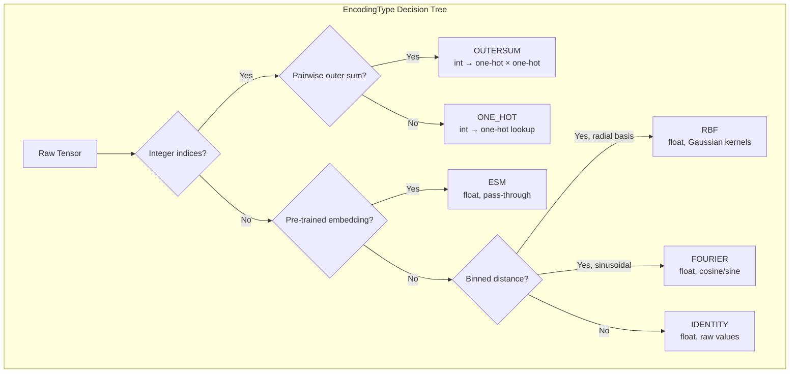
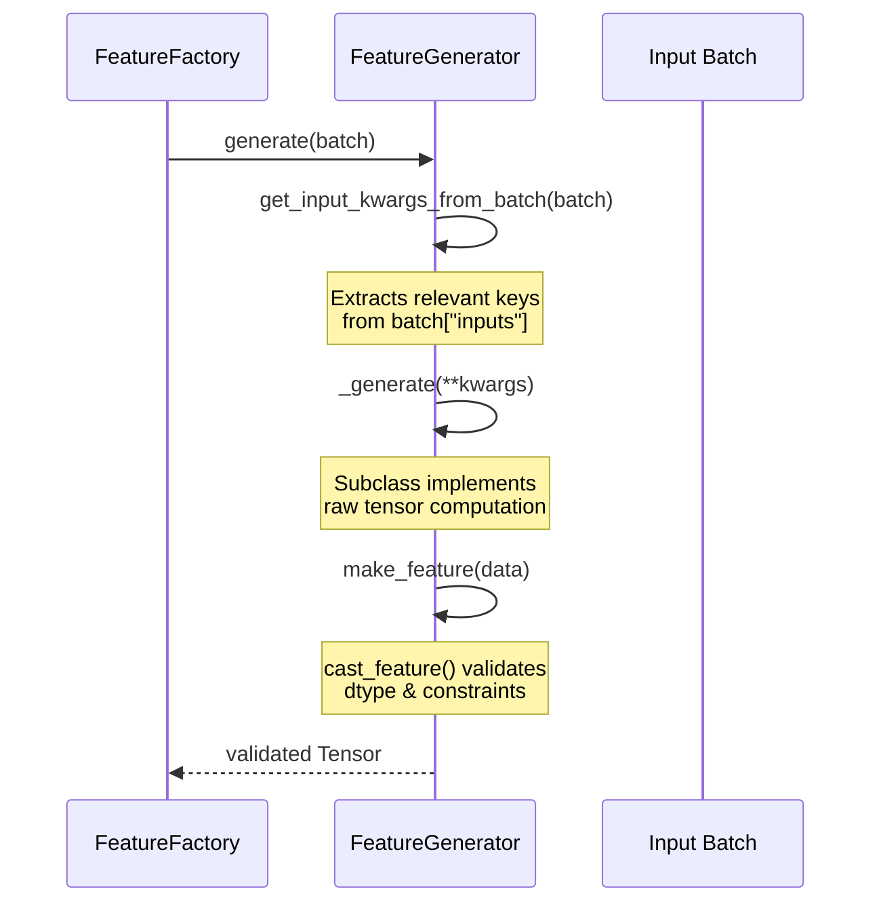

Chai-1's feature engineering system is built on a disciplined abstract class hierarchy that transforms raw batch data into numerically encoded tensors ready for model consumption. Every feature—whether it's a one-hot residue type, an RBF-encoded distance restraint, or a floating-point reference position—flows through the same `FeatureGenerator` contract: inspect the batch, extract relevant fields, compute the raw tensor, then validate and cast its dtype. This page examines the architectural skeleton that makes that uniformity possible: the `FeatureGenerator` ABC, its `EncodingType` and `FeatureType` enumerations, the masking contract, and the `FeatureFactory` orchestrator.

Sources: [base.py](chai_lab/data/features/generators/base.py#L1-L114), [feature_type.py](chai_lab/data/features/feature_type.py#L1-L17), [feature_factory.py](chai_lab/data/features/feature_factory.py#L1-L27)

## FeatureType: The Structural Taxonomy

Before a feature is generated, it must declare *where* it lives in the model's input tensor topology. The `FeatureType` enum partitions all features into eight spatial categories that correspond directly to the model's embedding layers:

| FeatureType | Tensor Rank | Spatial Shape | Example Generator |
|---|---|---|---|
| `TOKEN` | 3 | `(B, N, C)` | `ResidueType`, `ESMEmbeddings` |
| `TOKEN_PAIR` | 4 | `(B, N, N, C)` | `RelativeChain`, `TokenBondRestraint` |
| `ATOM` | 3 | `(B, A, C)` | `AtomElementOneHot`, `RefPos` |
| `ATOM_PAIR` | 4 | `(B, A, A, C)` | `BlockedAtomPairDistances` |
| `MSA` | 4 | `(B, D, N, C)` | `MSAFeatureGenerator` |
| `TEMPLATES` | 5 | `(B, T, N, N, C)` | `TemplateDistogramGenerator` |
| `RESIDUE` | 3 | `(B, R, C)` | (legacy / reserved) |
| `PAIR` | 4 | `(B, R, R, C)` | (legacy / reserved) |

Here **B** = batch, **N** = tokens, **A** = atoms, **D** = MSA depth, **T** = template count, **C** = feature channels. The model's embedding modules consume features grouped by these types—single representations feed token/atom embedders, while pair representations feed pairwise attention modules. This taxonomy ensures the factory can route each generated tensor to the correct downstream consumer without runtime inspection.

Sources: [feature_type.py](chai_lab/data/features/feature_type.py#L1-L17)

## EncodingType: The Numerical Representation Contract

Each generator declares an `EncodingType` that governs two critical behaviors: **dtype validation** (via `cast_feature`) and **masking semantics** (via `mask_value`). These six encoding types cover every numerical pattern in the system:



The `cast_feature` function enforces dtype constraints at generation time. `ONE_HOT` and `OUTERSUM` require integer dtypes (`torch.long`, `torch.int`, `torch.int16`, `torch.int8`, `torch.uint8`) because their values serve as indices into embedding tables. `RBF` and `FOURIER` require floating-point dtypes (`torch.float16`, `torch.float32`, `torch.bfloat16`). `IDENTITY` casts to `float32` and asserts the absolute maximum is below 100 as a safety check against unscaled inputs. `ESM` is a pass-through that accepts any dtype.

Sources: [base.py](chai_lab/data/features/generators/base.py#L16-L50)

## The Masking Protocol

Missing or unknown values are an inherent reality of structural biology data—atoms may lack reference coordinates, templates may be absent, and distillation data may not define B-factors. The `FeatureGenerator` base class provides a unified masking protocol through `can_mask` and `mask_value`, with semantics that vary by encoding type:

| EncodingType | `mask_value` | Mechanism | Example Use |
|---|---|---|---|
| `ONE_HOT` / `OUTERSUM` | `num_classes` | Index beyond last class → zero vector after embedding | Masked residue types, binned distances |
| `RBF` / `FOURIER` | `-100.0` | Large negative sentinel → zero after Gaussian/sinusoidal transform | Distance restraints without constraints |
| `IDENTITY` | Zero tensor with last channel = 1 | Dedicated mask channel appended to feature | Atom positions, deletion values |
| `ESM` | `0.0` | Zero embedding | Masked ESM representations |

For `IDENTITY`-encoded features with `can_mask=True`, the generator appends an extra channel to the output tensor. When a position is masked, the data channels are zeroed and the final mask channel is set to 1, allowing downstream layers to distinguish "value is zero" from "value is unknown." This design is critical for features like `RefPos` and `BlockedAtomPairDistances` where zero is a meaningful coordinate value.

Sources: [base.py](chai_lab/data/features/generators/base.py#L52-L80)

## FeatureGenerator: The Abstract Contract

The `FeatureGenerator` ABC defines a two-phase generation pipeline that all 20+ concrete generators implement:



**Phase 1 — Batch extraction** (`get_input_kwargs_from_batch`): Each subclass declares which keys it needs from the batch dictionary. This indirection decouples the generator from the batch structure, allowing generators to rename, cast, or compose batch fields before computation. For example, `ResidueType` extracts `batch["inputs"]["aatype"]` and casts it to `.long()`, while `RelativeChain` pulls both `token_entity_id` and `token_sym_id`.

**Phase 2 — Computation and validation** (`_generate` + `make_feature`): The subclass computes a raw tensor, then `make_feature` delegates to `cast_feature` for dtype enforcement. The `generate` method orchestrates both phases, so callers never invoke `_generate` directly.

The constructor accepts six parameters that fully characterize a feature's encoding contract: `ty` (spatial type), `encoding_ty` (numerical type), `num_classes` (cardinality for one-hot/bins), `mult` (multiplier for features like atom name characters with `mult=4`), `ignore_index` (sentinel for loss computation, default -100), and `can_mask` (whether masking is supported).

> [!TIP]
> When implementing a custom generator, always call `self.make_feature()` on the raw output tensor rather than returning it directly. This ensures dtype validation fires—skipping it can introduce silent float/int mismatches that only surface as shape errors deep in the model's embedding layers.

Sources: [base.py](chai_lab/data/features/generators/base.py#L82-L114)

## Two Implementation Patterns

Examining the concrete generators reveals two distinct patterns for implementing the abstract contract:

### Pattern A: Keyword Extraction (Standard)

Most generators follow the template method pattern faithfully—they implement both `get_input_kwargs_from_batch` and `_generate`. The batch extraction method returns a dictionary of named tensors, and `_generate` receives them as typed keyword arguments:

```python
# ResidueType — classic two-method pattern
class ResidueType(FeatureGenerator):
    def get_input_kwargs_from_batch(self, batch) -> dict:
        return dict(aatype=batch["inputs"]["aatype"].long())

    def _generate(self, aatype: Int[Tensor, "b n"]) -> Tensor:
        seq_emb = aatype.clone()
        return self.make_feature(data=seq_emb.unsqueeze(-1))
```

This pattern benefits from `@typecheck` decorators on `_generate` that validate tensor shapes and dtypes at development time, catching dimension mismatches early.

### Pattern B: Direct Override (Identity and RefPos)

Some generators bypass the keyword extraction phase entirely by overriding `generate()` directly. This is used when the computation is simple enough that the indirection adds no value, or when the feature requires special handling that doesn't fit the kwargs pattern:

```python
# Identity — overrides generate() directly
class Identity(FeatureGenerator):
    def generate(self, batch: dict) -> Tensor:
        feat = futils.get_entry_for_key(batch, self.key)
        # ... dimension handling and mask channel appending ...
        return self.make_feature(data=feat)
```

The `Identity` generator is a generic passthrough that uses a configurable `key` (supporting slash-separated nested paths via `get_entry_for_key`) to extract any field from the batch. It handles both scalar features (reshaping from `(B, N)` to `(B, N, 1)`) and vector features (shape `(B, N, D)`), and appends the mask channel when `can_mask=True`.

> [!TIP]
> Prefer Pattern A (keyword extraction) for any generator that processes multiple batch fields or performs non-trivial computation. The `@typecheck`-decorated `_generate` signature serves as living documentation of expected tensor shapes, which is invaluable when debugging feature mismatches across the pipeline.

Sources: [residue_type.py](chai_lab/data/features/generators/residue_type.py#L1-L35), [identity.py](chai_lab/data/features/generators/identity.py#L1-L49), [ref_pos.py](chai_lab/data/features/generators/ref_pos.py#L1-L33), [feature_utils.py](chai_lab/data/features/feature_utils.py#L1-L32)

## FeatureFactory: Batch-Level Orchestration

The `FeatureFactory` is the top-level coordinator that transforms an entire batch into a complete feature dictionary. It holds an ordered `dict[str, FeatureGenerator]` mapping feature names to their generators, and its `generate` method iterates over all entries:

```python
class FeatureFactory:
    generators: dict[str, FeatureGenerator]

    def generate(self, batch) -> dict[str, Tensor]:
        return {name: gen.generate(batch) for name, gen in self.generators.items()}
```

The resulting dictionary maps string keys (e.g., `"residue_type"`, `"relative_chain"`) to their computed tensors. Downstream, the model's input modules consume this dictionary, grouping features by `FeatureType` to construct single representations, pair representations, MSA stacks, and template stacks. The factory pattern ensures that adding or removing a feature requires only a dictionary mutation—no changes to the generation loop itself.

Sources: [feature_factory.py](chai_lab/data/features/feature_factory.py#L1-L27)

## Constructor Parameter Reference

The `FeatureGenerator.__init__` signature defines six parameters that together fully specify a feature's encoding behavior:

| Parameter | Type | Default | Purpose |
|---|---|---|---|
| `ty` | `FeatureType` | required | Spatial category: TOKEN, TOKEN_PAIR, ATOM, etc. |
| `encoding_ty` | `EncodingType` | required | Numerical encoding: ONE_HOT, IDENTITY, RBF, etc. |
| `num_classes` | `int` | `-1` | Cardinality for ONE_HOT bins; dimension count for IDENTITY |
| `mult` | `int` | `1` | Feature multiplier (e.g., 4 for 4-character atom names) |
| `ignore_index` | `float` | `-100.0` | Sentinel value for loss masking |
| `can_mask` | `bool` | `True` | Whether the feature supports masked/unknown values |

The `mult` parameter is particularly noteworthy for features with multiple sub-components per spatial position. `AtomNameOneHot`, for instance, encodes atom names as 4 characters each, so it sets `mult=4` to signal that each spatial position produces 4 one-hot indices rather than 1.

Sources: [base.py](chai_lab/data/features/generators/base.py#L82-L95)

## What Comes Next

This page covered the abstract skeleton. The concrete generators that populate this framework fall into two natural groups:

- **[Token and Atom Feature Generators](19-token-and-atom-feature-generators)** — Single-position features like `ResidueType`, `AtomElementOneHot`, `ESMEmbeddings`, `RefPos`, and `Identity` that encode per-token or per-atom properties.
- **[Pairwise and Restraint Feature Generators](20-pairwise-and-restraint-feature-generators)** — Pair-position features like `RelativeChain`, `RelativeEntity`, `TokenBondRestraint`, `TokenDistanceRestraint`, `DockingRestraintGenerator`, and template generators that encode relationships between positions.