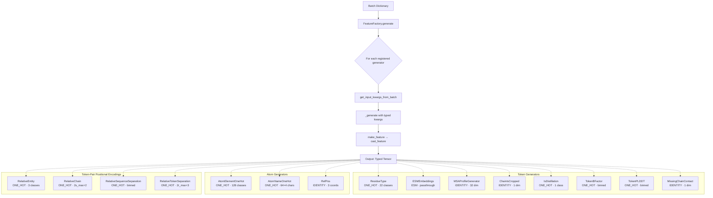

Chai-1's feature engineering pipeline transforms raw structural and sequence data into rich tensor representations that the model can consume. This page examines the **token-level** and **atom-level** feature generators — the per-position encodings that give the model its fundamental vocabulary of chemical identity, spatial reference, and structural metadata. These generators occupy the critical boundary between raw input data and the embedding layers, converting heterogeneous biological information into uniform, maskable tensors governed by a rigorous type system.

## Feature Type Taxonomy and Encoding System

Every feature generator in Chai-1 is classified along two orthogonal axes: its **FeatureType** (which structural granularity it operates at) and its **EncodingType** (how raw values are numerically represented). The `FeatureType` enum defines eight domains that partition the feature space by structural resolution and relational arity:

| FeatureType | Granularity | Shape Pattern | Description |
|---|---|---|---|
| `ATOM` | Per-atom | `(b, n_atoms, ...)` | Single-atom properties |
| `ATOM_PAIR` | Atom-pair | `(b, n_blocks, bl_q, bl_kv, ...)` | Blocked pairwise atom features |
| `TOKEN` | Per-token | `(b, n_tokens, ...)` | Single-token properties |
| `TOKEN_PAIR` | Token-pair | `(b, n_tokens, n_tokens, ...)` | Pairwise token relationships |
| `MSA` | Per-MSA-row | `(b, depth, n_tokens, ...)` | Multiple sequence alignment features |
| `TEMPLATES` | Per-template | `(b, n_templ, n_tokens, ...)` | Structural template features |

The `EncodingType` enum governs how raw values are cast and masked:

| EncodingType | Input Dtype | Mask Strategy | Typical Use |
|---|---|---|---|
| `ONE_HOT` | Integer | Class index = `num_classes` (out-of-range) | Categorical features |
| `IDENTITY` | Float | Last channel set to 1.0, zeros elsewhere | Continuous scalar/vector features |
| `RBF` | Float | Value = `-100.0` | Radial basis function encodings |
| `FOURIER` | Float | Value = `-100.0` | Fourier feature encodings |
| `OUTERSUM` | Integer | Same as `ONE_HOT` | Pairwise categorical via outer sum |
| `ESM` | Float | Value = `0.0` | Pre-computed protein language model embeddings |

The `cast_feature` function enforces these dtype contracts at generation time — `ONE_HOT` and `OUTERSUM` require integer types, while `RBF` and `FOURIER` require floating-point. The `mask_value` property on each generator produces the canonical sentinel for missing data according to the encoding type, ensuring downstream embedding layers can distinguish "no data" from "zero value."

Sources: [feature_type.py](/chai_lab/data/features/feature_type.py#L1-L17), [base.py](/chai_lab/data/features/generators/base.py#L1-L114)

## The FeatureGenerator Contract

All generators inherit from `FeatureGenerator`, an abstract base class that enforces a two-phase generation protocol. The `generate(batch)` method first calls `get_input_kwargs_from_batch(batch)` to extract relevant tensors from the collated batch dictionary, then passes those kwargs to `_generate(**kwargs)`, which each concrete subclass implements. This separation ensures that batch key lookups are centralized and that the core generation logic receives pre-typed, pre-validated inputs.

Each generator is configured at construction time with five parameters that determine its output shape and masking behavior:

- **`ty`** (FeatureType): The structural granularity, determining which embedding pathway consumes this feature.
- **`encoding_ty`** (EncodingType): The numerical encoding strategy, controlling dtype and masking semantics.
- **`num_classes`**: For `ONE_HOT`, the number of distinct categories (the output channel count after embedding). For `IDENTITY`, the dimensionality of the continuous feature vector.
- **`mult`**: A multiplier on `num_classes`, typically 1, used when a single categorical feature is replicated (e.g., atom name characters encoded 4 times).
- **`can_mask`**: Whether this feature supports masking — i.e., whether a sentinel value can be inserted for missing/invalid entries.

The `make_feature(data)` method is the final gate before a tensor leaves the generator: it calls `cast_feature` to enforce dtype correctness and range safety (e.g., `IDENTITY` features must have absolute max < 100).

> [!TIP]
> The `Identity` generator appends an extra zero-channel to its output when `can_mask=True`, then sets that channel to 1.0 for masked positions. This means the actual output dimension is `num_classes + 1` — the last channel acts as a binary "is this masked?" indicator rather than using a sentinel value. This design avoids ambiguity between a legitimate zero value and a missing value.

Sources: [base.py](/chai_lab/data/features/generators/base.py#L58-L114)

## Atom-Level Feature Generators

Atom-level generators produce per-atom features that feed into the atom embedding pathway. These encode the most fine-grained chemical identity and spatial reference information available in the input.

### AtomElementOneHot

**FeatureType**: `ATOM` | **EncodingType**: `ONE_HOT` | **Output channels**: 129 (128 + 1 mask)

Encodes the atomic number of each atom as a one-hot vector. The `max_atomic_num` parameter defaults to 128, covering the full periodic table with room to spare. Atomic numbers are clamped to `num_classes` before encoding, so any out-of-range element maps to the last valid index rather than overflowing. The input `atom_ref_element` is drawn directly from the structure context's per-atom element assignment.

```python
# Generation logic (simplified)
seq_emb = torch.clamp(atomic_numbers, max=self.num_classes).unsqueeze(-1)
```

### AtomNameOneHot

**FeatureType**: `ATOM` | **EncodingType**: `ONE_HOT` | **Output channels**: 64 × 4 = 256 (with mult=4)

Encodes each atom's name as four separate one-hot vectors, one per character position. Atom names like "CA", "N", "OG1" are decomposed into individual character indices, with each character independently one-hot encoded over `num_chars=64` possible values. The `mult=4` parameter signals to downstream consumers that this feature contains 4 repeated categorical encodings that should be embedded separately and then combined.

### RefPos

**FeatureType**: `ATOM` | **EncodingType**: `IDENTITY` | **Output channels**: 3 (x, y, z) | **can_mask**: `False`

Provides the 3D reference position of each atom, scaled by dividing by 10.0 to bring coordinates into a range suitable for neural network input. An assertion enforces that the maximum L2 norm of the scaled coordinates is below 100, serving as a sanity check against improperly scaled inputs. Unlike most `IDENTITY` features, `RefPos` sets `can_mask=False` because reference positions are expected to always be valid for existing atoms — the atom existence mask handles invalid atoms separately.

```python
feat = original_pos / 10.0  # Å → deca-Ångström scale
assert torch.amax(feat.norm(dim=-1)) < 100.0
```

> [!TIP]
> The `/10.0` scaling in `RefPos` is critical for stable training. Raw Ångström coordinates (typically 0–100) would produce large magnitudes that overwhelm the `IDENTITY` encoding's assertion guard (`abs().max() < 100`). The deca-Ångström scale keeps all coordinate components in roughly the [-10, 10] range, well within the safe interval for embedding.

Sources: [atom_element.py](/chai_lab/data/features/generators/atom_element.py#L1-L35), [atom_name.py](/chai_lab/data/features/generators/atom_name.py#L1-L32), [ref_pos.py](/chai_lab/data/features/generators/ref_pos.py#L1-L33)

## Token-Level Feature Generators

Token-level generators produce per-token features — one value per residue, nucleotide, or ligand token in the input. These encode the coarser-grained biological identity and metadata that the model uses for its primary sequence-level reasoning.

### ResidueType

**FeatureType**: `TOKEN` | **EncodingType**: `ONE_HOT` | **Output channels**: 23 (22 + 1 mask)

The foundational categorical feature encoding the residue type at each token position. With `num_res_ty=22`, it covers the 20 standard amino acids plus a gap token and an "X" (unknown) token. The `key` parameter defaults to `"aatype"` but can be overridden to point at alternative batch fields, allowing the same generator class to encode different residue taxonomies. The input is cloned before unsqueezing to avoid mutating the batch data in-place.

### ESMEmbeddings

**FeatureType**: `TOKEN` | **EncodingType**: `ESM` | **can_mask**: `False`

A passthrough generator that delivers pre-computed ESM (Evolutionary Scale Model) embeddings directly into the token feature stream. Unlike other generators that transform raw data, `ESMEmbeddings` simply validates and forwards the `esm_embeddings` tensor from the batch. The `ESM` encoding type uses `0.0` as its mask value and bypasses the usual dtype casting, since these embeddings are already in their final floating-point form. The embedding dimension is determined by the upstream ESM model (typically 256 or 1280 dimensions).

### MSAProfileGenerator

**FeatureType**: `TOKEN` | **EncodingType**: `IDENTITY` | **Output channels**: 32 (matches `residue_types_with_nucleotides_order`)

Computes the MSA profile — the per-position frequency distribution across residue types — and delivers it as a continuous `IDENTITY`-encoded feature at the token level. The profile is computed from the *main* (shallow, profile-only) MSA using an optimized `torch.scatter_add` implementation: it accumulates counts for each residue type across the MSA depth dimension, then normalizes by the total count per position. This gives the model a compressed view of evolutionary conservation without requiring the full MSA depth at inference.

```python
# Profile = normalized residue-type frequency across MSA depth
unnormalized_profile = torch.zeros(...).scatter_add(dim=2, index=..., src=...)
profile = unnormalized_profile / unnormalized_profile.sum(dim=-1, keepdim=True).clamp_min_(1)
```

### MSADeletionMeanGenerator

**FeatureType**: `TOKEN` | **EncodingType**: `IDENTITY` | **Output channels**: 1

Averages the MSA deletion counts across the depth dimension of the main MSA, producing a per-token scalar indicating the mean number of deletions at each position. This uses `masked_mean` to properly handle masked MSA rows, ensuring that padding rows don't deflate the average. The output is a single continuous value per token.

### ChainIsCropped

**FeatureType**: `TOKEN` | **EncodingType**: `IDENTITY` | **Output channels**: 1 | **can_mask**: `False`

A placeholder generator that currently produces all-zeros for every token. Its `can_mask=False` setting means the output will not have a mask channel appended. The generator exists as a structural hook in the feature pipeline — it reads `token_asym_id` from the batch, providing a consistent interface for future implementations that may signal which chains have been truncated by cropping.

### IsDistillation

**FeatureType**: `TOKEN` | **EncodingType**: `ONE_HOT` | **Output channels**: 2 (1 + 1 mask)

A binary flag indicating whether each token originates from distillation data (i.e., predicted structures used as training data, as in AlphaFold2's distillation augmentation). The `is_distillation` scalar from the batch is broadcast across all token positions, and the result is cast to `uint8` for one-hot encoding.

### TokenBFactor

**FeatureType**: `TOKEN` | **EncodingType**: `ONE_HOT` | **Output channels**: 2 (1 bin boundary + 1 mask)

B-B-factor values into a discrete one-hot encoding. The default bin boundary is `[140.0]`, creating two bins: B-factor ≤ 140 and B-factor > 140. This feature is **only defined for non-distillation data** — for distillation examples or when the stochastic `include_prob` gate excludes a sample, the feature is filled with the mask value. The `include_prob` parameter (default 1.0) randomly drops this feature during training as a data augmentation strategy.

### TokenPLDDT

**FeatureType**: `TOKEN` | **EncodingType**: `ONE_HOT` | **Output channels**: 3 (2 bin boundaries + 1 mask)

The mirror image of `TokenBFactor`: binarizes pLDDT (predicted LDDT) scores with default boundaries at `[0.3, 0.7]`, creating three bins. This feature is **only defined for distillation data** — the mask logic is inverted relative to `TokenBFactor`. The same `include_prob` stochastic dropout mechanism applies. Together, `TokenBFactor` and `TokenPLDDT` share the `token_b_factor_or_plddt` batch field, with the `is_distillation` flag determining which interpretation is valid.

### MissingChainContact

**FeatureType**: `TOKEN` | **EncodingType**: `IDENTITY` | **Output channels**: 2 (1 feature + 1 mask)

Identifies tokens belonging to chains that have **no inter-chain atom contacts** within a threshold distance (default 6.0 Å, matching the DockQ contact cutoff). The generator computes all pairwise atom distances, filters for inter-chain atom pairs within the threshold, and then flags tokens on chains where no such contacts exist. For monomeric inputs, the feature is all-zeros. This provides the model with an explicit signal about which chains are spatially isolated — information that is critical for docking scenarios.

Sources: [residue_type.py](/chai_lab/data/features/generators/residue_type.py#L1-L35), [esm_generator.py](/chai_lab/data/features/generators/esm_generator.py#L1-L35), [msa.py](/chai_lab/data/features/generators/msa.py#L139-L197), [is_cropped_chain.py](/chai_lab/data/features/generators/is_cropped_chain.py#L1-L37), [structure_metadata.py](/chai_lab/data/features/generators/structure_metadata.py#L1-L144), [missing_chain_contact.py](/chai_lab/data/features/generators/missing_chain_contact.py#L1-L97)

## Token-Pair Positional Encodings

Several generators produce `TOKEN_PAIR` features that encode relative positional relationships between tokens. These are the spatial and sequential inductive biases that allow the model to reason about chain topology, entity membership, and residue adjacency.

### RelativeEntity

**FeatureType**: `TOKEN_PAIR` | **EncodingType**: `ONE_HOT` | **Output channels**: 3

Implements Algorithm 5 from AlphaFold-Multimer. Computes whether token pair *(i, j)* belongs to the same entity (class 1), a different entity (class 2), or is masked (class 0). Entity IDs are first remapped to a zero-indexed range via `torch.unique`, then the relative difference is computed as `entity_id[j] - entity_id[i] + 1`, clamped to [0, 2]. This gives the model a three-way categorical signal about entity co-membership.

### RelativeChain

**FeatureType**: `TOKEN_PAIR` | **EncodingType**: `ONE_HOT` | **Output channels**: 2*s_max* + 2 (default: 6)

Also following Algorithm 5 from AF-Multimer. Encodes the **relative chain index** between tokens that share the same entity — i.e., for symmetric copies of the same chain. The parameter `s_max` (default 2) controls the maximum representable chain offset. For token pairs within the same entity, the relative chain offset is clamped to `[-s_max, s_max]` and shifted to `[0, 2*s_max]`. For token pairs across different entities, the feature is set to a dedicated "inter-entity" class at index `2*s_max + 1`. This lets the model distinguish intra-entity chain relationships from inter-entity ones.

### RelativeSequenceSeparation

**FeatureType**: `TOKEN_PAIR` | **EncodingType**: `ONE_HOT` | **Output channels**: 66 (default: 2×32 + 2)

Encodes the relative residue index offset between token pairs on the **same chain**. The default `SMALL_SEP_BINS` cover offsets from -32 to +32 (65 bins), with an additional class for inter-chain pairs. The generation uses `torch.searchsorted` to bin the residue index difference, then masks out inter-chain positions (where `asym_id[i] ≠ asym_id[j]`) with the dedicated class. This provides a discretized positional encoding that captures local sequence proximity within a chain.

### RelativeTokenSeparation

**FeatureType**: `TOKEN_PAIR` | **EncodingType**: `ONE_HOT` | **Output channels**: 35 (default: 2×16 + 3)

A finer-grained positional encoding that captures the relative **token index** offset (rather than residue index) between tokens on the same residue of the same chain. The `r_max` parameter (default 16) controls the maximum representable token offset. The mask condition requires both same chain (`asym_id` match) AND same residue (`residue_index` match), making this feature active only for multi-atom tokens (e.g., ligand tokens with multiple heavy atoms). Token pairs not meeting this condition receive the sentinel class `2*r_max + 2`.



Sources: [relative_entity.py](/chai_lab/data/features/generators/relative_entity.py#L1-L48), [relative_chain.py](/chai_lab/data/features/generators/relative_chain.py#L1-L55), [relative_sep.py](/chai_lab/data/features/generators/relative_sep.py#L1-L63), [relative_token.py](/chai_lab/data/features/generators/relative_token.py#L1-L54)

## Atom-Pair Distance Generators

### BlockedAtomPairDistances

**FeatureType**: `ATOM_PAIR` | **EncodingType**: `IDENTITY` | **can_mask**: `True`

Computes pairwise Euclidean distances between atoms in a **blocked** sparse pattern. Rather than materializing the full O(n²) atom-pair distance matrix, it uses pre-computed query and key/value index tensors (`block_atom_pair_q_idces`, `block_atom_pair_kv_idces`) to select only the atom pairs that fall within a spatial block structure. Additionally, atom pairs are filtered to only include atoms sharing the same `atom_ref_space_uid`, which groups atoms that belong to the same reference coordinate frame.

The output concatenates the distance feature with a binary mask channel, producing a 2-channel tensor where `[..., 0]` is the (optionally inverse-squared) distance and `[..., 1]` is 1.0 if the value is valid. The `inverse_squared` transform (`1 / (1 + d²)`) maps large distances toward zero while preserving sensitivity at short range — a physically motivated encoding that emphasizes steric constraints.

### BlockedAtomPairDistogram

**FeatureType**: `ATOM_PAIR` | **EncodingType**: `ONE_HOT` or `RBF` | **Output channels**: varies by bin count

A discrete counterpart to `BlockedAtomPairDistances` that bins distances into a one-hot distogram. Default bins for `ONE_HOT` mode are `[0, 1, 2, 3, 4, 5, 6, 8, 12, 16]` Å, creating 11 classes (10 bins + 1 mask). Default bins for `RBF` mode are `[0, 2, 4, 6, 8, 10, 12, 14, 16]` Å. The same blocked computation and `atom_ref_space_uid` filtering apply, but the continuous distance is discretized via `torch.searchsorted` before encoding. Invalid pairs receive the mask value.

Sources: [blocked_atom_pair_distances.py](/chai_lab/data/features/generators/blocked_atom_pair_distances.py#L1-L176)

## Identity: The Generic Passthrough Generator

The `Identity` generator is a parameterized passthrough that can adapt to any batch key and feature type. Rather than implementing custom `_generate` logic, it reads a configurable `key` from the batch (supporting nested paths via `/` separators) and forwards the tensor directly as an `IDENTITY`-encoded feature. When `can_mask=True`, it appends the standard zero-channel mask indicator.

This generator serves as the glue between the raw batch tensors produced by the collation pipeline and the typed feature system. Its flexibility means new scalar or vector features can be added to the pipeline by simply registering an `Identity` generator with the appropriate key and dimension, without writing a new subclass.

```python
# Nested key resolution: "inputs/token_asym_id" → batch["inputs"]["token_asym_id"]
sub_keys, sub_dict = key.split("/"), data
for sub_key in sub_keys:
    sub_dict = sub_dict[sub_key]
```

Sources: [identity.py](/chai_lab/data/features/generators/identity.py#L1-L49), [feature_utils.py](/chai_lab/data/features/feature_utils.py#L1-L32)

## Feature Factory: Orchestration Layer

The `FeatureFactory` is the runtime orchestrator that transforms a batch dictionary into a complete feature dictionary. It holds a `dict[str, FeatureGenerator]` mapping and calls `generate(batch)` on each, producing a `dict[str, Tensor]` where each key matches the generator's registration name. This design allows feature sets to be composed declaratively — the same batch can be processed by different factory configurations to produce different feature sets for training vs. inference, or for different model variants.

```python
class FeatureFactory:
    generators: dict[str, FeatureGenerator]
    def generate(self, batch) -> dict[str, Tensor]:
        return {name: gen.generate(batch) for name, gen in self.generators.items()}
```

The complete feature context that feeds the factory is assembled by `AllAtomFeatureContext.to_dict()`, which merges dictionaries from the structure context, MSA context, template context, embedding context, and restraint context into a single flat namespace that generators draw from via `get_input_kwargs_from_batch`.

Sources: [feature_factory.py](/chai_lab/data/features/feature_factory.py#L1-L27), [all_atom_feature_context.py](/chai_lab/data/dataset/all_atom_feature_context.py#L68-L96)

## Generator Summary Reference

| Generator | FeatureType | EncodingType | Key Dimensions | Maskable |
|---|---|---|---|---|
| `AtomElementOneHot` | ATOM | ONE_HOT | 129 (128+1) | ✓ |
| `AtomNameOneHot` | ATOM | ONE_HOT | 64×4=256 | ✓ |
| `RefPos` | ATOM | IDENTITY | 3 | ✗ |
| `ResidueType` | TOKEN | ONE_HOT | 23 (22+1) | ✓ |
| `ESMEmbeddings` | TOKEN | ESM | variable | ✗ |
| `MSAProfileGenerator` | TOKEN | IDENTITY | 32 | ✗ |
| `MSADeletionMeanGenerator` | TOKEN | IDENTITY | 1 | ✗ |
| `ChainIsCropped` | TOKEN | IDENTITY | 1 | ✗ |
| `IsDistillation` | TOKEN | ONE_HOT | 2 (1+1) | ✓ |
| `TokenBFactor` | TOKEN | ONE_HOT | 2 (1+1) | ✓ |
| `TokenPLDDT` | TOKEN | ONE_HOT | 3 (2+1) | ✓ |
| `MissingChainContact` | TOKEN | IDENTITY | 1 | ✗ |
| `RelativeEntity` | TOKEN_PAIR | ONE_HOT | 3 | ✗ |
| `RelativeChain` | TOKEN_PAIR | ONE_HOT | 2×2+2=6 | ✗ |
| `RelativeSequenceSeparation` | TOKEN_PAIR | ONE_HOT | 66 (2×32+2) | ✗ |
| `RelativeTokenSeparation` | TOKEN_PAIR | ONE_HOT | 35 (2×16+3) | ✗ |
| `BlockedAtomPairDistances` | ATOM_PAIR | IDENTITY | 2 | ✓ |
| `BlockedAtomPairDistogram` | ATOM_PAIR | ONE_HOT | 11 (default) | ✓ |
| `Identity` | configurable | IDENTITY | configurable | configurable |

The restraint-specific and docking-specific pairwise generators (`TokenDistanceRestraint`, `TokenPairPocketRestraint`, `DockingRestraintGenerator`, `TokenBondRestraint`) and the MSA-depth generators (`MSAFeatureGenerator`, `MSAHasDeletionGenerator`, `MSADeletionValueGenerator`, `IsPairedMSAGenerator`, `MSADataSourceGenerator`) are covered in detail on [Pairwise and Restraint Feature Generators](20-pairwise-and-restraint-feature-generators) and [MSA Generation and Loading](14-msa-generation-and-loading) respectively. The template generators (`TemplateMaskGenerator`, `TemplateUnitVectorGenerator`, `TemplateResTypeGenerator`, `TemplateDistogramGenerator`) are discussed in the context of [Template Processing Pipeline](16-template-processing-pipeline).
