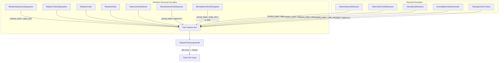

Pairwise and restraint feature generators are the bridge between raw structural context and the model's pair representation. They encode **relational information** — how tokens relate to each other along sequence, chain, and entity axes — and **experimental constraints** that steer the diffusion process toward biologically valid structures. This page dissects every generator that produces `TOKEN_PAIR`, `ATOM_PAIR`, or `TOKEN`-type features with pairwise semantics, tracing the data flow from batch tensors through encoding to the final feature tensor consumed by the trunk.

## Architectural Overview: Two Feature Domains

All generators covered here fall into two functional domains. **Pairwise structural encoders** capture intrinsic relational geometry (sequence separation, chain membership, entity identity, distances). **Restraint encoders** inject external prior knowledge — contacts, pockets, covalent bonds, and docking groups — that bias the model toward desired configurations. Despite their different purposes, both domains share the same `FeatureGenerator` abstraction: they pull named tensors from the batch dictionary, compute an N×N (or blocked N×N) feature, encode it via the type system defined in [Feature Generator Base Design](18-feature-generator-base-design), and return it for collation by the `FeatureFactory`.



The `FeatureFactory` orchestrates generation by calling each registered generator's `generate()` method against the same batch, collecting all features into a single dictionary [FeatureFactory](chai_lab/data/features/feature_factory.py#L18-L27).

Sources: [feature_type.py](chai_lab/data/features/feature_type.py#L1-L17), [feature_factory.py](chai_lab/data/features/feature_factory.py#L1-L27), [base.py](chai_lab/data/features/generators/base.py#L1-L114)

## Pairwise Structural Encoders

These generators produce features that describe the **intrinsic relationships** between token pairs. They operate on batch-level metadata — residue indices, asym IDs, entity IDs — and encode relative offsets as one-hot categorical distributions. The common pattern: compute a pairwise difference matrix via `rearrange(x, "b n -> b n 1") - rearrange(x, "b n -> b 1 n")`, bin or clamp the result, and one-hot encode.

### RelativeSequenceSeparation

`RelativeSequenceSeparation` encodes the signed sequence distance between two tokens **within the same chain**. Inter-chain pairs receive a dedicated sentinel bin. The generator bins offsets using `torch.searchsorted` against a configurable set of separation bins (default: ±32 positions, yielding 67 bins). Critically, the feature is computed only when `asym_id` matches — all inter-chain entries are set to `num_classes - 1`, a dedicated "different chain" class.

| Parameter | Default | Description |
|---|---|---|
| `sep_bins` | `get_sep_bins(32)` | Bin edges for sequence separation |
| `num_bins` | `None` | Alternative: generates symmetric bins ±`num_bins` |
| Output shape | `(B, N, N, 1)` | ONE_HOT with `len(sep_bins) + 2` classes |
| Feature type | `TOKEN_PAIR` | Consumed by pair trunk |

> [!TIP]
> The extra +2 in `num_classes` accounts for: (1) the sentinel index produced by `searchsorted` for values beyond the last bin edge, and (2) the dedicated inter-chain bin at `num_classes - 1`. When specifying `num_bins=32`, the actual one-hot depth is `2*32 + 2 = 67`.

Sources: [relative_sep.py](chai_lab/data/features/generators/relative_sep.py#L1-L63)

### RelativeTokenSeparation

Where `RelativeSequenceSeparation` operates on residue-level offsets, `RelativeTokenSeparation` operates on **token-level** offsets — accounting for ligands, modified residues, and multi-atom token types where token index ≠ residue index. It requires that both the residue index and the chain (asym_id) match between the pair before encoding the relative token separation. Out-of-scope pairs (different residue or different chain) receive the sentinel value `2 * r_max + 2`.

| Parameter | Default | Description |
|---|---|---|
| `r_max` | `16` | Maximum token offset to encode explicitly |
| Output shape | `(B, N, N, 1)` | ONE_HOT with `2*r_max + 3` classes |
| Masking logic | `rel_residue == 0 & rel_chain == 0` | Only same-residue, same-chain pairs |

Sources: [relative_token.py](chai_lab/data/features/generators/relative_token.py#L1-L54)

### RelativeChain

Following Algorithm 5 of AlphaFold-Multimer, `RelativeChain` encodes the **relative chain index within the same entity**. It computes the pairwise difference of `sym_id` (after remapping to zero-indexed via `torch.unique`), clamps to ±`s_max`, and masks inter-entity pairs to a sentinel bin. This is distinct from `RelativeEntity` — it distinguishes between *copies* of the same entity (e.g., homodimer chains A and B of the same protein sequence).

| Parameter | Default | Description |
|---|---|---|
| `s_max` | `2` | Maximum relative chain offset |
| Output shape | `(B, N, N, 1)` | ONE_HOT with `2*s_max + 2` classes |
| Input keys | `token_entity_id`, `token_sym_id` | Entity and symmetry IDs |
| Inter-entity value | `2*s_max + 1` | Dedicated sentinel for cross-entity |

Sources: [relative_chain.py](chai_lab/data/features/generators/relative_chain.py#L1-L55)

### RelativeEntity

`RelativeEntity` provides the coarsest relational encoding: a 3-class one-hot indicating whether a token pair belongs to the **same entity** (class 0), a **different entity** (class 2), or represents a self-pair (class 1, when `rel_entity == 0` after zero-indexing). Entity IDs are remapped to zero-indexed before differencing, then `clamp(+1, 0, 2)` maps the three cases.

| Value | Semantics |
|---|---|
| 0 | Same entity, different token |
| 1 | Self-pair (same token) |
| 2 | Different entity |

Sources: [relative_entity.py](chai_lab/data/features/generators/relative_entity.py#L1-L48)

### TokenCenterDistance

`TokenCenterDistance` bridges atom-level coordinates to token-pair features by computing pairwise Euclidean distances between each token's **center atom** (gathered via `token_centre_atom_index`). The resulting distance matrix is binned using `torch.searchsorted` against configurable distance bins, then masked where either token's center atom is absent. Default bins are `[0, 4, 8, 12, 16]`, yielding a 6-class one-hot (5 explicit bins + 1 mask sentinel).

```
all_atom_positions ──► center_atom_coords (via gather on token_centre_atom_index)
                              │
                              ▼
                    cdist(center_atom_coords) ──► bin via searchsorted
                              │
                              ▼
                    mask invalid pairs ──► ONE_HOT encoded TOKEN_PAIR feature
```

This generator is also **composed** by `DockingRestraintGenerator`, which delegates distance computation to `TokenCenterDistance._generate()` internally.

Sources: [token_pair_distance.py](chai_lab/data/features/generators/token_pair_distance.py#L1-L66), [token_utils.py](chai_lab/data/features/token_utils.py#L1-L55)

### BlockedAtomPairDistances and BlockedAtomPairDistogram

These two generators produce `ATOM_PAIR`-type features using a **blocked sparse representation** rather than a full N×N matrix. Instead of computing all atom-atom distances, they use precomputed query/key index tensors (`block_atom_pair_q_idces`, `block_atom_pair_kv_idces`) that define which atom pairs to evaluate — a critical optimization for the atom attention module.

`BlockedAtomPairDistances` outputs raw inverse-squared distances (`1 / (1 + d²)`) concatenated with a validity mask channel, yielding shape `(B, n_blocks, bl_q, bl_kv, 2)`. `BlockedAtomPairDistogram` bins the same distances into discrete categories (one-hot or RBF) for categorical consumption.

Both generators enforce a **same-reference-space** constraint: atom pairs are only valid when their `atom_ref_space_uid` values match, ensuring that distances are only computed between atoms that share a coordinate frame.

| Generator | Encoding | Default Bins | Output Channels |
|---|---|---|---|
| `BlockedAtomPairDistances` | IDENTITY | N/A | 2 (feature + mask) |
| `BlockedAtomPairDistogram` | ONE_HOT | `[0,1,2,3,4,5,6,8,12,16]` | `len(bins)+1` |
| `BlockedAtomPairDistogram` | RBF | `[0,2,4,6,8,10,12,14,16]` | `len(bins)+1` |

Sources: [blocked_atom_pair_distances.py](chai_lab/data/features/generators/blocked_atom_pair_distances.py#L1-L176)

## Restraint Feature Generators

Restraint generators encode **user-specified prior knowledge** about desired structural outcomes. They share a common contract: when no constraints are provided (or when constraint resolution fails), they produce a null feature matrix filled with `ignore_idx` (typically `-1.0`), ensuring the model falls back to unbiased prediction. When constraints are present, they resolve chain/residue identifiers into token positions and write constraint values into the N×N feature matrix.

### Constraint Resolution Pipeline

All restraint generators follow the same resolution pipeline from raw text constraints to feature tensors:

```mermaid
flowchart LR
    A[Raw .restraints file] --> B[parse_pairwise_table]
    B --> C[PairwiseInteraction objects]
    C --> D[load_manual_restraints_for_chai1]
    D --> E[RestraintContext]
    E --> F[Collator: batch dict keys]
    F --> G[Generator.get_input_kwargs_from_batch]
    G --> H[RestraintGroup dataclasses]
    H --> I[_generate / generate_from_restraint]
    I --> J[RBF or ONE_HOT encoded feature]
```



The parsing layer converts CSV-formatted restraint files into `PairwiseInteraction` objects, which are then resolved into `RestraintContext` during chain loading. The collator places constraint dictionaries under batch keys like `contact_constraints`, `pocket_constraints`, and `docking_constraints`. Each generator's `get_input_kwargs_from_batch` deserializes these back into typed `RestraintGroup` dataclasses before feature computation.

Sources: [token_dist_restraint.py](chai_lab/data/features/generators/token_dist_restraint.py#L1-L35), [test_restraints.py](tests/test_restraints.py#L1-L126)

### TokenDistanceRestraint (Contact Restraints)

`TokenDistanceRestraint` encodes **pairwise residue-residue contact constraints** — the most common restraint type. Each `RestraintGroup` specifies a left/right residue pair (identified by subchain ID + residue index + residue name) and a distance threshold. The generator writes the threshold value into `constraint_mat[left_residue_mask, right_residue_mask]`, producing an **asymmetric** feature — the constraint is not mirrored to the transposed position.

Key implementation details:

- **Residue validation**: Both `left_residue_mask` and `right_residue_mask` must select exactly one token each. An assertion fires if multiple tokens match, preventing ambiguous constraints.
- **Name verification**: The residue name in the constraint is validated against the token's parsed residue name via `tensorcode_to_string`, catching mismatched chain/residue specifications early.
- **RBF encoding**: The distance threshold is encoded with radial basis functions (`EncodingType.RBF`, default 5 radii), allowing the model to interpret the constraint as a soft distance prior.
- **Null fallback**: If constraints are `None` or if any exception occurs during resolution, the generator returns a matrix filled with `-1.0`, which the RBF encoding interprets as "no constraint."

| Parameter | Default | Description |
|---|---|---|
| `include_probability` | `1.0` | Probability of including restraints per example |
| `size` | `0.33` | Number of restraints; if `<1`, sampled from `Geometric(size)` |
| `min_dist` / `max_dist` | `10.0` / `30.0` | Distance range for RBF encoding |
| `num_rbf_radii` | `5` | Number of RBF basis functions |
| `query_entity_types` | All | Entity types eligible as constraint "query" side |
| `key_entity_types` | All | Entity types eligible as constraint "key" side |

> [!TIP]
> The `size` parameter has dual semantics: integer values specify an exact count, while float values in `(0, 1)` are interpreted as the parameter of a geometric distribution. This design allows training-time stochasticity (randomly varying the number of constraints per batch) while still supporting deterministic inference with a fixed count.

Sources: [token_dist_restraint.py](chai_lab/data/features/generators/token_dist_restraint.py#L1-L273)

### TokenPairPocketRestraint (Pocket Restraints)

`TokenPairPocketRestraint` encodes **pocket constraints** — a qualitatively different relationship from pairwise contacts. Instead of specifying a residue-residue pair, a pocket restraint specifies a **single residue** (the "pocket token") and a **target chain**. The generator then creates constraints between the pocket token and *all* tokens in the target chain, setting each entry to `pocket_distance_threshold`.

This is implemented in `add_pocket_restraint`, which writes `pocket_distance_threshold` into `restraint_mat[pocket_token_residue_mask, pocket_chain_asym_mask]` — a row-vector of constraints from the pocket token to every token on the target chain. Like contact restraints, this feature is **asymmetric**: the reverse direction is not filled.

The `TokenPairPocketRestraint` class internally composes a `TokenDistanceRestraint` instance (with matching hyperparameters) to handle the sampling logic, but overrides the feature generation with its own pocket-specific resolution:

| Aspect | Contact Restraint | Pocket Restraint |
|---|---|---|
| Constraint scope | 1 residue ↔ 1 residue | 1 residue → entire chain |
| Feature symmetry | Asymmetric (one cell) | Asymmetric (one row) |
| Batch key | `contact_constraints` | `pocket_constraints` |
| RestraintGroup fields | `left/right_residue_*` | `pocket_chain/token_*` |

Sources: [token_pair_pocket_restraint.py](chai_lab/data/features/generators/token_pair_pocket_restraint.py#L1-L248)

### TokenBondRestraint (Covalent Bonds)

`TokenBondRestraint` encodes **covalent bond topology** between tokens. It consumes `atom_covalent_bond_indices` — a list of `(left_atom_indices, right_atom_indices)` pairs per batch element — maps atom indices to token indices via `atom_token_index`, and writes `1.0` into `bond_feature[left_token_indices, right_token_indices]`.

Notable design choices:

- **No masking**: `apply_mask` is overridden to return the feature unchanged, since bonds are structural facts rather than soft constraints.
- **Zero-initialized**: The feature starts as all zeros; bonds are explicitly set to 1.0. The absence of a bond is simply the default state.
- **IDENTITY encoding**: Unlike distance restraints that use RBF, bonds are binary (present/absent), making identity encoding natural.

Sources: [token_bond.py](chai_lab/data/features/generators/token_bond.py#L1-L64)

### DockingRestraintGenerator

`DockingRestraintGenerator` is the most complex restraint encoder, implementing a **chain-partitioning strategy** for docking tasks. It can operate in two modes:

1. **Training mode** (`_generate_from_batch`): Chains are randomly partitioned into two groups. Token-center distances are computed and provided for **intra-group** pairs while **inter-group** distances are masked. This teaches the model to predict inter-chain interfaces from intra-chain structural cues. Coordinate noise is sampled uniformly from `coord_noise` range. Structure dropout and chain dropout are optionally applied as regularization.

2. **Inference mode** (`_generate_from_restraints`): Explicit `RestraintGroup` objects specify which chains belong to a docking group, along with their center coordinates and noise parameters. Distances are computed between all chain pairs within the group using `add_restraint`, which fills a symmetric constraint matrix and its associated mask.

The generator delegates core distance computation to an internal `TokenCenterDistance` instance, then applies the partition mask or constraint overlay on top:

| Parameter | Default | Description |
|---|---|---|
| `dist_bins` | `[0, 4, 8, 16]` | Distance bin edges for ONE_HOT encoding |
| `coord_noise` | `(0.0, 3.0)` | Uniform noise range for coordinates |
| `include_probability` | `0.1` | Probability of including inter-group distances |
| `structure_dropout_prob` | `0.0` | Probability of dropping entire structures |
| `chain_dropout_prob` | `0.0` | Probability of randomly masking chains |
| `entity_types` | All | Entity types eligible for docking |

The `include_probability=0.1` default means that during training, 90% of the time *all* inter-chain distances are masked, forcing the model to learn interface prediction. The remaining 10% provides partial distance information as a teaching signal.

Sources: [docking.py](chai_lab/data/features/generators/docking.py#L1-L372)

### MissingChainContact

`MissingChainContact` is a **token-level** (not pair-level) feature that flags chains with no inter-chain contacts. It computes all atom-atom distances, identifies atoms within `contact_threshold` Ångströms of atoms from other chains, and marks tokens belonging to chains that have zero such contacts. This is a diagnostic feature — it signals to the model that certain chains are structurally isolated, which may indicate a docking failure or a genuinely disconnected component.

The generator handles the monomer edge case explicitly: when only one chain exists, all tokens receive `0.0` (no missing contacts), since there are no inter-chain contacts to be missing.

| Parameter | Default | Description |
|---|---|---|
| `contact_threshold` | `6.0` | DockQ-compatible atom contact cutoff (Å) |
| Feature type | `TOKEN` | Per-token, not per-pair |
| Encoding | `IDENTITY` | Binary: 0.0 = has contacts, 1.0 = isolated |

Sources: [missing_chain_contact.py](chai_lab/data/features/generators/missing_chain_contact.py#L1-L97)

## Encoding and Masking Contract

All pairwise and restraint generators share a unified encoding contract inherited from `FeatureGenerator`. The `mask_value` property and `cast_feature` function ensure consistent dtype handling across encoding types:

| Encoding Type | Mask Value | Dtype | Generators Using It |
|---|---|---|---|
| `ONE_HOT` | `num_classes` (sentinel index) | `long` / `int` | RelativeSep, RelativeToken, RelativeChain, RelativeEntity, TokenCenterDistance, BlockedAtomPairDistogram, DockingRestraint |
| `RBF` | `-100.0` | `float16/32/bfloat16` | TokenDistanceRestraint, TokenPairPocketRestraint |
| `IDENTITY` | Zero tensor with last channel = 1 | `float` | BlockedAtomPairDistances, TokenBondRestraint, MissingChainContact |

The `can_mask` flag on each generator controls whether the identity-encoding mask channel is allocated. For `ONE_HOT` and `RBF` encodings, masking is implicit: sentinel values (`num_classes` or `-100.0`) are decoded as "no information" by downstream embedding layers.

Sources: [base.py](chai_lab/data/features/generators/base.py#L36-L74)

## Feature Matrix Summary

The table below provides a comprehensive reference for all pairwise and restraint feature generators, their output specifications, and the batch keys they consume:

| Generator | Feature Type | Encoding | Output Shape | Key Batch Inputs |
|---|---|---|---|---|
| `RelativeSequenceSeparation` | `TOKEN_PAIR` | ONE_HOT | `(B,N,N,1)` | `token_residue_index`, `token_asym_id` |
| `RelativeTokenSeparation` | `TOKEN_PAIR` | ONE_HOT | `(B,N,N,1)` | `token_index`, `token_residue_index`, `token_asym_id` |
| `RelativeChain` | `TOKEN_PAIR` | ONE_HOT | `(B,N,N,1)` | `token_entity_id`, `token_sym_id` |
| `RelativeEntity` | `TOKEN_PAIR` | ONE_HOT | `(B,N,N,1)` | `token_entity_id` |
| `TokenCenterDistance` | `TOKEN_PAIR` | ONE_HOT | `(B,N,N,1)` | `atom_gt_coords`, `atom_exists_mask`, `token_centre_atom_index`, `token_exists_mask` |
| `BlockedAtomPairDistances` | `ATOM_PAIR` | IDENTITY | `(B,bl,bl_q,bl_kv,2)` | `atom_ref_pos`, `atom_ref_mask`, `atom_ref_space_uid`, `block_atom_pair_*` |
| `BlockedAtomPairDistogram` | `ATOM_PAIR` | ONE_HOT/RBF | `(B,bl,bl_q,bl_kv,1)` | Same as above |
| `TokenDistanceRestraint` | `TOKEN_PAIR` | RBF | `(B,N,N,1)` | `contact_constraints`, `token_asym_id`, `token_residue_index`, `subchain_id` |
| `TokenPairPocketRestraint` | `TOKEN_PAIR` | RBF | `(B,N,N,1)` | `pocket_constraints`, same token metadata |
| `TokenBondRestraint` | `TOKEN_PAIR` | IDENTITY | `(B,N,N,1)` | `atom_covalent_bond_indices`, `atom_token_index` |
| `DockingRestraintGenerator` | `TOKEN_PAIR` | ONE_HOT | `(B,N,N,1)` | `docking_constraints`, `atom_gt_coords`, `token_asym_id`, `token_entity_type` |
| `MissingChainContact` | `TOKEN` | IDENTITY | `(B,N,1)` | `atom_gt_coords`, `atom_exists_mask`, `token_asym_id`, `atom_token_index` |

Sources: [feature_type.py](chai_lab/data/features/feature_type.py#L1-L17), [base.py](chai_lab/data/features/generators/base.py#L1-L114)

## Integration with the Inference Pipeline

During inference, restraints flow from user-specified `.restraints` files through the parsing and collation layers into the batch dictionary. The `predict_with_restraints.py` example demonstrates the end-to-end path: a CSV file with columns `chainA, res_idxA, chainB, res_idxB, connection_type, confidence, min_distance_angstrom, max_distance_angstrom, comment, restraint_id` is parsed by `parse_pairwise_table`, resolved into `PairwiseInteraction` objects with `PairwiseInteractionType.CONTACT` or `PairwiseInteractionType.POCKET`, then loaded via `load_manual_restraints_for_chai1` into the `RestraintContext`. The collator places these under the `contact_constraints` and `pocket_constraints` batch keys that the respective generators consume.

The **contact** and **pocket** restraint formats differ in their CSV structure: contact restraints specify residue indices on both sides, while pocket restraints leave `res_idxA` empty and specify a chain-level target. Both formats share the same confidence and distance columns.

Sources: [predict_with_restraints.py](examples/restraints/predict_with_restraints.py#L1-L36), [contact.restraints](examples/restraints/contact.restraints#L1-L3), [pocket.restraints](examples/restraints/pocket.restraints#L1-L4), [test_restraints.py](tests/test_restraints.py#L1-L126)

## Next Steps

With the pairwise and restraint feature generators understood, the feature engineering layer is complete. The next pages in the deep-dive track cover how these features are consumed:

- [Feature Embedding and Token Embedding](9-feature-embedding-and-token-embedding) — how raw feature tensors are embedded into the model's hidden dimension
- [Trunk Recycling and Attention](10-trunk-recycling-and-attention) — how pair features flow through the trunk's triangular attention
- [Restraint and Covalent Bond System](17-restraint-and-covalent-bond-system) — the full end-to-end restraint pipeline from user input to model guidance