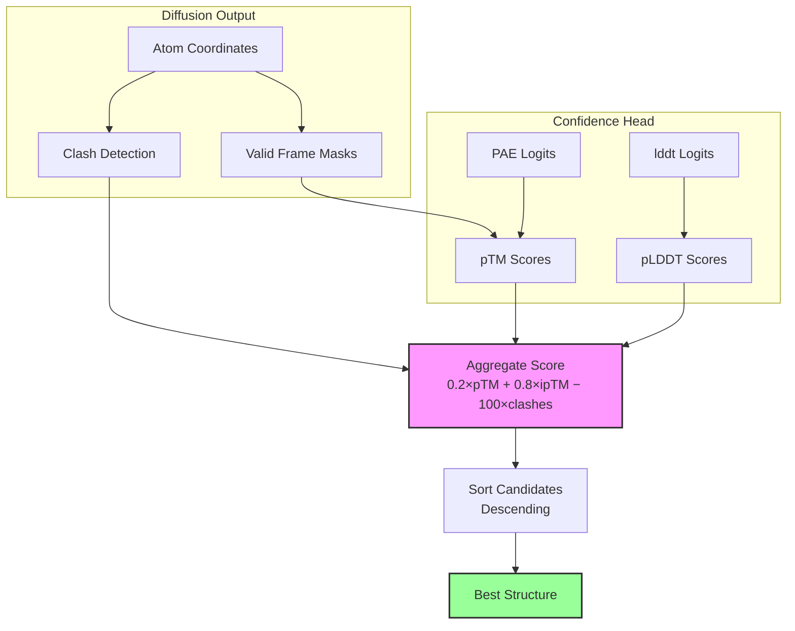

When Chai-1 generates multiple structure candidates through its diffusion sampling process, it must determine which candidate best represents the true biological assembly. The **ranking and scoring system** orchestrates three independent confidence signals—predicted TM-score (pTM), predicted LDDT (pLDDT), and steric clash detection—into a single aggregate score that drives candidate selection. This page explains how these signals are computed, combined, and used to rank structure predictions.

## Architecture Overview

The ranking pipeline sits at the terminal end of the inference workflow, after the confidence head has emitted its logits and the diffusion module has produced atomic coordinates. Every diffusion sample is independently scored, and the highest-scoring candidate is selected as the predicted structure.



The entry point is the `rank()` function in [rank.py](chai_lab/ranking/rank.py), which produces a `SampleRanking` dataclass containing all sub-scores and the aggregate. This is invoked once per diffusion sample inside the inference loop of [chai1.py](chai_lab/chai1.py).

Sources: [rank.py](chai_lab/ranking/rank.py#L1-L126), [chai1.py](chai_lab/chai1.py#L938-L975)

## The SampleRanking Data Model

The `SampleRanking` dataclass is the central artifact of the ranking system. It bundles four categories of scores together:

| Field | Type | Description |
|-------|------|-------------|
| `asym_ids` | `Int[Tensor, "chain"]` | Sorted unique chain identifiers (1-based) |
| `aggregate_score` | `Float[Tensor, "1"]` | Composite ranking score for the entire sample |
| `ptm_scores` | `PTMScores` | pTM and ipTM at complex, chain, and chain-pair levels |
| `clash_scores` | `ClashScores` | Total, inter-chain, and per-chain-pair clash counts |
| `plddt_scores` | `PLDDTScores` | pLDDT at complex, per-chain, and per-atom levels |

After ranking, the `get_scores()` function flattens these into a plain dictionary of NumPy arrays for serialization to `.npz` files, with keys including `aggregate_score`, `ptm`, `iptm`, `per_chain_ptm`, `per_chain_pair_iptm`, `has_inter_chain_clashes`, and `chain_chain_clashes`.

Sources: [rank.py](chai_lab/ranking/rank.py#L16-L32), [rank.py](chai_lab/ranking/rank.py#L117-L126)

## Aggregate Score Formula

The aggregate score determines which candidate is "best." It is a weighted combination of pTM scores with a harsh penalty for inter-chain steric clashes:

```
aggregate_score = 0.2 × complex_ptm + 0.8 × interface_ptm − 100 × has_inter_chain_clashes
```

The weighting reveals a clear design intent: **interface quality dominates**. The 0.8 weight on `interface_ptm` (ipTM) versus 0.2 on `complex_ptm` reflects that for multi-chain complexes, the quality of chain-chain interactions is far more informative than the overall fold quality. The clash penalty is binary and punitive—any detected inter-chain clash between polymer chains subtracts 100 points, effectively disqualifying candidates with serious steric violations.

> [!TIP]
> The 80/20 weighting between ipTM and pTM means that for single-chain predictions (where ipTM equals pTM), the formula reduces to `pTM − 100×clashes`. For multi-chain complexes, a strong interface score can overcome a mediocre complex-level score, but clashes are always fatal to the ranking.

Sources: [rank.py](chai_lab/ranking/rank.py#L99-L103)

## pTM Scoring: Predicted Template Modeling Score

The pTM (predicted Template Model) score estimates how well the predicted structure would align to the true structure, derived from the model's **Predicted Aligned Error (PAE)** logits. The `PTMScores` dataclass captures four granularity levels:

| Score | Shape | Meaning |
|-------|-------|---------|
| `complex_ptm` | `...` | Overall predicted TM-score for the entire complex |
| `interface_ptm` | `...` | Best interface TM-score across all chains |
| `per_chain_ptm` | `... c` | pTM for each individual chain |
| `per_chain_pair_iptm` | `... c c` | ipTM for each ordered chain pair |

### TM-Score d0 Normalization

All pTM computation depends on the TM-score `d0` normalization constant, computed from the number of tokens:

```
d0 = 1.24 × (n_tokens − 15)^(1/3) − 1.8
```

The value is clamped to a minimum of 19 tokens to avoid undefined behavior for very small chains. This follows the standard TM-score normalization convention.

### Core pTM Computation: `_compute_ptm`

The shared computation engine `_compute_ptm()` works as follows:

1. **Bin weighting**: For each PAE bin, compute `1 / (1 + (bin_center / d0)²)`, which assigns higher weight to small predicted errors—the same weighting used in the actual TM-score formula.
2. **Expected pair TM**: Compute `expectation(logits, bin_weights)` using softmax over bins, yielding a per-pair expected TM contribution.
3. **Query-key masking**: Only pairs where the query has a valid frame and both query/key tokens exist contribute.
4. **Aggregation**: Sum weighted expected TM scores per query, normalized by the number of key tokens.
5. **Optimistic selection**: Take `torch.max` over query rows to select the most optimistic alignment—the row whose predicted alignment yields the highest TM-score.

### Complex pTM vs. Interface pTM

The distinction between `complex_ptm` and `interface_ptm` lies in which tokens serve as query vs. key:

- **complex_ptm**: All tokens are both query and key. This measures the overall fold quality of the entire assembly.
- **interface_ptm**: For each chain `c`, tokens in `c` are the query and tokens in all *other* chains are the key. The maximum over chains is returned, capturing the strongest interface signal.

The `per_chain_pair_iptm` extends this to every ordered chain pair (i → j), using tokens in chain `i` as query and tokens in chain `j` as key. For memory efficiency, this is computed in a for-loop rather than batched when the tensor size would exceed 2³² elements.

Sources: [ptm.py](chai_lab/ranking/ptm.py#L1-L222)

## pLDDT Scoring: Predicted Local Distance Difference Test

The pLDDT score estimates the local accuracy of atomic positions, derived from the model's **lddt logits**. Unlike pTM which operates at the token level on PAE, pLDDT operates at the atom level on predicted distance errors.

The `PLDDTScores` dataclass provides three granularity levels:

| Score | Shape | Meaning |
|-------|-------|---------|
| `complex_plddt` | `...` | Masked mean pLDDT over all atoms |
| `per_chain_plddt` | `... c` | Masked mean pLDDT per chain |
| `per_atom_plddt` | `... a` | Per-atom pLDDT expectations |

The computation is straightforward: `expectation(logits, bin_centers)` applies softmax to the logits and computes the weighted sum with bin center values as weights. For the complex-level score, a `masked_mean` averages over all valid atoms. For per-chain scores, the chain masks from `get_chain_masks_and_asyms()` are applied before averaging.

Note that pLDDT scores are **not** part of the aggregate ranking formula—they are reported alongside the ranking for diagnostic purposes and written as B-factors (scaled to 0–100) in the output CIF files.

Sources: [plddt.py](chai_lab/ranking/plddt.py#L1-L82), [chai1.py](chai_lab/chai1.py#L978-L979)

## Clash Detection: Steric Violation Scoring

Clash detection identifies atoms that are unphysically close to each other, a critical quality check especially for multi-chain interfaces. The `ClashScores` dataclass captures:

| Score | Shape | Meaning |
|-------|-------|---------|
| `total_clashes` | `...` | Total clash count (intra + inter, double-counting corrected) |
| `total_inter_chain_clashes` | `...` | Sum of clashes across all chain pairs |
| `chain_chain_clashes` | `... n_chains n_chains` | Per chain-pair clash matrix |
| `has_inter_chain_clashes` | `...` | Boolean: whether any polymer chain pair has problematic clashes |

### Pairwise Distance Computation

The core `_compute_clashes()` function computes all pairwise atom distances via `cdist`, then flags any pair where: (1) both atoms exist, (2) they are not the same atom, and (3) their distance is below `clash_threshold` (default **1.1 Å**).

### Chain-Level Aggregation

Raw atom-atom clashes are aggregated into a chain-chain matrix using `scatter_add_` operations: first mapping atoms to their chain (via `atom_asym_id`), then accumulating clashes per chain pair. The diagonal (intra-chain clashes) is compensated for double-counting by dividing by 2, and the off-diagonal (inter-chain) is similarly halved to account for matrix symmetry.

### Inter-Chain Clash Criteria

A chain pair is flagged as having inter-chain clashes if **any** of these conditions hold:

1. **Absolute count**: The pair has ≥ `max_clashes` (default 100) clashes
2. **Relative ratio**: Clashes exceed `max_clash_ratio` (default 0.5) of the smaller chain's atom count
3. **Polymer restriction**: Both chains must be polymer types (Protein, RNA, DNA, or Polymer Hybrid)

> [!TIP]
> The polymer-only filter means that ligand-polymer or ligand-ligand clashes do not contribute to the `has_inter_chain_clashes` flag, even though they are counted in `chain_chain_clashes`. This prevents small-molecule proximity from penalizing the aggregate score.

Sources: [clashes.py](chai_lab/ranking/clashes.py#L1-L164)

## Frame Computation for pTM Validity

The `frames.py` module provides the `valid_frames_mask` that gates which tokens participate in pTM computation. A token can contribute to pTM only if it has a well-defined local reference frame—three non-collinear atoms that define an orientation.

The `get_frames_and_mask()` function combines two sources of frame definitions:

1. **Backbone frames**: Pre-defined N-Cα-C frames for standard amino acid residues, provided via `token_backbone_frame_mask` and `token_backbone_frame_index`
2. **Single-atom frames**: For tokens without backbone frames (e.g., ligand atoms), the function constructs frames by finding the two nearest atoms within the same residue and chain, then checking for collinearity

The collinearity check uses `abc_is_colinear()`, which computes the angle at atom B in the A-B-C triplet. If the angle is less than 25° or greater than 155°, the triplet is deemed collinear and the frame is rejected. This ensures that only geometrically meaningful frames influence the pTM calculation.

Sources: [frames.py](chai_lab/ranking/frames.py#L1-L173)

## Integration in the Inference Pipeline

The ranking system is invoked inside `run_folding_on_context()` in [chai1.py](chai_lab/chai1.py), after the confidence head has produced its logits for each diffusion sample. The call sequence for each sample is:

1. **Frame computation**: `get_frames_and_mask()` determines which tokens have valid reference frames
2. **Ranking**: `rank()` computes the full `SampleRanking` from atom coordinates, token metadata, PAE logits, and lddt logits
3. **Output**: The aggregate score is logged, the CIF file is written with pLDDT as B-factors, and scores are saved to `.npz`

After all samples are scored, the `StructureCandidates.sorted()` method reorders candidates by descending `aggregate_score`, making the first candidate the model's best prediction. When multiple trunk samples are used, `StructureCandidates.concat()` merges candidates from different trunk runs before sorting.

```
Score=0.8241, writing output to .../pred.model_idx_0.cif
Score=0.7903, writing output to .../pred.model_idx_1.cif
...
```

Sources: [chai1.py](chai_lab/chai1.py#L938-L1004), [chai1.py](chai_lab/chai1.py#L53-L92)

## Shared Ranking Utilities

The `utils.py` module provides foundational operations used across all scoring submodules:

| Function | Purpose |
|----------|---------|
| `get_chain_masks_and_asyms()` | Extracts per-chain boolean masks and sorted unique asym IDs from token/atom tensors |
| `get_interface_mask()` | Identifies token pairs across chains within an interface distance threshold |
| `expectation()` | Computes softmax-weighted expectation: `softmax(logits) · weights` |
| `num_atoms_per_chain()` | Counts valid atoms per chain using chain masks |
| `chain_is_polymer()` | Determines if each chain contains polymer entity types (Protein, RNA, DNA, Polymer Hybrid) |

The `expectation()` function is particularly critical—it is the shared mechanism by which both pTM and pLDDT convert categorical logit distributions into scalar scores. For pLDDT, weights are bin center values; for pTM, weights are TM-score bin weights `1/(1+(d/d0)²)`.

Sources: [utils.py](chai_lab/ranking/utils.py#L1-L87)

## Score Output Files

Each diffusion sample produces two output files in the output directory:

| File | Contents |
|------|----------|
| `pred.model_idx_{N}.cif` | Atomic coordinates with pLDDT (0–100 scale) as B-factors |
| `scores.model_idx_{N}.npz` | NumPy archive with all ranking scores as arrays |

The `.npz` file contains the following keys, as produced by `get_scores()`:

- `aggregate_score` — the composite ranking score
- `ptm` — complex-level pTM
- `iptm` — interface pTM
- `per_chain_ptm` — per-chain pTM array
- `per_chain_pair_iptm` — chain-pair ipTM matrix
- `has_inter_chain_clashes` — boolean clash flag
- `chain_chain_clashes` — per chain-pair clash count matrix

Sources: [rank.py](chai_lab/ranking/rank.py#L117-L126), [chai1.py](chai_lab/chai1.py#L985-L988)

## Next Steps

The aggregate score relies on three distinct metric systems, each with its own mathematical foundations and implementation nuances. To deepen your understanding:

- **[pTM, pLDDT, and Clash Metrics](23-ptm-plddt-and-clash-metrics)** — detailed mathematical derivations and interpretation guidelines for each metric
- **[CIF Output and Chain Naming](22-cif-output-and-chain-naming)** — how ranked predictions are materialized into structural files
- **[Confidence Prediction and Scoring](12-confidence-prediction-and-scoring)** — the upstream module that produces the PAE and lddt logits consumed by ranking