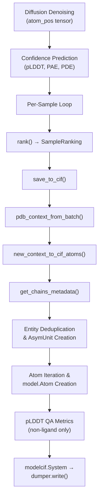
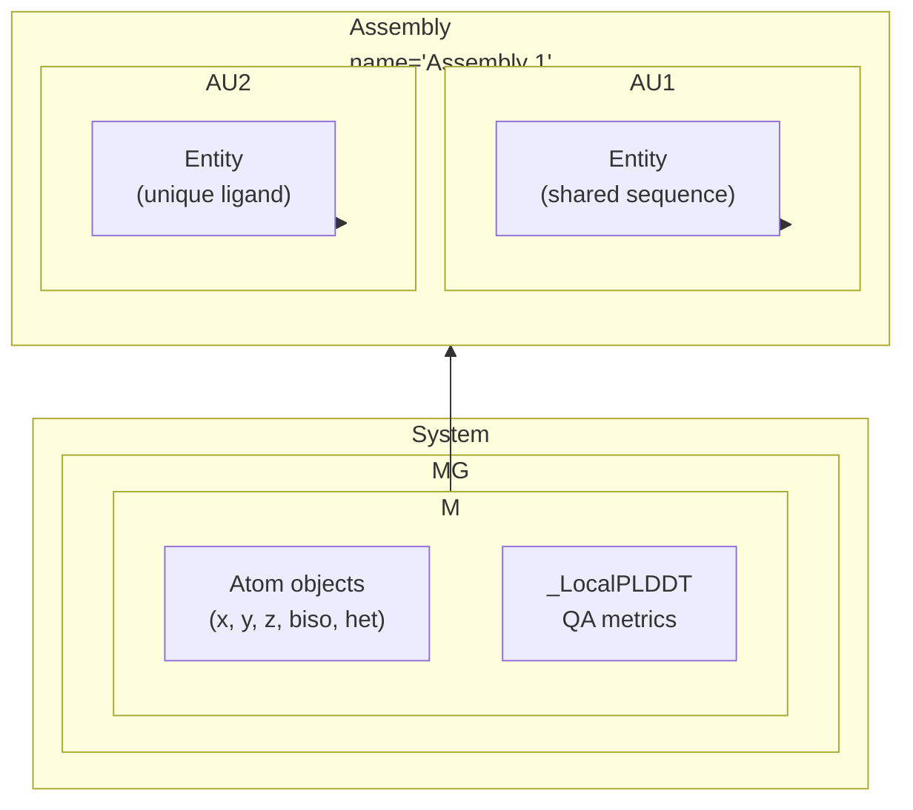

Chai-1 writes predicted structures in **ModelCIF** format—a standardized extension of mmCIF designed for computational models. The CIF output subsystem is responsible for translating raw coordinate tensors, token-level metadata, and per-atom confidence scores into a fully compliant `.cif` file with correct chain identifiers, entity grouping, chemical component annotations, and embedded quality metrics. This page explains how chain names are assigned, how entities are deduplicated, how different biomolecule types are serialized, and how the output pipeline integrates with the broader inference workflow.

## From Inference to CIF: The Output Pipeline

The CIF writing step is the final stage of the inference pipeline. After diffusion denoising produces atomic coordinates and the confidence head emits pLDDT/PAE/PDE logits, the system iterates over each diffusion sample, computes ranking scores, and writes one `.cif` file per sample. The entry point is `save_to_cif`, which orchestrates coordinate rearrangement, PDB context reconstruction, and delegation to the lower-level writer.



The `save_to_cif` function accepts the predicted coordinates (shape `[1, n_atoms, 3]`), the full output batch dictionary, the output path, a mapping of asym IDs to entity names, and optional B-factor (pLDDT) tensors. It rearranges the batch dimension away, reconstructs a `PDBContext` from the batch dictionary, and passes everything to `new_context_to_cif_atoms` for the actual serialization. The output directory is created automatically if it does not exist. [save_to_cif](chai_lab/data/io/cif_utils.py#L144-L158), [call site in inference](chai_lab/chai1.py#L1034-L1049)

## Chain Naming: Auto-Generated vs. FASTA-Derived

Chain naming is controlled by the `fasta_names_as_cif_chains` flag in `run_inference` (exposed as `--fasta-names-as-cif-chains` in the CLI). This flag determines whether chains receive sequential auto-generated identifiers or retain the entity names from the input FASTA file.

### Auto-Generated Chain Letters

When `fasta_names_as_cif_chains=False` (the default), the system uses `get_chain_letter()` to map each 1-indexed `asym_id` to a string from a structured vocabulary:

| Priority | Pattern | Range | Count |
|----------|---------|-------|-------|
| 1 | Single uppercase | A–Z | 26 |
| 2 | Single lowercase | a–z | 26 |
| 3 | Double letter | AA–zz | 2,704 |

The vocabulary is built as `_CHAIN_VOCAB`: first all 52 single-letter codes (A–Z then a–z), then all 52×52 two-letter combinations in lexicographic order. This supports up to **2,808 unique chains**—far beyond typical use cases. The mapping is strictly 1-indexed: `asym_id=1` → `"A"`, `asym_id=2` → `"B"`, ..., `asym_id=27` → `"a"`, `asym_id=53` → `"AA"`. [_CHAIN_VOCAB and get_chain_letter](chai_lab/data/io/cif_utils.py#L39-L47)

### FASTA-Derived Chain Names

When `fasta_names_as_cif_chains=True`, each chain is named using the `entity_name` field from the corresponding FASTA header. This is critical for restraint workflows where restraints reference chains by name—using auto-generated names would break the correspondence. The system validates that entity names are unique before proceeding with inference. [validation in run_folding_on_context](chai_lab/chai1.py#L621-L632)

The actual name assignment happens at the `save_to_cif` call site, where a dictionary comprehension builds the `asym_entity_names` mapping:

```python
asym_entity_names={
    i: (
        chain.entity_data.entity_name
        if entity_names_as_chain_names_in_output_cif
        else get_chain_letter(i)
    )
    for i, chain in enumerate(feature_context.chains, start=1)
}
```

This dictionary flows into `get_chains_metadata`, where each `AsymUnit` receives its `id` and `details` from the entity name. [asym_entity_names construction](chai_lab/chai1.py#L1041-L1049)

## Entity Deduplication and Chemical Component Mapping

Not every chain becomes a distinct entity in the CIF file. The `get_chains_metadata` function implements **entity deduplication**: chains with identical sequences and entity types share a single `Entity` object. This mirrors how the PDB groups identical sequences under one entity ID.

### Deduplication Key Construction

The entity key is computed differently based on entity type:

| Entity Type | Entity Key | Deduplication Behavior |
|-------------|-----------|----------------------|
| PROTEIN | `(type, *sequence)` | Identical protein sequences share one entity |
| RNA | `(type, *sequence)` | Identical RNA sequences share one entity |
| DNA | `(type, *sequence)` | Identical DNA sequences share one entity |
| LIGAND | `(type, asym_id)` | **Each ligand is always a unique entity** |
| MANUAL_GLYCAN | `(type, *sequence)` | Identical glycan sequences share one entity |

Ligands are never deduplicated because two different SMILES strings may represent the same molecule, and the system cannot reliably determine equivalence. Each ligand therefore gets its own Entity with a unique key incorporating its `asym_id`. [entity_key construction](chai_lab/data/io/cif_utils.py#L93-L98)

### Chemical Component Type Mapping

Each residue in an entity is represented by an IHM `ChemComponent` subclass, selected by the `_to_chem_component` function based on entity type:

| Entity Type | IHM Class | Canonical Code Handling |
|-------------|-----------|------------------------|
| PROTEIN | `LPeptideChemComp` | 3-letter → 1-letter via `restype_3to1` + gemmi lookup |
| DNA | `DNAChemComp` | Strips leading "D" (e.g., DA→A for canonical) |
| RNA | `RNAChemComp` | Uses 3-letter code as-is |
| LIGAND | `NonPolymerChemComp` | ID = residue name + asym_id suffix |
| MANUAL_GLYCAN | `SaccharideChemComp` | Uses 3-letter residue name |

For proteins, the canonical one-letter code is resolved through gemmi's tabulated residue database, ensuring correct handling of non-standard amino acids. For DNA, the convention follows wwPDB practice where the canonical code drops the "D" prefix (e.g., "DA" → "A"). [_to_chem_component](chai_lab/data/io/cif_utils.py#L120-L139)

## Atom Serialization and Ligand Handling

The core serialization loop in `new_context_to_cif_atoms` iterates over every atom, skipping those masked by `atom_exists_mask`. For each surviving atom, it extracts coordinates, resolves the parent chain's `AsymUnit`, determines the atom name, and creates a `model.Atom` instance.

### Ligand Atom Name Disambiguation

Ligand residues present a naming challenge: multiple atoms may share the same element-based name (e.g., two carbon atoms both named "C"). The system solves this with a counter-based suffix: for each `(asym_id, atom_name)` pair in a ligand, a running count is appended, producing names like `C_1`, `C_2`, `O_1`. Non-ligand atoms retain their standard PDB names (CA, CB, N, etc.). The `het` flag is set to `True` for all ligand atoms, marking them as HETATM entries. [ligand atom naming](chai_lab/data/io/cif_utils.py#L206-L213)

### Residue Numbering

Residue sequence IDs in the output CIF are **1-indexed**, converted from the 0-indexed internal representation by adding 1: `seq_id = int(token_residue_index) + 1`. This follows mmCIF convention where residue numbering starts at 1. [seq_id computation](chai_lab/data/io/cif_utils.py#L222)

## pLDDT Quality Metrics: Dual Representation

Chai-1 writes pLDDT confidence values in two complementary ways within the same CIF file:

1. **B-factor field (`biso`)**: Every atom receives its per-atom pLDDT score (scaled to 0–100) as the B-factor value. This enables immediate visualization in molecular viewers like PyMOL and ChimeraX, which color structures by B-factor.

2. **ModelCIF QA metric**: For non-ligand chains, token-centre pLDDT values are attached as `_LocalPLDDT` QA metrics at the residue level. The token centre is CA for proteins and C1' for nucleic acids. This provides the standardized ModelCIF representation that programmatic tools can parse. Ligands are excluded from QA metrics because they lack a meaningful token-centre convention. [pLDDT as biso and QA metric](chai_lab/data/io/cif_utils.py#L224-L244), [_LocalPLDDT class](chai_lab/data/io/cif_utils.py#L31-L34)

> [!TIP]
> When consuming Chai-1 CIF output programmatically, prefer the ModelCIF QA metrics for residue-level pLDDT (they are explicitly per-residue and exclude ligand noise) and the B-factor field for atom-level visualization. The two representations use the same underlying scores but differ in granularity and scope.

## PDBContext: The Structural Metadata Backbone

The `PDBContext` dataclass serves as the bridge between the batch tensor dictionary produced during inference and the CIF serialization logic. It extracts and organizes all token-level and atom-level metadata needed for CIF writing:

| Field | Level | Purpose in CIF Writing |
|-------|-------|----------------------|
| `token_asym_id` | Token | Maps tokens → chains |
| `token_residue_index` | Token | Residue numbering (seq_id) |
| `token_entity_type` | Token | Chemical component selection |
| `token_residue_names` | Token | Sequence reconstruction |
| `token_centre_atom_index` | Token | pLDDT QA metric anchoring |
| `atom_token_index` | Atom | Maps atoms → parent tokens |
| `atom_ref_element` | Atom | Element symbol (type_symbol) |
| `atom_exists_mask` | Atom | Skip masked atoms |
| `atom_ref_name_chars` | Atom | Atom name resolution |

The dataclass provides two cached properties: `token_res_names_to_string` (converts encoded residue names to strings) and `asym_id2entity_type` (builds a mapping from chain ID to entity type, excluding padding asym_id=0). The `pdb_context_from_batch` factory function extracts the first batch element (index `[0]`) from each tensor and validates that all tensors reside on CPU. [PDBContext](chai_lab/data/io/pdb_utils.py#L15-L64)

## ModelCIF Assembly Structure

The final CIF file follows the ModelCIF hierarchical structure:



The system title is set to `"Chai-1 predicted structure"` and the author is `"Chai Discovery team"`. Each diffusion sample produces one model within a single model group named `"pred"`. The assembly encompasses all asymmetric units (chains), and entities are shared across chains where deduplication applies. [ModelCIF system construction](chai_lab/data/io/cif_utils.py#L246-L255)

## Output File Naming and Multiple Samples

For each diffusion sample, two files are written to the output directory:

| File | Format | Content |
|------|--------|---------|
| `pred.model_idx_{idx}.cif` | ModelCIF | Atomic coordinates, chain metadata, pLDDT metrics |
| `scores.model_idx_{idx}.npz` | NumPy archive | Ranking scores from `SampleRanking` |

The sample index `idx` ranges from 0 to `num_diffn_samples - 1`. When multiple trunk samples are requested (`num_trunk_samples > 1`), outputs are further organized into `trunk_{trunk_idx}/` subdirectories. The aggregate score is printed to stdout for each sample. [output file writing](chai_lab/chai1.py#L1029-L1052)

> [!TIP]
> The `StructureCandidates` object returned by `run_inference` contains all CIF paths, ranking data, and confidence tensors. Its `.sorted()` method reorders candidates by aggregate score (descending), making it straightforward to select the top prediction: `candidates.sorted().cif_paths[0]`.

## Related Pages

- [Structure Ranking and Scoring](21-structure-ranking-and-scoring) — How aggregate scores are computed before CIF writing
- [pTM, pLDDT, and Clash Metrics](23-ptm-plddt-and-clash-metrics) — Detailed explanation of confidence metrics embedded in CIF output
- [FASTA Parsing and Entity Types](13-fasta-parsing-and-entity-types) — How entity names and types are determined from input
- [Feature Context Assembly](8-feature-context-assembly) — The pipeline stage that produces the batch tensors consumed by CIF writing
