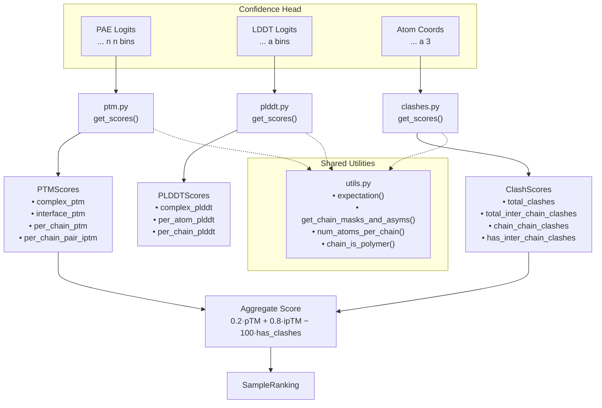
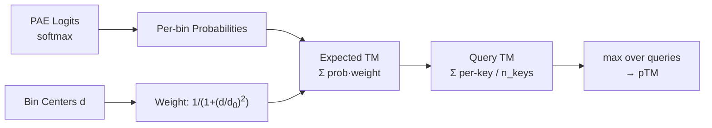
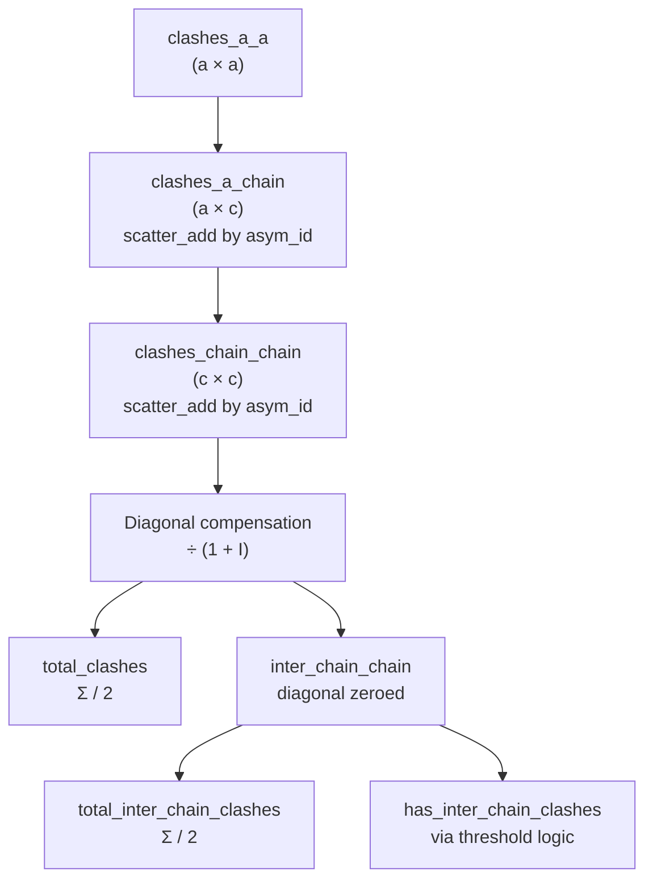
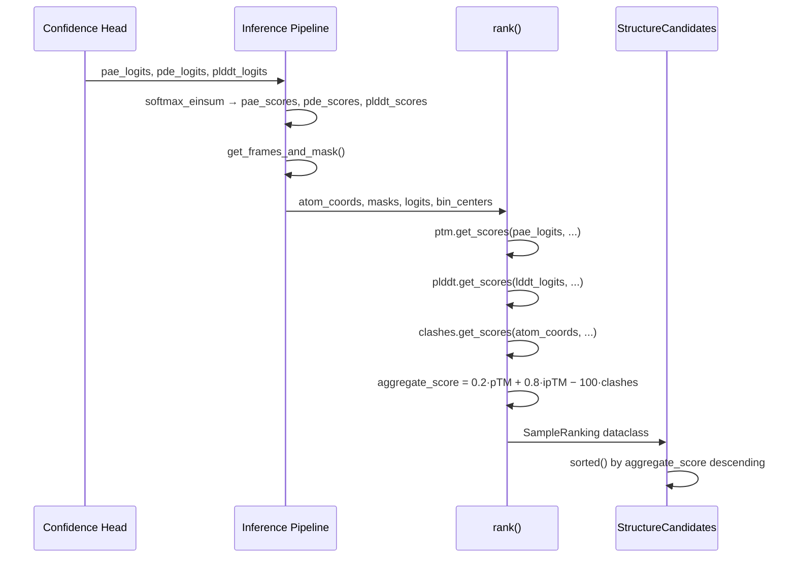

Chai1's confidence and quality assessment system produces three complementary metric families—**pTM** (predicted Template Modeling score), **pLDDT** (predicted Local Distance Difference Test), and **Clash** metrics—that together power the aggregate ranking of structure candidates. These metrics are computed downstream of the confidence prediction head and operate on distinct signal types: pTM interprets the Predicted Aligned Error (PAE) distribution through the TM-score lens, pLDDT extracts per-atom localization confidence from the LDDT logits, and clash detection performs geometric verification on the final atomic coordinates. The aggregate score that determines the best candidate is a weighted formula: `0.2 × pTM + 0.8 × ipTM − 100 × has_inter_chain_clashes`, heavily prioritizing interface quality and penalizing steric violations.

Sources: [rank.py](chai_lab/ranking/rank.py#L88-L93), [chai1.py](chai_lab/chai1.py#L897-L903)

## Metric Architecture Overview

The three metric modules share a common architectural pattern: each exposes a `get_scores()` entry point that returns a typed dataclass, each decomposes scores into complex-level, per-chain, and per-chain-pair granularities, and each relies on shared utilities in `ranking/utils.py` for chain mask construction and expectation computation. The ranking orchestrator in `rank.py` calls all three `get_scores()` functions, assembles the `SampleRanking` dataclass, and computes the aggregate score.



> [!TIP]
> The aggregate score's 0.2/0.8 weighting between pTM and ipTM means that for multi-chain complexes, interface quality dominates the ranking. For single-chain predictions where ipTM equals pTM, the formula reduces to `pTM − 100·has_clashes`, making clash detection the sole differentiator when present.

Sources: [rank.py](chai_lab/ranking/rank.py#L50-L93), [utils.py](chai_lab/ranking/utils.py#L1-L87)

## pTM: Predicted Template Modeling Score

The pTM metric translates the model's PAE (Predicted Aligned Error) distribution into a TM-score estimate. The TM-score is a length-dependent measure of structural similarity that ranges from 0 to 1, where values above 0.5 suggest correct fold topology. Chai1 computes four pTM variants, each querying the PAE logits against different subsets of tokens to measure structural confidence at different scopes.

### The d0 Normalization Function

The foundational computation is the TM-score **d0** parameter, which scales the distance penalty by the number of tokens:

```
d0(n) = 1.24 × (n − 15)^(1/3) − 1.8
```

This formula, clamped to a minimum of 19 tokens, produces a distance threshold that grows sublinearly with sequence length—longer chains tolerate larger absolute deviations. The d0 value converts raw PAE distances into the TM-score's normalized distance metric.

Sources: [ptm.py](chai_lab/ranking/ptm.py#L28-L31)

### Core Computation: `_compute_ptm`

The internal `_compute_ptm` function implements the pairwise TM-score expectation. It takes PAE logits of shape `(... n n bins)`, a set of query tokens, a set of key tokens, and bin centers representing distance values. The computation proceeds as:

1. **Bin weighting**: Each distance bin center is weighted by `1 / (1 + (d/d0)²)`, the TM-score distance weighting function applied element-wise to all bins.
2. **Expected TM per pair**: The softmax of PAE logits produces per-bin probabilities; multiplying by bin weights and summing yields the expected TM contribution for each query-key token pair.
3. **Query-level aggregation**: Each query token's TM score is the sum of its pairwise expected TM values divided by the number of key tokens.
4. **Optimistic selection**: The final pTM is the **maximum** query-level TM score across all queries, selecting the most favorable alignment orientation.



> [!TIP]
> The `max` operation in step 4 is critical: pTM reports the best-case alignment rather than an average. This makes pTM an optimistic estimate of how well the predicted structure would align to the true structure under the most favorable superposition.

Sources: [ptm.py](chai_lab/ranking/ptm.py#L34-L66)

### pTM Variants

| Variant | Query Scope | Key Scope | Purpose |
|---|---|---|---|
| **complex_ptm** | All tokens with valid frames | All tokens | Global structural confidence for the entire complex |
| **interface_ptm (ipTM)** | One chain at a time | All tokens *outside* that chain | Best inter-chain alignment quality |
| **per_chain_ptm** | One chain at a time | Same chain | Per-chain internal fold confidence |
| **per_chain_pair_iptm** | One chain at a time | All other chains individually | Pairwise interface quality matrix |

**complex_ptm** uses the simplest query/key configuration: all existing tokens with valid frames query against all existing tokens. This measures the overall confidence in the entire structural arrangement.

**interface_ptm** restricts each query chain to key tokens from *other* chains only, then takes the maximum over all chains. This isolates the confidence in inter-chain docking arrangements, which is the most informative signal for multi-chain complexes. The formula: `ipTM = max_c pTM(query=c, key=∁\{c})`.

**per_chain_ptm** constrains both query and key to the same chain, measuring how confidently each individual chain is folded regardless of inter-chain arrangement.

**per_chain_pair_iptm** computes a full chain×chain matrix where entry (i,j) is the pTM when chain i queries against chain j. This is the most granular interface metric. For memory efficiency, it defaults to a loop implementation over chains rather than batched computation, switching to batched mode only when the total tensor size is below 2³² elements.

Sources: [ptm.py](chai_lab/ranking/ptm.py#L69-L186)

### The `PTMScores` Dataclass

The `get_scores()` function assembles all four variants into a single `PTMScores` dataclass:

```python
@dataclass
class PTMScores:
    complex_ptm: Float[Tensor, "..."]           # scalar
    interface_ptm: Float[Tensor, "..."]          # scalar
    per_chain_ptm: Float[Tensor, "... c"]        # one value per chain
    per_chain_pair_iptm: Float[Tensor, "... c c"]  # chain × chain matrix
```

The per_chain_pair_iptm matrix is asymmetric: entry (i,j) reflects how well chain i aligns relative to chain j, which differs from (j,i) when chains have different sizes.

Sources: [ptm.py](chai_lab/ranking/ptm.py#L14-L24), [ptm.py](chai_lab/ranking/ptm.py#L189-L222)

## pLDDT: Predicted Local Distance Difference Test

The pLDDT metric estimates per-atom local structural accuracy by computing the expected value of the LDDT score from the model's binned logits. Unlike pTM which operates on token-level PAE, pLDDT operates at atom resolution and measures the confidence that local inter-atomic distance neighborhoods are correct.

### Core Computation

The computation is elegantly simple: apply softmax to the LDDT logits to get per-bin probabilities, then compute the weighted sum using bin center values as weights. This yields the expected LDDT score per atom.

```python
def plddt(logits, mask, bin_centers, per_residue=False):
    expectations = rank_utils.expectation(logits, bin_centers)  # softmax + weighted sum
    if per_residue:
        return expectations           # per-atom scores
    else:
        return masked_mean(mask, expectations, dim=-1)  # scalar average
```

The `expectation()` utility in `ranking/utils.py` performs `softmax(logits) · weights`, summing over the bin dimension. For pLDDT, the weights are simply the bin center values themselves (not the TM-score weighting used in pTM), producing a value proportional to the expected distance accuracy.

Sources: [plddt.py](chai_lab/ranking/plddt.py#L26-L34), [utils.py](chai_lab/ranking/utils.py#L43-L49)

### pLDDT Variants

| Variant | Granularity | Shape | Use Case |
|---|---|---|---|
| **complex_plddt** | Scalar (masked mean) | `...` | Overall structure quality |
| **per_atom_plddt** | Per-atom | `... a` | Atom-level confidence mapping |
| **per_chain_plddt** | Per-chain (masked mean per chain) | `... c` | Chain-level quality comparison |

**per_chain_plddt** works by constructing a chain mask tensor of shape `(... c a)` via `get_chain_masks_and_asyms()`, then repeating the logits across the chain dimension and computing the masked mean for each chain independently.

### Bin Center Derivation

In the inference pipeline (`chai1.py`), the LDDT bin centers are derived as:

```python
_bin_centers(0, 1, plddt_logits.shape[-1])
```

This creates `no_bins` evenly-spaced centers via `torch.linspace(0, 1, 2*no_bins+1)[1::2]`, placing each center at the midpoint of its bin. The range [0, 1] corresponds to the normalized LDDT scale. When reported in the `StructureCandidates` dataclass, per-atom pLDDT is converted to per-token by averaging within tokens, and the raw expectation values are stored for downstream use.

Sources: [plddt.py](chai_lab/ranking/plddt.py#L37-L82), [chai1.py](chai_lab/chai1.py#L919-L932)

### The `PLDDTScores` Dataclass

```python
@dataclass
class PLDDTScores:
    complex_plddt: Float[Tensor, "..."]       # scalar average
    per_atom_plddt: Float[Tensor, "... a"]    # per-atom scores
    per_chain_plddt: Float[Tensor, "... c"]   # per-chain averages
```

Sources: [plddt.py](chai_lab/ranking/plddt.py#L14-L22)

## Clash Metrics: Steric Quality Assessment

Clash metrics perform post-hoc geometric validation on the predicted atomic coordinates, detecting steric clashes that indicate physically implausible structures. Unlike pTM and pLDDT which interpret model confidence outputs, clash detection is a deterministic geometric computation on the final coordinates.

### Core Clash Detection: `_compute_clashes`

The foundational operation computes a boolean matrix of atom pairs that are too close:

1. **Pairwise distances**: Compute all pairwise Euclidean distances via `cdist(atom_coords)`.
2. **Valid pair mask**: Exclude self-interactions (diagonal) and pairs where either atom is masked out.
3. **Threshold**: Mark a pair as clashing if `distance < clash_threshold` (default **1.1 Å**).

The result is a boolean matrix of shape `(... a a)` indicating all clashing atom pairs.

Sources: [clashes.py](chai_lab/ranking/clashes.py#L29-L41)

### From Atom-Atom to Chain-Chain Clashes

The `get_scores()` function aggregates atom-atom clashes into chain-level statistics through a series of scatter operations:

1. **Build `clashes_a_a`**: Boolean → int32 matrix of atom-atom clashes.
2. **Scatter to `clashes_a_chain`**: For each atom, sum clashes grouped by chain identity (using `atom_asym_id` shifted from 1-based to 0-based).
3. **Scatter to `clashes_chain_chain`**: Aggregate atom-chain clashes into a chain×chain matrix.
4. **Compensate doubling**: The diagonal (intra-chain) entries are counted twice due to symmetry, so divide by `(1 + I)` where I is the identity matrix—this halves diagonal entries while leaving off-diagonal unchanged.
5. **Extract inter-chain**: Zero out the diagonal to isolate inter-chain clashes, then sum and divide by 2 for symmetry.



Sources: [clashes.py](chai_lab/ranking/clashes.py#L72-L138)

### Inter-Chain Clash Determination: `has_inter_chain_clashes`

The boolean `has_inter_chain_clashes` flag uses a dual-criteria threshold to determine whether inter-chain clashes are significant enough to flag the entire structure:

| Criterion | Threshold | Rationale |
|---|---|---|
| **Absolute count** | ≥ `max_clashes` (default 100) | Large absolute number of clashes regardless of chain size |
| **Relative ratio** | ≥ `max_clash_ratio` (default 0.5) of smaller chain's atom count | Disproportionate clashes for small chains |
| **Polymer restriction** | Both chains must be polymers (protein/RNA/DNA/hybrid) | Ignore clashes involving ligands or water |

A chain pair is flagged if **either** the absolute count or the relative ratio is exceeded, and **both** chains are polymers. The final `has_inter_chain_clashes` is `any()` reduction over all chain pairs—meaning even a single problematic polymer-polymer interface triggers the flag.

> [!TIP]
> The polymer-only restriction means that ligand chain clashes never trigger the penalty. This is intentional: ligands are often in tight binding pockets where many atoms are close to the protein surface, which would produce false-positive clash flags under the same thresholds used for polymer-polymer interfaces.

Sources: [clashes.py](chai_lab/ranking/clashes.py#L44-L70), [utils.py](chai_lab/ranking/utils.py#L71-L87)

### The `ClashScores` Dataclass

```python
@dataclass
class ClashScores:
    total_clashes: Int[Tensor, "..."]                    # all clashes (intra + inter)
    total_inter_chain_clashes: Int[Tensor, "..."]        # inter-chain only
    chain_chain_clashes: Int[Tensor, "... n_chains n_chains"]  # per-pair matrix
    has_inter_chain_clashes: Bool[Tensor, "..."]         # penalty flag
```

Sources: [clashes.py](chai_lab/ranking/clashes.py#L14-L27)

## Aggregate Score Composition

The aggregate score in `rank()` combines pTM and clash metrics into a single scalar:

```python
aggregate_score = (
    0.2 * ptm_scores.complex_ptm
    + 0.8 * ptm_scores.interface_ptm
    - 100 * clash_scores.has_inter_chain_clashes.float()
)
```

The weighting scheme has important implications:

| Scenario | Score Behavior | Practical Effect |
|---|---|---|
| Multi-chain, good interface, no clashes | ~0.8 × ipTM dominates | ipTM is the primary quality signal |
| Multi-chain, poor interface, no clashes | Score drops with ipTM | Interface quality determines rank |
| Any complex with inter-chain clashes | −100 penalty applied | Clash-bearing structures sink to bottom |
| Single-chain structure | 0.2×pTM + 0.8×pTM = pTM | Reduces to complex_ptm alone |

The `get_scores()` function converts the `SampleRanking` dataclass to a flat numpy dictionary for downstream consumption, exposing: `aggregate_score`, `ptm`, `iptm`, `per_chain_ptm`, `per_chain_pair_iptm`, `has_inter_chain_clashes`, and `chain_chain_clashes`.

Sources: [rank.py](chai_lab/ranking/rank.py#L88-L126)

## Integration with the Inference Pipeline

The metrics are computed after the confidence head produces its three output logit tensors. In `run_folding_on_context()`, the confidence head is invoked per diffusion sample, producing `pae_logits`, `pde_logits`, and `plddt_logits`. These are converted to score tensors via softmax-einsum with bin centers, then fed into `rank()` along with atom coordinates and token metadata.



The PAE and PDE bin centers both use `_bin_centers(0.0, 32.0, 64)` (64 bins spanning 0–32 Å), while LDDT uses `_bin_centers(0, 1, n_bins)` spanning the normalized [0, 1] range. Frame computation via `get_frames_and_mask()` provides the `valid_frames_mask` that determines which tokens participate in pTM calculations—tokens without valid local frames (e.g., isolated atoms without neighbors for frame construction) are excluded from the alignment search.

Sources: [chai1.py](chai_lab/chai1.py#L897-L980), [chai1.py](chai_lab/chai1.py#L865-L895)

## Comparative Summary

| Aspect | pTM | pLDDT | Clash |
|---|---|---|---|
| **Input Signal** | PAE logits (token×token) | LDDT logits (per-atom) | Atom coordinates |
| **Operates On** | Token pairs | Individual atoms | Atom pairs |
| **Score Range** | [0, 1] | [0, 1] (normalized) | Non-negative integers |
| **Key Formula** | TM-score weighting `1/(1+(d/d₀)²)` | Bin center expectation | Euclidean distance < threshold |
| **Chain Awareness** | Full asymmetry decomposition | Per-chain averaging | Chain scatter + polymer filter |
| **Primary Granularity** | Chain pair matrix | Per-atom | Chain pair matrix |
| **Role in Ranking** | 20% complex + 80% interface | Not in aggregate score | −100 penalty flag |
| **Module** | [ptm.py](chai_lab/ranking/ptm.py) | [plddt.py](chai_lab/ranking/plddt.py) | [clashes.py](chai_lab/ranking/clashes.py) |

Note that pLDDT does **not** contribute to the aggregate ranking score despite being computed and stored—it serves as a per-atom confidence map useful for visualization and local quality assessment, but the ranking decision is driven entirely by pTM/ipTM and clash penalties.

Sources: [ptm.py](chai_lab/ranking/ptm.py#L1-L222), [plddt.py](chai_lab/ranking/plddt.py#L1-L82), [clashes.py](chai_lab/ranking/clashes.py#L1-L164), [rank.py](chai_lab/ranking/rank.py#L1-L126)

## Next Steps

- For how these metrics feed into the broader sample selection and CIF output pipeline, see [Structure Ranking and Scoring](21-structure-ranking-and-scoring).
- For the confidence head architecture that produces the PAE and LDDT logits consumed by these metrics, see [Confidence Prediction and Scoring](12-confidence-prediction-and-scoring).
- For the frame computation that determines which tokens have valid structural frames for pTM, see [frames.py](chai_lab/ranking/frames.py).