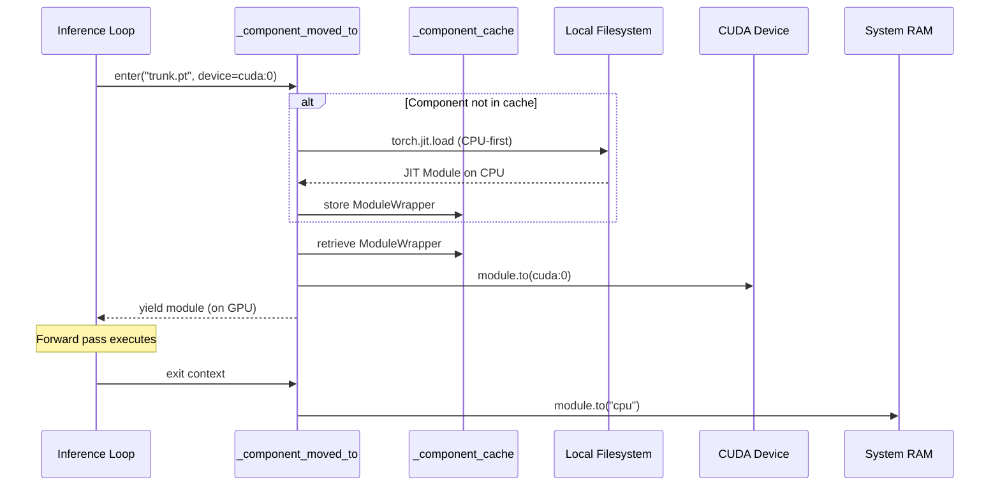
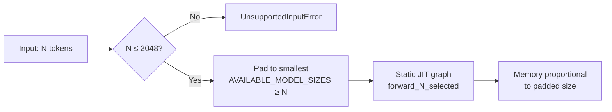
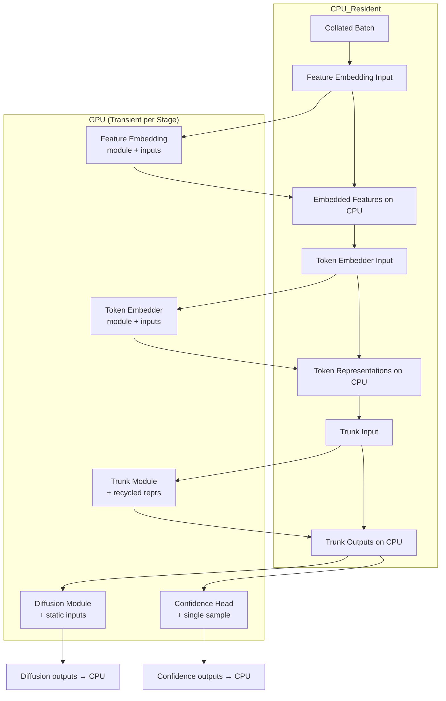

Chai-1's inference pipeline processes massive tensor representations — pairwise token features, MSA stacks, atom-level diffusion coordinates — that can easily exceed GPU memory if naively loaded all at once. The codebase addresses this through a **transient device migration** architecture: model components and intermediate tensors are moved to GPU only when actively computing, and immediately returned to CPU afterward. This page dissects the three pillars of that strategy — module lifecycle management, data movement control, and strategic cache eviction — so you can reason about memory behavior when folding large complexes or running on constrained hardware.

## The Core Abstraction: ModuleWrapper and Transient Migration

The central memory-saving mechanism is the `ModuleWrapper` class, which wraps TorchScript-compiled model components and exposes a `forward` method with two memory-controlling parameters: `move_to_device` and `return_on_cpu`. When `move_to_device` is set, input data is recursively transferred to the target device right before the forward call; when `return_on_cpu` is set, the output is moved back to CPU immediately after computation. This means no caller needs to manually track where data lives — the wrapper enforces the contract.

The `forward` method resolves the correct compiled graph variant by dynamically selecting `forward_{crop_size}` based on the padded model size (one of 256, 384, 512, 768, 1024, 1536, 2048). Each size corresponds to a separately exported static graph, avoiding dynamic-shape overhead inside the JIT runtime.

Sources: [chai1.py](chai_lab/chai1.py#L104-L122), [utils.py](chai_lab/data/collate/utils.py#L10-L11)

## Component Caching and Lazy Loading

Model components are loaded via `load_exported`, which implements a **CPU-first loading strategy**: when the target device is not `cuda:0`, the JIT module is first loaded onto CPU and then transferred to the target device. This avoids CUDA OOM errors that can occur when `torch.jit.load` directly materializes large parameter buffers on the GPU.

The module-level dictionary `_component_cache` stores loaded `ModuleWrapper` instances by their component key. Once a component is loaded, it is never re-read from disk. The context manager `_component_moved_to` leverages this cache to transiently move a cached module to the active device, yield it for computation, and then move it back to CPU — a round-trip that is far cheaper than deserializing from disk repeatedly.

This pattern is applied consistently across all five model components — `feature_embedding.pt`, `bond_loss_input_proj.pt`, `token_embedder.pt`, `trunk.pt`, `diffusion_module.pt`, and `confidence_head.pt` — each entering and exiting the GPU within a single `with` block.

Sources: [chai1.py](chai_lab/chai1.py#L124-L141), [chai1.py](chai_lab/chai1.py#L606-L616)

## The low_memory Flag: Two Operating Modes

The `run_inference` function accepts a `low_memory` boolean (defaulting to `True`) that governs how aggressively the pipeline moves intermediate tensors off the GPU. This flag propagates into `run_folding_on_context` and controls behavior at every major pipeline stage.

| Mode | Batch Placement | Intermediate Features | Module Outputs | Use Case |
|---|---|---|---|---|
| `low_memory=True` | CPU (default) | Moved to GPU per-module via `move_to_device` | Returned to CPU via `return_on_cpu` | Consumer GPUs (≤24 GB VRAM) |
| `low_memory=False` | GPU immediately | Already on GPU | Kept on GPU | High-VRAM servers (≥80 GB) |

In low-memory mode, the collated batch remains on CPU after construction. Each model component's `forward` call uses `move_to_device=device` to transfer only the required inputs to GPU for the duration of that call, and `return_on_cpu=True` to bring outputs back. This means that at any point, only one model component and its immediate inputs occupy GPU memory — peak usage is bounded by the largest single component rather than the sum of all components.

When `low_memory=False`, the entire batch is moved to GPU upfront via `move_data_to_device(batch, device=device)`, and module outputs stay on GPU. This eliminates the overhead of repeated CPU↔GPU transfers but requires sufficient VRAM to hold all intermediate representations simultaneously.

Sources: [chai1.py](chai_lab/chai1.py#L590-L595), [chai1.py](chai_lab/chai1.py#L620-L631)

## Recursive Data Migration: move_data_to_device

The utility function `move_data_to_device` performs recursive, type-dispatched device transfer across arbitrarily nested data structures. It handles `torch.Tensor` (via `.to(device)`), `dict`, `list`, `tuple`, and `dataclass` instances — the latter by reconstructing the dataclass with all fields migrated. This is the workhorse that enables both the `ModuleWrapper.forward` parameter and the batch-level migration in non-low-memory mode.

The recursive nature matters because the batch dictionary produced by `Collate` contains deeply nested structures: `batch["inputs"]` is a flat dict of tensors, but `batch["features"]` is a dict of named feature tensors, and future extensions could nest further. A simple `tensor.to()` call would miss non-tensor containers; the recursive dispatch ensures nothing is left behind.

> [!TIP]
> When extending the pipeline with new data structures, ensure they are either plain tensors/dicts/lists or dataclasses. The `move_data_to_device` function will raise `NotImplementedError` for unsupported types — this is intentional and catches bugs early rather than silently leaving data on the wrong device.

Sources: [tensor_utils.py](chai_lab/utils/tensor_utils.py#L254-L278)

## Strategic Cache Eviction Points

Beyond the component-level migration pattern, the pipeline includes explicit `torch.cuda.empty_cache()` calls at three critical junctures where peak memory pressure is known to occur:

1. **Before folding begins** — clears any residual allocations from feature context assembly.
2. **After trunk recycles complete** — the trunk module is the most memory-intensive component (pairwise attention over all tokens), and its fragmented GPU memory must be reclaimed before the diffusion loop begins.
3. **After the diffusion loop completes** — before confidence prediction, the `static_diffusion_inputs` dict (which holds trunk outputs, pair representations, and atom masks) is explicitly `del`'ed, then the cache is emptied. This is the single largest memory release in the entire pipeline.

Additionally, after confidence prediction and scoring, all output data — `inputs`, `atom_pos`, `plddt_logits`, `pae_logits` — is explicitly moved to CPU before writing CIF files. This ensures the GPU is free for subsequent trunk samples in the outer loop.

Sources: [chai1.py](chai_lab/chai1.py#L578-L579), [chai1.py](chai_lab/chai1.py#L682-L683), [chai1.py](chai_lab/chai1.py#L810-L812), [chai1.py](chai_lab/chai1.py#L895-L898)

## Static Model Sizing and Padding Strategy

Memory consumption is also controlled at the input level through **static model sizing**. The `AVAILABLE_MODEL_SIZES` list defines seven discrete token counts (256, 384, 512, 768, 1024, 1536, 2048), and the `Collate` class pads every input to the smallest size that accommodates the actual token count. Atom counts are derived as `23 × n_tokens` (23 atoms per token maximum), ensuring alignment to 32-atom blocks for the blocked atom-pair attention mechanism.

This padding has a direct memory implication: an input with 300 tokens is padded to 384, consuming memory proportional to the padded size rather than the actual size. The trade-off is that static graph shapes enable TorchScript optimization and eliminate dynamic-shape dispatch overhead. The `raise_if_too_many_tokens` guard rejects inputs exceeding 2048 tokens, providing a hard ceiling on peak memory.

Sources: [utils.py](chai_lab/data/collate/utils.py#L10-L40), [chai1.py](chai_lab/chai1.py#L235-L245)

## Memory-Aware Distance Computation

The `cdist` function in `tensor_utils.py` demonstrates a subtler memory optimization: when computing pairwise Euclidean distances on CUDA, it checks whether the total number of point pairs exceeds a threshold (2,147,400,000). If so, it falls back to a naive implementation that avoids the memory spike of `torch.cdist`'s internal buffer allocation. The naive version computes differences via broadcasting and uses in-place operations (`pow_`, `add_`, `sqrt_`) to minimize intermediate allocations.

This matters during ranking and scoring, where pairwise distance matrices over thousands of atoms can approach the multi-gigabyte range. The threshold was calibrated to prevent OOM on 24 GB GPUs during batch-32 inference scenarios.

Sources: [tensor_utils.py](chai_lab/utils/tensor_utils.py#L17-L47)

## Device Selection and ESM Embedding Placement

The `run_inference` entry point accepts an optional `device` string parameter, defaulting to `"cuda:0"`. This device is used for all model components and is also passed to `make_all_atom_feature_context` as the `esm_device` parameter for ESM embedding generation. ESM inference runs on the same device as the folding pipeline, which means it competes for GPU memory during the feature assembly phase. On memory-constrained setups, ESM embeddings can be precomputed and loaded from disk (by setting `use_esm_embeddings=False` and providing cached embeddings) to avoid this contention.

Sources: [chai1.py](chai_lab/chai1.py#L530-L566)

## End-to-End Memory Flow

The diagram below shows the complete device residency lifecycle for a single trunk sample in low-memory mode:

> [!TIP]
> When running multiple trunk samples (`num_trunk_samples > 1`), the outer loop in `run_inference` calls `run_folding_on_context` repeatedly. Since `_component_cache` persists across calls, module loading cost is amortized — only the device migration round-trip repeats. However, feature context data remains in memory for the full duration; for very large inputs, consider whether multiple trunk samples are necessary.

## Summary of Memory Control Mechanisms

| Mechanism | Scope | Overhead | Memory Saved |
|---|---|---|---|
| `low_memory=True` (default) | Entire pipeline | CPU↔GPU transfers per stage | ~60-70% peak VRAM reduction |
| `_component_moved_to` context | Per-model-component | `.to()` round-trip per stage | Only 1 component on GPU at a time |
| `_component_cache` | Cross-call persistence | None (avoids disk I/O) | Avoids duplicate loads |
| `torch.cuda.empty_cache()` | 3 strategic points | Brief stall | Reclaims fragmented memory |
| Static model sizing | Input padding | Over-padding for small inputs | Enables JIT optimization |
| `cdist` threshold fallback | Pairwise distances | Slower naive computation | Avoids multi-GB buffer spikes |
| Explicit `del` + CPU move | Post-diffusion | None | Frees largest intermediates |

Sources: [chai1.py](chai_lab/chai1.py#L104-L141), [chai1.py](chai_lab/chai1.py#L530-L898), [tensor_utils.py](chai_lab/utils/tensor_utils.py#L17-L47), [utils.py](chai_lab/data/collate/utils.py#L10-L40)

---

**Next steps**: To understand how the diffusion noise schedule interacts with memory during the iterative denoising loop, see [Diffusion Noise Schedule](25-diffusion-noise-schedule). For the trunk recycling mechanism that repeats GPU-intensive attention under the same memory constraints, see [Trunk Recycling and Attention](10-trunk-recycling-and-attention).