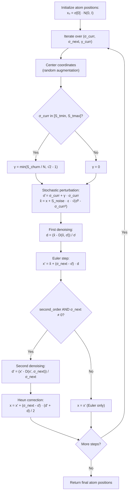

The diffusion noise schedule governs how Chai-1 traverses from pure noise to structured atomic coordinates during inference. It defines the sequence of noise levels (σ values) that the denoising network progressively resolves, and it controls the stochastic perturbation strategy that determines sample diversity and quality. This page dissects the mathematical formulation, the power-interpolation mechanism, and the concrete integration into Chai-1's stochastic sampler.

## Core Abstraction: InferenceNoiseSchedule

The noise schedule is encapsulated in a single frozen dataclass — `InferenceNoiseSchedule` — with four parameters that jointly define a continuous σ(t) curve mapping normalized time t ∈ [0, 1] to noise levels:

| Parameter | Default | Role |
|-----------|---------|------|
| `s_max` | 160.0 (schedule) / 80.0 (DiffusionConfig) | σ at t = 0, the maximum noise level (pure noise) |
| `s_min` | 4e-4 | σ at t = 1, the minimum noise level (near-clean) |
| `p` | 7.0 | Power exponent controlling the interpolation curvature |
| `sigma_data` | 16.0 | Data scale factor; final σ = sigma_data × interpolated_value |

The schedule is constructed via two methods: `get_schedule` produces a discrete σ trajectory for a given number of timesteps, while `get_noise_for_times` computes σ for arbitrary normalized time values. Both ultimately delegate to the `_power_interpolation` function.

Sources: [diffusion_schedules.py](/chai_lab/model/diffusion_schedules.py#L12-L34)

## Power Interpolation: The Mathematical Kernel

The heart of the schedule is `_power_interpolation`, which defines a smooth, parametric curve between `val_0` (at t = 0) and `val_1` (at t = 1):

```
f(t) = (t · val_1^(1/p) + (1-t) · val_0^(1/p))^p
```

This is a **generalized power mean** of order 1/p. When p > 1, the curve spends more time near `val_0` (high noise) before transitioning toward `val_1` (low noise). With p = 7, the interpolation is heavily skewed — the schedule lingers in high-noise regions where coarse structural features are resolved, then rapidly traverses low-noise regions where fine atomic details emerge. The final σ values are obtained by scaling this interpolation by `sigma_data`:

```
σ(t) = sigma_data · f(t)
```

This two-stage design (interpolate then scale) decouples the shape of the schedule from the absolute noise magnitude, allowing `sigma_data` to be tuned independently to match the data distribution's variance.

Sources: [diffusion_schedules.py](/chai_lab/model/diffusion_schedules.py#L37-L49)

## Timestep Discretization: Midpoint Lattice

The `get_schedule` method generates discrete timesteps using a **midpoint lattice** strategy rather than uniform endpoint spacing:

```python
times = torch.linspace(0, 1, 2 * num_timesteps + 1, device=device)[1::2]
```

This creates `2N + 1` equally-spaced points on [0, 1], then selects every other point starting from index 1 — yielding N points at positions 1/(2N+1), 3/(2N+1), 5/(2N+1), …, (2N-1)/(2N+1). These are the midpoints of N equal subintervals, which provides a more balanced sampling of the σ curve compared to endpoint-inclusive linspace. The default `num_timesteps = 200` produces 200 σ values, with the first being the noisiest and the last being nearly clean.

Sources: [diffusion_schedules.py](/chai_lab/model/diffusion_schedules.py#L21-L26)

## DiffusionConfig: Sampler Hyperparameters

While `InferenceNoiseSchedule` defines the σ trajectory, the `DiffusionConfig` class in `chai1.py` controls the **stochastic sampling** behavior applied during the denoising loop:

| Parameter | Default | Role |
|-----------|---------|------|
| `S_churn` | 80.0 | Total stochasticity budget; controls how much random perturbation is injected across all steps |
| `S_tmin` | 4e-4 | Lower σ threshold for stochastic perturbation — below this, no noise is added |
| `S_tmax` | 80.0 | Upper σ threshold for stochastic perturbation — above this, no noise is added |
| `S_noise` | 1.003 | Scale factor on the noise injected at each stochastic step |
| `sigma_data` | 16.0 | Data scale, passed to `InferenceNoiseSchedule` |
| `second_order` | True | Whether to use the second-order (Heun's) correction for improved accuracy |

> [!TIP]
> The `S_tmax` parameter serves dual purpose: it defines both the upper bound for stochastic churn in the sampler AND the `s_max` value passed to `InferenceNoiseSchedule`. This coupling means the schedule's starting noise level and the sampler's stochastic window are intentionally aligned — the sampler only adds perturbation within the same σ range that the schedule traverses.

Sources: [chai1.py](/chai_lab/chai1.py#L242-L248)

## Integration: The Stochastic Sampler Loop

The noise schedule is consumed within `run_folding_on_context` to drive the full denoising process. The integration follows a variant of the **stochastic sampler from Karras et al.** (Algorithm 2), which combines deterministic Euler steps with optional stochastic perturbation:



The key mechanics are:

**Schedule instantiation.** The `InferenceNoiseSchedule` is constructed with `s_max = DiffusionConfig.S_tmax` (80.0), `s_min = 4e-4`, `p = 7.0`, and `sigma_data = 16.0`. The resulting σ trajectory determines the sequence of noise levels the model traverses.

**Gamma computation.** For each step, the stochasticity factor γ is computed as `min(S_churn / num_timesteps, √2 - 1)` when the current σ falls within the window `[S_tmin, S_tmax]`, and zero otherwise. The `√2 - 1` upper bound prevents the perturbation from overshooting into instability.

**Stochastic perturbation.** When γ > 0, the current positions are noised to a slightly higher level σ̂ = σ_curr(1 + γ), then the denoiser is applied from that perturbed state. This injection of controlled randomness is what generates diverse structural samples from the same trunk representation.

**Second-order correction.** When enabled, a second denoiser evaluation at σ_next provides a corrected gradient estimate (Heun's method), improving the accuracy of each step at the cost of one additional forward pass per timestep.

Sources: [chai1.py](/chai_lab/chai1.py#L775-L830)

## Schedule Shape and Its Implications

The interaction between the power interpolation (p = 7) and the midpoint discretization produces a schedule that is heavily concentrated in the high-σ regime. With `sigma_data = 16.0` and the default schedule range, the initial σ values are on the order of 16 × 80 = 1280, while the final values approach 16 × 4e-4 ≈ 0.0064. This six-order-of-magnitude span ensures that the denoiser first resolves large-scale structural topology (backbone arrangement, domain packing) before attending to atomic-level precision (bond lengths, side-chain rotamers).

| Regime | σ Range | Structural Features Resolved |
|--------|---------|------------------------------|
| High noise | σ > 100 | Global topology, chain arrangement |
| Medium noise | 10 < σ < 100 | Secondary structure, domain folding |
| Low noise | σ < 10 | Side-chain packing, bond geometry |
| Near-clean | σ < 1 | Atomic precision, hydrogen bonds |

> [!TIP]
> Reducing `num_diffn_timesteps` below the default 200 trades sample quality for speed, but because the power interpolation is concentrated in the high-noise regime, the schedule remains well-behaved even at lower step counts. The γ values scale inversely with `num_timesteps`, so fewer steps automatically receive larger perturbations per step, partially compensating for the coarser traversal.

Sources: [diffusion_schedules.py](/chai_lab/model/diffusion_schedules.py#L21-L34), [chai1.py](/chai_lab/chai1.py#L775-L790)

## Relationship to the Broader Pipeline

The noise schedule sits at the boundary between the trunk representation and the final atomic output. It operates on the **structure branch** of the model — consuming `token_single_structure_input`, `token_pair_structure_input_feats`, and their trunk-refined counterparts — and produces the atom coordinates that feed into the confidence head. The schedule's design is therefore independent of the MSA, template, and feature embedding stages, but its output quality directly determines the confidence predictions and ranking scores downstream.

For the full denoising pipeline context, see [Diffusion Denoising Process](11-diffusion-denoising-process). For how the resulting structures are evaluated, see [Confidence Prediction and Scoring](12-confidence-prediction-and-scoring) and [pTM, pLDDT, and Clash Metrics](23-ptm-plddt-and-clash-metrics).
