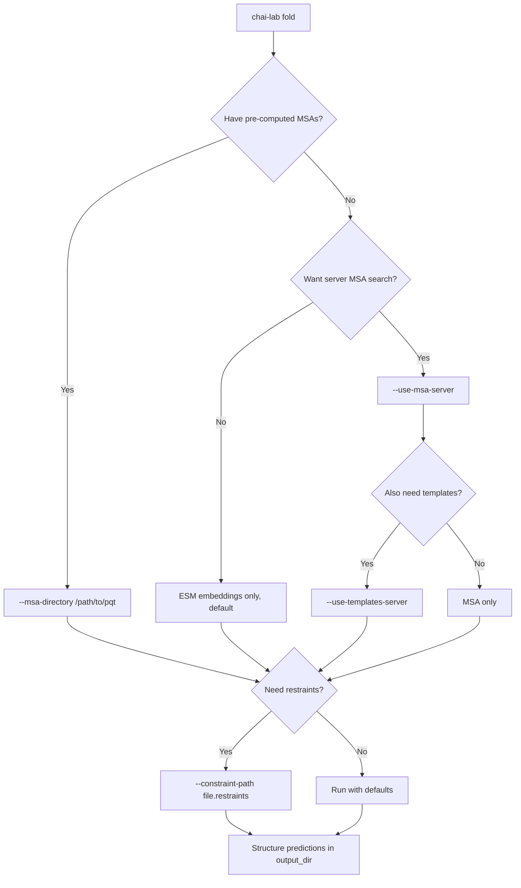

The `chai-lab` command-line interface provides direct access to Chai-1's structure prediction capabilities without writing Python code. After installing the package (`pip install chai_lab`), the `chai-lab` command becomes available in your shell, exposing three subcommands: **fold** for running structure prediction, **a3m-to-pqt** for converting MSA file formats, and **citation** for printing citation information. This page covers every subcommand, its parameters, defaults, and practical usage patterns.

Sources: [main.py](chai_lab/main.py#L1-L49), [pyproject.toml](pyproject.toml#L62-L63)

## Command Tree Overview

The CLI is built on [Typer](https://typer.tiangolo.com/) and registers three subcommands. The entry point `chai-lab` is declared in the package configuration and maps directly to `chai_lab.main:cli`. Each subcommand is a thin wrapper around a core Python function, which means every CLI parameter has an exact counterpart in the Python API — no feature is lost when switching between interfaces.

```
chai-lab
├── fold          → chai_lab.chai1.run_inference
├── a3m-to-pqt    → chai_lab.data.parsing.msas.aligned_pqt.merge_a3m_in_directory
└── citation      → prints Chai-1 technical report citation
```

Sources: [main.py](chai_lab/main.py#L33-L48), [pyproject.toml](pyproject.toml#L62-L63)

## `chai-lab fold` — Structure Prediction

This is the primary subcommand. It takes a FASTA file describing your molecular complex and produces a set of predicted 3D structures in CIF format, along with confidence scores. Internally, it calls [`run_inference`](chai_lab/chai1.py#L493-L539), which orchestrates the full pipeline: feature context assembly → trunk recycling → diffusion denoising → confidence prediction → ranking and output.

### Basic Usage

```shell
chai-lab fold input.fasta output_folder
```

By default, the model generates **5 diffusion samples** from a **single trunk pass**, runs **3 trunk recycles**, and uses **200 diffusion timesteps**. It employs ESM embeddings automatically but does **not** search for MSAs or templates unless explicitly requested. The output directory must be **empty** — if it already contains files, the command will fail with an assertion error.

### With MSA and Template Search

For improved prediction quality, enable the ColabFold MMseqs2 server for MSA and template generation:

```shell
chai-lab fold --use-msa-server --use-templates-server input.fasta output_folder
```

If you host your own ColabFold-compatible server, specify its URL:

```shell
chai-lab fold --use-msa-server --msa-server-url "https://api.internalcolabserver.com" input.fasta output_folder
```

> [!TIP]
> The `--use-msa-server` and `--msa-directory` flags are **mutually exclusive** — you cannot specify both simultaneously. The same exclusivity applies to `--use-templates-server` and `--template-hits-path`.

### Full Parameter Reference

| Parameter | Type | Default | Description |
|---|---|---|---|
| `fasta_file` | Path (positional) | *required* | Path to input FASTA file |
| `output_dir` | Path (positional) | *required* | Path to empty output directory |
| `--use-esm-embeddings` | bool | `True` | Use ESM protein language model embeddings |
| `--use-msa-server` | bool | `False` | Generate MSAs via ColabFold MMseqs2 server |
| `--msa-server-url` | str | `https://api.colabfold.com` | URL for custom ColabFold server |
| `--msa-directory` | Path \| None | `None` | Directory of pre-computed `.aligned.pqt` MSA files |
| `--constraint-path` | Path \| None | `None` | Path to restraints file (contacts, pockets, covalent bonds) |
| `--use-templates-server` | bool | `False` | Search for structural templates via ColabFold server |
| `--template-hits-path` | Path \| None | `None` | Path to pre-computed template hits (`.m8` format) |
| `--num-trunk-recycles` | int | `3` | Number of trunk recycling iterations |
| `--num-diffn-timesteps` | int | `200` | Number of diffusion denoising steps |
| `--num-diffn-samples` | int | `5` | Number of structure samples per trunk pass |
| `--num-trunk-samples` | int | `1` | Number of independent trunk passes |
| `--recycle-msa-subsample` | int | `0` | MSA subsampling during recycling (0 = disabled) |
| `--seed` | int \| None | `None` | Random seed for reproducibility |
| `--device` | str \| None | `None` | Torch device string (default: `cuda:0`) |
| `--low-memory` | bool | `True` | Enable CPU offloading to reduce GPU memory usage |
| `--fasta-names-as-cif-chains` | bool | `False` | Use FASTA entity names as CIF chain identifiers |

Sources: [chai1.py](chai_lab/chai1.py#L493-L539), [chai1.py](chai_lab/chai1.py#L288-L398)

### Input Limits

The model enforces hard limits on input size. Token counts are padded to the nearest available model size from the set **{256, 384, 512, 768, 1024, 1536, 2048}**, and inputs exceeding 2048 tokens are rejected. Similarly, MSA depth and template count are bounded by internal constants (`MAX_MSA_DEPTH`, `MAX_NUM_TEMPLATES`). Each FASTA entity must have a **unique name** — duplicate entity names trigger an `UnsupportedInputError`.

Sources: [chai1.py](chai_lab/chai1.py#L232-L254), [utils.py](chai_lab/data/collate/utils.py#L11-L12)

### Output Files

After a successful run, the output directory contains the following files per diffusion sample:

| File | Format | Content |
|---|---|---|
| `pred.model_idx_{N}.cif` | CIF | Predicted 3D structure with pLDDT B-factors (0–100 scale) |
| `scores.model_idx_{N}.npz` | NumPy archive | pTM, ipTM, pLDDT, and clash scores |
| `msa_depth.pdf` | PDF | MSA token coverage plot (only if MSA data was used) |

The `StructureCandidates` object returned by the Python API also exposes `pae`, `pde`, and `plddt` tensors for all candidates, plus a `.sorted()` method that reorders results by descending aggregate confidence score. The highest-scoring candidate is considered the best prediction.

Sources: [chai1.py](chai_lab/chai1.py#L259-L282), [chai1.py](chai_lab/chai1.py#L940-L1060)

### FASTA Input Format

The FASTA input uses extended headers to declare entity type and name. Each entity occupies one FASTA record with a header pattern of `>{type}|name={identifier}`, followed by the sequence on the next line. Supported entity types are `protein`, `ligand`, `RNA`, and `DNA`. Ligands are specified as **SMILES strings**, and modified residues are encoded inline (e.g., `AAA(SEP)AAA`). Here is a concrete example:

```fasta
>protein|name=receptor
AGSHSMRYFSTSVSRPGRGEPRFIAVGYVDDTQFVRFDSDAASPRGEPRAPWVEQEGPEYWDRETQKYKR
>protein|name=partner
AIQRTPKIQVYSRHPAENGKSNFLNCYVSGFHPSDIEVDLLKNGERIEKVEHSDLSFSKDWSFYLLYYTE
>ligand|name=drug
CCCCCCCCCCCCCC(=O)O
```

Sources: [predict_structure.py](examples/predict_structure.py#L18-L30)

## `chai-lab a3m-to-pqt` — MSA Format Conversion

This utility converts raw `.a3m` MSA files (as produced by tools like MMseqs2 or Jackhmmer) into the `.aligned.pqt` parquet format that Chai-1 consumes. The conversion is performed **per query sequence** — all `.a3m` files in the input directory are assumed to derive from the same query, and they are merged into a single parquet file.

### Usage

```shell
chai-lab a3m-to-pqt /path/to/a3m_directory
```

The command scans the specified directory for files matching `*.a3m`, auto-detects the source database from each filename (e.g., `hits_uniref90.a3m` → UniRef90), and writes the merged result as `{seqhash}.aligned.pqt` into the same directory (or into a custom `--output-directory` if specified). The `seqhash` is a SHA-256 hash of the uppercase query sequence, ensuring deterministic filenames.

### File Naming Convention

| Filename Pattern | Detected Source | Fallback |
|---|---|---|
| `hits_uniref90.a3m` / `uniref90_hits.a3m` | `uniref90` | — |
| `hits_uniprot.a3m` / `uniprot_hits.a3m` | `uniprot` | — |
| Any unrecognized pattern | — | Defaults to `uniref90` |

> [!TIP]
> The output `.aligned.pqt` file must follow the `AlignedParquetModel` schema: columns `sequence` (str), `source_database` (str from recognized sources), `pairing_key` (str), and `comment` (str). The first row must always have `source_database == "query"`.

Sources: [aligned_pqt.py](chai_lab/data/parsing/msas/aligned_pqt.py#L200-L241), [aligned_pqt.py](chai_lab/data/parsing/msas/aligned_pqt.py#L33-L41)

## `chai-lab citation` — Citation Information

Prints the BibTeX entry for the Chai-1 technical report to standard output. Use this to quickly grab the citation when writing papers or documentation.

```shell
chai-lab citation
```

Output:

```
@article{Chai-1-Technical-Report,
    title        = {Chai-1: Decoding the molecular interactions of life},
    author       = {{Chai Discovery}},
    year         = 2024,
    journal      = {bioRxiv},
    publisher    = {Cold Spring Harbor Laboratory},
    doi          = {10.1101/2024.10.10.615955},
    ...
}
```

Sources: [main.py](chai_lab/main.py#L17-L31), [main.py](chai_lab/main.py#L34-L36)

## Common Workflows

The following flowchart illustrates how to choose the right CLI flags for common prediction scenarios:



### Quick Reference: Minimal vs. Full-Featured Commands

| Scenario | Command |
|---|---|
| **Fastest** (ESM only, no MSA) | `chai-lab fold input.fasta output/` |
| **Recommended** (with MSA + templates) | `chai-lab fold --use-msa-server --use-templates-server input.fasta output/` |
| **With restraints** | `chai-lab fold --constraint-path pocket.restraints input.fasta output/` |
| **With local MSAs** | `chai-lab fold --msa-directory ./msas/ input.fasta output/` |
| **Reproducible run** | `chai-lab fold --seed 42 input.fasta output/` |
| **Custom GPU device** | `chai-lab fold --device cuda:1 input.fasta output/` |
| **High-quality (more samples)** | `chai-lab fold --num-diffn-samples 10 --num-diffn-timesteps 400 input.fasta output/` |

Sources: [chai1.py](chai_lab/chai1.py#L493-L539), [predict_structure.py](examples/predict_structure.py#L35-L45), [predict_with_msas.py](examples/msas/predict_with_msas.py#L28-L38), [predict_with_restraints.py](examples/restraints/predict_with_restraints.py#L21-L33), [predict_with_templates.py](examples/templates/predict_with_templates.py#L25-L31)

## Python API Equivalence

Every CLI `fold` invocation maps directly to the `chai_lab.chai1.run_inference` function. If you need finer control — such as constructing an `AllAtomFeatureContext` manually or accessing intermediate tensors — switch to the Python API. The following table shows the exact mapping between CLI flags and function parameters:

| CLI Flag | Python Parameter |
|---|---|
| `fasta_file` (positional) | `fasta_file: Path` |
| `output_dir` (positional) | `output_dir: Path` |
| `--use-msa-server` | `use_msa_server: bool` |
| `--msa-directory` | `msa_directory: Path \| None` |
| `--constraint-path` | `constraint_path: Path \| None` |
| `--num-trunk-recycles` | `num_trunk_recycles: int` |
| `--num-diffn-timesteps` | `num_diffn_timesteps: int` |
| `--num-diffn-samples` | `num_diffn_samples: int` |
| `--seed` | `seed: int \| None` |

For advanced use cases beyond the CLI, see [Architecture Overview](7-architecture-overview) for the full pipeline breakdown, or [FASTA Parsing and Entity Types](13-fasta-parsing-and-entity-types) for input format details. To understand how restraints guide folding, refer to [Restraint and Covalent Bond System](17-restraint-and-covalent-bond-system).

Sources: [chai1.py](chai_lab/chai1.py#L493-L539), [chai1.py](chai_lab/chai1.py#L288-L398)

## Environment Variables

| Variable | Purpose |
|---|---|
| `CHAI_DOWNLOADS_DIR` | Override default model weights download location (useful in Docker or mounted-drive setups) |

By default, weights are stored in `<package_root>/downloads`. Set `CHAI_DOWNLOADS_DIR` to redirect downloads to a custom path, e.g., `CHAI_DOWNLOADS_DIR=/tmp/downloads chai-lab fold input.fasta output/`.

Sources: [README.md](README.md#L74-L80)

## What's Next

Now that you can invoke Chai-1 from the command line, explore these topics to deepen your understanding:

- **[Architecture Overview](7-architecture-overview)** — understand what happens inside the pipeline after you press Enter
- **[FASTA Parsing and Entity Types](13-fasta-parsing-and-entity-types)** — master the input format to encode proteins, ligands, RNA, DNA, and glycans
- **[MSA Generation and Loading](14-msa-generation-and-loading)** — learn how MSA contexts are built and why they improve accuracy
- **[Restraint and Covalent Bond System](17-restraint-and-covalent-bond-system)** — guide predictions with experimental contacts and covalent bonds