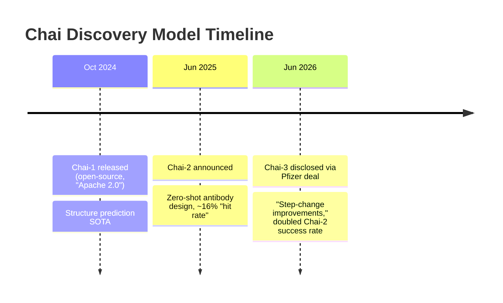

Chai Discovery has moved fast -- from an open-source structure prediction tool to a unicorn-valued platform with two Big Pharma partnerships in under two years. But while the company's commercial trajectory has accelerated, the open-source `chai-lab` repository tells a quieter, more incremental story of dependency bumps, bugfixes, and usability refinements. Here is what has changed, what hasn't, and what it all means if you are a developer betting on this stack.

---

## From Chai-1 to Chai-3: A Rapid Model Succession

The most consequential development is that Chai-1 is no longer the company's flagship model. In the span of roughly twelve months, Chai Discovery shipped three model generations:

| Model | Released | Core Capability | Open-Source? | Key Benchmark |
|-------|----------|----------------|--------------|---------------|
| Chai-1 | Oct 2024 | Multi-modal structure prediction | Yes (Apache 2.0) | 77% PoseBusters ligand RMSD success; 75.1% protein-protein DockQ success |
| Chai-2 | Jun 2025 | De novo antibody design | No (partner access) | 16% hit rate across 52 targets; 50% of targets yield at least one binder |
| Chai-3 | Jun 2026 | Antibody design (improved) | No (Pfizer-licensed) | Claims 2x Chai-2 success rate (per [Pfizer license announcement](https://www.businesswire.com/news/home/20260602498831/en/Chai-Discovery-Announces-License-Agreement-with-Pfizer-to-Accelerate-Drug-Discovery-with-AI)) |

The critical detail for developers: **Chai-1 remains the only model with publicly available weights and code.** Chai-2 and Chai-3 are commercial-only. The [Chai-2 technical report](https://www.biorxiv.org/content/10.1101/2025.07.05.663018v1) was posted on bioRxiv in July 2025, and a bibtex entry was [added to the chai-lab README](https://github.com/chaidiscovery/chai-lab/commit/2f7b713d6addd8cd7688ddfd5cb49e138f3e5b78) in August 2025, but no inference code or weights have been released. This bifurcation is structurally significant -- the open-source repo is a structure prediction tool, while the company's commercial value proposition is generative antibody design.

---

## Repository Activity: Steady Maintenance, Not Feature Sprints

The commit log on `chai-lab` since mid-2025 shows a pattern of **maintenance-first engineering**: dependency compatibility, parsing flexibility, and infrastructure hardening. There have been no major architectural changes or new model integrations.

### Dependency and Compatibility Updates

The most common commit type is dependency management -- keeping the package installable on evolving Python/PyTorch ecosystems:

| Commit | Date | What Changed |
|--------|------|-------------|
| [Update rdkit (#416)](https://github.com/chaidiscovery/chai-lab/commit/c544fb183e865c4950909444db860a9d50604f66) | Apr 2026 | RDKit version bump |
| [Support newer versions of gemmi (#415)](https://github.com/chaidiscovery/chai-lab/commit/61036259c98222160963cb780750e354876ce485) | Mar 2026 | Gemmi compatibility fix |
| [update pandera (#399)](https://github.com/chaidiscovery/chai-lab/commit/a01bfdeead343e1c7f369660ec519f12c940e9df) | Sep 2025 | Pandera upgrade (resolving FutureWarning) |
| [Allow torch 2.7 (#383)](https://github.com/chaidiscovery/chai-lab/commit/29195b89b1f63fb8a4a78406fc7a58468318ff4a) | Jun 2025 | PyTorch 2.7.1 compatibility |
| [specify kalign version (#375)](https://github.com/chaidiscovery/chai-lab/commit/6d1e44d8f2bdd37d96e0ed8d67ca4938d9bff54b) | May 2025 | Pin kalign to avoid version drift |
| [use more generic error (#387)](https://github.com/chaidiscovery/chai-lab/commit/0a5a85594a44096aeeba7b6f53f99b53f240de15) | Jul 2025 | Fixed urllib3 NameResolutionError import on older versions |

These are the unglamorous but essential commits that keep `pip install chai_lab==0.6.1` from breaking. The [NameResolutionError fix](https://github.com/chaidiscovery/chai-lab/issues/386) is a good example: Chai was importing `NameResolutionError` from `urllib3.exceptions`, but that class only existed in newer urllib3 versions, causing import failures on AWS instances with older system Python packages.

### Feature and Usability Improvements

A second category of commits improves the input/output ergonomics without changing the model itself:

- **Flexible modification parsing** ([#384](https://github.com/chaidiscovery/chai-lab/commit/dc41706bfc19b8530809c8b88cf7d90a58640b2e)): Support `[]` in addition to `()` for specifying modified residues in FASTA, and relax entity name validation. This directly addresses users who were struggling with custom residue notation.

- **Entity names as chain names** ([#378](https://github.com/chaidiscovery/chai-lab/commit/2a2d4a96e842a73499bacced0db662455b42e886)): Allow FASTA-specified entity names to carry through as chain names in CIF output. Previously, output chains would get generic identifiers, making it harder to map predictions back to inputs.

- **Restraint improvements**: Multiple commits ([#379](https://github.com/chaidiscovery/chai-lab/commit/ac9c1f3edc5c85d0fcb95f465ca1f27bb0481a5f), [#377](https://github.com/chaidiscovery/chai-lab/commit/79dc5b9253c8baae1107ac095bd9693840a72c65)) added support for entity name-based subchains in restraints and improved parsing for edge cases like empty comment fields.

- **Global template cache** ([#371](https://github.com/chaidiscovery/chai-lab/commit/eb63e84536bcbb46c0b675abb6a312ec9d682443)): Introduced `CHAI_TEMPLATE_CIF_FOLDER` envvar for controlling where template CIF files are cached. This is a meaningful operational improvement for Docker deployments and shared compute environments where the default `/downloads` path inside site-packages is not persistent.

### Performance and Infrastructure

Two commits stand out for their impact on operational reliability:

- **Parallel conformer generation with timeout** ([#410](https://github.com/chaidiscovery/chai-lab/commit/af596cbc075a1fce368cec0ab5f31be1090ca7e2)): The previous conformer generation code could hang indefinitely. This fix added parallel processing and a reasonable timeout -- a classic "the process just sits there doing nothing" problem that is devastating in batch workflows.

- **CPU cache for model components** ([#360](https://github.com/chaidiscovery/chai-lab/commit/4d110dd40ee4ae60303c83a21de5ecb2d4a57dd1)): Keeping model components in CPU cache to reduce GPU memory pressure during inference. This is particularly relevant for users running on GPUs with less VRAM (A10, A30, or the consumer-grade RTX 4090 that the README mentions).

---

## PyPI Release History: 0.6.1 and Counting

The current stable PyPI release is **`chai_lab==0.6.1`**, published March 18, 2025. The full release history shows a rapid initial cadence that has since slowed:

| Version | Release Date | Notes |
|---------|-------------|-------|
| 0.0.1 | Sep 9, 2024 | Initial release |
| 0.1.0 | Sep 25, 2024 | First public release alongside Chai-1 |
| 0.2.0 | Oct 21, 2024 | CLI improvements |
| 0.3.0 | Nov 19, 2024 | |
| 0.4.2 | Nov 27, 2024 | Hugging Face model card references this version |
| 0.5.0 | Dec 5, 2024 | |
| 0.5.2 | Dec 24, 2024 | |
| 0.6.0 | Feb 18, 2025 | |
| **0.6.1** | **Mar 18, 2025** | **Current stable release** |

Notably, there has been **no new PyPI release in over a year** despite ongoing commits to `main`. The README still recommends pinning to `0.6.1` and notes that `pip install git+https://github.com/chaidiscovery/chai-lab.git` "updates daily to test features that weren't released yet." This gap between commit activity and release cadence suggests that the team is prioritizing stability over feature velocity for the published package, while using the `main` branch as a rolling release for internal and early-adopter testing.

---

## Company Milestones Reshaping the Landscape

The repository exists within a company that has undergone a dramatic transformation. These events do not change the code directly, but they reshape the strategic context for anyone building on Chai-1:

| Date | Event | Significance |
|------|-------|-------------|
| Sep 2024 | $30M seed round (Thrive Capital, OpenAI, Dimension) | Initial funding |
| Oct 2024 | Chai-1 open-source release + [bioRxiv preprint](https://www.biorxiv.org/content/10.1101/2024.10.10.615955v2) | Established credibility |
| Jun 2025 | Chai-2 announcement: 16% antibody design hit rate | Shift from prediction to generation |
| Aug 2025 | $70M Series A (Menlo Ventures, Anthology Fund/Anthropic) | Validation from pharma-focused VCs |
| Dec 2025 | $130M Series B at $1.3B valuation (Oak HC/FT, General Catalyst) | Unicorn status; total funding > $225M |
| Jan 2026 | [Eli Lilly partnership](https://www.linkedin.com/posts/yosemiteco_yosemite-is-excited-to-see-eli-lilly-and-activity-7415491352773521408-blcA) (custom model on proprietary data) | First major pharma deployment |
| Jun 2026 | [Pfizer license agreement](https://www.businesswire.com/news/home/20260602498831/en/Chai-Discovery-Announces-License-Agreement-with-Pfizer-to-Accelerate-Drug-Discovery-with-AI) (Chai-3 access + custom model) | Chai-3 revealed; validated at scale |

Joshua Meier, Chai's co-founder and CEO, summarized the transition succinctly on LinkedIn: "2025 was the year we proved AI could transform preclinical drug discovery. 2026 will be the year of deployment." The Pfizer deal, in particular, confirmed the existence of **Chai-3** -- a model that "doubles the success rate of its predecessor" and focuses on therapeutic binding, multi-specifics, and hard-to-drug targets. Chai-3 has not been described in any publication and is not available outside the Pfizer agreement.

Forbes also [reported in June 2026](https://www.facebook.com/forbes/posts/1372275921429061) that Chai Discovery is in talks to raise an additional $400M at a $3.4B valuation -- a nearly 3x step-up from the Series B just six months prior.

---

## What the Divergence Means for Developers

Here is the structural tension: the `chai-lab` repository is a **structure prediction** tool (Chai-1), while Chai Discovery's commercial future is **generative molecular design** (Chai-2, Chai-3). These are fundamentally different products. Structure prediction takes a sequence and returns a 3D structure. Generative design takes a target and returns a novel sequence.

**What you get from the open-source repo today** is still remarkably capable. On the PoseBusters protein-ligand benchmark, Chai-1 achieves 77% ligand RMSD success, comparable to [AlphaFold3](https://github.com/google-deepmind/alphafold3)'s reported 76%. Its single-sequence mode (no MSAs needed) outperforms AlphaFold-Multimer 2.3 with MSAs on protein-protein interfaces. The restraint system -- pocket restraints, contact restraints, and covalent bond specification -- remains a distinctive feature not available in competing open-source tools.

**What you do not get** is antibody design, miniprotein binder generation, or any of the generative capabilities that have driven the company's recent funding and partnerships. The [About Chai-2 issue](https://github.com/chaidiscovery/chai-lab/issues/412) in the repository -- simply titled "About Chai-2" with the body "I really look forward to use Chai-2. Please please please release it as soon as possible!" -- captures the community sentiment, but there is no indication that generative model weights will be open-sourced.

The practical implication: if you are building a workflow that needs structure prediction of known sequences (protein-protein docking, ligand pose generation, nucleic acid complex modeling), `chai-lab` remains a strong, actively maintained choice. If you need de novo antibody design, you will need to negotiate commercial access.

---

## Notable Technical Changes Worth Tracking

A few recent commits signal directionality worth watching:

1. **Removal of sequence corruption logic** ([#368](https://github.com/chaidiscovery/chai-lab/commit/f824e747b46e73ea78c1153077a5907f6a0c3cca)): D-amino acids are now mapped to `X` rather than to their L-partners, and the residue corruption logic was removed entirely. This is a correctness improvement -- the old behavior silently corrupted D-amino acid information, potentially producing misleading predictions for sequences containing non-standard stereochemistry.

2. **Full Typer CLI** ([#350](https://github.com/chaidiscovery/chai-lab/commit/6d3439a0f41a0f33bb8cc1c3bbacfa36a99b7df9)): Migration to the full `typer` library for CLI argument parsing, replacing ad-hoc argument handling. This makes the CLI more discoverable and consistent.

3. **Bugfix for non-paired MSAs** ([#349](https://github.com/chaidiscovery/chai-lab/commit/bd49ff24d68fe97af7b7a2999b7c7c15fb6fb331)): A subtle but important fix -- incorrect handling of non-paired multiple sequence alignments could silently produce wrong features, degrading prediction quality without raising an error.

---

## Looking Forward

The `chai-lab` repository is in a stable-but-stationary state. The last PyPI release was March 2025. Commits continue to land on `main`, but they are overwhelmingly maintenance-oriented. The company's engineering attention has clearly shifted to Chai-2 and Chai-3, which are not part of this repository.

For developers evaluating whether to build on this stack, the key questions are:

- **Will Chai-1 weights continue to be maintained?** The Apache 2.0 license is irrevocable, but model compatibility with future PyTorch versions is not guaranteed without ongoing maintenance. The torch 2.7 compatibility commit suggests the team is keeping the pipeline alive, but this could change as commercial priorities shift.

- **Will any generative capabilities trickle into the open-source repo?** The restraint system already allows guiding predictions with experimental data. It is conceivable that a simplified version of pocket-restraint-guided design could appear, but nothing has been announced.

- **What about PAE output?** The [open issue requesting PAE matrix extraction](https://github.com/chaidiscovery/chai-lab/issues/411) from CIF files has gone unanswered since December 2025. Chai-1 generates PAE internally but does not write `_ma_qa_metric_local_pairwise` entries to ModelCIF by default. This is a significant gap for users who need confidence metrics for downstream ranking.

The bottom line: `chai-lab` is a well-engineered structure prediction toolkit in a holding pattern while its parent company races toward commercial generative AI. The code works, the license is permissive, and the model is competitive. But if you need capabilities beyond "fold this sequence and give me a structure," you are looking at a commercial conversation, not a pip install.