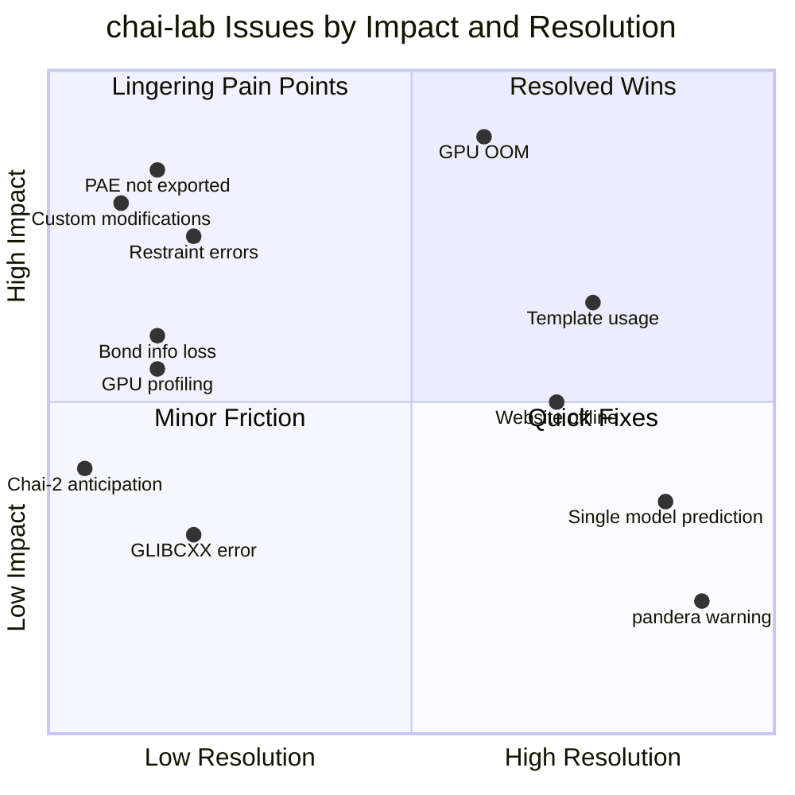
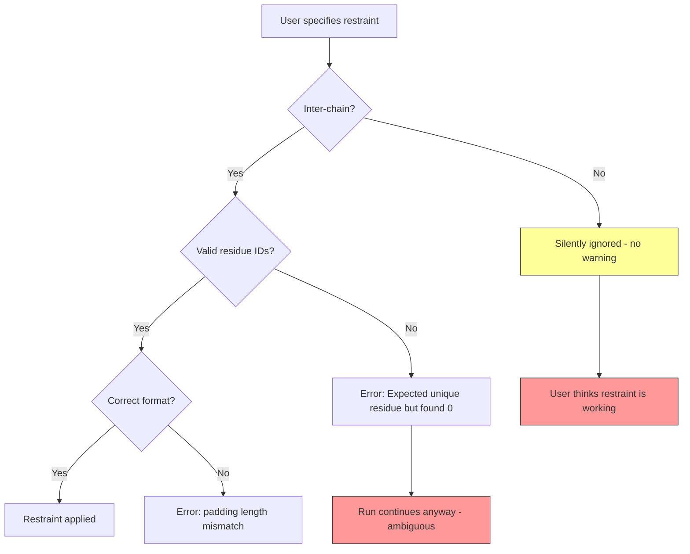

The chai-lab repository has accumulated 84 open and 144 closed issues as of mid-2026. That's a substantial signal for a project that launched publicly in September 2024. What's revealing is not just the volume, but the *shape* of the complaints: they cluster around a handful of structural gaps that any serious adopter will hit sooner or later. Below, I break down the recurring themes, map how the team has responded, and flag where things still feel unresolved.

## The Issue Landscape at a Glance

## 1. GPU Hardware: The Elephant in the Room

Chai-1's hardware requirements are not subtle. The README recommends **A100 80GB, H100 80GB, or L40S 48GB**, and notes that A10/A30 "will work for smaller complexes." Consumer-grade RTX 4090 (24GB) is mentioned as having been "reported to work." That language is doing a lot of heavy lifting.

The most notorious open issue is [CUDA out of memory (#17)](https://github.com/chaidiscovery/chai-lab/issues/17), where users on 2080 Ti (11GB), A100 40GB partitions, and even some A100 80GB setups all hit OOM errors. One commenter discovered that the issue was related to protein sequence length:

> "If I use the full sequence ~1500 it crash. Then I only put ~900 (remove 600), it worked." -- [@lonelu](https://github.com/chaidiscovery/chai-lab/issues/17)

The issue was eventually closed by contributor Alex Rogozhnikov in January 2025, likely related to the [keep model components in CPU cache (#360)](https://github.com/chaidiscovery/chai-lab/commit/4d110dd40ee4ae60303c83a21de5ecb2d4a57dd1) commit, which offloads model components to CPU when not actively needed. This is a pragmatic fix, but the fundamental tension remains: **this is a large model that demands serious GPU memory, and there is no multi-GPU parallelism.**

The hardware story gets more complicated on non-NVIDIA terrain. [GLIBCXX_3.4.31 (#422)](https://github.com/chaidiscovery/chai-lab/issues/422) reports an `ImportError` on systems with outdated `libstdc++`, a classic dependency hell problem that bites users on older CentOS or HPC cluster environments. And [Inquiry about chai-1 support for NVIDIA Blackwell GPUs (#381)](https://github.com/chaidiscovery/chai-lab/issues/381) shows users trying to run on the newest RTX PRO 6000 Blackwell cards -- the answer is yes, but you may need bleeding-edge PyTorch and CUDA builds.

Meanwhile, [Error applying restraints (#413)](https://github.com/chaidiscovery/chai-lab/issues/413) specifically surfaces on **AMD GPUs via PyTorch ROCm**, where a padding-length mismatch error occurs in the restraint feature generator. This is a reminder that the chai-lab codebase is tested against NVIDIA CUDA first, and ROCm compatibility is essentially community-verified.

**Bottom line**: If you're not on an A100/H100 with current CUDA, expect friction. The team has made memory optimizations (CPU caching, conformer timeout in [PR #410](https://github.com/chaidiscovery/chai-lab/commit/af596cbc075a1fce368cec0ab5f31be1090ca7e2)), but there's no magic bullet for running large complexes on budget hardware.

## 2. The Restraint System: Powerful but Perilous

Chai-1's restraint feature is arguably its most differentiated capability compared to [AlphaFold 3](https://deepmind.google/technologies/alphafold-3/) and [Boltz](https://github.com/jwohlwend/boltz). You can specify pocket restraints, contact restraints, and covalent bonds to guide folding with experimental priors. But the implementation has sharp edges.

The most fundamental confusion was documented in [Using constraints seems to have little to no effect (#204)](https://github.com/chaidiscovery/chai-lab/issues/204), where a user specified **intra-chain** contact restraints and saw zero effect. Contributor Kevin Wu explained:

> "The restraints in Chai-1 are trained as **inter**-chain contacts; based on the line you've provided, it looks like you're trying to specify an **intra**-chain contact. Intra-chain contacts are more akin to structure templates, which you may be able to hack into the `TemplateContext`."

This is a critical documentation gap. The restraint system *silently ignores* intra-chain restraints rather than raising an error. Users waste compute cycles thinking the model is using their data when it isn't.

Then there are the outright bugs. [Error on run with restraints: Expected unique residue but found 0 (#376)](https://github.com/chaidiscovery/chai-lab/issues/376) reports an error with pocket restraints where the model can't resolve a residue identifier -- yet the run continues and produces output anyway, leaving users unsure whether their restraints were actually applied. And [Error applying restraints (#413)](https://github.com/chaidiscovery/chai-lab/issues/413) shows a padding-length mismatch when using restraints on ROCm, suggesting the feature generator has platform-specific behavior.

On the documentation side, [Source for Pocket Restraint Docs (#418)](https://github.com/chaidiscovery/chai-lab/issues/418) reveals that even the restraint documentation figure in the repository assets appears to have no attributable source, with a user noting they "am unable to find a source, besides some X posts that also showcase the same figure."

**Bottom line**: The restraint system is one of Chai-1's killer features, but it needs better guardrails. At minimum, intra-chain restraints should produce a warning. At best, they should be supported or the documentation should clearly state the limitation upfront.

## 3. Output Fidelity: What You See Isn't Always What You Get

Two persistent issues reveal that Chai-1's output format drops important information that downstream tools expect.

### PAE: Present in Computation, Absent in Output

[Extract PAE matrix from .cif file (#411)](https://github.com/chaidiscovery/chai-lab/issues/411) documents that Chai-1's ModelCIF output contains `_ma_qa_metric_local` entries (per-residue confidence) but **not** the `_ma_qa_metric_local_pairwise` entries that encode the Predicted Aligned Error (PAE) matrix. This is confirmed by [Missing PAE File in Python Prediction Mode (#348)](https://github.com/chaidiscovery/chai-lab/issues/348), which has accumulated 4 comments from users hitting the same wall.

The PAE matrix is essential for understanding inter-domain or inter-chain prediction confidence. Its absence means you can't distinguish between "both chains are well-predicted and correctly oriented" and "both chains are well-predicted but may be mis-positioned relative to each other" -- precisely the distinction that matters most for docking and complex prediction.

This is not a model limitation; the PAE is computed internally. It's an export gap. As [ChimeraX's ModelCIF PAE recipe](https://rbvi.github.io/chimerax-recipes/modelcif_pae/modelcif_pae.html) demonstrates, other tools in the ecosystem *do* write and read this field.

### Bond Information Loss in Small Molecules

[chai-1 prediction causes loss of atomic bond information (#417)](https://github.com/chaidiscovery/chai-lab/issues/417) reports that when predicting small molecule ligands, double bonds are reduced to single bonds in the output CIF. This is a known class of problem with diffusion-based structure predictors: the diffusion module predicts atom coordinates, not bond orders, so bond type information must be reconstructed from the input chemistry. When that reconstruction fails, you lose aromaticity and double-bond character -- information that's critical for downstream drug design workflows.

| Output Metric | Status | Impact |
|---|---|---|
| pLDDT (per-residue confidence) | Exported | Low |
| pTM / ipTM | Exported | Low |
| PAE (pairwise aligned error) | **Not exported** | **High** |
| Bond order (small molecules) | **Lost** | **High** |
| Chain naming | Configurable (since [PR #378](https://github.com/chaidiscovery/chai-lab/commit/2a2d4a96e842a73499bacced0db662455b42e886)) | Medium |

**Bottom line**: For a model marketed as SOTA for drug discovery, losing PAE and bond orders in the output is a significant gap. These aren't edge cases -- they're core to how practitioners evaluate and use predictions.

## 4. Custom Chemistry: The CCD Wall

[Prediction with custom nucleotide/amino acid modifications (#423)](https://github.com/chaidiscovery/chai-lab/issues/423) is the most recent open issue and arguably the most forward-looking. A user wants to predict structures containing phosphorothioated nucleotides and other modifications that **have no CCD (Chemical Component Dictionary) code**. They've generated custom CIF files in the minimal CCD format used by AlphaFold 3 and Boltz, and ask:

> "Similarly to AF3 and Boltz, is there a way to update the list of CCD codes to include my custom ones, so I can predict sequences like ATG(PSC-min)GGTA?"

This is a real architectural limitation. Chai-1's input parsing resolves modification codes against the CCD, and there's currently no mechanism to extend the dictionary with user-provided entries. The recent [More flexible modification parsing (#384)](https://github.com/chaidiscovery/chai-lab/commit/dc41706bfc19b8530809c8b88cf7d90a58640b2e) commit broadened the parsing syntax (supporting `[]` in addition to `()` for modification specification), but didn't add custom CCD support.

Related issues include [Custom residue modification and covalent constraints (#366)](https://github.com/chaidiscovery/chai-lab/issues/366) and [Will ligand input as ccdcode be optional? (#382)](https://github.com/chaidiscovery/chai-lab/issues/382), both pointing at the same wall: the CCD is a fixed dependency, and the growing world of therapeutic oligonucleotides with non-standard chemistry doesn't fit neatly inside it.

**Bottom line**: For a tool used in drug discovery, extensibility of the chemistry dictionary is not optional. This is an area where [Boltz](https://github.com/jwohlwend/boltz) currently has no advantage either, making it an opportunity for chai-lab to differentiate.

## 5. Infrastructure Fragility

Several issues reveal that getting chai-lab running is harder than it should be:

- **[Website is offline (#408)](https://github.com/chaidiscovery/chai-lab/issues/408)**: The `chaiassets.com` domain that serves conformer data files went offline on December 1, 2025, blocking inference entirely. This is a single-point-of-failure in the dependency chain: the model downloads conformer reference data at runtime from an external host, and when that host disappears, you're stuck. Five comments on this issue suggest it affected many users.

- **[HTTPError URL not found (#404)](https://github.com/chaidiscovery/chai-lab/issues/404)**: Another runtime download failure, this time with no details provided beyond a screenshot of the error.

- **[NameResolutionError (#386)](https://github.com/chaidiscovery/chai-lab/issues/386)**: A breaking import error caused by `urllib3.exceptions.NameResolutionError` not existing in older `urllib3` versions. Fixed quickly in [PR #387](https://github.com/chaidiscovery/chai-lab/commit/0a5a85594a44096aeeba7b6f53f99b53f240de15) by switching to a more generic exception class, but the pattern is clear: **dependency version constraints are loosely specified**, and churn in transitive dependencies breaks chai-lab in unpredictable ways.

- **[pandera warning (#398)](https://github.com/chaidiscovery/chai-lab/issues/398)**: A `FutureWarning` from pandera about deprecated import paths. Non-fatal, but it signals that the dependency pinning strategy needs attention. Fixed the same day in [PR #399](https://github.com/chaidiscovery/chai-lab/commit/a01bfdeead343e1c7f369660ec519f12c940e9df).

The [Global template cache folder + envvar (#371)](https://github.com/chaidiscovery/chai-lab/commit/eb63e84536bcbb46c0b675abb6a312ec9d682443) commit is a step in the right direction -- it adds a `CHAI_TEMPLATE_CIF_FOLDER` environment variable for controlling where template CIF files are cached, avoiding repeated downloads from RCSB. More of this kind of "make downloads optional and cacheable" thinking would help.

## 6. The Template System: Documented but Undocumented

[How to use structural templates? (#101)](https://github.com/chaidiscovery/chai-lab/issues/101) was opened in October 2024 and remained open for seven months before being closed. The original poster wanted to dock two proteins where one had a known structure, and couldn't find examples of how to provide template features. This is a common pattern: the README explains *that* you can provide templates, but the *how* is scattered across example scripts and source code.

The more recent [IntCastingNaNError (#402)](https://github.com/chaidiscovery/chai-lab/issues/402) shows a user crafting a custom `.m8` template hits file by hand to force Chai-1 to use a specific PDB structure as a template, only to hit a NaN error during parsing. The root cause was likely a formatting mismatch between the hand-crafted m8 file and what the parser expects, but the error message was unhelpful.

**Bottom line**: Template usage is a power-user feature with power-user documentation requirements that haven't been met. The addition of `CHAI_TEMPLATE_CIF_FOLDER` in [PR #371](https://github.com/chaidiscovery/chai-lab/commit/eb63e84536bcbb46c0b675abb6a312ec9d682443) helps, but what's really needed is a worked example with a custom (non-RCSB) template.

## 7. Throughput and Scalability: The Virtual Screening Question

Two closed issues point at a class of use case that chai-lab isn't optimized for:

- **[Virtual Screening (#380)](https://github.com/chaidiscovery/chai-lab/issues/380)**: A user asked whether protein features could be cached when folding multiple ligands against the same protein, to speed up virtual screening workflows. They even offered to submit a PR with guidance. No response from the team was documented in the issue.

- **[How to predict only one model instead of five? (#385)](https://github.com/chaidiscovery/chai-lab/issues/385)**: A straightforward request to reduce the default 5-sample prediction to 1 for batch processing speed. The `--num-diffn-samples` flag exists but isn't prominently documented.

- **[Feature Request: GPU Profiling (#414)](https://github.com/chaidiscovery/chai-lab/issues/414)**: A request for built-in GPU profiling to identify memory hot spots, referencing the [PyTorch Profiler](https://pytorch.org/blog/introducing-pytorch-profiler-the-new-and-improved-performance-tool/). Closed immediately without implementation.

These issues collectively point at a tension: **Chai-1 is designed for accuracy-first single-complex prediction, but many drug discovery workflows need throughput-first batch processing.** The architecture doesn't currently support feature caching, and there's no built-in tooling for profiling or optimizing memory usage.

## 8. The Chai-2 Elephant

[About Chai-2 (#412)](https://github.com/chaidiscovery/chai-lab/issues/412) is just one sentence -- "I really look forward to use Chai-2. Please please please release it as soon as possible!" -- but it represents a broader dynamic. Chai Discovery [announced a $130M Series B](https://www.chaidiscovery.com) and has published the [Chai-2 technical report](https://www.biorxiv.org/content/early/2025/07/06/2025.07.05.663018) on bioRxiv demonstrating zero-shot antibody design with ~20% experimental hit rates. Yet the Chai-2 code and model weights are **not open source** and are only available through a [trial application](https://github.com/chaidiscovery/chai-lab/issues/391).

This creates a fork in the community: chai-lab (the open-source repo) remains Chai-1 only, while Chai-2 lives behind a proprietary access wall. As [Boolean Biotech's comparison](https://blog.booleanbiotech.com/alphafold3-boltz-chai1) noted, Chai-1 is already "inference only" -- no training code -- and now the next generation is further restricted. This trajectory is worth watching.

## Response Pattern: How the Team Engages

Looking at commit history and issue closure patterns, the chai-lab team is responsive but selective:

| Category | Typical Response | Example |
|---|---|---|
| Dependency breakage | Fast (days) | [NameResolutionError](https://github.com/chaidiscovery/chai-lab/issues/386) fixed in hours |
| Parsing/formatting | Moderate (weeks) | [Modification parsing](https://github.com/chaidiscovery/chai-lab/commit/dc41706bfc19b8530809c8b88cf7d90a58640b2e) |
| Feature requests | Slow or silent | [GPU Profiling](https://github.com/chaidiscovery/chai-lab/issues/414) closed without action |
| Architecture gaps | No public response | [PAE export](https://github.com/chaidiscovery/chai-lab/issues/411) open since Dec 2025 |
| Documentation gaps | Minimal | [Template usage](https://github.com/chaidiscovery/chai-lab/issues/101) took 7 months |

The contributors -- primarily **Alex Rogozhnikov** (dependency fixes, memory optimization), **Kevin Wu** (restraint system, parsing, template handling), and **Jack Dent** (CLI, dependency updates) -- are clearly iterating on the codebase, but the GitHub issue tracker feels more like a support forum than a product roadmap. Many open issues receive no maintainer response at all.

## Summary: Where Chai-1 Stands with Its Users

The community feedback paints a picture of a model with genuine technical strengths -- SOTA benchmarks, commercial-friendly licensing, unique restraint capabilities -- but with operational rough edges that matter in practice:

1. **Hardware access remains the #1 gate.** No multi-GPU support, and memory optimization is incremental rather than transformative.
2. **The restraint system needs documentation and guardrails.** Silently ignoring intra-chain restraints is a design smell.
3. **Output completeness is a trust issue.** Missing PAE and bond orders undermine confidence for drug discovery workflows.
4. **Custom chemistry support is the next frontier.** The CCD wall will only get taller as oligonucleotide therapeutics grow.
5. **Infrastructure reliability needs hardening.** Runtime downloads from external hosts are fragile.

The good news is that many of these are fixable without architectural changes. The bad news is that with Chai-2 going proprietary, the open-source community's leverage for getting these fixes is diminishing. If you're building on chai-lab, pin your versions, cache your dependencies, and test your restraints carefully.