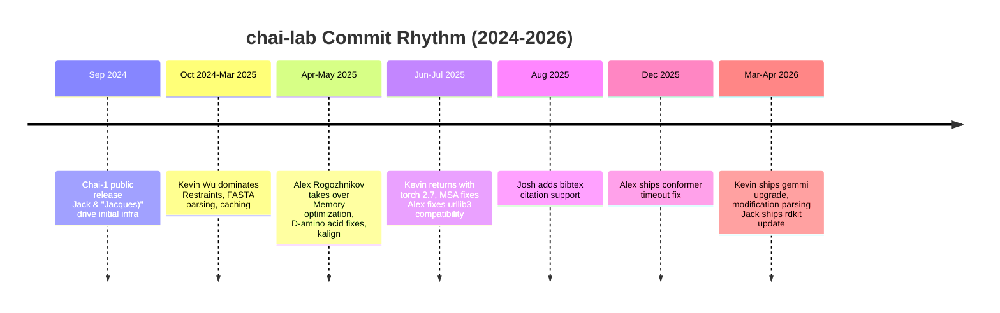

The people behind chai-lab are not your typical open-source maintainers tinkering on weekends. They are the core of **Chai Discovery**, a San Francisco-based applied AI lab that has raised over **$225 million** in total financing ([General Catalyst Series B announcement](https://www.generalcatalyst.com/stories/our-investment-in-chai-discovery)), landed partnerships with **Pfizer** and **Eli Lilly**, and shipped two consecutive state-of-the-art models — Chai-1 for structure prediction, Chai-2 for de novo antibody design — in under two years. The repo itself is the open-source inference engine for Chai-1, released under Apache 2.0, and the commit log tells the story of a small, intensely focused team.

Let us meet them.

---

## The Founders

The four co-founders — Joshua Meier, Jack Dent, Matthew McPartlon, and Jacques Boitreaud — form a tightly knit unit whose professional histories intertwine across Harvard, big tech, and biotech. As [General Catalyst's investment memo](https://www.generalcatalyst.com/stories/our-investment-in-chai-discovery) puts it: their partnership was **"a decade in the making."**

### Joshua Meier — Co-Founder & CEO

Josh is the public face and corresponding author of both the [Chai-1 preprint](https://www.biorxiv.org/content/10.1101/2024.10.10.615955v2) and the [Chai-2 preprint](https://www.biorxiv.org/content/10.1101/2025.07.05.663018v1). His career arc reads like a microcosm of the AI-for-biology movement itself:

- **Harvard** — Studied chemistry and computer science, where he met Jack Dent on their first day of CS classes.
- **OpenAI** — Joined during the GPT-1/GPT-2 era. As Josh told *GEN*: *"We really had a front-row seat to language modeling and everything that was happening there."* The experience prompted a career-defining question: *"If these AI models can understand natural language processing, why can't they understand the real natural language, like DNA and proteins?"*
- **Meta (Facebook AI)** — Co-led development of **ESM1**, the first transformer protein-language model. This work on evolutionary scale modeling fundamentally changed how the field thinks about replacing MSAs with learned representations.
- **Absci** — Served as Chief AI Officer, where he and Matt McPartlon pioneered early de novo antibody design research and contributed to multiple drugs now in the clinic.

Josh's commit footprint in chai-lab is selective but meaningful — he authored [chai-2-bibtex (#394)](https://github.com/chaidiscovery/chai-lab/commit/2f7b713d6addd8cd7688ddfd5cb49e138f3e5b78), a citation utility, reflecting his role as the publication-facing lead. On X, he [described](https://x.com/joshim5/status/1917600000000000000) Chai-2's antibody hit rates as something he had *"only dreamed of"* for his entire career.

### Jack Dent — Co-Founder & President

Jack's trajectory is the most unusual of the four. As revealed in a [LinkedIn podcast appearance](https://www.linkedin.com/posts/sabrina-halper-00535716a_new-episode-with-jack-dent-co-founder-of-activity-7463323129533100033-aPpp), he **cold-emailed Stripe as a teenager** and joined the company, spending several years building out new product and engineering teams. His X profile simply reads: [Co-Founder @chaidiscovery](https://x.com/jackdent).

In chai-lab, Jack's contributions reflect his product-engineering instincts. He authored [Use full typer (#350)](https://github.com/chaidiscovery/chai-lab/commit/6d3439a0f41a0f33bb8cc1c3bbacfa36a99b7df9), migrating the CLI framework, and the recent [Update rdkit (#416)](https://github.com/chaidiscovery/chai-lab/commit/c544fb183e865c4950909444db860a9d50604f66) — dependency hygiene work that is thankless but critical for a package users install across wildly heterogeneous HPC environments. He was also the one who [engaged with the Hugging Face community](https://x.com/jackdent/status/1862200000000000000) to get Chai-1 on the Hub, and who [responded promptly](https://x.com/jackdent/status/1300000000000000000) when a user flagged a broken terms-of-service link.

The podcast anecdote that Sam Altman apparently asked Josh and Jack to start Chai **years before they actually did** is telling. They waited — Jack building systems muscle at Stripe, Josh deepening domain expertise — until the timing was right. That patience shows in the repo's engineering quality.

### Matthew McPartlon — Co-Founder

Matt is the least public-facing founder but arguably the most scientifically central to Chai-2's breakthrough. His quote in [Pharm Exec](https://www.pharmexec.com/view/menlo-ventures-led-70-million-series-a-fundraiser-chai-discovery-transform-molecular-design) captures the vision:

> *"Before Chai-2, the process was not unlike searching a giant bunch of keys for the right fit for a lock but there are millions of keys. Now, it's like having a master locksmith design exactly the right shape key, based only on your description of the lock. A company had spent more than three years and over $5m on a problem. With Chai-2, we were able to find an experimentally validated solution within two weeks."*

Matt's background runs parallel to Josh's: **Absci**, where he served as tech lead for de novo antibody design modeling. Before that, the [Menlo Ventures announcement](https://menlovc.com/perspective/revolutionizing-antibody-design-with-ai-why-were-backing-chai-discovery) describes him as one of the *"top researchers at the intersection of biology and artificial intelligence."* He is a co-author on both the Chai-1 and Chai-2 preprints but does not appear in the chai-lab commit log — his contributions sit upstream in model architecture and training, not inference infrastructure.

### Jacques Boitreaud — Co-Founder

Jacques led AI at **Aqemia**, a French small-molecule drug discovery company, where he productionized ML tools for molecular design — making research prototypes robust, scalable, and reliable enough for real-world deployment. That productionization ethos is visible in the chai-lab codebase: Jacques authored the early [PR to write predictions in CIF format](https://github.com/chaidiscovery/chai-lab/pull/45), which Jack Dent [publicly acknowledged](https://x.com/jackdent/status/1300000000000000000) as a response to community feedback. He is a co-author on both preprints.

---

## The Core Engineers

Beyond the founders, two names dominate the chai-lab commit history: **Alex Rogozhnikov** and **Kevin Wu**. Between them, they account for the majority of commits in the past year.

### Alex Rogozhnikov — The Infrastructure Architect

Alex is, by any measure, the most prolific contributor to chai-lab's day-to-day development. His [personal blog](https://arogozhnikov.github.io/about) describes him as a machine learning methodologist with a **PhD in mathematics and physics from Moscow University**, additional master's degrees from MSU's CS faculty, Higher School of Economics, and Yandex School of Data Analysis.

But Alex is best known in the broader ML community as the creator of **[einops](https://github.com/arogozhnikov/einops)** — the tensor manipulation library that has become a de facto standard in PyTorch codebases worldwide, with ~4 million monthly PyPI downloads and 9,500+ GitHub stars. In his own [retrospective on einops](https://arogozhnikov.github.io/2023/07/13/retrospective-thoughts-on-einops.html), he describes it as *"engineering art"* — a system shaped by hard constraints. That same sensibility is visible in his chai-lab work.

His commits tell a clear story: Alex is the person who keeps the inference pipeline from falling over. A representative sample:

| Commit | What it does |
|--------|-------------|
| [keep model components in CPU cache (#360)](https://github.com/chaidiscovery/chai-lab/commit/4d110dd40ee4ae60303c83a21de5ecb2d4a57dd1) | Memory optimization — offloading model components to CPU |
| [remove seq corruption logic, do not map D-AAs to their L-partners (#368)](https://github.com/chaidiscovery/chai-lab/commit/f824e747b46e73ea78c1153077a5907f6a0c3cca) | Correctness fix for D-amino acid handling |
| [use more generic error, that is also available in old urllib3 (#387)](https://github.com/chaidiscovery/chai-lab/commit/0a5a85594a44096aeeba7b6f53f99b53f240de15) | Compatibility fix for older environments |
| [Minimized version of #409 (parallel processing of conformers + reasonable timeout) (#410)](https://github.com/chaidiscovery/chai-lab/commit/af596cbc075a1fce368cec0ab5f31be1090ca7e2) | Fixed process hanging on conformer generation |
| [specify kalign version (#375)](https://github.com/chaidiscovery/chai-lab/commit/6d1e44d8f2bdd37d96e0ed8d67ca4938d9bff54b) | Dependency pinning |
| [update pandera (#399)](https://github.com/chaidiscovery/chai-lab/commit/a01bfdeead343e1c7f369660ec519f12c940e9df) | Dependency update |

The pattern is unmistakable: **compatibility, robustness, memory management, and dependency hygiene**. Alex is the reason chai-lab runs on A100s and RTX 4090s alike without mysterious crashes. He also opened the GitHub issues [How do I get A100 GPU? #69](https://github.com/chaidiscovery/chai-lab/issues/69) and [Feature request: support larger crop sizes #153](https://github.com/chaidiscovery/chai-lab/issues/153), showing he thinks about user experience from the inside out.

### Kevin Wu — The Feature Workhorse

Kevin is the second most active committer and the one who has shaped chai-lab's restraint and input system almost single-handedly. His [X profile](https://x.com/Kevin_E_Wu) lists former affiliations with **Stanford** and **UC Berkeley** as an AI Research Scientist. He is a co-author on both the Chai-1 and Chai-2 preprints.

Kevin's commit trail reads like a roadmap of the repo's feature evolution:

| Commit | What it does |
|--------|-------------|
| [Allow using names specified in fasta file as chain names in cif (#378)](https://github.com/chaidiscovery/chai-lab/commit/2a2d4a96e842a73499bacced0db662455b42e886) | FASTA-to-CIF chain name propagation |
| [Allow restraints w.r.t. entity name-based subchains (#379)](https://github.com/chaidiscovery/chai-lab/commit/ac9c1f3edc5c85d0fcb95f465ca1f27bb0481a5f) | Entity-name-based restraint targeting |
| [Import cleanup + restraint unit test (#377)](https://github.com/chaidiscovery/chai-lab/commit/79dc5b9253c8baae1107ac095bd9693840a72c65) | Test coverage for restraints |
| [Global template cache folder + envvar to control its location (#371)](https://github.com/chaidiscovery/chai-lab/commit/eb63e84536bcbb46c0b675abb6a312ec9d682443) | Template caching infrastructure |
| [Allow torch 2.7 - tested to work correctly with 2.7.1 (#383)](https://github.com/chaidiscovery/chai-lab/commit/29195b89b1f63fb8a4a78406fc7a58468318ff4a) | PyTorch compatibility expansion |
| [More flexible modification parsing (#384)](https://github.com/chaidiscovery/chai-lab/commit/dc41706bfc19b8530809c8b88cf7d90a58640b2e) | Broader input format support |
| [Support newer versions of gemmi (#415)](https://github.com/chaidiscovery/chai-lab/commit/61036259c98222160963cb780750e354876ce485) | Dependency compatibility |
| [Bugfix for non-paired MSAs, adjust return types (#349)](https://github.com/chaidiscovery/chai-lab/commit/bd49ff24d68fe97af7b7a2999b7c7c15fb6fb331) | MSA pairing correctness fix |
| [Fix corner case when template server is enabled with no protein entities (#355)](https://github.com/chaidiscovery/chai-lab/commit/b0175979a4a99c6bfcd18d4fd4a585191f33ca48) | Edge case handling |
| [Remove threads argument from kalign (#356)](https://github.com/chaidiscovery/chai-lab/commit/a96c8ed4c35d3663ec8e9e8b4540b7c52c366797) | Alignment tool cleanup |

Kevin is the engineer who makes chai-lab **usable**: chain naming, restraint syntax, template caching, modification parsing — these are the features that determine whether a researcher can actually get their specific problem into the model without fighting the tool.

---

## Other Contributors

The Chai-1 preprint lists **Vinicius Reis** as a co-author, and the Chai-2 preprint adds **Danny Geisz**, **Zhuoran Qiao**, **Nathan Rollins**, and **Paul Wollenhaupt** — reflecting the team's expansion from ~7 researchers at founding to roughly 25 people as of late 2025. External contributors have also appeared in the commit log: **Keaun A** co-authored the [parallel conformer processing PR (#410)](https://github.com/chaidiscovery/chai-lab/commit/af596cbc075a1fce368cec0ab5f31be1090ca7e2) with Alex Rogozhnikov.

---

## Commit Velocity and Team Rhythm

The commit history reveals a telling pattern about how this team operates:

The team clearly works in focused sprints rather than a steady drip of commits. Long silences correspond to periods when the team is heads-down on model development (Chai-2, Chai-3), with bursts of open-source activity when they surface to integrate fixes and push releases.

---

## What the Team's Background Explains About the Repo

Several characteristics of chai-lab that users frequently encounter — and occasionally frustration-vent in issues — become more legible when you understand who built it:

**The product-engineering DNA** (Jack from Stripe, Josh from OpenAI) explains why chai-lab has a clean CLI, a web interface, and an Apache 2.0 license rather than the non-commercial license typical of academic bioinformatics tools. This is infrastructure built for adoption.

**The Absci lineage** (Josh and Matt) explains the restraint system. Absci's whole thesis was AI-driven antibody design, and the ability to constrain folding with experimental data is what distinguishes Chai-1 from pure structure prediction tools like AlphaFold3. Kevin Wu's extensive restraint work is a direct continuation of that lineage.

**The production-ML DNA** (Alex from einops, Jacques from Aqemia) explains the obsessive attention to dependency compatibility, memory management, and timeout handling. These are people who have seen what happens when research code meets real infrastructure.

**The small team size** (~25 people total, far fewer working on open-source inference) explains why some issues linger. As Josh acknowledged to *GEN*: *"We're a small team, but we've got a lot of work to do."* The open issues about [custom nucleotide modifications](https://github.com/chaidiscovery/chai-lab/issues/423), [PAE extraction](https://github.com/chaidiscovery/chai-lab/issues/411), and [bond information loss](https://github.com/chaidiscovery/chai-lab/issues/417) are not signs of neglect — they reflect the reality of a team whose commercial priorities (Chai-2, Chai-3, Pfizer, Lilly) pull in a different direction from the open-source inference engine.

---

## The Bigger Picture

Chai Discovery's contributor story is ultimately about a team that made a very specific bet: that foundation models for biology would hit an inflection point where they become useful across the board for drug discovery. As Josh [told *GEN*](https://www.genengnews.com/topics/artificial-intelligence/chais-the-limit-for-ai-antibody-designer-after-130m-series-b-funding): *"We made a bet that these language models would reach an inflection point... five years from now, this is just how everyone is going to be discovering drugs."*

The chai-lab repo is the open-source expression of that bet. It is maintained by a team that could easily have kept it proprietary — and indeed, Chai-2 and Chai-3 are not open-source — but chose to release Chai-1 freely. Whether that openness continues as the company's commercial pressures mount remains an open question. For now, the commit log tells the story of a small, technically elite team moving fast and shipping real infrastructure.

That the repo's most active maintainer is also the author of einops — one of the most widely used ML utilities in the PyTorch ecosystem — is not a coincidence. It is a signal about the caliber of engineering that serious AI-for-biology demands.