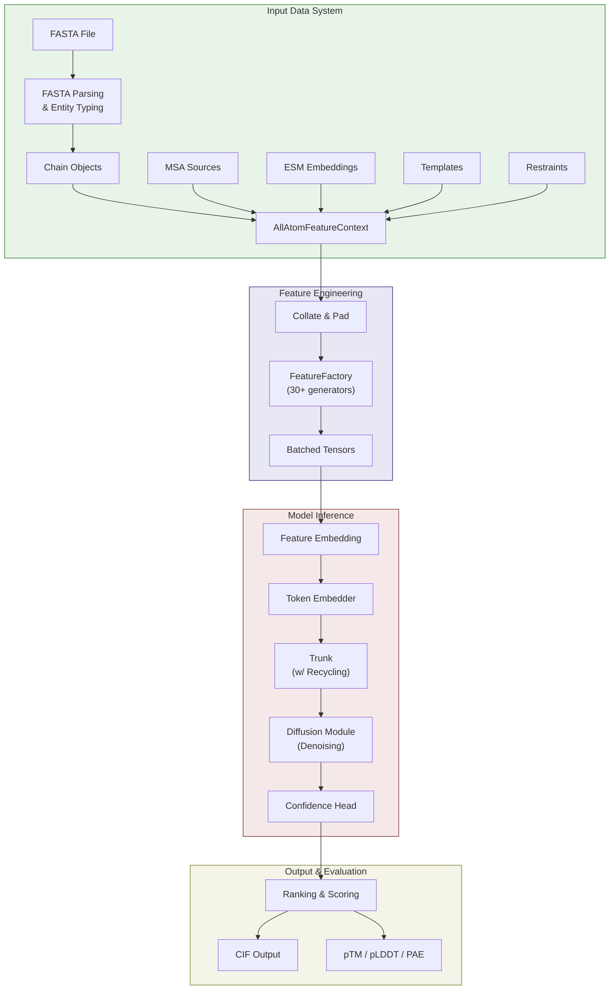
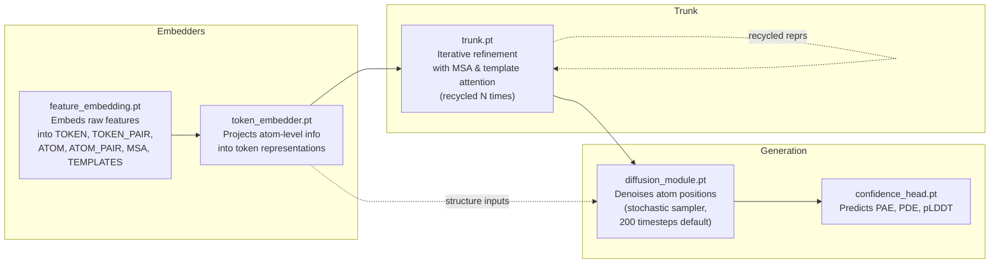

Chai-1 is a unified deep learning system for **multi-chain molecular structure prediction** — it folds proteins, nucleic acids, small molecules, and glycans into joint 3D structures from sequence inputs alone. The architecture follows a **four-stage pipeline**: input parsing and context assembly, feature embedding and token representation, iterative trunk refinement with recycling, and diffusion-based structure generation with confidence scoring. Each stage is decoupled into dedicated modules that communicate through typed data contexts, enabling both CLI-driven inference and programmatic exploration.


Sources: [chai1.py](chai_lab/chai1.py#L1-L109), [main.py](chai_lab/main.py#L1-L49)

## High-Level Pipeline Architecture

The end-to-end inference flow is orchestrated by `run_inference`, which delegates to `make_all_atom_feature_context` for data preparation and `run_folding_on_context` for model inference. The system loads **five exported TorchScript model components** — `feature_embedding.pt`, `token_embedder.pt`, `trunk.pt`, `diffusion_module.pt`, and `confidence_head.pt` — each wrapped in a `ModuleWrapper` that handles device migration and crop-size dispatching via `forward_{crop_size}` methods.



Sources: [chai1.py](chai_lab/chai1.py#L498-L572), [chai1.py](chai_lab/chai1.py#L579-L716)

## Core Data Model: Context Objects

The architecture is built around a hierarchy of **immutable context objects** that encapsulate different modalities of input data. The central hub is `AllAtomFeatureContext`, which aggregates six distinct contexts — each independently paddable, serializable to dicts, and carrying typed tensor data. This design ensures that every model component receives exactly the data it needs through a well-defined interface rather than ad-hoc parameter passing.

| Context | Purpose | Key Fields | Source Module |
|---------|---------|------------|---------------|
| **AllAtomStructureContext** | Atom-level coordinates, masks, residue indices, bond info | `atom_coords`, `atom_exists_mask`, `token_residue_index` | [all_atom_structure_context.py](chai_lab/data/dataset/structure/all_atom_structure_context.py) |
| **MSAContext** | Multiple sequence alignment tokens, deletions, pairing keys | `tokens`, `mask`, `deletion_matrix`, `pairing_key_hash` | [msa_context.py](chai_lab/data/dataset/msas/msa_context.py) |
| **TemplateContext** | Structural template hits from homologous structures | Template distograms, unit vectors, residue types, masks | [context.py](chai_lab/data/dataset/templates/context.py) |
| **EmbeddingContext** | Pre-computed ESM protein language model embeddings | `esm_embeddings` (shape: `num_tokens × 2560`) | [embedding_context.py](chai_lab/data/dataset/embeddings/embedding_context.py#L14-L26) |
| **RestraintContext** | User-specified distance/pocket restraints and covalent bonds | Pairwise constraint tensors | [restraint_context.py](chai_lab/data/dataset/constraints/restraint_context.py) |
| **AllAtomFeatureContext** | **Aggregate container** for all above contexts | `chains`, plus all five contexts above | [all_atom_feature_context.py](chai_lab/data/dataset/all_atom_feature_context.py#L24-L39) |

> [!TIP]
> The `AllAtomFeatureContext.pad()` method cascades padding through every sub-context — tokens are padded to the nearest `AVAILABLE_MODEL_SIZES` bucket (256, 384, …, 2048), and atoms scale proportionally at 23 atoms per token. This ensures that the exported TorchScript models, which are compiled for fixed sizes, always receive correctly shaped input.

Sources: [all_atom_feature_context.py](chai_lab/data/dataset/all_atom_feature_context.py#L24-L96), [embedding_context.py](chai_lab/data/dataset/embeddings/embedding_context.py#L14-L51), [collate/utils.py](chai_lab/data/collate/utils.py#L13-L39)

## Feature Generation System

Features are produced by a **registry of 30+ `FeatureGenerator` instances** collected into a `FeatureFactory`. Each generator declares a `FeatureType` (the output slot it fills) and an `EncodingType` (how raw data is encoded). The factory's `generate()` method iterates all registered generators against the collated batch, producing a dictionary of named tensors that the model consumes.

The `FeatureType` enum defines **seven feature slots** that correspond to the model's input channels. Each slot carries distinct geometric and semantic information:

| FeatureType | Dimensionality | Description | Example Generators |
|-------------|---------------|-------------|-------------------|
| `TOKEN` | Per-token | Single-token properties | `ResidueType`, `ESMEmbeddings`, `RelativeEntity` |
| `TOKEN_PAIR` | Token×Token | Pairwise token relations | `RelativeSequenceSeparation`, `TokenDistanceRestraint` |
| `ATOM` | Per-atom | Single-atom properties | `AtomElementOneHot`, `AtomNameOneHot`, `RefPos` |
| `ATOM_PAIR` | Atom×Atom (blocked) | Pairwise atom relations | `BlockedAtomPairDistogram`, `BlockedAtomPairDistances` |
| `MSA` | MSA depth × Tokens | Multiple sequence alignment | `MSAFeatureGenerator`, `MSADeletionValueGenerator` |
| `TEMPLATES` | Templates × Tokens | Structural templates | `TemplateDistogramGenerator`, `TemplateUnitVectorGenerator` |
| `RESIDUE` / `PAIR` | Legacy slots | Internal use | — |

> [!TIP]
> The `EncodingType` controls how raw integer or float data is cast for model consumption. `ONE_HOT` and `OUTERSUM` modes append a mask class (index = `num_classes`) for padding positions; `IDENTITY` mode reserves its last channel as a binary mask flag. This unified masking strategy ensures that every feature tensor is self-describing about which positions are valid.

Sources: [feature_type.py](chai_lab/data/features/feature_type.py#L1-L17), [base.py](chai_lab/data/features/generators/base.py#L58-L114), [feature_factory.py](chai_lab/data/features/feature_factory.py#L16-L27), [chai1.py](chai_lab/chai1.py#L172-L236)

## Model Component Architecture

The model is decomposed into **five exported TorchScript components**, each loaded on demand and moved between CPU and GPU to manage memory. The `ModuleWrapper` and `_component_moved_to` context manager implement a transient device migration pattern — a component is moved to GPU for computation, then immediately back to CPU, avoiding repeated disk I/O for large model weights.



The **feature embedder** splits each output into two halves along the channel dimension — one for the trunk pathway and one for the structure/diffusion pathway. This dual-output design means that the token embedder and trunk operate on one set of embeddings while the diffusion module receives a parallel set, allowing specialized representations for iterative refinement versus coordinate generation.

Sources: [chai1.py](chai_lab/chai1.py#L679-L738), [chai1.py](chai_lab/chai1.py#L115-L148), [chai1.py](chai_lab/chai1.py#L844-L885)

## Inference Flow: From Context to Structure

The `run_folding_on_context` function implements the complete inference trajectory in a precise sequence. Understanding this flow is essential for navigating the codebase:

1. **Collation**: The `Collate` class pads the `AllAtomFeatureContext` to the nearest model size bucket, computes blocked atom-pair indices for local attention, and runs all feature generators to produce the full feature dictionary. [collate.py](chai_lab/data/collate/collate.py#L29-L97)

2. **Feature Embedding**: Raw features are projected through `feature_embedding.pt`, producing embedded representations for each feature slot. Each slot's output is **split in half** — one half feeds the trunk, the other feeds the structure module. [chai1.py](chai_lab/chai1.py#L687-L698)

3. **Bond Feature Injection**: `TokenBondRestraint` features are generated separately (due to export constraints) and projected through `bond_loss_input_proj.pt`, then **added** to the token pair representations for both trunk and structure pathways. [chai1.py](chai_lab/chai1.py#L705-L715)

4. **Token Embedding**: The `token_embedder.pt` consumes embedded token, pair, and atom features along with blocked atom-pair data, producing three outputs: `token_single_initial_repr`, `token_single_structure_input`, and `token_pair_initial_repr`. [chai1.py](chai_lab/chai1.py#L721-L738)

5. **Trunk Recycling**: The trunk iterates `num_trunk_recycles` times (default 3), receiving both initial and recycled representations. On each recycle, MSA features can be subsampled. The trunk outputs updated `token_single_trunk_repr` and `token_pair_trunk_repr`. [chai1.py](chai_lab/chai1.py#L748-L777)

6. **Diffusion Denoising**: Starting from pure noise (scaled by σ_max), the diffusion module iteratively denoises atom coordinates using a **stochastic sampler** with configurable churn (S_churn=80), second-order updates, and power-interpolation noise scheduling. [chai1.py](chai_lab/chai1.py#L806-L885)

7. **Confidence Prediction**: The `confidence_head.pt` predicts per-atom pLDDT, per-token-pair PAE, and per-token-pair PDE for each of the `num_diffn_samples` generated structures. [chai1.py](chai_lab/chai1.py#L894-L915)

8. **Ranking & Output**: Each sample is ranked using an aggregate score: `0.2 × pTM + 0.8 × ipTM − 100 × has_inter_chain_clashes`. Results are written as CIF files and `.npz` score archives. [rank.py](chai_lab/ranking/rank.py#L94-L99)

Sources: [chai1.py](chai_lab/chai1.py#L579-L1059), [rank.py](chai_lab/ranking/rank.py#L56-L112), [diffusion_schedules.py](chai_lab/model/diffusion_schedules.py#L13-L48)

## Memory Management Strategy

The codebase implements an explicit **CPU offloading strategy** to support inference on GPUs with limited memory. The `_component_moved_to` context manager caches loaded TorchScript modules in a global `_component_cache` dict, moving each component to GPU only during its forward pass and back to CPU immediately afterward. The `low_memory` flag (default `True`) controls whether intermediate embeddings are returned to CPU between stages. Additionally, `torch.cuda.empty_cache()` is called after the trunk recycling loop and after the diffusion loop to release fragmented GPU memory before subsequent operations.

Sources: [chai1.py](chai_lab/chai1.py#L151-L166), [chai1.py](chai_lab/chai1.py#L648-L649), [chai1.py](chai_lab/chai1.py#L779-L780), [chai1.py](chai_lab/chai1.py#L887-L888)

## Input Data System Overview

The input pipeline converts raw FASTA files into the `AllAtomFeatureContext` through a multi-step process. Each entity in the FASTA file is parsed according to its type (protein, DNA, RNA, ligand, glycan), tokenized into residue-level tokens, and assembled into `Chain` objects. External data sources — MSA, ESM embeddings, templates, and restraints — are loaded or generated and merged into the context. The following table summarizes the five data modalities and their entry points:

| Modality | Entry Point | Default Behavior | User Control |
|----------|-------------|-----------------|--------------|
| **MSA** | `get_msa_contexts()` / `generate_colabfold_msas()` | Empty if no source specified | `--use-msa-server` or `--msa-directory` |
| **ESM Embeddings** | `get_esm_embedding_context()` | Enabled by default (CPU) | `--no-use-esm` |
| **Templates** | `get_template_context()` | Empty if no source specified | `--use-templates-server` or `--templates-path` |
| **Restraints** | `load_manual_restraints_for_chai1()` | Empty if no constraint file | `--constraint-path` |
| **Covalent Bonds** | `get_atom_covalent_bond_pairs_from_constraints()` | Parsed from restraint file | Embedded in `.restraints` file |

Sources: [chai1.py](chai_lab/chai1.py#L338-L495), [inference_dataset.py](chai_lab/data/dataset/inference_dataset.py#L94-L177)

## Project Directory Map

```
chai_lab/
├── chai1.py                  ← Core inference orchestration & feature factory
├── main.py                   ← CLI entry point (typer)
├── data/
│   ├── collate/              ← Batch collation & padding to model sizes
│   ├── dataset/              ← Context objects (structure, MSA, embeddings, etc.)
│   │   ├── constraints/      ← Restraint loading and covalent bond handling
│   │   ├── embeddings/       ← ESM embedding context
│   │   ├── msas/             ← MSA generation (ColabFold) and loading
│   │   ├── structure/        ← All-atom tokenization, chain, bond utilities
│   │   └── templates/        ← Template alignment and loading
│   ├── features/             ← Feature generation framework & 20+ generators
│   │   └── generators/       ← Individual feature generator implementations
│   ├── io/                   ← CIF/PDB output, RCSB utilities
│   ├── parsing/              ← FASTA, glycan, restraint, MSA, template parsing
│   └── sources/              ← RDKit integration for ligand conformers
├── model/
│   ├── diffusion_schedules.py← Noise schedule (power interpolation)
│   └── utils.py              ← Attention blocking, quaternion math, augmentation
├── ranking/                  ← Structure scoring: pTM, pLDDT, clash detection
├── tools/                    ← External tool wrappers (kalign, rigid transforms)
└── utils/                    ← Paths, tensor ops, plotting, typing, defaults
```

Sources: [Project structure](chai_lab/)

## Suggested Reading Progression

The Architecture Overview you've just read establishes the system-wide mental model. To go deeper, follow this path through the catalog:

1. **Start with the inference pipeline stages** — each page dissects one of the five model components in detail:
   - [Feature Context Assembly](8-feature-context-assembly) — how raw inputs become `AllAtomFeatureContext`
   - [Feature Embedding and Token Embedding](9-feature-embedding-and-token-embedding) — the projection from features to representations
   - [Trunk Recycling and Attention](10-trunk-recycling-and-attention) — iterative refinement mechanics
   - [Diffusion Denoising Process](11-diffusion-denoising-process) — coordinate generation from noise
   - [Confidence Prediction and Scoring](12-confidence-prediction-and-scoring) — PAE, pLDDT, and pTM computation

2. **Then explore the input data system** — each modality has its own processing pipeline:
   - [FASTA Parsing and Entity Types](13-fasta-parsing-and-entity-types)
   - [MSA Generation and Loading](14-msa-generation-and-loading)
   - [ESM Embeddings Integration](15-esm-embeddings-integration)
   - [Template Processing Pipeline](16-template-processing-pipeline)
   - [Restraint and Covalent Bond System](17-restraint-and-covalent-bond-system)

3. **Finally, understand feature engineering and output evaluation**:
   - [Feature Generator Base Design](18-feature-generator-base-design)
   - [Token and Atom Feature Generators](19-token-and-atom-feature-generators)
   - [Pairwise and Restraint Feature Generators](20-pairwise-and-restraint-feature-generators)
   - [Structure Ranking and Scoring](21-structure-ranking-and-scoring)
   - [CIF Output and Chain Naming](22-cif-output-and-chain-naming)
   - [pTM, pLDDT, and Clash Metrics](23-ptm-plddt-and-clash-metrics)