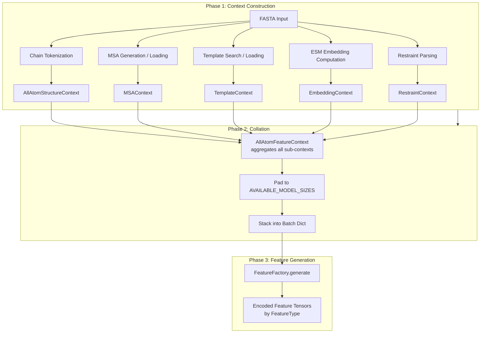
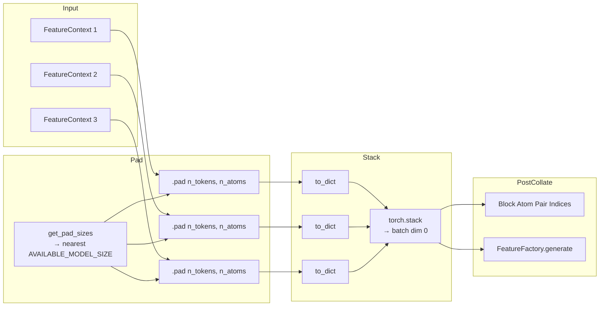
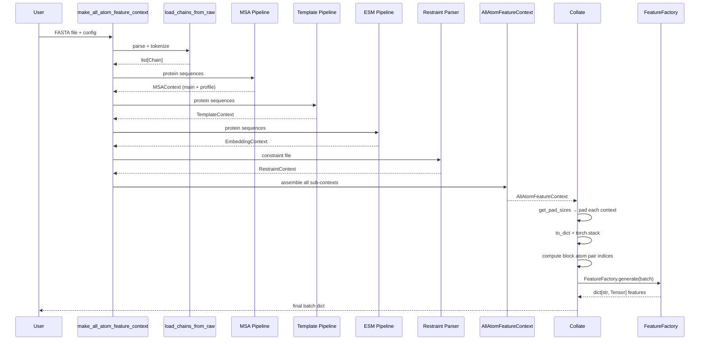

Feature Context Assembly is the critical orchestration layer in Chai-1's inference pipeline that transforms raw input sequences into a fully resolved, padded, and batched tensor dictionary ready for model consumption. It bridges the gap between heterogeneous input sources — FASTA sequences, MSAs, templates, ESM embeddings, and restraints — and the unified feature tensors that the model's forward pass expects. Understanding this assembly process is essential for anyone extending Chai-1's input capabilities or debugging data pipeline issues.

## The Assembly Architecture at a Glance

The assembly follows a strict three-phase pipeline: **context construction** (per-system), **collation** (cross-system), and **feature generation** (batch-wide). Each phase has a clear contract — contexts produce typed dataclasses, collation handles padding and stacking, and feature generation applies encoding transformations to produce the final tensor dictionary.

Sources: [chai1.py](/chai_lab/chai1.py#L214-L399), [all_atom_feature_context.py](/chai_lab/data/dataset/all_atom_feature_context.py#L26-L96), [collate.py](/chai_lab/data/collate/collate.py#L23-L98)

## The Central Data Structure: AllAtomFeatureContext

**AllAtomFeatureContext** is the unified container that aggregates every sub-context for a single molecular system. It is a frozen dataclass produced by the dataset layer and consumed by the collation layer. Its design enforces a clean separation: metadata fields (like `chains`) travel alongside the batch but are never padded or stacked, while all sub-contexts implement a `pad()` method and a `to_dict()` method that standardize their representation for batched tensor operations.

| Sub-Context | Role | Key Fields | Max Size |
|---|---|---|---|
| `AllAtomStructureContext` | Token/atom coordinates, residue types, chain IDs, bond indices | `token_residue_type`, `atom_ref_pos`, `atom_covalent_bond_indices` | n_tokens × 23 atoms |
| `MSAContext` | Multiple sequence alignment rows, deletion matrices, pairing keys | `tokens`, `mask`, `deletion_matrix`, `pairing_key_hash` | 16,384 depth |
| `TemplateContext` | Structural templates with backbone frames and distograms | `template_restype`, `template_distances`, `template_unit_vector` | 4 templates |
| `EmbeddingContext` | Pre-computed ESM protein embeddings | `esm_embeddings` | n_tokens × 2560 |
| `RestraintContext` | Contact, pocket, and docking restraints | `docking_restraints`, `contact_restraints`, `pocket_restraints` | Unbounded lists |

The `to_dict()` method merges all sub-context dictionaries into a single flat dictionary, where tensor keys follow a naming convention like `msa_tokens`, `template_restype`, and `esm_embeddings`. This flattened representation is what the collator stacks across the batch dimension. The `pad()` method delegates to each sub-context's own padding logic, ensuring that every tensor within a batch shares the same spatial dimensions before stacking.

> [!TIP]
> The `profile_msa_context` is a second `MSAContext` distinct from `msa_context`. The main MSA context carries the full depth alignment (up to 16,384 rows), while the profile MSA context provides a compressed summary used for profile-based feature generation like `MSAProfileGenerator`. Both are padded and batched identically but serve different feature generators downstream.

Sources: [all_atom_feature_context.py](/chai_lab/data/dataset/all_atom_feature_context.py#L26-L96), [all_atom_structure_context.py](/chai_lab/data/dataset/structure/all_atom_structure_context.py#L25-L96), [msa_context.py](/chai_lab/data/dataset/msas/msa_context.py#L19-L168), [context.py](/chai_lab/data/dataset/templates/context.py#L35-L120), [embedding_context.py](/chai_lab/data/dataset/embeddings/embedding_context.py#L10-L52), [restraint_context.py](/chai_lab/data/dataset/constraints/restraint_context.py#L29-L71)

## Context Construction: From FASTA to AllAtomFeatureContext

The `make_all_atom_feature_context` function in `chai1.py` is the entry point for context construction during inference. It orchestrates a deterministic sequence of steps, each producing one sub-context:

1. **Input parsing and validation** — `read_inputs` parses the FASTA file, identifies entity types (protein, ligand, RNA, DNA, glycan), and validates uniqueness of entity names.

2. **Chain tokenization** — `load_chains_from_raw` converts each input into an `AllAtomEntityData`, then tokenizes it via `AllAtomResidueTokenizer` to produce `Chain` objects wrapping `AllAtomStructureContext`. Failed tokenizations are silently dropped.

3. **Structure merging** — Individual chain structure contexts are merged via `AllAtomStructureContext.merge`, producing a single unified structure context with reindexed tokens and atoms across all chains. Token count validation (`raise_if_too_many_tokens`) occurs here.

4. **MSA assembly** — Depending on configuration, MSAs are either generated via ColabFold server, loaded from a directory, or left empty. The `get_msa_contexts` function produces the main `MSAContext`, while a profile MSA is derived separately.

5. **Template loading** — Template contexts are built from MMseqs2 search results or pre-loaded template files, producing a `TemplateContext` with up to 4 structural templates.

6. **ESM embedding** — Optionally, ESM-2 embeddings are computed for protein sequences and wrapped in an `EmbeddingContext`.

7. **Restraint parsing** — If a restraint file is provided, `load_manual_restraints_for_chai1` parses it into a `RestraintContext` containing contact, pocket, or docking constraints.

The final `AllAtomFeatureContext` is assembled by passing all sub-contexts to its constructor. Notably, `EmbeddingContext` is optional (`None` if ESM is disabled), and `RestraintContext.empty()` is used when no restraints are specified.

Sources: [chai1.py](/chai_lab/chai1.py#L293-L399), [inference_dataset.py](/chai_lab/data/dataset/inference_dataset.py#L172-L246), [restraint_context.py](/chai_lab/data/dataset/constraints/restraint_context.py#L82-L137)

## Collation: Padding, Stacking, and Batch Preparation

The `Collate` dataclass transforms a list of `AllAtomFeatureContext` objects into a single batched dictionary. This is a two-stage process implemented in `_collate` and `_post_collate`.

**Stage 1 — Pad and Stack (`_collate`)**: First, `get_pad_sizes` determines the maximum token and atom counts across all feature contexts in the batch. Token padding snaps up to the nearest entry in `AVAILABLE_MODEL_SIZES = [256, 384, 512, 768, 1024, 1536, 2048]`, while atom padding uses the formula `23 × n_tokens` (each token can have up to 23 atoms). Each context is padded independently via `AllAtomFeatureContext.pad`, then all padded contexts are converted to dicts and stacked along a new batch dimension using `torch.stack`.

**Stage 2 — Post-Collation (`_post_collate`)**: After stacking, the collator computes auxiliary data structures needed by the model: block-based atom pair indices (`block_q_atom_idces`, `block_kv_atom_idces`) and their corresponding masks. These enable the model's blocked attention pattern over atom pairs, which is critical for memory efficiency at large token counts. Finally, the `FeatureFactory.generate` method is called on the entire batch to produce the encoded feature tensors.

| Model Size | Max Tokens | Max Atoms (23×) | Typical Use Case |
|---|---|---|---|
| 256 | 256 | 5,888 | Small single proteins |
| 384 | 384 | 8,832 | Medium proteins |
| 512 | 512 | 11,776 | Protein-ligand complexes |
| 768 | 768 | 17,664 | Multi-chain assemblies |
| 1024 | 1,024 | 23,552 | Large complexes |
| 1536 | 1,536 | 35,328 | Very large complexes |
| 2048 | 2,048 | 47,104 | Maximum capacity |

Sources: [collate.py](/chai_lab/data/collate/collate.py#L23-L98), [collate_utils.py](/chai_lab/data/collate/utils.py#L10-L40)

## FeatureFactory: The Encoding Engine

`FeatureFactory` is a lightweight orchestrator that maps named feature generators to their outputs. It holds a `dict[str, FeatureGenerator]` and its `generate` method simply iterates over all registered generators, calling each one's `generate` method on the batch dictionary. The resulting `dict[str, Tensor]` is stored under the `"features"` key in the final batch.

Each `FeatureGenerator` is an abstract base class that declares three critical properties:

- **`ty` (FeatureType)** — Determines the tensor's structural role: `TOKEN` (per-token features), `TOKEN_PAIR` (pairwise token features), `MSA` (alignment features), `TEMPLATES` (template features), `ATOM` (per-atom features), or `ATOM_PAIR` (pairwise atom features).

- **`encoding_ty` (EncodingType)** — Determines the numerical encoding strategy: `ONE_HOT` (categorical → one-hot vectors), `RBF` (radial basis functions for distances), `FOURIER` (positional encodings), `IDENTITY` (pass-through with masking), `ESM` (pre-computed embeddings), or `OUTERSUM` (outer sum of one-hot encodings).

- **`mask_value`** — A computed property that returns the appropriate fill value for masked positions, varying by encoding type. For one-hot encodings, it returns `num_classes` (an extra "mask" class); for RBF/Fourier, it returns `-100.0`; for identity, it uses a dedicated mask channel where the last position is 1 for masked items.

The full set of feature generators registered in Chai-1's `feature_factory` spans 29 named generators, organized by their feature type:

| FeatureType | Generator Names | Count |
|---|---|---|
| TOKEN | `ResidueType`, `ESMEmbeddings`, `IsDistillation`, `TokenBFactor`, `TokenPLDDT`, `ChainIsCropped` | 6 |
| TOKEN_PAIR | `RelativeSequenceSeparation`, `RelativeTokenSeparation`, `RelativeEntity`, `RelativeChain`, `MissingChainContact`, `TokenDistanceRestraint`, `TokenPairPocketRestraint` | 7 |
| ATOM | `AtomRefPos`, `AtomRefCharge`, `AtomRefMask`, `AtomRefElement`, `AtomNameOneHot` | 5 |
| ATOM_PAIR | `BlockedAtomPairDistogram`, `InverseSquaredBlockedAtomPairDistances` | 2 |
| MSA | `MSAOneHot`, `MSAHasDeletion`, `MSADeletionValue`, `MSADeletionMean`, `MSAProfile`, `IsPairedMSA`, `MSADataSource` | 7 |
| TEMPLATES | `TemplateMask`, `TemplateUnitVector`, `TemplateResType`, `TemplateDistogram` | 4 |

> [!TIP]
> The `DockingConstraintGenerator` is registered with `include_probability=0.0` and `structure_dropout_prob=0.75`, meaning docking restraints are effectively disabled during standard inference. This is a training-time feature for data augmentation. If you need to enable docking restraints at inference, you must modify the generator's configuration or create a custom feature factory.

Sources: [feature_factory.py](/chai_lab/data/features/feature_factory.py#L1-L27), [base.py](/chai_lab/data/features/generators/base.py#L11-L114), [feature_type.py](/chai_lab/data/features/feature_type.py#L1-L17), [chai1.py](/chai_lab/chai1.py#L165-L253)

## Sub-Context Padding Semantics

Each sub-context implements padding with domain-specific semantics that go beyond simple zero-filling. Understanding these semantics is critical for interpreting masked values in downstream feature tensors.

**AllAtomStructureContext** pads tokens by extending `token_exists_mask` with `False` entries and filling token-level fields with neutral values (e.g., gap residue type for `token_residue_type`). Atom-level fields follow a similar pattern: `atom_exists_mask` and `atom_is_not_padding_mask` are extended with `False`, and coordinate fields (`atom_ref_pos`, `atom_gt_coords`) are zero-filled. Covalent bond indices are preserved as-is since they reference atoms within the non-padded region.

**MSAContext** pads along both the token dimension (columns) and the depth dimension (rows). Token padding fills with the gap token (`:`), `NO_PAIRING_KEY` for pairing hashes, zero deletions, and `False` mask. Depth padding adds empty rows with identical fill values. The `sequence_source` field is padded with `MSADataSource.NONE` to ensure padded MSA rows are not attributed to any search source.

**TemplateContext** pads templates with null residue types (gap character `-`), zero masks for pseudo-beta and backbone frames, and zero distance/unit-vector tensors. The `template_mask` property (derived as `template_restype != gap`) correctly identifies non-null templates after padding.

**EmbeddingContext** zero-pads the ESM embedding matrix along the token dimension, producing `esm_embeddings` of shape `[max_tokens, 2560]` with zero vectors for padding positions.

**RestraintContext** is a notable exception — its `pad()` method is a no-op, returning the same object unchanged. This is because restraints are stored as Python lists of dataclasses, not tensors, and are processed by feature generators that handle their own indexing into the token space.

Sources: [all_atom_structure_context.py](/chai_lab/data/dataset/structure/all_atom_structure_context.py#L25-L200), [msa_context.py](/chai_lab/data/dataset/msas/msa_context.py#L90-L130), [context.py](/chai_lab/data/dataset/templates/context.py#L108-L200), [embedding_context.py](/chai_lab/data/dataset/embeddings/embedding_context.py#L30-L42), [restraint_context.py](/chai_lab/data/dataset/constraints/restraint_context.py#L44-L48)

## The End-to-End Data Flow

Tracing the complete path from a FASTA file to the model-ready batch reveals how each component participates in the assembly:

The final batch dictionary contains three top-level keys: `"inputs"` (the stacked, padded raw tensors from all sub-contexts), `"features"` (the encoded feature tensors produced by the FeatureFactory), and additional block-attention indices (`block_atom_pair_q_idces`, `block_atom_pair_kv_idces`, `block_atom_pair_mask`). The model's forward method receives this complete dictionary and dispatches features by their `FeatureType` to the appropriate embedding modules.

Sources: [chai1.py](/chai_lab/chai1.py#L293-L399), [collate.py](/chai_lab/data/collate/collate.py#L36-L98), [feature_factory.py](/chai_lab/data/features/feature_factory.py#L14-L21)

## Next Steps

With the feature context fully assembled and batched, the pipeline proceeds to the embedding and attention stages. To understand how raw features are transformed into model inputs:

- **[Feature Embedding and Token Embedding](9-feature-embedding-and-token-embedding)** — How each FeatureType is embedded and combined into the trunk's input representations.
- **[Feature Generator Base Design](18-feature-generator-base-design)** — Deep dive into the `FeatureGenerator` ABC and how to create custom generators.
- **[Token and Atom Feature Generators](19-token-and-atom-feature-generators)** — Detailed breakdown of per-token and per-atom feature encoding logic.