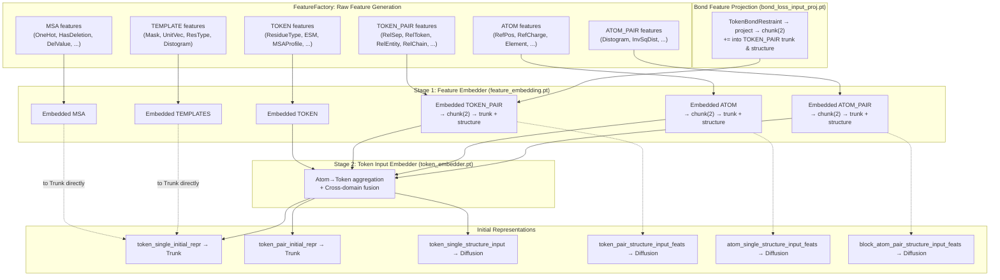

The Feature Embedding and Token Embedding stages form the critical bridge between raw, heterogeneous input features and the structured latent representations that feed Chai-1's trunk recycler and diffusion module. Together, they transform a dictionary of disparate feature tensors—each with its own encoding scheme, dimensionality, and semantic domain—into unified **token single**, **token pair**, and **atom** representations ready for iterative attention. Understanding this two-stage pipeline is essential for anyone extending the feature set, debugging representation quality, or reasoning about what information is available to downstream modules.

## From Raw Features to Typed Tensors: The FeatureFactory

Every inference run begins with a **FeatureFactory** that orchestrates the generation of all raw features. The factory is a simple name-to-generator registry: each registered `FeatureGenerator` knows how to extract its input keys from a batch dictionary, compute its feature tensor, and cast it to the correct dtype via its `EncodingType`. The factory's `generate` method iterates over all generators and returns a flat dictionary of named tensors.

```python
# The factory is constructed once in chai1.py with ~30 generators
feature_factory = FeatureFactory(feature_generators)
# ... later, inside Collate._post_collate:
raw_batch["features"] = self.feature_factory.generate(raw_batch)
```

Each generator declares two orthogonal axes of identity: its **FeatureType** (the semantic domain it belongs to) and its **EncodingType** (how the raw data is numerically represented). These two axes determine how the downstream feature embedder will process the tensor.

Sources: [chai1.py](/chai_lab/chai1.py#L118-L186), [feature_factory.py](/chai_lab/data/features/feature_factory.py#L1-L27), [collate.py](/chai_lab/data/collate/collate.py#L77-L85)

## Feature Types and the Semantic Domain Taxonomy

The `FeatureType` enum partitions all features into six semantic domains. This taxonomy is not merely organizational—it directly governs how the feature embedder routes and concatenates tensors:

| FeatureType | Shape Pattern | Description | Example Generators |
|---|---|---|---|
| `TOKEN` | `[B, N, ...]` | Per-token single features | `ResidueType`, `ESMEmbeddings`, `MSAProfile` |
| `TOKEN_PAIR` | `[B, N, N, ...]` | Per-token-pair features | `RelativeSequenceSeparation`, `RelativeEntity`, `RelativeChain` |
| `ATOM` | `[B, A, ...]` | Per-atom single features | `AtomRefPos`, `AtomRefCharge`, `AtomRefElement` |
| `ATOM_PAIR` | `[B, A_block, ...]` | Blocked atom-pair features | `BlockedAtomPairDistogram` |
| `MSA` | `[B, D, N, ...]` | MSA depth × token features | `MSAFeatureGenerator`, `MSAHasDeletion` |
| `TEMPLATES` | `[B, T, N, ...]` | Template features | `TemplateDistogram`, `TemplateUnitVector` |

Here `B` is batch size, `N` is number of tokens, `A` is number of atoms, `D` is MSA depth, and `T` is number of templates. The feature embedder consumes all of these in a single forward pass, concatenating within each domain before applying domain-specific linear projections.

Sources: [feature_type.py](/chai_lab/data/features/feature_type.py#L1-L17)

## Encoding Types and the Mask Convention

Each `FeatureGenerator` also declares an `EncodingType` that determines both the raw dtype and the masking strategy:

| EncodingType | Input Dtype | Masking Strategy | Used By |
|---|---|---|---|
| `ONE_HOT` | `long/int` | Mask index = `num_classes` (extra class) | `ResidueType`, `RelativeSequenceSeparation`, `RelativeTokenSeparation`, `RelativeEntity`, `RelativeChain` |
| `IDENTITY` | `float` | Extra channel appended; 1 = masked | `AtomRefCharge`, `MSADeletionValue`, `MSAProfile` |
| `RBF` | `float16/32/bf16` | -100.0 sentinel | `BlockedAtomPairDistogram`, `TokenDistanceRestraint` |
| `FOURIER` | `float16/32/bf16` | -100.0 sentinel | `RefPos` |
| `ESM` | `float` | 0.0 (zero vector) | `ESMEmbeddings` |
| `OUTERSUM` | `long/int` | Mask index = `num_classes` | Pairwise one-hot combinations |

The critical insight is that **masking is baked into the feature tensor itself** before it ever reaches the neural network. For `ONE_HOT`-encoded features, masked positions receive an additional class index beyond the valid range; for `IDENTITY`-encoded features, an extra binary channel is concatenated where `1` indicates a masked position. This convention allows the feature embedder to learn how to handle missing data without requiring separate mask tensors per feature.

> [!TIP]
> When adding a new feature generator, the `can_mask` parameter controls whether an extra channel is appended for `IDENTITY`-type features. Setting `can_mask=False` (the default for most pair features) means the generator asserts its data is always present—use this only for structurally guaranteed features like relative positions.

Sources: [base.py](/chai_lab/data/features/generators/base.py#L1-L114)

## The Feature Generators: Token-Level Features

Token-level features capture the per-residue identity and context. The most important generators in this domain are:

**ResidueType** — A 32-class one-hot encoding of the residue type (20 standard amino acids + gap + unknown + nucleotide types + special tokens). It reads `token_residue_type` from the batch and produces a `[B, N, 33]` tensor (32 classes + 1 mask class). This is the primary sequence identity signal.

**ESMEmbeddings** — A pass-through of precomputed ESM-2 embeddings with encoding type `ESM`. These 768-dimensional (or 1280-dimensional, depending on the ESM model used) vectors provide a rich, pretrained representation of each residue's biochemical context. The generator simply reads `esm_embeddings` from the batch and returns it as-is.

**MSAProfile** — The marginal distribution over residue types computed from the full (unsubsampled) MSA. This is an `IDENTITY`-encoded feature of dimension `num_res_ty` (typically 32), computed via `scatter_add` over the MSA depth dimension. It provides a coevolutionary summary that complements the raw MSA features fed to the MSA stream.

**MSADeletionMean** — The mean deletion count at each position across the MSA depth, scaled by `2/π · arctan(d/3)`. This is a scalar `IDENTITY`-encoded feature that signals insertion/deletion pressure at each residue.

Sources: [residue_type.py](/chai_lab/data/features/generators/residue_type.py#L1-L35), [esm_generator.py](/chai_lab/data/features/generators/esm_generator.py#L1-L35), [msa.py](/chai_lab/data/features/generators/msa.py#L84-L167)

## The Feature Generators: Pair-Level Features

Pair-level features encode the relational structure between tokens—the spatial, sequential, and organizational relationships that the pair representation must capture.

**RelativeSequenceSeparation** — Binned relative residue index between tokens *i* and *j*, but only within the same chain. For inter-chain pairs, a special bin index is assigned. The default configuration uses 65 bins (offset range ±32), producing a 67-class one-hot (65 + inter-chain + mask). This is the primary within-chain positional signal.

**RelativeTokenSeparation** — Similar to above but operates on absolute token index rather than residue index, and additionally masks out inter-residue and inter-chain positions (setting them to a dedicated class `2*r_max+2`). With `r_max=32`, this yields a 67-class one-hot. The distinction from `RelativeSequenceSeparation` is that token index accounts for multi-token residues (e.g., modified residues with multiple tokens).

**RelativeEntity** — A 3-class one-hot derived from `entity_id`: same entity (class 0), previous entity (class 1), or next entity (class 2). Inspired by AlphaFold-Multimer's Algorithm 5, this feature informs the model whether two tokens belong to the same polypeptide chain, the same ligand entity, or different entities entirely.

**RelativeChain** — A 6-class one-hot (with `s_max=2`) encoding the relative chain ID *within* the same entity. Inter-entity positions are assigned a dedicated class. This captures homo-oligomeric symmetry: chains that are copies of the same entity receive distinct relative-chain labels.

**BlockedAtomPairDistogram** — An RBF-encoded distance histogram between atom pairs in a blocked (sparse) format. This is the primary geometric signal entering the atom-pair stream, providing a coarse-grained representation of 3D proximity between atom blocks.

Sources: [relative_sep.py](/chai_lab/data/features/generators/relative_sep.py#L1-L63), [relative_token.py](/chai_lab/data/features/generators/relative_token.py#L1-L54), [relative_entity.py](/chai_lab/data/features/generators/relative_entity.py#L1-L48), [relative_chain.py](/chai_lab/data/features/generators/relative_chain.py#L1-L55)

## Stage 1: The Feature Embedder

The feature embedder (`feature_embedding.pt`) is the first learned component in the inference pipeline. It takes the raw feature dictionary produced by the `FeatureFactory` and projects each semantic domain into a unified embedding space. Critically, it processes all domains in a single forward pass:

```python
with _component_moved_to("feature_embedding.pt", device) as feature_embedding:
    embedded_features = feature_embedding.forward(
        crop_size=model_size,
        move_to_device=device,
        return_on_cpu=low_memory,
        **features,
    )
```

The output is a dictionary keyed by `FeatureType` names, each containing an embedded tensor. The inference code then splits specific outputs into **trunk** and **structure** pathways:

```python
token_single_input_feats = embedded_features["TOKEN"]
token_pair_input_feats, token_pair_structure_input_feats = embedded_features[
    "TOKEN_PAIR"
].chunk(2, dim=-1)
atom_single_input_feats, atom_single_structure_input_feats = embedded_features[
    "ATOM"
].chunk(2, dim=-1)
block_atom_pair_input_feats, block_atom_pair_structure_input_feats = (
    embedded_features["ATOM_PAIR"].chunk(2, dim=-1)
)
template_input_feats = embedded_features["TEMPLATES"]
msa_input_feats = embedded_features["MSA"]
```

The `.chunk(2, dim=-1)` pattern is architecturally significant: the feature embedder produces embeddings with **double width** for `TOKEN_PAIR`, `ATOM`, and `ATOM_PAIR` domains. The first half feeds the trunk (iterative refinement), while the second half is held aside for the structure module (diffusion conditioning). This bifurcation ensures that the diffusion module receives geometrically grounded input even before trunk recycling begins.

Sources: [chai1.py](/chai_lab/chai1.py#L636-L663)

## Bond Features: A Separate Projection

Bond features are handled outside the main feature embedder due to TorchScript export limitations. The `TokenBondRestraint` generator produces a raw bond feature tensor, which is then projected by a dedicated `bond_loss_input_proj.pt` module:

```python
bond_ft_gen = TokenBondRestraint()
bond_ft = bond_ft_gen.generate(batch=batch).data
with _component_moved_to("bond_loss_input_proj.pt", device) as bond_loss_input_proj:
    trunk_bond_feat, structure_bond_feat = bond_loss_input_proj.forward(
        return_on_cpu=low_memory,
        move_to_device=device,
        crop_size=model_size,
        input=bond_ft,
    ).chunk(2, dim=-1)
token_pair_input_feats += trunk_bond_feat
token_pair_structure_input_feats += structure_bond_feat
```

The projected bond features are **additively merged** into the token-pair representations for both the trunk and structure pathways. This residual-style integration means the bond signal acts as a bias on the pair representation without disrupting the primary feature embedding.

> [!TIP]
> The additive merge (`+=`) for bond features means that if no covalent bond restraints are provided, `bond_ft` will be all-zeros, and the projection will add a near-zero bias. This graceful degradation ensures the pipeline works identically with or without covalent bond specifications.

Sources: [chai1.py](/chai_lab/chai1.py#L669-L684)

## Stage 2: The Token Input Embedder

The token input embedder (`token_embedder.pt`) is the second learned component. It takes the feature-embedded representations and cross-domain information (atom features aggregated to token level, block atom-pair features) and produces the **initial token representations** that seed the trunk:

```python
with _component_moved_to("token_embedder.pt", device) as token_input_embedder:
    token_input_embedder_outputs = token_input_embedder.forward(
        token_single_input_feats=token_single_input_feats,
        token_pair_input_feats=token_pair_input_feats,
        atom_single_input_feats=atom_single_input_feats,
        block_atom_pair_feat=block_atom_pair_input_feats,
        block_atom_pair_mask=block_atom_pair_mask,
        block_indices_h=block_indices_h,
        block_indices_w=block_indices_w,
        atom_single_mask=atom_single_mask,
        atom_token_indices=atom_token_indices,
        crop_size=model_size,
    )
token_single_initial_repr, token_single_structure_input, token_pair_initial_repr = (
    token_input_embedder_outputs
)
```

This module performs the critical **atom-to-token aggregation**: atom-level single features are pooled to token-level using the `atom_token_indices` mapping, and block atom-pair features are similarly condensed. The output is a triple:

| Output | Shape | Destination |
|---|---|---|
| `token_single_initial_repr` | `[B, N, D_trunk]` | Trunk single representation (seed for recycling) |
| `token_single_structure_input` | `[B, N, D_struct]` | Structure module single input (diffusion conditioning) |
| `token_pair_initial_repr` | `[B, N, N, D_trunk]` | Trunk pair representation (seed for recycling) |

Notice that `token_pair_structure_input_feats` (from the feature embedder) is *not* produced by the token embedder—it flows directly to the structure module. The token embedder thus owns the initial trunk representations and the structure single input, while the structure pair input bypasses it entirely.

Sources: [chai1.py](/chai_lab/chai1.py#L688-L714)

## End-to-End Data Flow

The following diagram summarizes the complete pipeline from raw batch to initial representations:



Sources: [chai1.py](/chai_lab/chai1.py#L636-L714)

## Feature Registration Summary

The following table lists every feature generator registered in the default `feature_factory`, organized by domain, with its encoding type and output dimensionality class:

| Generator | FeatureType | EncodingType | Key Parameter |
|---|---|---|---|
| `RelativeSequenceSeparation` | `TOKEN_PAIR` | `ONE_HOT` | `sep_bins=None` (±32, 67 classes) |
| `RelativeTokenSeparation` | `TOKEN_PAIR` | `ONE_HOT` | `r_max=32` (67 classes) |
| `RelativeEntity` | `TOKEN_PAIR` | `ONE_HOT` | 3 classes |
| `RelativeChain` | `TOKEN_PAIR` | `ONE_HOT` | `s_max=2` (6 classes) |
| `ResidueType` | `TOKEN` | `ONE_HOT` | `num_res_ty=32` (33 classes) |
| `ESMEmbeddings` | `TOKEN` | `ESM` | 768/1280 dim |
| `BlockedAtomPairDistogram` | `ATOM_PAIR` | `RBF` | Binned distances |
| `InvSqBlockedAtomPairDist` | `ATOM_PAIR` | `IDENTITY` | `inverse_squared` transform |
| `AtomRefPos` | `ATOM` | `FOURIER` | 3D coordinates |
| `AtomRefCharge` | `ATOM` | `IDENTITY` | 1 dim + mask |
| `AtomRefMask` | `ATOM` | `IDENTITY` | 1 dim |
| `AtomRefElement` | `ATOM` | `ONE_HOT` | `max_atomic_num=128` |
| `AtomNameOneHot` | `ATOM` | `ONE_HOT` | Atom name classes |
| `TemplateMask` | `TEMPLATES` | `IDENTITY` | Binary mask |
| `TemplateUnitVector` | `TEMPLATES` | `IDENTITY` | 3D unit vectors |
| `TemplateResType` | `TEMPLATES` | `ONE_HOT` | Residue type classes |
| `TemplateDistogram` | `TEMPLATES` | `RBF` | Binned distances |
| `TokenDistanceRestraint` | `TOKEN_PAIR` | `RBF` | `num_rbf_radii=6` |
| `DockingConstraintGenerator` | `TOKEN_PAIR` | `RBF` | `include_probability=0.0` |
| `TokenPairPocketRestraint` | `TOKEN_PAIR` | `RBF` | `num_rbf_radii=6` |
| `MSAProfile` | `TOKEN` | `IDENTITY` | 32 dim |
| `MSADeletionMean` | `TOKEN` | `IDENTITY` | 1 dim |
| `IsDistillation` | `TOKEN` | `IDENTITY` | Binary flag |
| `TokenBFactor` | `TOKEN` | `IDENTITY` | `include_prob=0.0` |
| `TokenPLDDT` | `TOKEN` | `IDENTITY` | `include_prob=0.0` |
| `ChainIsCropped` | `TOKEN` | `IDENTITY` | Binary flag |
| `MissingChainContact` | `TOKEN` | `IDENTITY` | 1 dim |
| `MSAOneHot` | `MSA` | `ONE_HOT` | `num_res_ty` classes |
| `MSAHasDeletion` | `MSA` | `IDENTITY` | 1 dim |
| `MSADeletionValue` | `MSA` | `IDENTITY` | 1 dim |
| `IsPairedMSA` | `MSA` | `IDENTITY` | 1 dim |
| `MSADataSource` | `MSA` | `IDENTITY` | Source integer |

Sources: [chai1.py](/chai_lab/chai1.py#L118-L186)

## Key Architectural Observations

**Dual-pathway design**: The `.chunk(2, dim=-1)` pattern at the feature embedder output creates a hard split between trunk and structure pathways at the *earliest possible stage*. This means the trunk and diffusion module never share a projection layer—only raw feature generators. This design choice likely improves training stability by preventing gradient interference between the iterative refinement trunk and the denoising diffusion module.

**Bond features as additive bias**: By projecting bond features separately and adding them to the token-pair representation, the architecture treats covalent bond information as a *perturbation* on the pair representation rather than a first-class feature. This is consistent with the observation that most proteins don't need covalent bond restraints, and the model must degrade gracefully in their absence.

**MSA bypasses the token embedder**: The embedded MSA and template features flow directly to the trunk module—they are not processed by the token input embedder. This means the token embedder's job is specifically to fuse atom-level geometric information with token-level sequence and pair information, while the trunk handles the MSA/template attention streams independently.

**Feature embedder is JIT-compiled with crop-size dispatch**: The `ModuleWrapper.forward` method selects a different compiled function based on `crop_size`, which means the feature embedder (and token embedder) are compiled separately for each supported model size. This is a performance optimization that avoids dynamic shape overhead at inference time.

Sources: [chai1.py](/chai_lab/chai1.py#L44-L60), [chai1.py](/chai_lab/chai1.py#L636-L714)

## What Comes Next

The initial representations produced by the token input embedder—`token_single_initial_repr` and `token_pair_initial_repr`—become the starting point for the trunk's iterative refinement loop. The structure-pathway representations (`token_single_structure_input`, `token_pair_structure_input_feats`, `atom_single_structure_input_feats`, `block_atom_pair_structure_input_feats`) are held constant and later used to condition the diffusion module. To understand how these representations evolve through recycling and attention, proceed to [Trunk Recycling and Attention](10-trunk-recycling-and-attention). For details on the individual feature generators that produce the raw inputs, see [Token and Atom Feature Generators](19-token-and-atom-feature-generators) and [Pairwise and Restraint Feature Generators](20-pairwise-and-restraint-feature-generators).