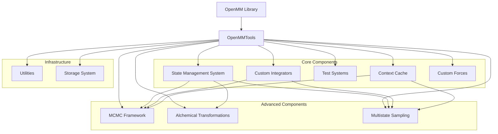
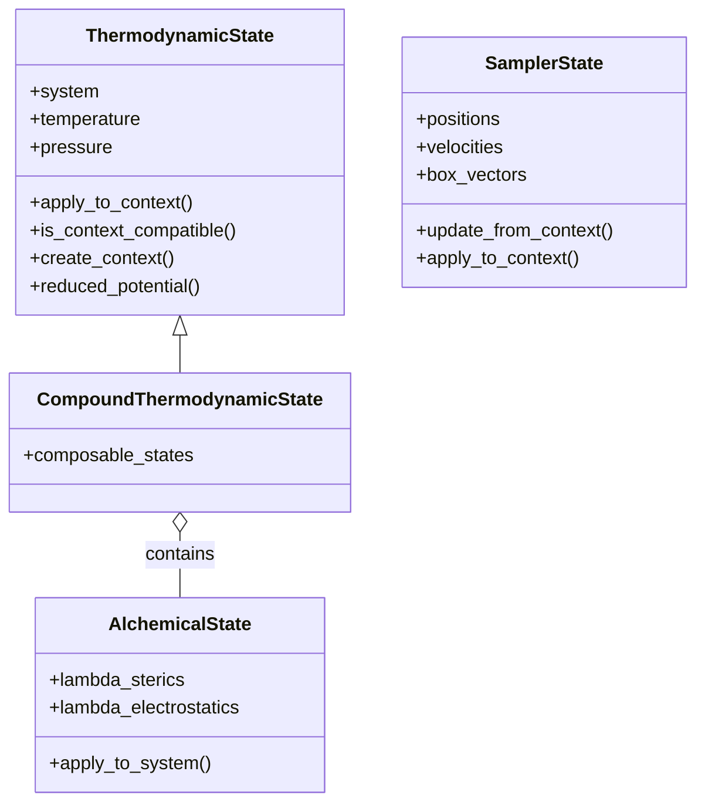

# Overview

<details>
<summary>Relevant source files</summary>

The following files were used as context for generating this wiki page:

- [.github/workflows/CI.yml](.github/workflows/CI.yml)
- [README.md](README.md)
- [devtools/conda-envs/test_env.yaml](devtools/conda-envs/test_env.yaml)
- [docs/_static/images/logo.jpg](docs/_static/images/logo.jpg)
- [docs/_static/images/logo.png](docs/_static/images/logo.png)
- [docs/alchemy.rst](docs/alchemy.rst)
- [docs/conf.py](docs/conf.py)
- [docs/index.rst](docs/index.rst)
- [docs/multistate.rst](docs/multistate.rst)
- [docs/releasehistory.rst](docs/releasehistory.rst)

</details>


OpenMMTools is a comprehensive toolkit that extends [OpenMM](http://openmm.org/), a high-performance molecular simulation library, by providing additional tools and functionality for advanced molecular simulations. This overview introduces the OpenMMTools repository, its purpose, key components, and how it enhances OpenMM's capabilities for molecular modeling and simulation.

## Purpose and Scope

OpenMMTools serves as a Python library layer atop OpenMM, offering specialized components to facilitate the development of full-featured molecular simulation packages. The toolkit focuses on providing enhanced sampling techniques, state management abstractions, custom integrators, alchemical transformations for free energy calculations, and various utilities that simplify common molecular simulation tasks.

For installation guidance, see [Installation Guide](#2).

## System Architecture

OpenMMTools follows a modular design pattern where specialized components build upon more general abstractions to provide enhanced molecular simulation capabilities.

### High-Level Architecture



Sources: `README.md`, `docs/index.rst`

### State Management System

At the core of OpenMMTools is a robust state management system that provides abstractions for representing simulation conditions and configurations:



Sources: `docs/alchemy.rst`, `docs/index.rst`

## Key Components

OpenMMTools provides several key subsystems that extend OpenMM's functionality:

| Component | Description |
|-----------|-------------|
| **State Management System** | Provides clean separation between thermodynamic conditions (temperature, pressure) and molecular configurations, simplifying the complex task of managing simulation states |
| **Custom Integrators** | Enhanced numerical integration schemes for molecular dynamics, including specialized Langevin integrators with different splittings and nonequilibrium integrators |
| **Context Cache** | Optimizes performance by reusing OpenMM Context objects, reducing the computational overhead of context creation |
| **MCMC Framework** | Offers a flexible foundation for implementing various Markov chain Monte Carlo sampling algorithms |
| **Alchemical Transformations** | Enables free energy calculations through alchemical perturbations using a factory pattern |
| **Multistate Sampling** | Implements enhanced sampling techniques across multiple thermodynamic states, including replica exchange and self-adjusted mixture sampling |
| **Test Systems** | Provides standardized test systems for benchmarking, validation, and debugging |
| **Storage System** | Provides interfaces for efficiently storing and retrieving simulation data |

Sources: `docs/index.rst`, `README.md`

## Enhanced Sampling Capabilities

OpenMMTools includes advanced sampling methods that significantly extend OpenMM's capabilities:

### MCMC Framework

The Markov chain Monte Carlo (MCMC) framework provides a flexible system for implementing different sampling algorithms:

```mermaid
graph TD
    subgraph "MCMC Framework"
        MCMCMove["MCMCMove\n(Base Class)"]
        LangevinMove["LangevinDynamicsMove"]
        HMCMove["HMCMove"]
        GHMCMove["GHMCMove"]
        BarostatMove["MonteCarloBarostatMove"]
        MCMCSampler["MCMCSampler"]
        
        MCMCMove <|-- LangevinMove
        MCMCMove <|-- HMCMove
        MCMCMove <|-- GHMCMove
        MCMCMove <|-- BarostatMove
        MCMCSampler --> MCMCMove : uses
    end
```

Sources: `README.md`, `docs/mcmc.rst`

### Multistate Sampling Methods

```mermaid
graph TD
    subgraph "Multistate Framework"
        MultiStateSampler["MultiStateSampler\n(Base Class)"]
        ReplicaExchange["ReplicaExchangeSampler"]
        SAMS["SAMSSampler"]
        ParallelTempering["ParallelTemperingSampler"]
        MultiStateReporter["MultiStateReporter"]
        
        MultiStateSampler <|-- ReplicaExchange
        MultiStateSampler <|-- SAMS
        MultiStateSampler <|-- ParallelTempering
        MultiStateSampler --> MultiStateReporter : outputs to
    end
```

Sources: `docs/multistate.rst`, `README.md`

## Alchemical Transformations

OpenMMTools provides tools for performing alchemical free energy calculations:

```mermaid
graph TD
    subgraph "Alchemical System"
        AbsoluteAlchemicalFactory["AbsoluteAlchemicalFactory"]
        AlchemicalState["AlchemicalState"]
        AlchemicalRegion["AlchemicalRegion"]
        
        AbsoluteAlchemicalFactory --> AlchemicalRegion : configures
        AbsoluteAlchemicalFactory --> OpenMMSystem : modifies
        AlchemicalState --> CompoundThermodynamicState : integrates with
    end
    
    OpenMMSystem["OpenMM System"] --> AlchemicalSystem["Alchemical System"]
```

Sources: `docs/alchemy.rst`

## Custom Integrators

OpenMMTools provides specialized integrators for various simulation protocols:

| Integrator Type | Examples | Description |
|-----------------|----------|-------------|
| Langevin Integrators | `LangevinIntegrator`, `GeodesicBAOABIntegrator` | Enhanced versions of OpenMM's Langevin integrators with different splitting schemes |
| Nonequilibrium Integrators | `AlchemicalNonequilibriumLangevinIntegrator` | Support for nonequilibrium switching and free energy calculations |
| Nose-Hoover Chain Integrators | `NoseHooverChainVelocityVerletIntegrator` | Alternative thermostat implementations |

Sources: `README.md`, `docs/releasehistory.rst`

## Test Systems

OpenMMTools includes a suite of test systems for benchmarking, validation, and debugging:

| Category | Examples |
|----------|----------|
| Simple Systems | Harmonic oscillators, ideal gases |
| Protein Systems | Alanine dipeptide, T4 lysozyme, DHFR |
| Host-Guest Systems | Host-guest complexes |
| Explicit Water Systems | Water clusters, water boxes |
| Alchemical Systems | Systems prepared for alchemical transformations |

Sources: `README.md`, `docs/releasehistory.rst`

## Getting Started

To start using OpenMMTools, you'll need to install the package and its dependencies. OpenMMTools is available through conda-forge and can be installed using:

```
conda install -c conda-forge openmmtools
```

For complete installation instructions, refer to the [Installation Guide](#2).

The typical workflow with OpenMMTools involves:

1. Setting up a molecular system (using OpenMM or OpenMMTools test systems)
2. Configuring thermodynamic states and sampler states
3. Optionally, setting up alchemical transformations
4. Choosing appropriate integrators and MCMC moves
5. Running simulations using the MCMC framework or multistate samplers
6. Analyzing the results

For detailed information on specific components, refer to their dedicated wiki pages:
- [State Management System](#3.1)
- [Custom Integrators](#3.2)
- [Context Cache](#3.4)
- [MCMC Framework](#4.1)
- [Alchemical Transformations](#4.2)
- [Multistate Sampling](#4.3)

## Compatibility

OpenMMTools is compatible with:

| Component | Supported Versions |
|-----------|-------------------|
| Python | 3.10, 3.11, 3.12 |
| OpenMM | 8.1.2, 8.2.0 |
| PyMBAR | 3.x, 4.x |
| Operating Systems | Linux, macOS, Windows |

Sources: `.github/workflows/CI.yml`, `devtools/conda-envs/test_env.yaml`

## Further Resources

For a comprehensive understanding of OpenMMTools capabilities, refer to the [full documentation](http://openmmtools.readthedocs.io) at ReadTheDocs.

Sources: `README.md`

---