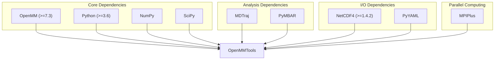
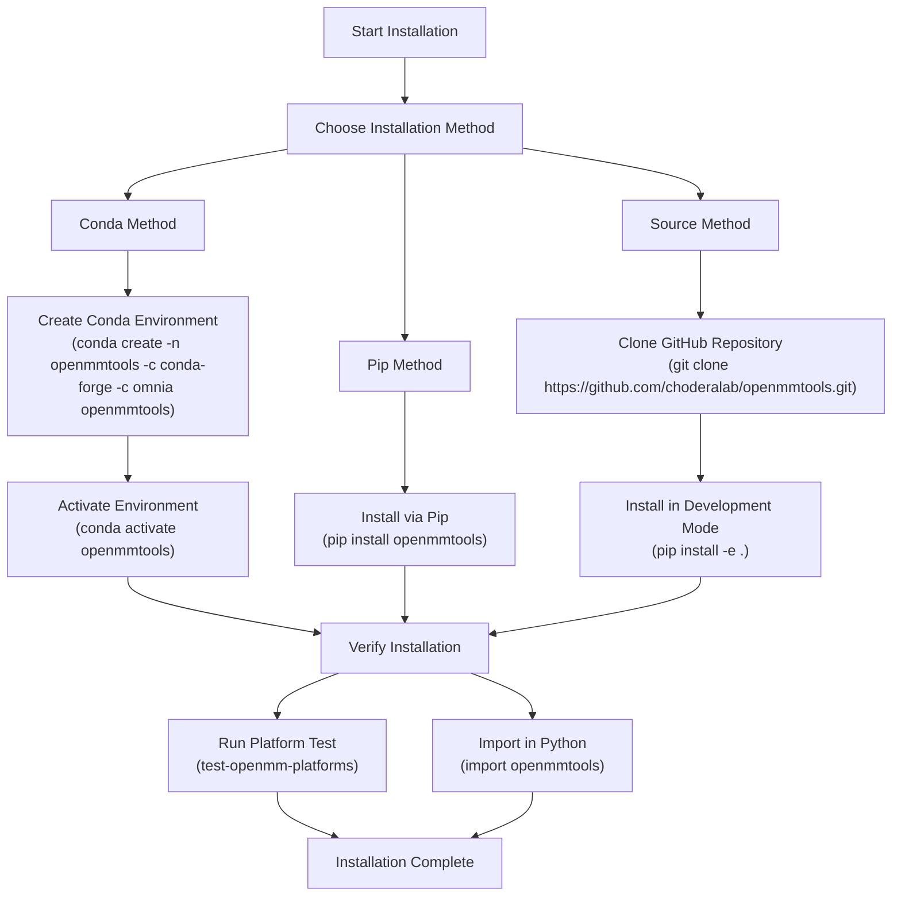

# Installation Guide

<details>
<summary>Relevant source files</summary>

The following files were used as context for generating this wiki page:

- [docs/environment.yml](docs/environment.yml)
- [readthedocs.yml](readthedocs.yml)
- [setup.cfg](setup.cfg)
- [setup.py](setup.py)

</details>


This guide provides detailed instructions for installing OpenMMTools, a toolkit that extends OpenMM with enhanced capabilities for molecular simulations. For an overview of OpenMMTools' purpose and components, see [Overview](#1).

## System Requirements

Before installing OpenMMTools, ensure your system meets these requirements:

- **Python**: Version 3.6 or higher
- **Platforms**: Linux, macOS, Windows, Unix
- **OpenMM**: Version 7.3 or higher
- **GPU Support** (Optional): CUDA-compatible NVIDIA GPU for accelerated simulations

Sources: [setup.py:69-71](), [docs/environment.yml:8]()

## Installation Methods

### Using Conda (Recommended)

Conda is the recommended installation method as it manages all dependencies efficiently:

```bash
# Create a new conda environment with OpenMMTools
conda create -n openmmtools -c conda-forge -c omnia openmmtools

# Activate the environment
conda activate openmmtools
```

Alternatively, create an environment from the provided specification:

```bash
# Clone the repository
git clone https://github.com/choderalab/openmmtools.git
cd openmmtools

# Create environment from specification
conda env create -f docs/environment.yml

# Activate the environment
conda activate openmmtools

# Install the package
pip install -e .
```

Sources: [docs/environment.yml:1-19](), [readthedocs.yml:3-4]()

### Using Pip

OpenMMTools can also be installed via pip:

```bash
# Basic installation
pip install openmmtools
```

Note that some dependencies might be challenging to install via pip alone, especially OpenMM.

Sources: [setup.py:39-80]()

### Installing from Source

For the latest development version or if you plan to contribute:

```bash
# Clone the repository
git clone https://github.com/choderalab/openmmtools.git
cd openmmtools

# Install in development mode
pip install -e .
```

Sources: [setup.py:39-80]()

## Dependency Structure

### Dependency Diagram



Sources: [docs/environment.yml:5-19](), [setup.py:71]()

## Installation Workflow

### Installation Process Diagram



Sources: [setup.py:76-79]()

## Verifying Your Installation

To verify that OpenMMTools has been installed correctly:

1. **Run the platform test tool**:
   ```bash
   test-openmm-platforms
   ```
   This utility checks which OpenMM platforms are available on your system.

2. **Import in Python**:
   ```python
   import openmmtools
   print(openmmtools.__version__)
   ```

Sources: [setup.py:76-79]()

## Key Dependencies

The following table lists the primary dependencies for OpenMMTools:

| Dependency | Minimum Version | Purpose |
| ---------- | --------------- | ------- |
| Python | 3.6 | Programming language |
| OpenMM | 7.3 | Molecular simulation engine |
| NumPy | - | Numerical computing |
| SciPy | - | Scientific computing |
| MDTraj | - | Trajectory analysis |
| NetCDF4 | 1.4.2 | File I/O |
| PyMBAR | - | Statistical analysis |
| MPIPlus | - | Parallel computing |
| PyYAML | - | Configuration parsing |

Sources: [docs/environment.yml:5-19](), [setup.py:71]()

## Command-Line Utilities

OpenMMTools provides the following command-line utilities:

1. **test-openmm-platforms**: Tests which OpenMM platforms are available
2. **benchmark-alchemy**: Benchmarks the alchemical transformation capabilities

Sources: [setup.py:76-79]()

## Troubleshooting

### Common Issues

1. **Missing Dependencies**:
   If you see import errors, ensure you have all required dependencies installed:
   ```bash
   conda install -c conda-forge -c omnia openmm numpy scipy mdtraj pymbar netcdf4 pyyaml mpiplus
   ```

2. **CUDA Compatibility Issues**:
   For GPU acceleration, ensure your NVIDIA drivers are compatible with the CUDA version required by OpenMM.

3. **Python Version Mismatch**:
   OpenMMTools requires Python 3.6 or higher.

Sources: [setup.py:71](), [docs/environment.yml:5-19]()

## Next Steps

Now that you have OpenMMTools installed, you can explore:

- [Core Simulation Components](#3): Learn about the fundamental components that power OpenMMTools
- [Enhanced Sampling Methods](#4): Discover advanced sampling techniques for more efficient simulations
- [Test Systems](#3.3): Explore ready-to-use test systems for validating your simulations

---