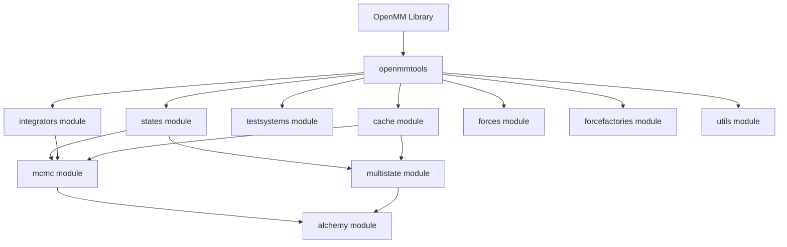
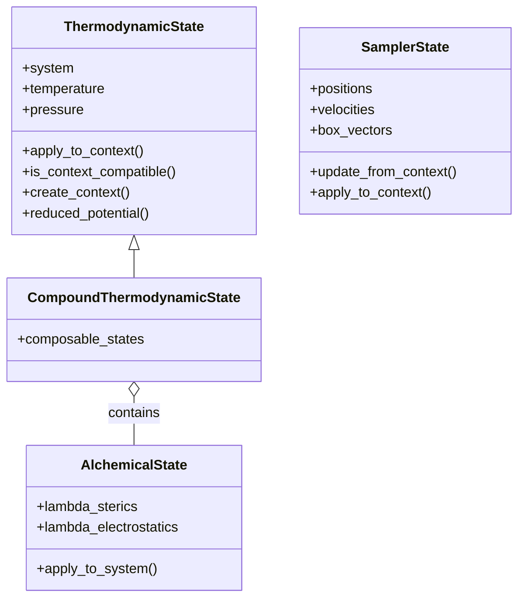
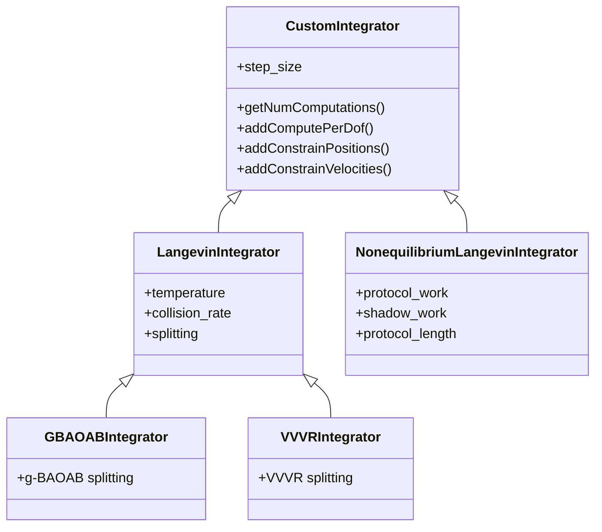
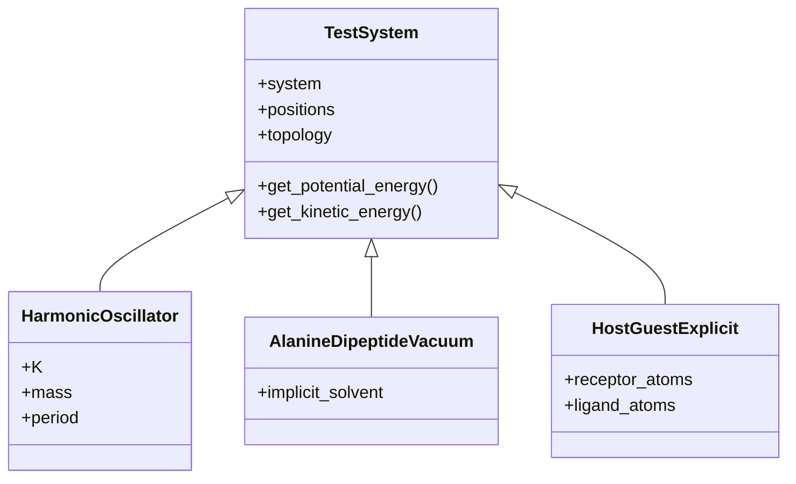
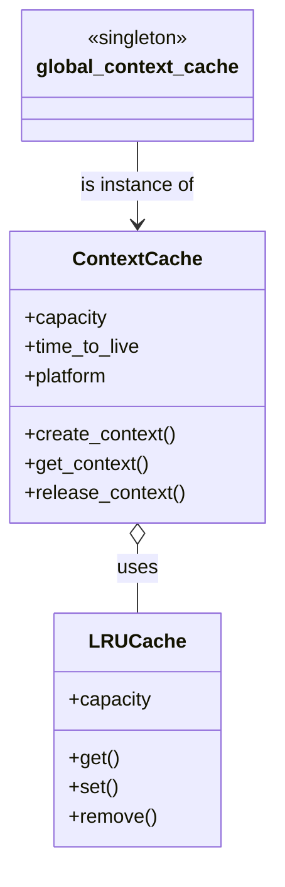
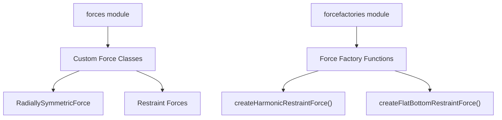
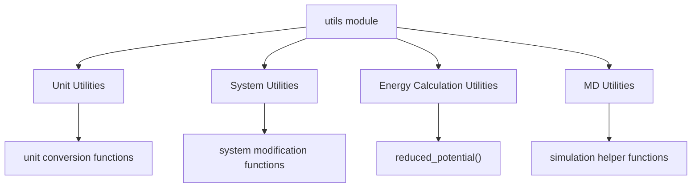
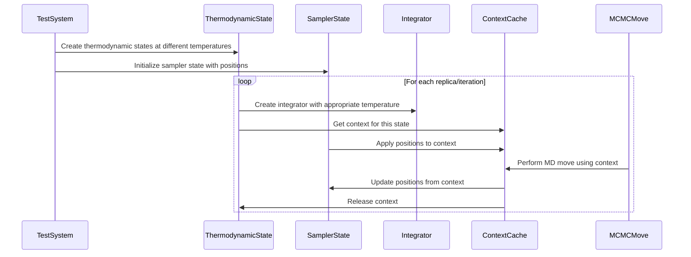

# Core Simulation Components

Relevant source files

The following files were used as context for generating this wiki page:

- [README.md](README.md)
- [docs/_static/images/logo.jpg](docs/_static/images/logo.jpg)
- [docs/_static/images/logo.png](docs/_static/images/logo.png)
- [docs/alchemy.rst](docs/alchemy.rst)
- [docs/conf.py](docs/conf.py)
- [docs/index.rst](docs/index.rst)
- [docs/multistate.rst](docs/multistate.rst)
- [openmmtools/__init__.py](openmmtools/__init__.py)
- [openmmtools/_version.py](openmmtools/_version.py)
- [versioneer.py](versioneer.py)

This page provides an overview of the fundamental components that make up the core functionality of OpenMMTools. These components form the foundation upon which the enhanced sampling methods and other advanced features are built.

The core simulation components of OpenMMTools include:

- State Management System
- Custom Integrators
- Test Systems
- Context Cache
- Custom Forces and Force Factories
- Utility Functions

For information on enhanced sampling methods that build upon these components, see [Enhanced Sampling Methods](#4).

## Core Architecture Overview

The following diagram shows how the core components of OpenMMTools relate to each other and to OpenMM:

This diagram shows the main Python modules in OpenMMTools and their dependencies. The core components (shown in the middle row) provide the foundation for the higher-level modules for enhanced sampling.

Sources: [openmmtools/__init__.py:8-8]()

## State Management System

The state management system provides a clean separation between thermodynamic conditions and molecular configurations. This is a critical design pattern in OpenMMTools that enables advanced sampling techniques.

The state system consists of:

- **ThermodynamicState**: Represents the thermodynamic conditions (temperature, pressure) and the OpenMM System
- **SamplerState**: Represents a point in phase space (positions, velocities, box vectors)
- **CompoundThermodynamicState**: Extends ThermodynamicState to include additional composable state parameters
- **AlchemicalState**: A composable state that controls alchemical parameters for free energy calculations

This separation makes it possible to:
1. Exchange configurations between different thermodynamic conditions
2. Modify thermodynamic parameters without changing the molecular configuration
3. Maintain a clear distinction between the physical system and its current state

For more detailed information, see [State Management System](#3.1).

Sources: [docs/index.rst:28-28](), [docs/index.rst:54-56]()

## Custom Integrators

OpenMMTools provides high-quality implementations of various integrators that extend the capabilities of OpenMM's built-in integrators.

Key integrator types include:

- **Langevin Integrators**: High-quality implementations with various "splittings" including:
  - **g-BAOAB**: Optimized for configurational sampling
  - **VVVR**: Velocity Verlet with velocity randomization
  - Other splittings with different numerical properties

- **Nonequilibrium Integrators**: For free energy calculations or nonequilibrium candidate Monte Carlo (NCMC)

These integrators provide improved stability, accuracy, and special features compared to standard implementations.

For more detailed information, see [Custom Integrators](#3.2).

Sources: [README.md:16-17](), [docs/index.rst:30-31]()

## Test Systems

OpenMMTools provides a comprehensive suite of test systems for benchmarking, validation, and debugging.

These test systems range from:

- **Simple Models**: Harmonic oscillators, ideal gases, Lennard-Jones fluids
- **Biomolecular Systems**: Alanine dipeptide in vacuum or solvent, host-guest complexes
- **Special-purpose Systems**: Systems designed for alchemical transformations

Benefits of using these pre-defined test systems include:
1. Standardized systems for benchmarking different algorithms
2. Well-defined systems for validation of new methods
3. Simplified debugging of simulation protocols
4. Reproducible examples for educational purposes

For more detailed information, see [Test Systems](#3.3).

Sources: [README.md:21](), [docs/index.rst:35](), [docs/index.rst:54]()

## Context Cache

The Context Cache optimizes the creation and reuse of OpenMM Context objects, which can be computationally expensive to create.

Key features of the Context Cache:

- **Performance Optimization**: Reuses expensive Context objects instead of creating new ones
- **LRU (Least Recently Used) Strategy**: Prioritizes keeping recently used contexts
- **Time-based Expiration**: Can expire contexts after a certain time to free resources
- **Global Access**: Provides a global context cache accessible throughout the application

Typical usage pattern:

1. Get a context for a calculation: `context = cache.get_context(thermodynamic_state, integrator)`
2. Perform the calculation using the context
3. Release the context back to the cache: `cache.release_context(context)`

For more detailed information, see [Context Cache](#3.4).

Sources: [docs/index.rst:57]()

## Custom Forces and Force Factories

OpenMMTools provides custom force implementations and force factory functions that extend the capabilities of OpenMM's built-in forces.

Key features include:

- **Custom Force Classes**: Specialized force implementations for specific use cases
- **Force Factories**: Functions that generate and configure force objects
- **Restraint Forces**: Forces that can restrain parts of the system (useful for enhanced sampling)
- **Integration with Alchemical System**: Forces designed to work with alchemical transformations

These custom forces enable complex simulation protocols that would be difficult to implement with standard OpenMM forces alone.

For more detailed information, see [Custom Forces and Force Factories](#3.5).

Sources: [docs/index.rst:60-62]()

## Utility Functions

OpenMMTools provides various utility functions for working with OpenMM that simplify common tasks in molecular simulations.

These utilities include functions for:

- **Unit Handling**: Conversion between unit systems, handling of quantities with units
- **System Manipulation**: Creating, modifying, and validating OpenMM System objects
- **Energy Calculations**: Computing energies, reduced potentials, and related quantities
- **Simulation Helpers**: Running simulations, equilibration, and analysis

The utilities provide a consistent interface for operations that would otherwise require repetitive boilerplate code, making it easier to work with OpenMM.

For more detailed information, see [Utility Functions](#3.6).

Sources: [docs/index.rst:64]()

## How Core Components Work Together

To illustrate how these components interact in a typical workflow, consider a simple replica exchange simulation:

This diagram shows how the core components interact in a typical enhanced sampling workflow:

1. A TestSystem provides the initial molecular system and positions
2. ThermodynamicState objects define different simulation conditions
3. A SamplerState holds the current molecular configuration
4. Integrators handle the time evolution of the system 
5. The ContextCache efficiently manages OpenMM Context objects
6. MCMC moves use these components to perform the actual sampling

Sources: Based on the overall architecture and components described in [docs/index.rst:19-35]()

## Summary

The core simulation components of OpenMMTools provide a flexible and efficient foundation for molecular simulations. By separating concerns like thermodynamic conditions, molecular configurations, and integration schemes, OpenMMTools makes it easier to implement advanced sampling techniques while maintaining high performance.

These components work together to enable the more complex functionality described in [Enhanced Sampling Methods](#4), [Alchemical Transformations](#4.2), and [Multistate Sampling](#4.3).

---