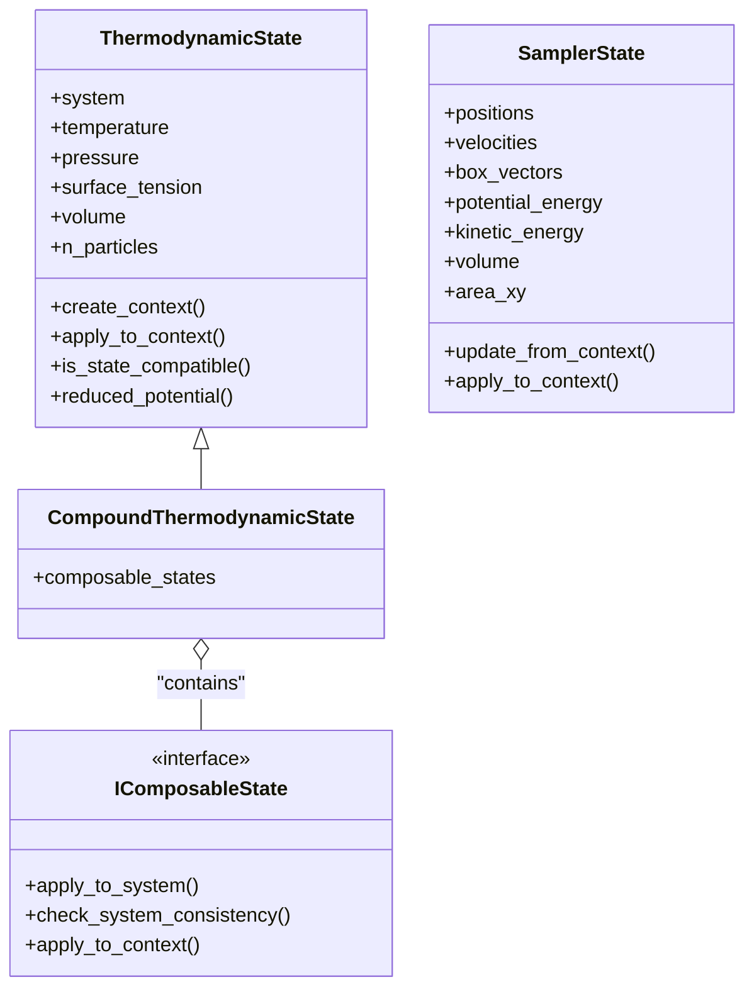
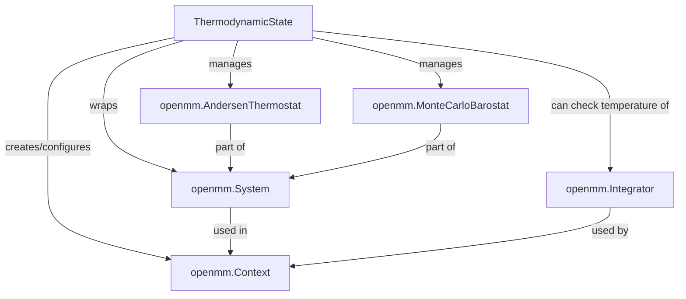
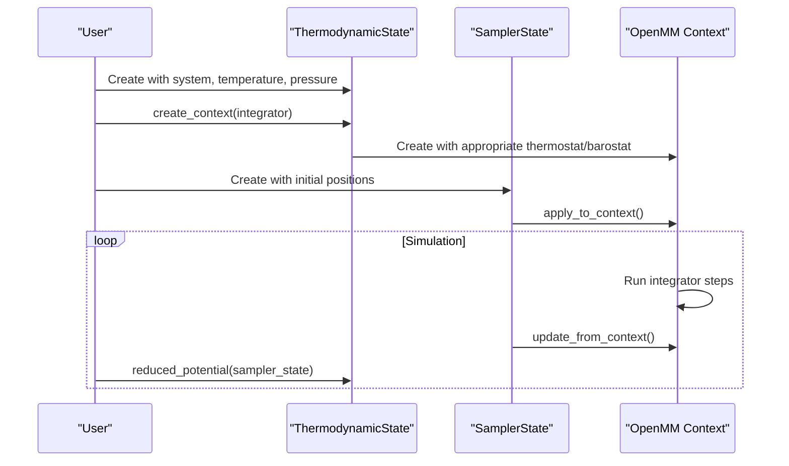
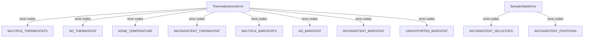
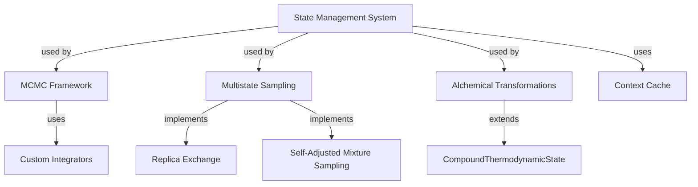

# State Management System

Relevant source files

The following files were used as context for generating this wiki page:

- [openmmtools/states.py](openmmtools/states.py)
- [openmmtools/tests/conftest.py](openmmtools/tests/conftest.py)
- [openmmtools/tests/test_states.py](openmmtools/tests/test_states.py)

The State Management System in OpenMMTools provides a framework for handling the different aspects of a molecular simulation's state. It separates the state into thermodynamic conditions (temperature, pressure) and configurational properties (positions, velocities), enabling clean and flexible implementation of complex simulation protocols.

## Overview

The State Management System consists of three main classes:

- **ThermodynamicState**: Manages thermodynamic parameters (temperature, pressure)
- **SamplerState**: Handles configurational properties (positions, velocities)
- **CompoundThermodynamicState**: Extends ThermodynamicState with composable state modifiers

These classes provide a clean separation of concerns, making it easier to implement advanced simulation techniques like replica exchange, alchemical transformations, and other enhanced sampling methods.

Sources: [openmmtools/states.py:7-10](), [openmmtools/states.py:381-441](), [openmmtools/states.py:1173-1174]()

## Class Structure

The following diagram illustrates the core classes in the State Management System and their relationships:

Sources: [openmmtools/states.py:385-501](), [openmmtools/states.py:1177-1533]()

## ThermodynamicState

The `ThermodynamicState` class represents the portion of a system's state that doesn't change with integration. It wraps an OpenMM system and maintains consistent thermodynamic parameters by managing thermostats and barostats.

### Features

- **Ensemble Support**: Handles NVT, NPT, and NPgammaT ensembles
- **System Management**: Ensures thermodynamic consistency by properly configuring thermostats and barostats
- **Context Creation**: Creates OpenMM contexts with appropriate thermodynamic settings
- **Compatibility Checking**: Determines if different thermodynamic states are compatible
- **Reduced Potential Calculation**: Computes the reduced potential energy for a given configuration

### Properties and Methods

Key properties:
- `temperature`: The thermodynamic temperature (read/write)
- `pressure`: The pressure for NPT ensembles (read/write, None for NVT)
- `surface_tension`: Surface tension for NPγT ensembles (read/write)
- `volume`: System volume (read-only, None for NPT)
- `system`: The OpenMM system in its current thermodynamic state (read/write)

Key methods:
- `create_context(integrator, platform=None)`: Creates an OpenMM Context configured with the current thermodynamic parameters
- `apply_to_context(context)`: Updates a context to match the current thermodynamic state
- `is_state_compatible(thermodynamic_state)`: Checks if two thermodynamic states are compatible
- `reduced_potential(context_state)`: Calculates the reduced potential energy

Sources: [openmmtools/states.py:385-1051](), [openmmtools/states.py:503-897](), [openmmtools/states.py:994-1007](), [openmmtools/states.py:1094-1170]()

### Interaction with OpenMM Components

Sources: [openmmtools/states.py:725-741](), [openmmtools/states.py:1094-1182]()

## SamplerState

The `SamplerState` class represents the configurational properties of a system - the variables that change during integration. It acts as a container for positions, velocities, box vectors, and energies.

### Features

- **Context Interaction**: Can create from, update from, and apply to OpenMM contexts
- **Particle Subsetting**: Supports slicing operations to work with subsets of particles
- **Performance Optimization**: Caches unitless arrays for improved performance
- **Collective Variables**: Can track and store collective variables defined in the context

### Properties and Methods

Key properties:
- `positions`: Atomic positions with units
- `velocities`: Atomic velocities with units (optional)
- `box_vectors`: Periodic box vectors
- `potential_energy`: The potential energy of the current configuration
- `kinetic_energy`: The kinetic energy of the current configuration
- `collective_variables`: Dictionary of collective variables defined in the system

Key methods:
- `update_from_context(context)`: Updates the sampler state from a context
- `apply_to_context(context)`: Applies the sampler state to a context
- `is_context_compatible(context)`: Checks if the sampler state is compatible with a context

Sources: [openmmtools/states.py:1177-1533](), [openmmtools/states.py:1356-1404](), [openmmtools/states.py:1483-1533]()

## CompoundThermodynamicState

The `CompoundThermodynamicState` class extends `ThermodynamicState` to incorporate composable states that can modify the system's Hamiltonian beyond just the thermodynamic parameters. This enables advanced simulation techniques like alchemical transformations.

### Features

- **Extensibility**: Allows custom state classes to modify the system Hamiltonian
- **Composition**: Combines multiple composable states with a thermodynamic state
- **Consistency**: Ensures all composable states are compatible with the system

Sources: [openmmtools/states.py:121-124]()

## Typical Workflow

A typical simulation workflow using the state management system looks like:

Sources: [openmmtools/states.py:1094-1106](), [openmmtools/states.py:1183-1227](), [openmmtools/states.py:1356-1404]()

## Utility Functions

The state system includes several utility functions to facilitate common operations:

- `create_thermodynamic_state_protocol(system, protocol, constants=None)`: Creates a sequence of thermodynamic states for a protocol
- `reduced_potential_at_states(sampler_state, thermodynamic_states, context_cache)`: Efficiently computes reduced potentials at multiple thermodynamic states
- `group_by_compatibility(thermodynamic_states)`: Groups thermodynamic states by compatibility

Sources: [openmmtools/states.py:39-141](), [openmmtools/states.py:144-183](), [openmmtools/states.py:186-217]()

## Error Handling

The State Management System defines custom exceptions for error handling:

- `ThermodynamicsError`: For errors related to thermodynamic consistency
- `SamplerStateError`: For errors related to sampler state consistency

These exceptions include detailed error codes and messages to help diagnose issues:

Sources: [openmmtools/states.py:272-377](), [openmmtools/tests/test_states.py:55-260]()

## Example Usage

Here's a typical usage example showing how ThermodynamicState and SamplerState work together:

1. Create a thermodynamic state with specific temperature and pressure
2. Create a context from the thermodynamic state
3. Create or update a sampler state with positions
4. Apply the sampler state to the context
5. Run simulation steps
6. Update the sampler state from the context
7. Calculate energies or other properties

This pattern is used extensively throughout OpenMMTools, particularly in the enhanced sampling methods such as Replica Exchange and Self-Adjusted Mixture Sampling.

Sources: [openmmtools/tests/test_states.py:858-1106](), [openmmtools/tests/test_states.py:1356-1404]()

## Internal Implementation Details

The ThermodynamicState class uses several internal methods to maintain consistency:

- `_standardize_system()`: Converts a system to a standard representation for compatibility checks
- `_find_thermostat()/`_find_barostat()`: Find and validate temperature/pressure control forces
- `_set_system_temperature()/`_set_system_pressure()`: Modify system forces to match state parameters
- `_is_integrator_thermostated()`: Check if an integrator controls temperature

The SamplerState class maintains caches of unitless positions and velocities for performance when these properties are accessed frequently.

Sources: [openmmtools/states.py:1358-1492](), [openmmtools/states.py:235-287](), [openmmtools/states.py:304-360](), [openmmtools/states.py:725-752]()

## Relationship to Other OpenMMTools Components

The State Management System serves as a foundation for other OpenMMTools components:

Sources: [openmmtools/states.py:121-124]()

## Performance Considerations

The State Management System incorporates several optimizations:

1. **System Caching**: The `ThermodynamicState` class maintains a cache of standardized systems to avoid redundant system creation
2. **Unitless Caching**: The `SamplerState` class caches unitless arrays of positions and velocities for improved performance
3. **Batch Computations**: The `reduced_potential_at_states` function optimizes the computation of energies across multiple states
4. **Force Group Tracking**: CompoundThermodynamicState can track which force groups need updates when parameters change

Sources: [openmmtools/states.py:1373-1377](), [openmmtools/states.py:1286-1355](), [openmmtools/states.py:912-992]()

## Summary

The State Management System in OpenMMTools provides a clean, efficient framework for handling the state of molecular simulations. By separating thermodynamic conditions from configurational properties, it enables flexible implementation of advanced sampling techniques while maintaining consistency with the underlying OpenMM engine.

---