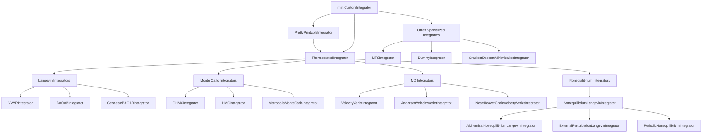
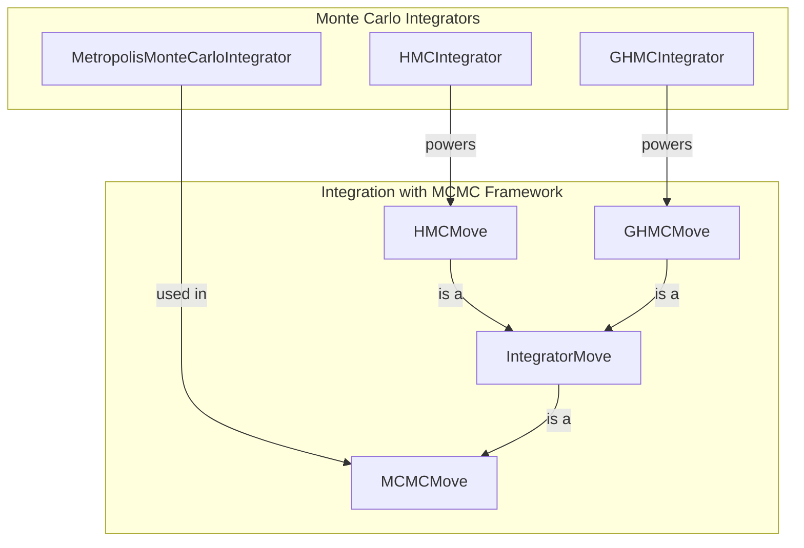
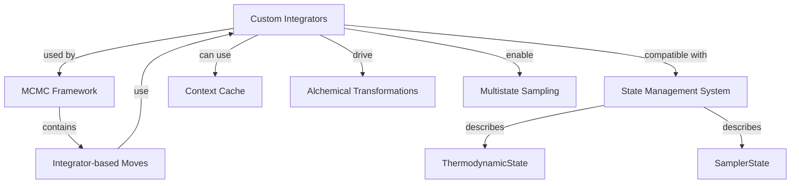

# Custom Integrators

<details>
<summary>Relevant source files</summary>

The following files were used as context for generating this wiki page:

- [docs/integrators.rst](docs/integrators.rst)
- [docs/mcmc.rst](docs/mcmc.rst)
- [docs/testsystems.rst](docs/testsystems.rst)
- [docs/utils.rst](docs/utils.rst)
- [openmmtools/integrators.py](openmmtools/integrators.py)
- [openmmtools/respa.py](openmmtools/respa.py)
- [openmmtools/tests/test_integrators.py](openmmtools/tests/test_integrators.py)
- [openmmtools/tests/test_integrators_and_testsystems.py](openmmtools/tests/test_integrators_and_testsystems.py)

</details>


Custom integrators in OpenMMTools provide enhanced numerical integration schemes for molecular dynamics simulations, extending the basic functionality of OpenMM's CustomIntegrator class. This page documents the various custom integrators available, their design philosophy, and how to use them effectively in molecular simulations.

For information about using these integrators with the Markov chain Monte Carlo framework, see [MCMC Framework](#4.1). For details on state management, refer to [State Management System](#3.1).

## Base Classes and Mixins

OpenMMTools provides foundational classes that add common functionality to all custom integrators.

### ThermostatedIntegrator

`ThermostatedIntegrator` serves as a base class for integrators that maintain a stationary distribution at a specific temperature. It adds temperature-related functionality:

- Adds a global variable `kT` representing thermal energy (kB × T)
- Provides `getTemperature()` and `setTemperature()` methods
- Includes a mechanism to update temperature-dependent constants only when temperature changes
- Preserves these methods after serialization through the `restore_interface()` method

```python
# Example usage
integrator = SomeThermostatedIntegrator(temperature=298.0*unit.kelvin)
current_temp = integrator.getTemperature()
integrator.setTemperature(310.0*unit.kelvin)
```

### PrettyPrintableIntegrator

This mixin class adds human-readable formatting capabilities:

- `pretty_format()` returns a formatted string representation of integrator steps
- `pretty_print()` prints this representation to standard output
- Helps with debugging and understanding complex integrator implementations

Sources: [openmmtools/integrators.py:59-122]()

## Hierarchy of Integrators



Sources: [openmmtools/integrators.py:125-316](), [openmmtools/integrators.py:317-2300]()

## Langevin Integrators

Langevin integrators model solvent effects implicitly through random forces and friction. They maintain temperature control without explicit solvent molecules.

### Common Features

- Temperature control through stochastic forces
- Various splitting schemes offering different accuracy-performance tradeoffs
- Options for shadow work and heat measurement

### Key Langevin Integrators

1. **VVVRIntegrator (Velocity Verlet with Velocity Randomization)**
   - Traditional Langevin splitting scheme
   - Balance of accuracy and computational efficiency

2. **BAOABIntegrator**
   - Superior configurational sampling properties
   - Optimal for equilibrium simulations focusing on positions

3. **GeodesicBAOABIntegrator**
   - Enhanced version of BAOAB with even better configurational accuracy
   - Highly recommended for equilibrium configurational sampling

```python
# Creating a BAOAB Langevin integrator
integrator = BAOABIntegrator(
    temperature=298.0*unit.kelvin,
    collision_rate=91.0/unit.picoseconds,
    timestep=2.0*unit.femtoseconds,
    constraint_tolerance=1e-6
)
```

Sources: [openmmtools/integrators.py:320-1200](), [docs/integrators.rst:15-36]()

## Nonequilibrium Integrators

Nonequilibrium integrators are specialized for free energy calculations and protocols where the system is driven out of equilibrium.

### Key Features

- Track protocol work, shadow work, and heat
- Support external parameter changes during simulation
- Designed for alchemical transformations and nonequilibrium switching

### Main Nonequilibrium Integrators

1. **NonequilibriumLangevinIntegrator**
   - Base class for nonequilibrium simulations
   - Tracks energetic quantities during transitions

2. **AlchemicalNonequilibriumLangevinIntegrator**
   - Specialized for alchemical free energy calculations
   - Designed to work with the alchemical state system

3. **ExternalPerturbationLangevinIntegrator**
   - Tracks work from changes to external parameters
   - Used for nonequilibrium switching protocols

```python
# Example: External perturbation integrator for a nonequilibrium protocol
integrator = ExternalPerturbationLangevinIntegrator(
    splitting="V R O R V",
    temperature=298.0*unit.kelvin,
    timestep=1.0*unit.femtoseconds,
    collision_rate=90.0/unit.picoseconds
)
```

Sources: [openmmtools/integrators.py:1500-2100](), [docs/integrators.rst:37-51]()

## Monte Carlo Integrators

Monte Carlo integrators use stochastic updates instead of or in addition to numerical integration of equations of motion.

### Key Monte Carlo Integrators

1. **MetropolisMonteCarloIntegrator**
   - Implements basic Metropolis Monte Carlo with Gaussian displacement trials
   - Tracks acceptance statistics

2. **HMCIntegrator (Hybrid Monte Carlo)**
   - Combines MD steps with Monte Carlo acceptance/rejection
   - Useful for maintaining exact temperature distribution

3. **GHMCIntegrator (Generalized Hybrid Monte Carlo)**
   - Extended version of HMC with partial momentum updates
   - Better for sampling configurations while preserving some dynamics



Sources: [openmmtools/integrators.py:800-1030]()

## Classical MD Integrators

Traditional molecular dynamics integrators provide deterministic integration of equations of motion, sometimes with thermostats.

### Key MD Integrators

1. **VelocityVerletIntegrator**
   - Implements the standard velocity Verlet algorithm
   - Symplectic integrator that conserves energy well over long timescales

2. **AndersenVelocityVerletIntegrator**
   - Velocity Verlet with Andersen thermostat
   - Temperature control via stochastic collisions

3. **NoseHooverChainVelocityVerletIntegrator**
   - Implements the Nosé-Hoover chain thermostat with velocity Verlet
   - Deterministic thermostat that produces the canonical ensemble
   - Requires the system to be passed to calculate degrees of freedom

Sources: [openmmtools/integrators.py:457-798]()

## Specialized Integrators

These integrators serve specific purposes in molecular simulations.

### MTSIntegrator (Multiple Time Step)

The rRESPA (Multiple Time Step) integrator allows different forces to be evaluated at different frequencies:

- Force groups can be evaluated at different intervals
- Useful for systems where some forces change rapidly while others change slowly
- Can significantly improve performance for appropriate systems

```python
# Example: Forces in group 0 evaluated every step, group 1 every 2 steps, group 2 every 8 steps
integrator = MTSIntegrator(4.0*unit.femtoseconds, [(0,1), (1,2), (2,8)])
```

### DummyIntegrator

A minimal integrator that:
- Only updates forces without advancing positions
- Useful for force evaluation without time integration
- Can be used for testing or specialized applications

### GradientDescentMinimizationIntegrator

A simple energy minimizer implemented as an integrator:
- Uses adaptive step size
- Enforces downhill moves in energy
- Alternative to OpenMM's built-in energy minimizers

Sources: [openmmtools/integrators.py:322-456](), [openmmtools/respa.py:39-98]()

## Integration with Other OpenMMTools Components

Custom integrators are designed to work seamlessly with other components of OpenMMTools:



Sources: [openmmtools/integrators.py:125-316](), [docs/mcmc.rst:1-139]()

## Usage Examples

### Creating and Configuring an Integrator

```python
from openmmtools import integrators
from openmm import unit

# Create a BAOAB Langevin integrator
integrator = integrators.BAOABIntegrator(
    temperature=298.0*unit.kelvin,
    collision_rate=91.0/unit.picoseconds,
    timestep=2.0*unit.femtoseconds
)

# Create a Context with the integrator
context = openmm.Context(system, integrator)
context.setPositions(positions)

# Run simulation
integrator.step(1000)
```

### Modifying Temperature During Simulation

```python
# Get current temperature
current_temp = integrator.getTemperature()
print(f"Current temperature: {current_temp}")

# Change temperature
new_temp = 310.0*unit.kelvin
integrator.setTemperature(new_temp)

# Continue simulation
integrator.step(1000)
```

### Using Multiple Time Step Integration

```python
# Create a multiple time step integrator
# Force group 0: evaluated every step
# Force group 1: evaluated every 2 steps
# Force group 2: evaluated every 8 steps
integrator = integrators.MTSIntegrator(
    timestep=4.0*unit.femtoseconds, 
    groups=[(0,1), (1,2), (2,8)]
)

# Set force groups in the system
for i, force in enumerate(system.getForces()):
    if i < 1:  # Fast-changing forces (bonds, angles)
        force.setForceGroup(2)  # Evaluated most frequently
    elif i < 3:  # Medium-changing forces
        force.setForceGroup(1)  # Medium frequency
    else:  # Slow-changing forces (long-range)
        force.setForceGroup(0)  # Evaluated least frequently
```

Sources: [openmmtools/integrators.py:322-387]()

### Using Nonequilibrium Integrators for Free Energy Calculations

```python
# Create a nonequilibrium switching integrator
integrator = integrators.AlchemicalNonequilibriumLangevinIntegrator(
    temperature=298.0*unit.kelvin,
    collision_rate=1.0/unit.picosecond,
    timestep=1.0*unit.femtosecond,
    splitting="V R O R V",
    measure_shadow_work=True,
    measure_heat=True
)

# Run nonequilibrium protocol
integrator.step(1000)

# Get accumulated work values
protocol_work = integrator.get_protocol_work()
shadow_work = integrator.get_shadow_work()
heat = integrator.get_heat()

print(f"Protocol work: {protocol_work}")
print(f"Shadow work: {shadow_work}")
print(f"Heat: {heat}")
```

Sources: [openmmtools/tests/test_integrators.py:384-431]()

## Performance Considerations

- **Multiple Time Step Integration**: Can significantly improve performance for systems with forces that evolve at different timescales
- **Temperature-Dependent Constants**: ThermostatedIntegrator only recalculates temperature-dependent values when temperature changes
- **Context Reuse**: Integrators work with the Context Cache system to minimize context creation overhead
- **Integration Stability**: Different integrators offer different tradeoffs between stability and step size

Sources: [openmmtools/integrators.py:236-254]()

---