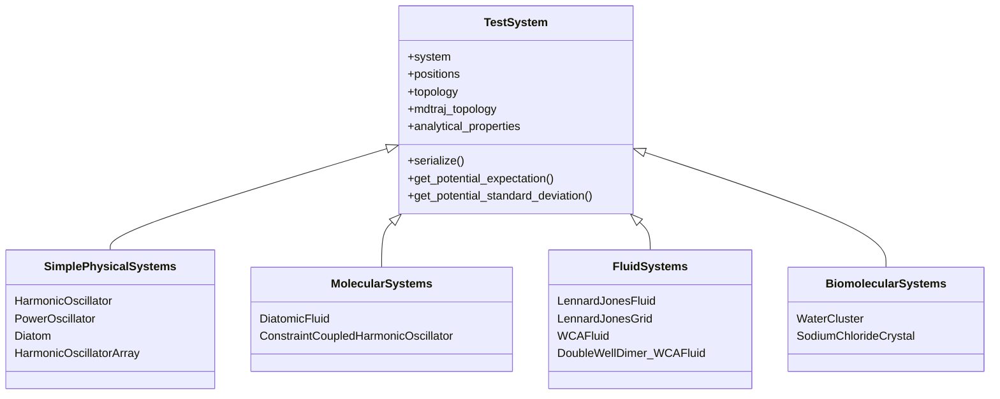
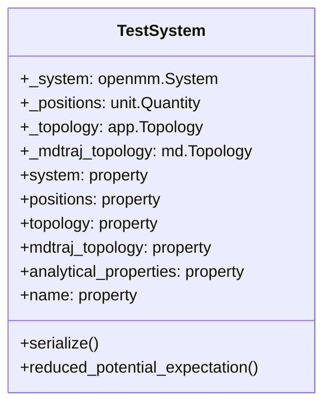

# Test Systems

<details>
<summary>Relevant source files</summary>

The following files were used as context for generating this wiki page:

- [openmmtools/tests/test_testsystems.py](openmmtools/tests/test_testsystems.py)
- [openmmtools/testsystems.py](openmmtools/testsystems.py)

</details>


The OpenMMTools test systems module provides a comprehensive collection of predefined molecular systems for benchmarking, validation, and debugging OpenMM-based simulations. These test systems range from simple physical models like harmonic oscillators to complex biomolecular systems, offering a standardized way to test and validate simulation methods.

## Overview

The test systems in OpenMMTools are implemented as Python classes that inherit from a common base class. Each test system provides:

1. An OpenMM `System` object that defines the energy function
2. Particle positions
3. A topology representing the molecular structure 
4. In many cases, analytical properties for validation



Sources: [openmmtools/testsystems.py:443-619]()

## Base TestSystem Class

The foundation of the test systems module is the `TestSystem` abstract base class, which defines the common interface for all test system implementations.



Sources: [openmmtools/testsystems.py:443-619]()

### Key Properties and Methods

- **system**: OpenMM `System` object representing the system's interactions
- **positions**: Particle positions as a `Quantity` object with units
- **topology**: OpenMM `Topology` object representing molecular structure
- **mdtraj_topology**: MDTraj topology object (lazy-loaded)
- **analytical_properties**: List of analytical properties available for the system
- **serialize()**: Converts the system and positions to XML format for storage or debugging
- **reduced_potential_expectation()**: Calculates the dimensionless potential energy

Sources: [openmmtools/testsystems.py:510-619]()

## Categories of Test Systems

The test systems are organized into several categories based on their complexity and intended use.

### Simple Physical Systems

These test systems represent simple physical models that have analytical solutions, making them excellent for validation.

#### Harmonic Oscillator

A single particle in a 3D harmonic potential, useful for testing basic integrators and thermostats.

```python
# Example usage
from openmmtools import testsystems
ho = testsystems.HarmonicOscillator()
system, positions = ho.system, ho.positions
```

Sources: [openmmtools/testsystems.py:680-836]()

#### Diatom

A two-particle system with a single harmonic bond, useful for testing bond constraints and dynamics.

Sources: [openmmtools/testsystems.py:943-1056]()

### Molecular Fluids

These systems represent simple molecular fluids at various densities.

#### Lennard-Jones Fluid

A periodic system of particles interacting via the Lennard-Jones potential, commonly used as a model for simple fluids.

```python
# Example usage
from openmmtools import testsystems
fluid = testsystems.LennardJonesFluid(nparticles=500, reduced_density=0.8)
system, positions = fluid.system, fluid.positions
```

Sources: [openmmtools/testsystems.py:1867-2072]()

#### WCA Fluid

A purely repulsive fluid using the Weeks-Chandler-Andersen potential, useful for studying entropy-driven effects.

Sources: [openmmtools/testsystems.py:2307-2382]()

#### Double Well Systems

Special test systems for studying rare events, featuring double-well potentials in a bath of WCA particles.

```python
# Example usage
from openmmtools import testsystems
dw_dimer = testsystems.DoubleWellDimer_WCAFluid(ndimers=2)
system, positions = dw_dimer.system, dw_dimer.positions
```

Sources: [openmmtools/testsystems.py:2388-2538]()

### Ionic Systems

Systems containing charged particles for testing electrostatic interactions.

#### Sodium Chloride Crystal

A simple ionic crystal system for testing electrostatic interactions and PME calculations.

Sources: [openmmtools/testsystems.py:1556-1665]()

## Test System Hierarchy

The following diagram illustrates the inheritance hierarchy of test systems provided in the module:

```mermaid
graph TD
    TestSystem["TestSystem"]
    
    TestSystem --> HarmonicOscillator["HarmonicOscillator"]
    TestSystem --> PowerOscillator["PowerOscillator"]
    TestSystem --> Diatom["Diatom"]
    TestSystem --> DiatomicFluid["DiatomicFluid"]
    TestSystem --> ConstraintCoupledHO["ConstraintCoupledHarmonicOscillator"]
    TestSystem --> HarmonicOscillatorArray["HarmonicOscillatorArray"]
    TestSystem --> SodiumChlorideCrystal["SodiumChlorideCrystal"]
    TestSystem --> LennardJonesCluster["LennardJonesCluster"]
    TestSystem --> WaterCluster["WaterCluster"]
    TestSystem --> LennardJonesFluid["LennardJonesFluid"]
    TestSystem --> CustomLJMixture["CustomLennardJonesFluidMixture"]
    TestSystem --> WCAFluid["WCAFluid"]
    
    DiatomicFluid --> UnconstrainedDiatomicFluid["UnconstrainedDiatomicFluid"]
    DiatomicFluid --> ConstrainedDiatomicFluid["ConstrainedDiatomicFluid"]
    DiatomicFluid --> DipolarFluid["DipolarFluid"]
    
    DipolarFluid --> UnconstrainedDipolarFluid["UnconstrainedDipolarFluid"]
    DipolarFluid --> ConstrainedDipolarFluid["ConstrainedDipolarFluid"]
    
    LennardJonesFluid --> LennardJonesFluidTruncated["LennardJonesFluidTruncated"]
    LennardJonesFluid --> LennardJonesFluidSwitched["LennardJonesFluidSwitched"]
    LennardJonesFluid --> LennardJonesGrid["LennardJonesGrid"]
    
    WCAFluid --> DoubleWellDimer_WCAFluid["DoubleWellDimer_WCAFluid"]
    DoubleWellDimer_WCAFluid --> DoubleWellChain_WCAFluid["DoubleWellChain_WCAFluid"]
```



Sources: [openmmtools/testsystems.py:676-2538](), [openmmtools/tests/test_testsystems.py:96-107]()

## Implementation Details

### System Creation Pattern

Most test systems follow a similar pattern in their implementation:

1. Initialize system parameters
2. Create an empty OpenMM `System` object
3. Add particles with appropriate masses
4. Add appropriate force terms
5. Set up particle positions
6. Create a topology

This pattern makes it relatively straightforward to understand and extend existing test systems.

Sources: [openmmtools/testsystems.py:680-836](), [openmmtools/testsystems.py:943-1056]()

### Analytical Properties

Many test systems provide analytical properties that can be used to validate simulation results. These are accessible through methods of the form `get_property_name()`:

```python
from openmmtools import testsystems
ho = testsystems.HarmonicOscillator()
state = testsystems.ThermodynamicState(temperature=300.0*unit.kelvin)
potential_mean = ho.get_potential_expectation(state)
potential_stddev = ho.get_potential_standard_deviation(state)
```

Available analytical properties can be queried using the `analytical_properties` attribute.

Sources: [openmmtools/testsystems.py:799-835](), [openmmtools/testsystems.py:906-924]()

## Utility Functions

The test systems module provides several utility functions that support the creation and manipulation of test systems:

| Function | Purpose |
|----------|---------|
| `halton_sequence()` | Generates a Halton quasi-random sequence |
| `subrandom_particle_positions()` | Creates positions with reduced clashes using quasi-random sequences |
| `build_lattice_cell()` | Creates a unit cell for lattice construction |
| `build_lattice()` | Builds a larger lattice from unit cells |
| `construct_restraining_potential()` | Creates a harmonic restraining potential for specific particles |

Sources: [openmmtools/testsystems.py:185-375]()

## Testing Framework

The test systems module is extensively tested to ensure that:

1. All systems can be constructed correctly
2. Energies are finite for all systems
3. Topologies contain the correct number of atoms
4. Analytical properties can be calculated

This testing framework is an excellent example of how to test complex simulation systems.

Sources: [openmmtools/tests/test_testsystems.py:79-106](), [openmmtools/tests/test_testsystems.py:158-207]()

## Usage Examples

### Basic Usage

```python
from openmmtools import testsystems
import numpy as np

# Create a test system
lj_fluid = testsystems.LennardJonesFluid(nparticles=500)
system, positions = lj_fluid.system, lj_fluid.positions

# Set up a simulation
from openmm import app
from openmm import LangevinIntegrator
integrator = LangevinIntegrator(300*unit.kelvin, 1/unit.picosecond, 2*unit.femtoseconds)
simulation = app.Simulation(lj_fluid.topology, system, integrator)
simulation.context.setPositions(positions)

# Run simulation
simulation.step(1000)
```

### Accessing Analytical Properties

```python
from openmmtools import testsystems
ho = testsystems.HarmonicOscillator()

# Check which analytical properties are available
print(ho.analytical_properties)
# ['potential_expectation', 'potential_standard_deviation']

# Create a thermodynamic state
state = testsystems.ThermodynamicState(temperature=298.0*unit.kelvin)

# Compute analytical properties
potential_mean = ho.get_potential_expectation(state)
potential_stddev = ho.get_potential_standard_deviation(state)
```

### Creating Custom Test Systems

You can create custom test systems by inheriting from the `TestSystem` base class:

```python
from openmmtools import testsystems
from openmm import System, CustomExternalForce
from openmm import unit

class MyTestSystem(testsystems.TestSystem):
    """A custom test system that implements a 3D quartic potential."""
    
    def __init__(self, K=100.0*unit.kilocalories_per_mole/unit.angstroms**4):
        super(MyTestSystem, self).__init__()
        
        # Create system
        system = System()
        system.addParticle(39.948*unit.amu)
        
        # Add quartic potential
        force = CustomExternalForce('K*((x^2 + y^2 + z^2)^2)')
        force.addGlobalParameter('K', K)
        force.addParticle(0, [])
        system.addForce(force)
        
        # Set positions
        positions = unit.Quantity(np.zeros([1, 3]), unit.angstroms)
        
        self.system, self.positions = system, positions
```

## Conclusion

The Test Systems module in OpenMMTools provides a rich collection of molecular systems that facilitate testing, benchmarking, and validation of molecular simulation methods. By using these standardized systems, developers can ensure their methods work correctly across a variety of physical scenarios, from simple toy models to complex molecular systems.

---