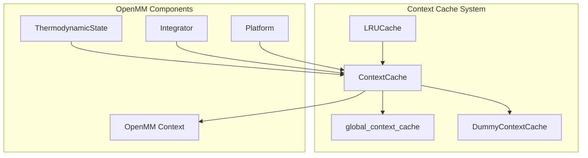
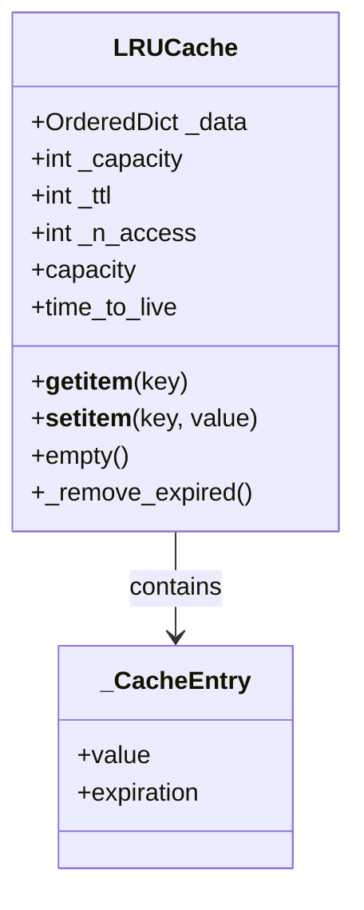
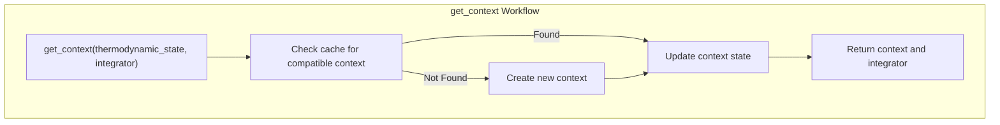
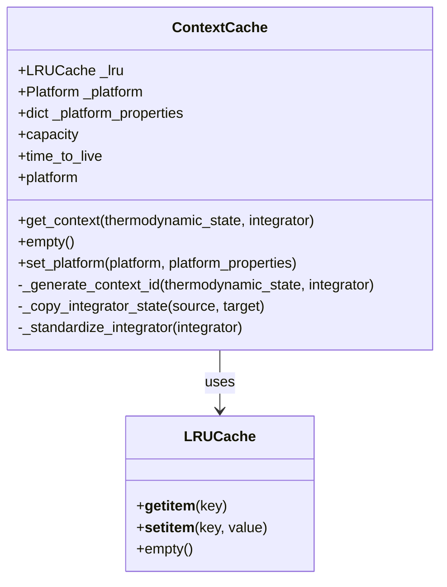
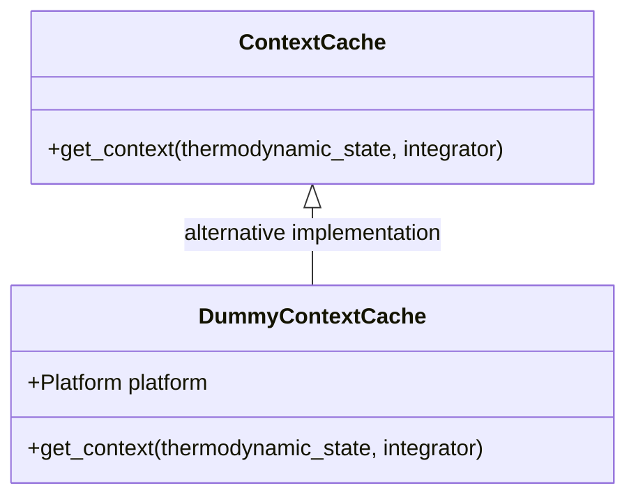
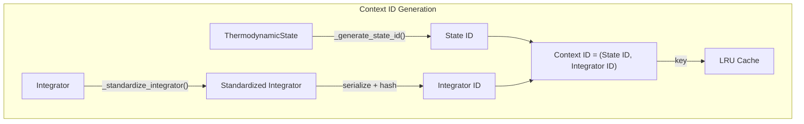

# Context Cache

<details>
<summary>Relevant source files</summary>

The following files were used as context for generating this wiki page:

- [openmmtools/cache.py](openmmtools/cache.py)
- [openmmtools/tests/test_cache.py](openmmtools/tests/test_cache.py)

</details>


The Context Cache system in OpenMMTools provides an efficient mechanism for creating, reusing, and managing OpenMM Context objects. Creating OpenMM Context objects is computationally expensive, and this caching system helps to minimize that overhead by reusing compatible contexts whenever possible. This page covers the design, functionality, and usage of the Context Cache system.

## Overview

In OpenMM, a Context object represents the complete state of a simulation, connecting a System, an Integrator, and a Platform. The Context Cache system minimizes the computational overhead of context creation by storing and reusing previously created contexts when appropriate.



**Diagram: Context Cache System Architecture**

Sources: [openmmtools/cache.py:214-266](), [openmmtools/cache.py:33-85](), [openmmtools/cache.py:791-792](), [openmmtools/cache.py:703-784]()

## LRU Cache

The foundation of the Context Cache system is a general-purpose Least Recently Used (LRU) cache implementation. This cache is designed to store elements with configurable capacity limits and expiration policies.

### Key Features

- **Maximum Capacity**: Limits the number of cached elements
- **Time-to-Live**: Automatically expires elements after a specified number of access operations
- **LRU Eviction Policy**: When capacity is reached, the least recently used element is removed



**Diagram: LRU Cache Class Structure**

Sources: [openmmtools/cache.py:34-208](), [openmmtools/cache.py:798-807]()

## Context Cache

The `ContextCache` class extends the LRU caching concept specifically for OpenMM Context objects. It determines compatibility between different thermodynamic states and integrators to efficiently reuse contexts when possible.

### Context Compatibility

Two Context objects are considered compatible if:
1. They are in compatible ThermodynamicStates (as determined by the `is_state_compatible` method)
2. They have compatible integrators

Integrator compatibility is determined by comparing their serialized states, with some flexibility for certain parameters that can be modified after context creation.



**Diagram: Context Retrieval Workflow**

Sources: [openmmtools/cache.py:378-461]()

### Configurable Parameters

The `ContextCache` can be configured with:

- **Capacity**: Maximum number of contexts to store
- **Time-to-Live**: Number of access operations before contexts expire
- **Platform**: OpenMM platform to use for creating contexts
- **Platform Properties**: Dictionary of platform-specific properties

### Integrator Compatibility

The `ContextCache` has sophisticated handling for integrator compatibility:

- Some integrator attributes (like step size) can be adjusted after context creation
- Compatible attributes are listed in `COMPATIBLE_INTEGRATOR_ATTRIBUTES`
- Incompatible attributes are listed in `INCOMPATIBLE_INTEGRATOR_ATTRIBUTES`



**Diagram: Context Cache Class Design**

Sources: [openmmtools/cache.py:214-692]()

## Global Context Cache

OpenMMTools provides a global instance of `ContextCache` for shared use throughout the library:

```python
global_context_cache = ContextCache(capacity=None, time_to_live=None)
```

This global instance is used by various components in OpenMMTools, particularly by MCMCMove implementations, to avoid redundant context creation.

Sources: [openmmtools/cache.py:791-792]()

## Dummy Context Cache

The `DummyContextCache` provides a simplified implementation that always creates a new Context object for each request. This can be useful for debugging or in situations where caching would not provide benefits.



**Diagram: Dummy Context Cache Relationship**

Sources: [openmmtools/cache.py:703-784]()

## Performance Considerations

The Context Cache significantly improves performance in simulations that frequently create and destroy contexts:

1. **MCMC Simulations**: Multiple short simulations benefit from context reuse
2. **Replica Exchange**: Multiple replicas with similar conditions can share contexts
3. **Free Energy Calculations**: Alchemical state changes often use compatible contexts

### Key Optimizations

- **Context Reuse**: Avoids the overhead of creating new Context objects
- **Integrator Standardization**: Allows reuse even with minor integrator differences
- **Automatic Cleanup**: Expired or unused contexts are removed to manage memory

## Usage Examples

### Basic Usage

```python
# Create a context cache
context_cache = ContextCache()

# Get a context for a thermodynamic state with a specific integrator
context, integrator = context_cache.get_context(thermodynamic_state, verlet_integrator)

# Get any context compatible with a thermodynamic state
context, integrator = context_cache.get_context(thermodynamic_state)
```

### Configuring Cache Capacity and Lifetime

```python
# Create a context cache with a maximum of 10 contexts
context_cache = ContextCache(capacity=10)

# Create a context cache where contexts expire after 100 accesses
context_cache = ContextCache(time_to_live=100)
```

### Platform Configuration

```python
# Create a context cache that uses CUDA platform
platform = openmm.Platform.getPlatformByName('CUDA')
context_cache = ContextCache(platform=platform)

# Set platform properties
context_cache = ContextCache(
    platform=platform,
    platform_properties={'CudaPrecision': 'mixed'}
)
```

## Relationship with Other Components

The Context Cache is a core utility used by various higher-level components in OpenMMTools:

- **MCMC Framework**: Uses the cache to efficiently create contexts for Monte Carlo moves
- **Multistate Sampling**: Manages contexts across multiple thermodynamic states
- **Alchemical Transformations**: Reuses contexts during alchemical free energy calculations

For more information about these higher-level components, see:
- [MCMC Framework](#4.1)
- [Multistate Sampling](#4.3)
- [Alchemical Transformations](#4.2)

Sources: [openmmtools/cache.py:791-792]()

## Technical Implementation Details

### Context ID Generation

The Context Cache identifies compatible contexts using a combination of:

1. **State ID**: Generated from the thermodynamic state's standardized system hash
2. **Integrator ID**: Generated from a standardized version of the integrator

These IDs are used as keys in the LRU cache to find and retrieve compatible contexts.



**Diagram: Context ID Generation Process**

Sources: [openmmtools/cache.py:616-651]()

### Integrator State Copying

When a compatible context is found but the integrator differs in some compatible aspects, the cache copies the state from the requested integrator to the cached integrator:

1. First, it restores any thermostated integrator interfaces
2. It copies all compatible global variables
3. It copies other compatible attributes through getters/setters

Sources: [openmmtools/cache.py:554-583]()

---