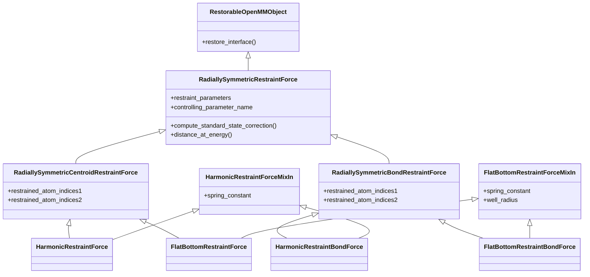
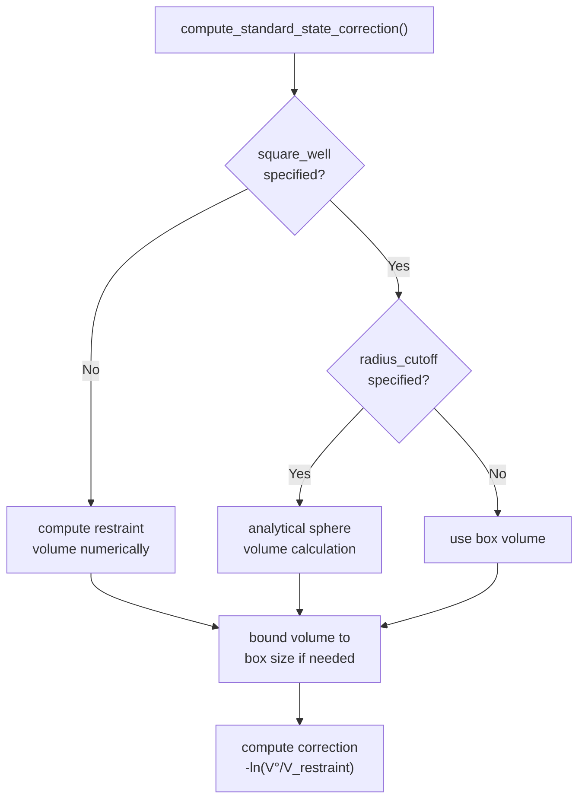
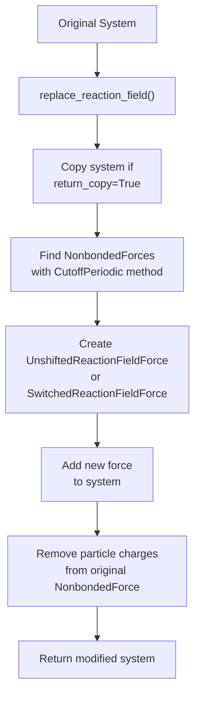
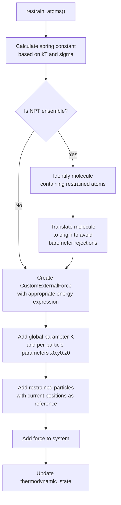

# Custom Forces and Force Factories

<details>
<summary>Relevant source files</summary>

The following files were used as context for generating this wiki page:

- [examples/integrator-benchmarks/integrator-benchmarks.py](examples/integrator-benchmarks/integrator-benchmarks.py)
- [openmmtools/data/alanine-dipeptide-explicit/alanine-dipeptide.pdb](openmmtools/data/alanine-dipeptide-explicit/alanine-dipeptide.pdb)
- [openmmtools/data/alanine-dipeptide-explicit/generate-pdb.py](openmmtools/data/alanine-dipeptide-explicit/generate-pdb.py)
- [openmmtools/data/alanine-dipeptide-explicit/run.sh](openmmtools/data/alanine-dipeptide-explicit/run.sh)
- [openmmtools/forcefactories.py](openmmtools/forcefactories.py)
- [openmmtools/forces.py](openmmtools/forces.py)
- [openmmtools/tests/test_forces.py](openmmtools/tests/test_forces.py)

</details>


This page documents the custom OpenMM force implementations and utility functions provided by OpenMMTools for manipulating forces in molecular simulations. These components enable advanced restraint forces for enhanced sampling and provide convenient utilities for modifying existing simulation systems.

## 1. Force Utility Functions

OpenMMTools provides several utility functions to make it easier to work with forces in OpenMM `System` objects.

### 1.1 Exception Types

Two exception types are defined for error handling when working with forces:

- `MultipleForcesError`: Raised when multiple forces of the same class are found but only one was expected
- `NoForceFoundError`: Raised when no forces matching the given criteria are found

### 1.2 Force Iteration and Discovery

The `iterate_forces()` function provides a convenient way to iterate through all forces in a system while ensuring the Python interface is properly restored:

```python
for force in iterate_forces(system):
    # Do something with the force
    print(force.__class__.__name__)
```

The `find_forces()` function offers a powerful way to locate specific forces in a system:

```python
# Find all NonbondedForces in the system
nonbonded_forces = find_forces(system, openmm.NonbondedForce)

# Find a single NonbondedForce (raises exception if multiple or none found)
force_idx, nonbonded_force = find_forces(system, openmm.NonbondedForce, only_one=True)

# Find forces using a regular expression pattern
harmonic_forces = find_forces(system, '.*Harmonic.*')

# Find forces including subclasses
custom_forces = find_forces(system, openmm.CustomBondForce, include_subclasses=True)
```

Sources: [openmmtools/forces.py:44-166]()

## 2. Radially Symmetric Restraint Forces

OpenMMTools provides a framework for creating and using restraint forces that are radially symmetric, primarily for receptor-ligand systems.

### 2.1 Force Class Hierarchy

The following diagram illustrates the inheritance hierarchy of the restraint force classes:



Sources: [openmmtools/forces.py:234-954](), [openmmtools/tests/test_forces.py:130-421]()

### 2.2 Base Classes

#### RadiallySymmetricRestraintForce

This is the base class for all radially symmetric restraint forces. It provides common functionality for:

- Computing standard state corrections for restraints
- Handling restraint parameter management
- Computing restraint volumes

Key methods:
- `compute_standard_state_correction()`: Calculates the standard state correction for the restraint
- `distance_at_energy()`: Computes the distance at which the potential energy has a specific value

#### Centroid vs. Bond Restraints

The framework provides two types of restraint implementations:

1. **Centroid-based restraints**: Implemented via `RadiallySymmetricCentroidRestraintForce`
   - Apply forces between the centroids of groups of atoms
   - Based on OpenMM's `CustomCentroidBondForce`
   - Only supported on 64-bit platforms with OpenCL

2. **Bond-based restraints**: Implemented via `RadiallySymmetricBondRestraintForce`
   - Apply forces between individual atoms
   - Based on OpenMM's `CustomBondForce`
   - Compatible with all platforms including 32-bit OpenCL

Sources: [openmmtools/forces.py:234-422](), [openmmtools/forces.py:672-800]()

### 2.3 Available Restraint Types

#### Harmonic Restraints

Implements a harmonic potential with energy expression:
```
E = controlling_parameter * (K/2)*r^2
```
where `K` is the spring constant and `r` is the distance between restrained atoms or centroids.

Available as:
- `HarmonicRestraintForce`: For restraining between groups of atoms
- `HarmonicRestraintBondForce`: For restraining between individual atoms

#### Flat-Bottom Restraints

Implements a flat-bottom potential that applies no force within a specified radius:
```
E = controlling_parameter * (K/2)*(max(0, r-r0))^2
```
where `K` is the spring constant, `r` is the distance, and `r0` is the well radius.

Available as:
- `FlatBottomRestraintForce`: For restraining between groups of atoms
- `FlatBottomRestraintBondForce`: For restraining between individual atoms

Sources: [openmmtools/forces.py:804-996](), [openmmtools/tests/test_forces.py:130-180]()

### 2.4 Standard State Correction

Restraint forces can compute standard state corrections, which are important for free energy calculations. The standard state correction is defined as:

```
ΔG°_correction = -kT * ln(V°/V_restraint)
```

Where:
- `V°` is the standard state volume (1661 ų)
- `V_restraint` is the effective volume of the restraint

The following diagram illustrates the standard state correction computation process:



Sources: [openmmtools/forces.py:367-460](), [openmmtools/tests/test_forces.py:233-421]()

## 3. Force Factories

OpenMMTools provides factory functions that can create or modify forces in an OpenMM system.

### 3.1 Reaction Field Electrostatics

The `replace_reaction_field()` function converts a system to use a switched reaction-field electrostatics:



Usage example:
```python
from openmmtools import forcefactories
# Convert a system to use unshifted reaction field
modified_system = forcefactories.replace_reaction_field(original_system)
# or with a specific switch width and using shifted reaction field
modified_system = forcefactories.replace_reaction_field(
    original_system, switch_width=1.5*unit.angstrom, shifted=True
)
```

Sources: [openmmtools/forcefactories.py:34-86]()

### 3.2 Atom Restraints

OpenMMTools provides functions to easily add restraints to a system:

#### restrain_atoms

The `restrain_atoms()` function applies soft harmonic restraints to specified atoms:

```python
from openmmtools import forcefactories
# Apply restraints with default strength
forcefactories.restrain_atoms(thermodynamic_state, sampler_state, restrained_atoms)
# With custom restraint strength
forcefactories.restrain_atoms(
    thermodynamic_state, sampler_state, restrained_atoms, 
    sigma=2.0*unit.angstroms
)
```

#### restrain_atoms_by_dsl

The `restrain_atoms_by_dsl()` function allows selecting atoms to restrain using the MDTraj domain-specific language (DSL):

```python
from openmmtools import forcefactories
# Restrain all alpha carbons
forcefactories.restrain_atoms_by_dsl(
    thermodynamic_state, sampler_state, topology, "name CA"
)
# Restrain a specific residue
forcefactories.restrain_atoms_by_dsl(
    thermodynamic_state, sampler_state, topology, "resid 1"
)
```

The restraint implementation automatically handles periodic boundary conditions and works with both NPT and NVT ensembles.



Sources: [openmmtools/forcefactories.py:93-179]()

## 4. Usage Patterns

### 4.1 Finding and Analyzing Forces

```python
import openmmtools as ommt

# Find all NonbondedForce objects in a system
nonbonded_forces = ommt.forces.find_forces(system, openmm.NonbondedForce)

# Find a specific type of custom restraint
restraints = ommt.forces.find_forces(
    system, ommt.forces.HarmonicRestraintForce, include_subclasses=True
)

# Examine properties of a restraint
for idx, restraint in restraints.items():
    print(f"Force {idx}: spring constant = {restraint.spring_constant}")
    print(f"Restrained atoms: {restraint.restrained_atom_indices1} - {restraint.restrained_atom_indices2}")
```

### 4.2 Adding Restraints to a System

```python
import openmmtools as ommt

# Create a harmonic restraint between atom groups
restraint = ommt.forces.HarmonicRestraintForce(
    spring_constant=500.0*unit.kilojoules_per_mole/unit.nanometer**2,
    restrained_atom_indices1=[10, 11, 12],  # First group of atoms (e.g., receptor atoms)
    restrained_atom_indices2=[50, 51]       # Second group of atoms (e.g., ligand atoms)
)

# Add the restraint to a system
system.addForce(restraint)

# Alternatively, use the forcefactories utility
ommt.forcefactories.restrain_atoms(
    thermodynamic_state, sampler_state, 
    restrained_atoms=[10, 11, 12, 50, 51]
)
```

### 4.3 Computing Standard State Corrections

```python
import openmmtools as ommt

# Create a restraint
restraint = ommt.forces.HarmonicRestraintForce(
    spring_constant=500.0*unit.kilojoules_per_mole/unit.nanometer**2,
    restrained_atom_indices1=[10, 11, 12],
    restrained_atom_indices2=[50, 51]
)

# Compute the standard state correction
correction = restraint.compute_standard_state_correction(
    thermodynamic_state,
    # Optional parameters:
    square_well=False,               # Reweight to square well potential
    radius_cutoff=1.0*unit.nanometer, # Maximum restraint distance
    energy_cutoff=10.0               # Maximum energy in kT
)

print(f"Standard state correction: {correction} kT")
```

Sources: [openmmtools/forces.py:367-460](), [openmmtools/tests/test_forces.py:311-421]()

---