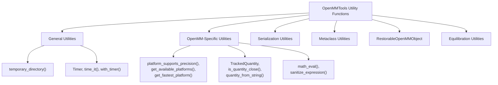
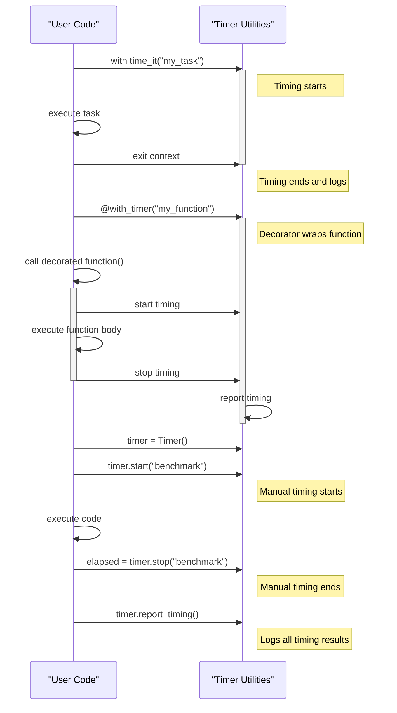
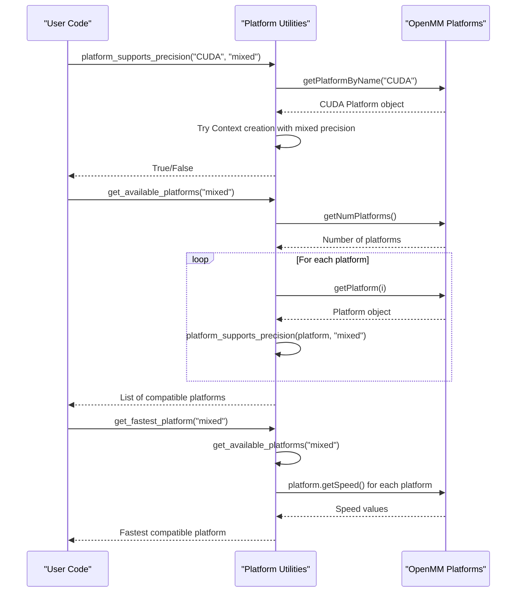
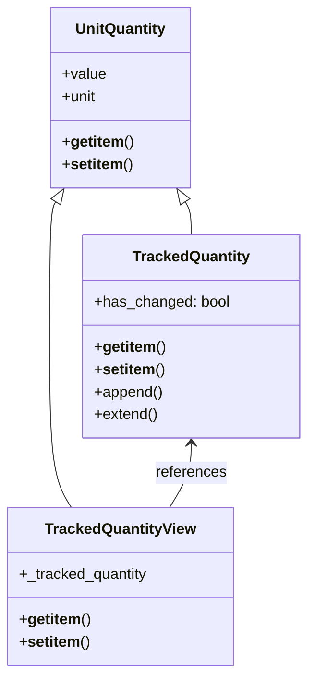
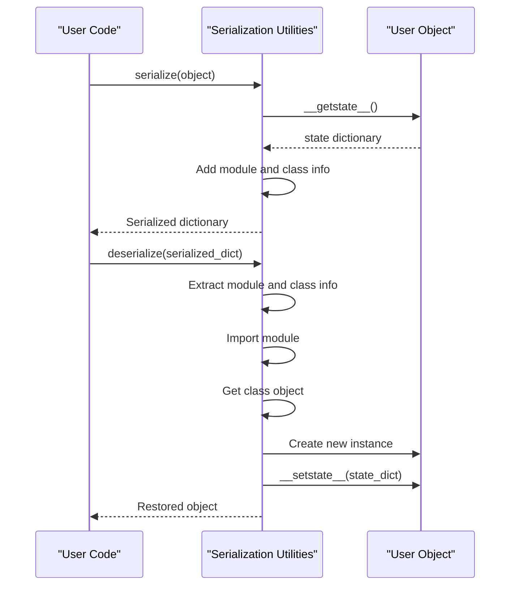
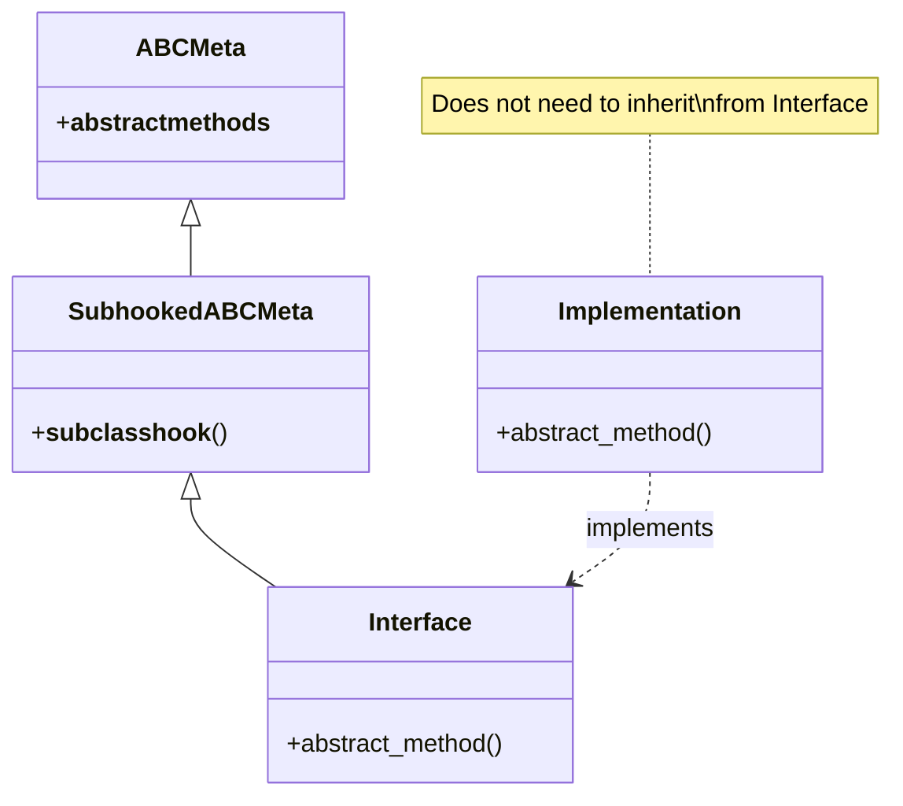
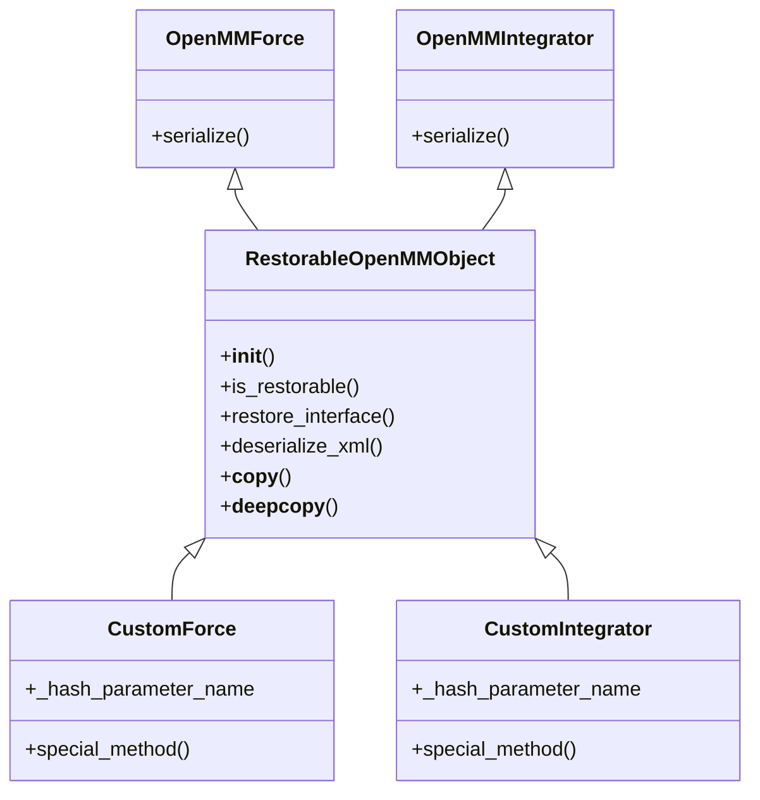
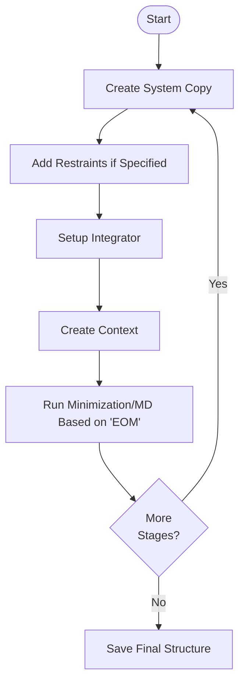

# Utility Functions

<details>
<summary>Relevant source files</summary>

The following files were used as context for generating this wiki page:

- [openmmtools/scripts/test_openmm_platforms.py](openmmtools/scripts/test_openmm_platforms.py)
- [openmmtools/tests/test_utils.py](openmmtools/tests/test_utils.py)
- [openmmtools/utils/__init__.py](openmmtools/utils/__init__.py)
- [openmmtools/utils/equilibration.py](openmmtools/utils/equilibration.py)
- [openmmtools/utils/utils.py](openmmtools/utils/utils.py)

</details>


OpenMMTools provides a collection of utility functions that assist with various aspects of molecular dynamics simulations using OpenMM. These utilities simplify common tasks such as managing temporary directories, timing code execution, working with quantities and units, interacting with different hardware platforms, serializing objects, and performing system equilibration.

## Utility Categories Overview

This diagram shows the major categories of utility functions available in OpenMMTools:



Sources: [openmmtools/utils/__init__.py:1-41](), [openmmtools/utils/utils.py:1-11]()

## General Utilities

### Temporary Directory Management

The `temporary_directory` context manager provides a safe way to create temporary directories that are automatically cleaned up when they're no longer needed.

```python
with temporary_directory() as tmp_dir:
    # Use temporary directory for operations
    # Directory will be automatically removed when exiting the with block
```

Sources: [openmmtools/utils/utils.py:48-59]()

### Timing and Benchmarking

OpenMMTools includes tools for timing code execution and benchmarking, which are useful for performance analysis:

- `Timer`: A class with stopwatch-style timing functions
- `time_it`: A context manager for timing code blocks
- `with_timer`: A decorator for timing function calls

Example usage patterns:



Sources: [openmmtools/utils/utils.py:64-184]()

## OpenMM-Specific Utilities

### Platform Utilities

OpenMMTools provides functions for working with OpenMM's hardware platforms:

- `platform_supports_precision`: Checks if a platform supports a specific precision
- `get_available_platforms`: Returns platforms that support a minimum precision
- `get_fastest_platform`: Returns the fastest available platform for a given precision



Sources: [openmmtools/utils/utils.py:518-601](), [openmmtools/tests/test_utils.py:36-69]()

### Quantity Utilities

These utilities help with managing OpenMM's unit system:

- `TrackedQuantity`: A subclass of `unit.Quantity` that tracks whether it has been modified
- `is_quantity_close`: Compares two quantities with specified tolerance
- `quantity_from_string`: Converts a string mathematical expression to a Quantity



Sources: [openmmtools/utils/utils.py:336-475](), [openmmtools/tests/test_utils.py:137-242]()

### Mathematical Expression Parsing

OpenMMTools provides functions for safely evaluating mathematical expressions:

- `math_eval`: Evaluates mathematical expressions with variables and functions
- `sanitize_expression`: Sanitizes expressions containing reserved words

```python
# Examples of math_eval usage
math_eval("x + y", {"x": 1.5, "y": 2})  # Returns 3.5
math_eval("(x + lambda) / z * 4", {"x": 1, "lambda": 2, "z": 3})  # Returns 4.0
math_eval("ceil(0.8) + step(0.5)", {"x": 0})  # Returns 2.0
```

Sources: [openmmtools/utils/utils.py:187-333](), [openmmtools/tests/test_utils.py:74-129]()

## Serialization Utilities

OpenMMTools includes functions to serialize and deserialize Python objects:

- `serialize`: Converts an object to a serializable dictionary representation
- `deserialize`: Reconstructs an object from its serialized form



Sources: [openmmtools/utils/utils.py:608-684](), [openmmtools/tests/test_utils.py:249-292]()

## Metaclass Utilities

These utilities assist with Python metaclass operations and inheritance management:

- `SubhookedABCMeta`: Abstract base class with implementation of `__subclasshook__`
- `find_all_subclasses`: Finds all subclasses of a parent class
- `find_subclass`: Finds a specific subclass by name



Sources: [openmmtools/utils/utils.py:691-798](), [openmmtools/tests/test_utils.py:300-371]()

## Restorable OpenMM Objects

The `RestorableOpenMMObject` class provides a mechanism to preserve class identity when OpenMM objects are serialized or copied:



This utility solves a common issue in OpenMM where custom forces and integrators lose their Python class information when they are serialized or copied. The `RestorableOpenMMObject` adds a hash parameter to the OpenMM object to track its class, enabling restoration after serialization.

Sources: [openmmtools/utils/utils.py:805-1036](), [openmmtools/tests/test_utils.py:379-521]()

## Equilibration Utilities

OpenMMTools provides utilities for system equilibration, particularly the `run_gentle_equilibration` function, which implements a multi-stage equilibration protocol:



The `run_gentle_equilibration` function takes a multi-stage approach to equilibration, where each stage can have different parameters:

| Parameter | Description |
|-----------|-------------|
| EOM | Equilibration operation mode: 'minimize', 'MD', or 'MD_interpolate' |
| n_steps | Number of steps to run in this stage |
| temperature | Temperature for the stage |
| ensemble | 'NPT', 'NVT', or None |
| restraint_selection | MDTraj selection syntax for atoms to restrain |
| force_constant | Restraint force constant |
| collision_rate | Langevin collision rate |
| timestep | Integration timestep |

Each stage builds upon the previous one, gradually relaxing the system toward production conditions.

Sources: [openmmtools/utils/equilibration.py:1-164](), [openmmtools/tests/test_utils.py:524-778]()

## Summary

The utility functions in OpenMMTools provide a broad set of tools that simplify many common tasks in molecular dynamics simulations. From managing temporary directories and measuring performance to working with OpenMM's platforms, quantities, and serialization mechanisms, these utilities form a foundation for the more specialized components of OpenMMTools. The equilibration utilities, in particular, provide ready-to-use protocols for preparing systems for production simulations.

---