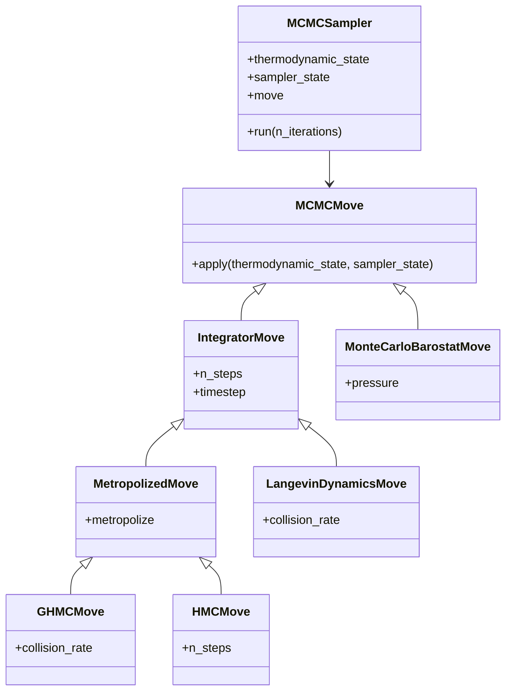
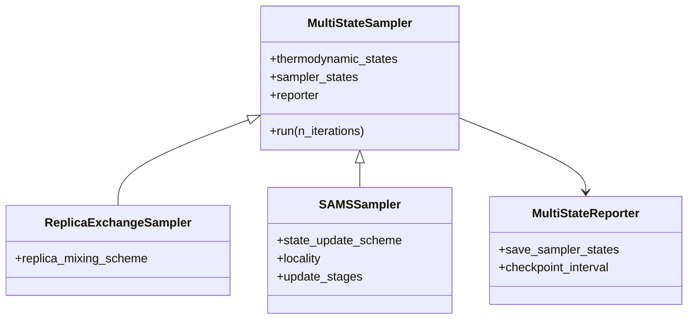
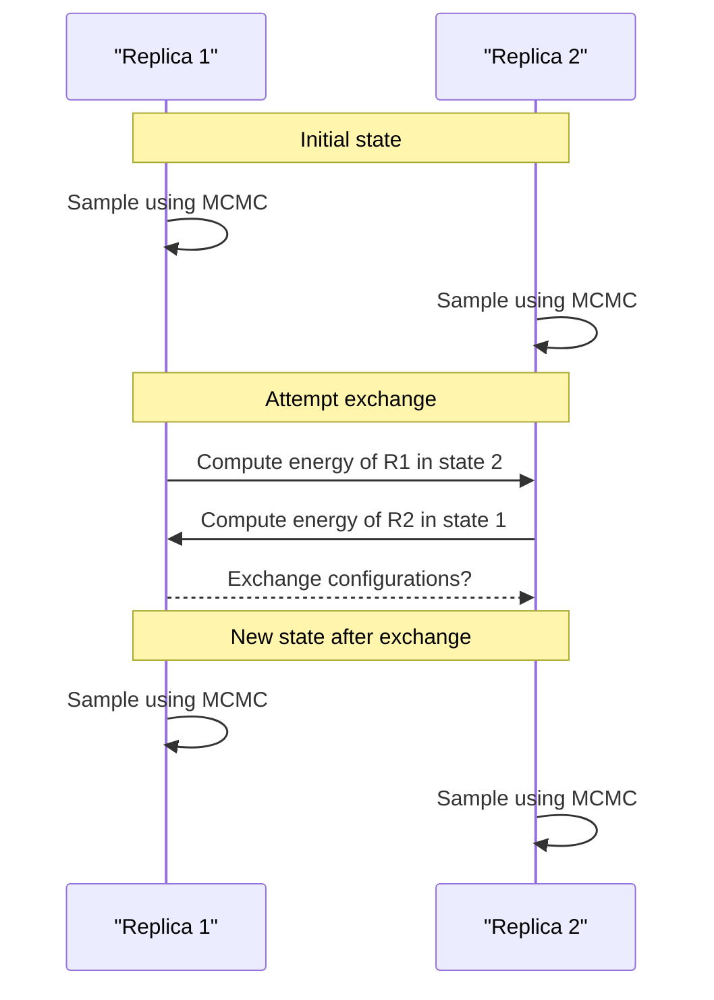
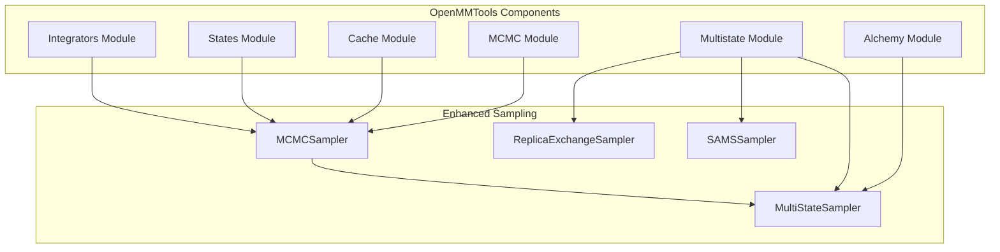

# Enhanced Sampling Methods

<details>
<summary>Relevant source files</summary>

The following files were used as context for generating this wiki page:

- [README.md](README.md)
- [docs/_static/images/logo.jpg](docs/_static/images/logo.jpg)
- [docs/_static/images/logo.png](docs/_static/images/logo.png)
- [docs/alchemy.rst](docs/alchemy.rst)
- [docs/conf.py](docs/conf.py)
- [docs/index.rst](docs/index.rst)
- [docs/integrators.rst](docs/integrators.rst)
- [docs/mcmc.rst](docs/mcmc.rst)
- [docs/multistate.rst](docs/multistate.rst)
- [docs/testsystems.rst](docs/testsystems.rst)
- [docs/utils.rst](docs/utils.rst)

</details>


Enhanced sampling techniques address a fundamental challenge in molecular simulations: traditional molecular dynamics (MD) simulations often get trapped in local energy minima, making it difficult to sample all relevant conformations. OpenMMTools provides several advanced sampling methods to overcome energy barriers and explore configuration space more effectively.

This page provides an overview of the enhanced sampling methods available in OpenMMTools. For detailed information on specific components, see the dedicated pages:
- [MCMC Framework](#4.1)
- [Alchemical Transformations](#4.2)
- [Multistate Sampling](#4.3)
- [Self-Adjusted Mixture Sampling](#4.4)
- [Replica Exchange Methods](#4.5)

## Enhanced Sampling Architecture

The diagram below illustrates the relationships between OpenMMTools' enhanced sampling components:

```mermaid
graph TD
    subgraph "Core Components"
        ThermodynamicState["ThermodynamicState"]
        SamplerState["SamplerState"]
        Integrators["Integrators"]
        ContextCache["ContextCache"]
    end
    
    subgraph "MCMC Framework"
        MCMCMove["MCMCMove"]
        LangevinMove["LangevinDynamicsMove"]
        HMCMove["HMCMove"]
        GHMCMove["GHMCMove"]
        BarostatMove["MonteCarloBarostatMove"]
        MCMCSampler["MCMCSampler"]
        
        MCMCMove <|-- LangevinMove
        MCMCMove <|-- HMCMove
        MCMCMove <|-- GHMCMove
        MCMCMove <|-- BarostatMove
        MCMCSampler --> MCMCMove
    end
    
    subgraph "Multistate Sampling"
        MultiStateSampler["MultiStateSampler"]
        ReplicaExchange["ReplicaExchangeSampler"]
        SAMS["SAMSSampler"]
        MultiStateReporter["MultiStateReporter"]
        
        MultiStateSampler <|-- ReplicaExchange
        MultiStateSampler <|-- SAMS
        MultiStateSampler --> MultiStateReporter
    end
    
    ThermodynamicState --> MCMCSampler
    SamplerState --> MCMCSampler
    Integrators --> MCMCMove
    ContextCache --> MCMCMove
    
    MCMCSampler --> MultiStateSampler
    ThermodynamicState --> MultiStateSampler
    SamplerState --> MultiStateSampler
```

Sources: README.md, docs/index.rst, docs/mcmc.rst, docs/multistate.rst

## MCMC Framework

The Markov chain Monte Carlo (MCMC) framework provides a flexible foundation for sampling from a given thermodynamic state. It enables the construction of complex sampling schemes by combining different move types.



The framework supports several move types:
- `LangevinDynamicsMove`: Uses Langevin dynamics for sampling
- `HMCMove`: Implements hybrid Monte Carlo
- `GHMCMove`: Implements generalized hybrid Monte Carlo
- `MonteCarloBarostatMove`: Performs Monte Carlo barostat moves

These moves can be combined through the `SequenceMove` and `WeightedMove` classes to create complex sampling schemes:

```python
# Combine moves to form a sequence of moves
sequence_move = SequenceMove([ghmc_move, langevin_move])
sampler = MCMCSampler(thermodynamic_state, sampler_state, move=sequence_move)

# Or create a move that selects one of them at random
weighted_move = WeightedMove([(ghmc_move, 0.5), (langevin_move, 0.5)])
sampler = MCMCSampler(thermodynamic_state, sampler_state, move=weighted_move)
```

Sources: docs/mcmc.rst

## Alchemical Transformations

Alchemical transformations modify the OpenMM `System` object to allow part of the system to be alchemically annihilated or decoupled. These transformations are essential for free energy calculations involving binding, solvation, or transfer processes.

```mermaid
graph TD
    subgraph "Alchemical System"
        AlchemicalFactory["AbsoluteAlchemicalFactory"]
        AlchemicalState["AlchemicalState"]
        AlchemicalRegion["AlchemicalRegion"]
        
        AlchemicalFactory --> AlchemicalRegion
        AlchemicalFactory --> OpenMMSystem
        AlchemicalState --> CompoundThermodynamicState
    end
    
    subgraph "Integration with State System"
        ThermodynamicState["ThermodynamicState"]
        CompoundThermodynamicState["CompoundThermodynamicState"]
        
        ThermodynamicState <-- CompoundThermodynamicState
    end
    
    OpenMMSystem["OpenMM System"] --> AlchemicalSystem["Alchemical System"]
    AlchemicalFactory --> AlchemicalSystem
    CompoundThermodynamicState --> AlchemicalState
```

The main components for alchemical transformations are:
- `AlchemicalState`: Represents the alchemical parameters (e.g., λ values)
- `AbsoluteAlchemicalFactory`: Creates modified systems for alchemical simulations
- `AlchemicalRegion`: Defines which parts of the system are to be modified

Sources: docs/alchemy.rst, README.md

## Multistate Sampling

The multistate sampling framework enables sampling from multiple thermodynamic states within a single calculation, which is crucial for enhanced sampling techniques.



OpenMMTools provides three main multistate sampling approaches:

### MultiStateSampler

The `MultiStateSampler` conducts independent simulations at distinct thermodynamic states. Each replica samples from a fixed thermodynamic state using MCMC, and the reduced potential is computed for each configuration across a neighborhood of thermodynamic states.

### Replica Exchange Sampler

The `ReplicaExchangeSampler` implements Hamiltonian replica exchange with Gibbs sampling. This method allows replicas to execute a random walk in thermodynamic state space, potentially reducing correlation times.



### Self-Adjusted Mixture Sampling

The `SAMSSampler` implements self-adjusted mixture sampling (SAMS), which combines replicas that sample from an expanded ensemble with an asymptotically optimal Wang-Landau-like weight update scheme.

SAMS provides several state update schemes:
- `global-jump`: The sampler can jump to any thermodynamic state (recommended)
- `restricted-range-jump`: The sampler can jump to any state within the specified neighborhood
- `local-jump`: Only proposals within the specified neighborhood are considered

SAMS also provides two ways of accumulating log weights:
- `optimal`: Accumulates weight only in the currently visited state
- `rao-blackwellized`: Accumulates fractional weight in all states within the energy evaluation neighborhood

Sources: docs/multistate.rst, README.md

## Integration with OpenMM Components

OpenMMTools' enhanced sampling methods integrate with other components such as custom integrators and the context cache system to provide efficient sampling.



Sources: docs/index.rst, README.md

## Example Usage

Below is a simple example of using the replica exchange sampler to simulate a system at multiple temperatures:

```python
from simtk import unit
from openmmtools import testsystems, cache
from openmmtools.states import ThermodynamicState, SamplerState
from openmmtools.mcmc import LangevinDynamicsMove
from openmmtools.multistate import ReplicaExchangeSampler, MultiStateReporter

# Create a test system
test = testsystems.AlanineDipeptideVacuum()

# Define thermodynamic states with different temperatures
temperatures = [300, 310, 320, 330, 340, 350] * unit.kelvin
thermodynamic_states = [ThermodynamicState(system=test.system, temperature=T) for T in temperatures]

# Define sampler state
sampler_state = SamplerState(positions=test.positions)

# Create MCMC move
move = LangevinDynamicsMove(n_steps=500)

# Set up reporter
reporter = MultiStateReporter('replica_exchange.nc', checkpoint_interval=10)

# Initialize replica exchange sampler
sampler = ReplicaExchangeSampler(
    mcmc_moves=move,
    number_of_iterations=100,
    replica_mixing_scheme='swap-neighbors'
)

# Run simulation
sampler.create(thermodynamic_states, sampler_state, reporter)
sampler.run()
```

Sources: docs/mcmc.rst, docs/multistate.rst

## Sampling Workflow

The general workflow for enhanced sampling in OpenMMTools follows this pattern:

| Step | Description | Key Classes |
|------|-------------|-------------|
| 1. System setup | Create or load a molecular system | `testsystems` classes |
| 2. State definition | Define thermodynamic states and sampler states | `ThermodynamicState`, `SamplerState` |
| 3. Move selection | Choose appropriate MCMC moves | `MCMCMove` subclasses |
| 4. Sampler setup | Configure the sampling method | `MultiStateSampler`, `ReplicaExchangeSampler`, or `SAMSSampler` |
| 5. Reporter setup | Configure data storage | `MultiStateReporter` |
| 6. Simulation | Run the enhanced sampling simulation | `sampler.run()` |
| 7. Analysis | Analyze the simulation results | `MultiStateAnalyzer` subclasses |

## Conclusion

OpenMMTools provides a comprehensive set of enhanced sampling methods that can significantly improve the efficiency of molecular simulations. These methods include MCMC sampling, alchemical transformations, replica exchange, and self-adjusted mixture sampling. By using these techniques, researchers can explore configuration space more effectively, overcome energy barriers, and obtain more accurate results from their simulations.

For more detailed information, refer to the dedicated pages for each component:
- [MCMC Framework](#4.1)
- [Alchemical Transformations](#4.2)
- [Multistate Sampling](#4.3)
- [Self-Adjusted Mixture Sampling](#4.4)
- [Replica Exchange Methods](#4.5)

Sources: README.md, docs/index.rst

---