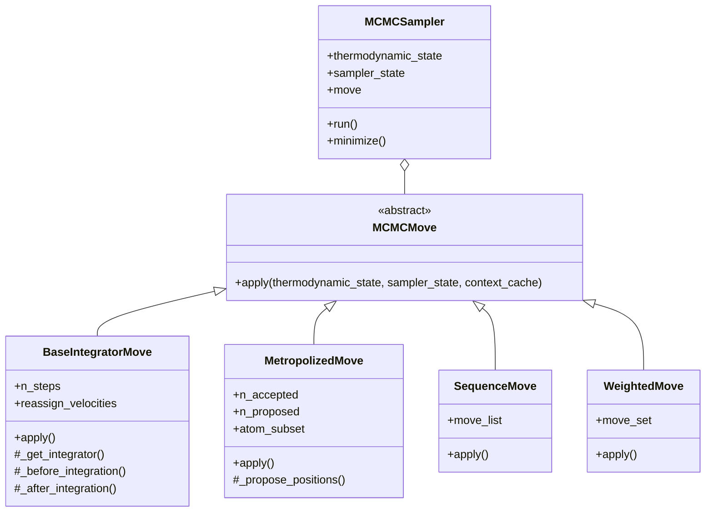
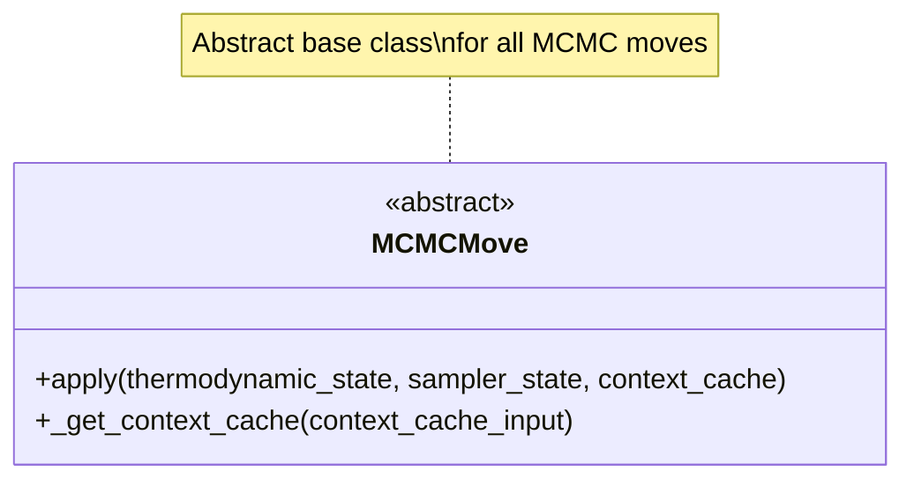
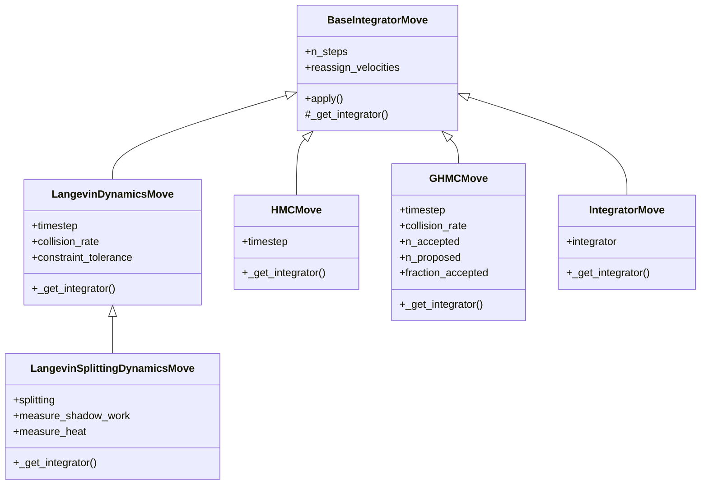
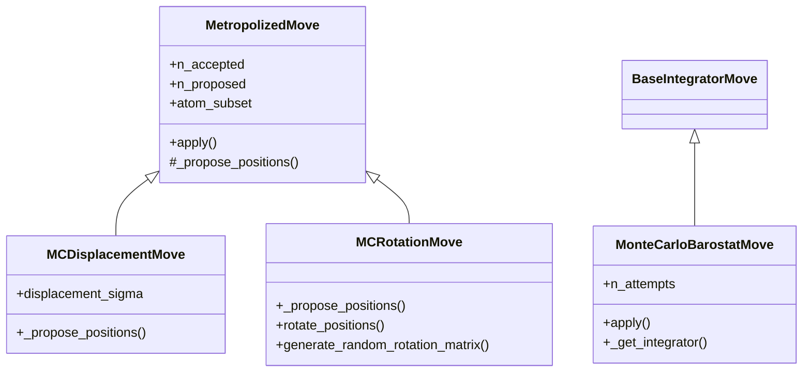
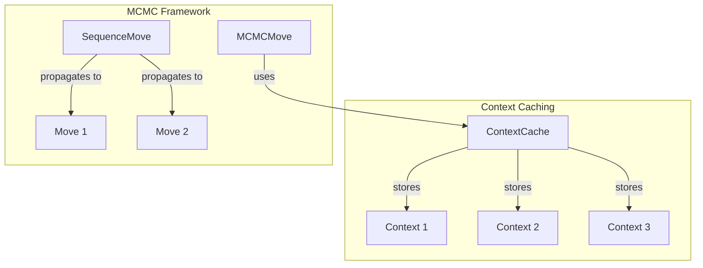
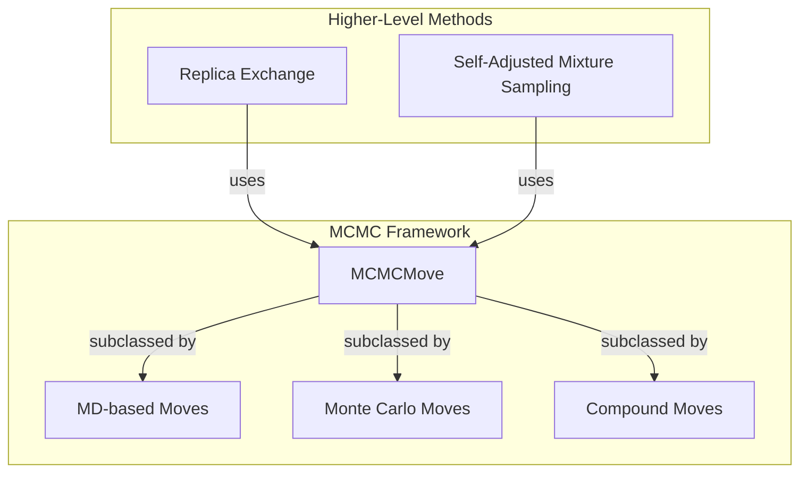

# MCMC Framework

<details>
<summary>Relevant source files</summary>

The following files were used as context for generating this wiki page:

- [openmmtools/mcmc.py](openmmtools/mcmc.py)
- [openmmtools/tests/test_mcmc.py](openmmtools/tests/test_mcmc.py)

</details>


## Purpose and Scope

The MCMC Framework provides a modular and extensible system for performing Markov chain Monte Carlo (MCMC) simulations using OpenMM. It's designed to offer a standardized interface for implementing various MCMC moves that can be combined in different ways to create sophisticated sampling strategies. This framework enables equilibrium sampling from a thermodynamic state of a biomolecular system, supporting a wide range of moves from pure molecular dynamics to Monte Carlo perturbations.

The MCMC Framework is a key component of OpenMMTools' enhanced sampling capabilities, providing the foundation upon which more complex algorithms like replica exchange or self-adjusted mixture sampling are built. For information about those higher-level methods, see the [Multistate Sampling](#4.3) wiki page.

## Core Architecture

The MCMC Framework follows an object-oriented design with a clear separation between:
1. The abstract move interface
2. Concrete move implementations
3. Move combiners
4. The sampler that coordinates the application of moves



**Diagram: Core MCMC Framework Class Hierarchy**

Sources: [openmmtools/mcmc.py:143-183](), [openmmtools/mcmc.py:216-343](), [openmmtools/mcmc.py:350-531](), [openmmtools/mcmc.py:603-803](), [openmmtools/mcmc.py:810-970]()

### MCMCMove Base Class

At the heart of the framework is the `MCMCMove` abstract base class, which defines the interface that all specific MCMC moves must implement. The key method is `apply()`, which updates the system state according to the specific move's algorithm.



**Diagram: MCMCMove Abstract Base Class**

Sources: [openmmtools/mcmc.py:143-183]()

### MCMCSampler

The `MCMCSampler` class manages the MCMC simulation, applying moves to update the system state over a specified number of iterations. It handles the interaction between the thermodynamic state (which defines the statistical ensemble), the sampler state (which holds coordinates, velocities, etc.), and the MCMC move that performs the actual state updates.

Key features:
- Handles initialization of the simulation state
- Applies moves for a specified number of iterations
- Provides minimization functionality for preparing systems

Sources: [openmmtools/mcmc.py:216-343]()

## MCMC Move Types

The MCMC Framework includes several categories of moves that serve different sampling purposes:

### Base Move Classes

#### BaseIntegratorMove

This is an abstract base class for moves that apply an OpenMM integrator to propagate the system. It handles:
- Integration with a specified number of steps
- Optional velocity reassignment
- Restart functionality for handling numerical instabilities

Child classes need to implement the `_get_integrator()` method to define the specific integrator to use.

Sources: [openmmtools/mcmc.py:603-803]()

#### MetropolizedMove

This abstract base class implements the Metropolis-Hastings acceptance criterion for Monte Carlo proposals. Child classes only need to implement the `_propose_positions()` method to generate candidate positions, and the base class handles:
- Calculating energies of the initial and proposed states
- Applying the Metropolis acceptance criterion
- Tracking acceptance statistics

Sources: [openmmtools/mcmc.py:810-970]()

### Molecular Dynamics Moves



**Diagram: Molecular Dynamics Move Classes**

Sources: [openmmtools/mcmc.py:976-1694]()

#### LangevinDynamicsMove

Uses Langevin dynamics to propagate the system. This is not a true Monte Carlo move as it assumes negligible discretization error. Key parameters include:
- `timestep`: The integration timestep
- `collision_rate`: The collision rate with fictitious bath particles
- `n_steps`: Number of integration steps per move application

Sources: [openmmtools/mcmc.py:1023-1173]()

#### LangevinSplittingDynamicsMove

Extends `LangevinDynamicsMove` with support for custom splitting schemes, allowing more control over the integration algorithm. The splitting parameter controls the sequence of operations within each timestep.

Sources: [openmmtools/mcmc.py:1175-1316]()

#### GHMCMove

Implements Generalized Hybrid Monte Carlo, which combines molecular dynamics with a Metropolis acceptance criterion to correct for time discretization errors. Tracks acceptance statistics.

Sources: [openmmtools/mcmc.py:1323-1487]()

#### HMCMove

Implements Hybrid Monte Carlo, which assigns velocities from a Maxwell-Boltzmann distribution and propagates the system using velocity Verlet before a Metropolis acceptance step.

Sources: [openmmtools/mcmc.py:1493-1590]()

### Monte Carlo Moves



**Diagram: Monte Carlo Move Classes**

Sources: [openmmtools/mcmc.py:1597-1912]()

#### MonteCarloBarostatMove

Makes one or more attempts to update the simulation box volume using Monte Carlo updates. This move requires that a `MonteCarloBarostat` force is present in the system.

Sources: [openmmtools/mcmc.py:1597-1697]()

#### MCDisplacementMove

A metropolized move that randomly displaces a subset of atoms according to a normal distribution with the specified standard deviation.

Sources: [openmmtools/mcmc.py:1704-1771]()

#### MCRotationMove

A metropolized move that randomly rotates a subset of atoms.

Sources: [openmmtools/mcmc.py:1777-1911]()

### Move Combiners

The MCMC framework provides two ways to combine multiple moves:

#### SequenceMove

Applies a sequence of MCMC moves in order. This allows for combining different move types, for example, applying a molecular dynamics step followed by a Monte Carlo barostat move.

```python
sequence_move = SequenceMove([
    LangevinDynamicsMove(n_steps=500),
    MonteCarloBarostatMove(n_attempts=5)
])
```

Sources: [openmmtools/mcmc.py:350-437]()

#### WeightedMove

Randomly selects one move from a set with specified probabilities. This can be used to create a mixed sampling strategy that combines the strengths of different move types.

```python
weighted_move = WeightedMove([
    (HMCMove(n_steps=10), 0.7),
    (MCDisplacementMove(), 0.3)
])
```

Sources: [openmmtools/mcmc.py:439-531]()

## Context Caching System

The MCMC Framework integrates with OpenMMTools' context caching system to improve performance by reusing OpenMM `Context` objects. Each `MCMCMove.apply()` method accepts an optional `context_cache` parameter that can be used to control caching behavior.



**Diagram: Context Caching in MCMC Framework**

Sources: [openmmtools/mcmc.py:184-213](), [openmmtools/mcmc.py:406-422](), [openmmtools/mcmc.py:495-514]()

Key aspects of the context caching system in MCMC:

1. **Default Behavior**: If no context cache is specified, the global context cache (`cache.global_context_cache`) is used.

2. **Propagation in Move Combinations**: For `SequenceMove` and `WeightedMove`, the specified context cache is propagated to all constituent moves.

3. **Custom Cache Configuration**: Users can create and configure custom context caches with different capacities, lifetimes, and platforms.

4. **DummyContextCache**: For testing or when cache reuse is not desired, a `DummyContextCache` can be used which creates a new context each time.

Sources: [openmmtools/tests/test_mcmc.py:277-406]()

## Usage Examples

### Basic MCMC Sampling

```python
# Create thermodynamic and sampler states
test = testsystems.AlanineDipeptideVacuum()
thermodynamic_state = ThermodynamicState(system=test.system, temperature=298*unit.kelvin)
sampler_state = SamplerState(positions=test.positions)

# Create a move
ghmc_move = GHMCMove(timestep=1.0*unit.femtosecond, n_steps=50)

# Initialize and run sampler
sampler = MCMCSampler(thermodynamic_state, sampler_state, move=ghmc_move)
sampler.minimize()  # Optional: minimize before sampling
sampler.run(n_iterations=1000)
```

Sources: [openmmtools/mcmc.py:47-90]()

### Combining Different Moves

```python
# Create a sequence move (moves applied in order)
sequence_move = SequenceMove([
    GHMCMove(timestep=1.0*unit.femtosecond, n_steps=50),
    LangevinDynamicsMove(n_steps=10)
])

# Create a weighted move (one move randomly selected per iteration)
weighted_move = WeightedMove([
    (GHMCMove(timestep=1.0*unit.femtosecond, n_steps=50), 0.5),
    (LangevinDynamicsMove(n_steps=10), 0.5)
])

# Use in a sampler
sampler = MCMCSampler(thermodynamic_state, sampler_state, move=weighted_move)
```

Sources: [openmmtools/mcmc.py:68-77]()

### NPT Simulation

```python
# Create a system with pressure control
test = testsystems.LennardJonesFluid()
thermodynamic_state = ThermodynamicState(system=test.system, 
                                         temperature=298*unit.kelvin,
                                         pressure=1*unit.atmospheres)
sampler_state = SamplerState(positions=test.positions)

# Create a move sequence with barostat
move = SequenceMove([
    GHMCMove(n_steps=50),
    MonteCarloBarostatMove(n_attempts=5)
])

sampler = MCMCSampler(thermodynamic_state, sampler_state, move=move)
sampler.run(n_iterations=1000)
```

Sources: [openmmtools/mcmc.py:366-382](), [openmmtools/tests/test_mcmc.py:48-64]()

## Integration with Higher-Level Sampling Methods

The MCMC Framework provides the foundational components used by OpenMMTools' higher-level enhanced sampling methods like Replica Exchange and Self-Adjusted Mixture Sampling. These methods use the `MCMCMove` classes to handle the sampling within each thermodynamic state.



**Diagram: Integration with Higher-Level Sampling Methods**

Sources: [openmmtools/mcmc.py:27-41]()

## Best Practices

1. **Choose Appropriate Moves**: 
   - For accurate sampling with large timesteps, use `GHMCMove` or `HMCMove` which include Metropolis corrections
   - For faster sampling where discretization error is acceptable, use `LangevinDynamicsMove`
   - For NPT simulations, include `MonteCarloBarostatMove`

2. **Context Caching**:
   - For batch simulations with similar systems, use a shared context cache
   - For production runs, configure an appropriate cache capacity based on available memory

3. **Error Handling**:
   - Set an appropriate `n_restart_attempts` for integrator moves to handle numerical instabilities
   - For systems prone to instabilities, use more conservative timesteps

4. **Performance Optimization**:
   - For pure MD moves, longer sequences of shorter moves can improve efficiency by amortizing context preparation costs
   - For MetropolizedMoves, restrict the `atom_subset` to only the atoms that need to be modified when possible

Sources: [openmmtools/mcmc.py:615-627](), [openmmtools/mcmc.py:735-759]()

## Summary

The MCMC Framework in OpenMMTools provides a flexible foundation for implementing a wide range of sampling algorithms in molecular simulations. By abstracting the common elements of MCMC methods and providing a modular, extensible design, it enables both simple usage patterns and sophisticated custom sampling strategies.

The framework forms the bedrock upon which more advanced enhanced sampling methods are built, standardizing the way state updates are performed across the OpenMMTools ecosystem.

---