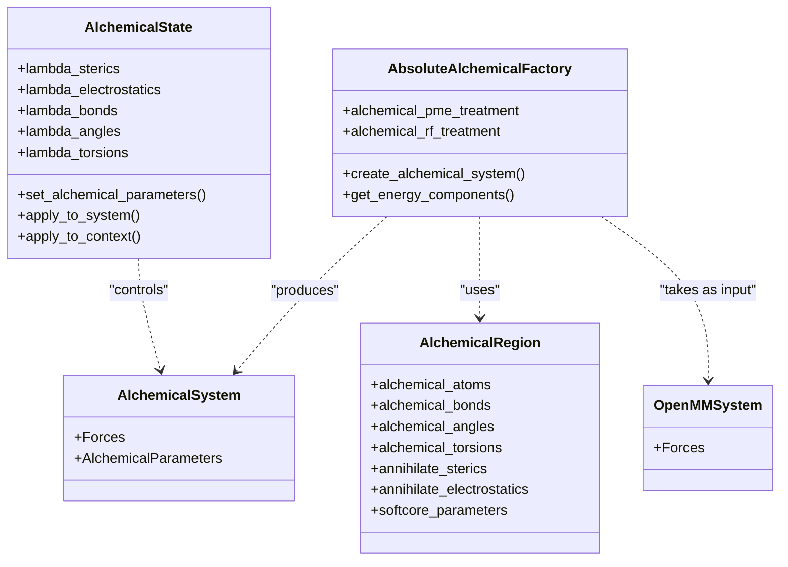
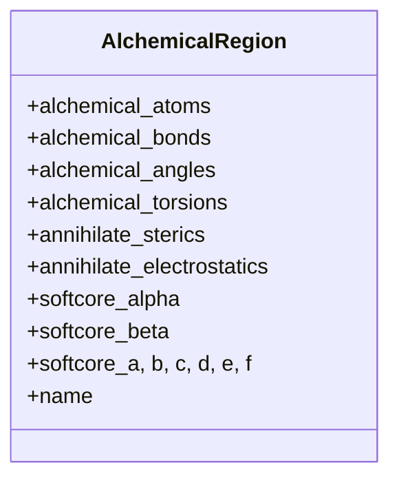
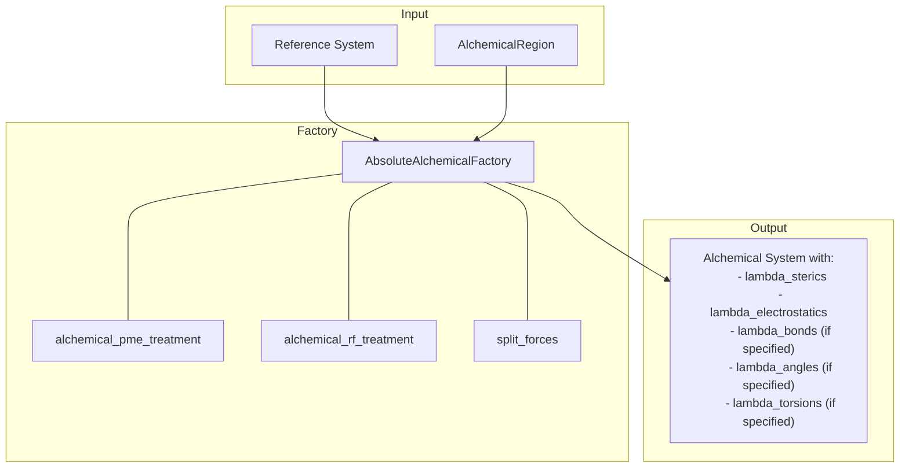
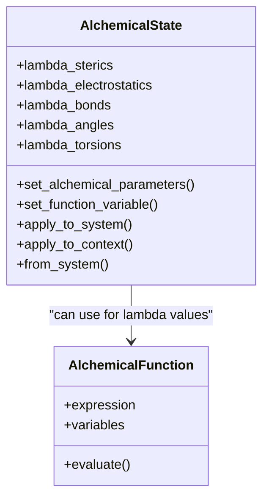
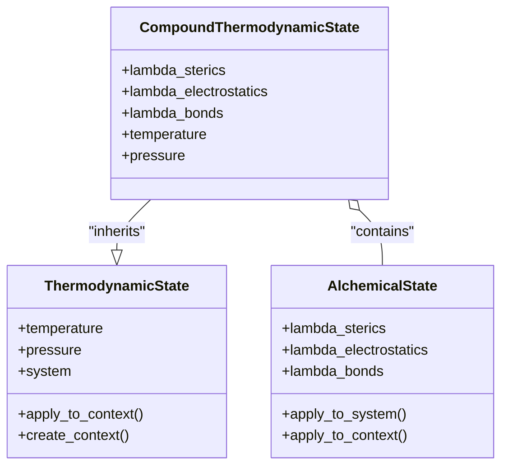
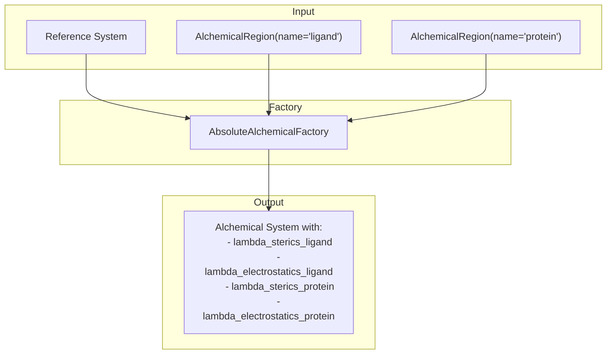

# Alchemical Transformations

<details>
<summary>Relevant source files</summary>

The following files were used as context for generating this wiki page:

- [openmmtools/tests/test_alchemy.py](openmmtools/tests/test_alchemy.py)

</details>


Alchemical transformations are a powerful technique in molecular simulations used to calculate free energy differences between molecular states. The OpenMMTools alchemical transformation system provides a framework for gradually modifying force field interactions through non-physical ("alchemical") intermediate states. These transformations are essential for free energy calculations like binding free energies, solvation free energies, and relative free energy differences between similar molecules.

For integration with enhanced sampling methods like replica exchange, see [Multistate Sampling](#4.3). For analysis of simulation data generated by alchemical transformations, see [Multistate Analysis](#5.1).

Sources: [openmmtools/tests/test_alchemy.py:33-39]()

## System Architecture

The alchemical transformation system consists of three primary components that work together to enable free energy calculations:



1. **AlchemicalRegion**: Defines which parts of a system will be alchemically modified
2. **AbsoluteAlchemicalFactory**: Creates alchemically-modified OpenMM systems 
3. **AlchemicalState**: Controls the lambda parameters during a simulation

Sources: [openmmtools/tests/test_alchemy.py:33-39]()

## AlchemicalRegion

The `AlchemicalRegion` class defines which components of a molecular system will be alchemically modified:



Key properties of `AlchemicalRegion`:

| Property | Description | Default |
|----------|-------------|---------|
| `alchemical_atoms` | Set of atom indices to modify | Required |
| `alchemical_bonds` | Bonds to modify (indices or `True` to infer) | `False` |
| `alchemical_angles` | Angles to modify (indices or `True` to infer) | `False` |
| `alchemical_torsions` | Torsions to modify (indices or `True` to infer) | `False` |
| `annihilate_sterics` | Whether to annihilate (vs. decouple) sterics | `False` |
| `annihilate_electrostatics` | Whether to annihilate (vs. decouple) electrostatics | `False` |
| `softcore_alpha`, `softcore_beta` | Softcore parameters for sterics and electrostatics | `0.5`, `0.0` |
| `name` | Optional name for region (required for multiple regions) | `None` |

Annihilation vs. decoupling:
- **Annihilation**: Interactions are scaled both within the alchemical region and between the alchemical and non-alchemical regions
- **Decoupling**: Only interactions between alchemical and non-alchemical regions are scaled; intra-alchemical interactions remain unchanged

Sources: [openmmtools/tests/test_alchemy.py:1862-1888](), [openmmtools/tests/test_alchemy.py:38]()

## AbsoluteAlchemicalFactory

The `AbsoluteAlchemicalFactory` transforms a regular OpenMM system into an alchemically-modified system:



Factory configuration options:

| Option | Description | Values |
|--------|-------------|--------|
| `alchemical_pme_treatment` | How to handle PME electrostatics | `'direct-space'`, `'exact'` |
| `alchemical_rf_treatment` | How to handle reaction field electrostatics | `'switched'`, `'excluded'` |
| `split_forces` | Whether to assign each lambda parameter its own force group | `True`, `False` |
| `disable_alchemical_dispersion_correction` | Whether to disable dispersion correction | `True`, `False` |

The factory handles various force types:

1. **NonbondedForce**: Modified to support alchemical scaling of sterics and electrostatics
2. **Bonded Forces**: Modified if specified in the alchemical region
3. **GB/SA Forces**: Modified for alchemical atoms

PME treatment options:
- **direct-space**: Only the direct space component is alchemically modified (faster but approximate)
- **exact**: The entire PME calculation is alchemically modified (more accurate)

Sources: [openmmtools/tests/test_alchemy.py:1895-1897](), [openmmtools/tests/test_alchemy.py:36]()

## AlchemicalState

The `AlchemicalState` class controls the degree of alchemical coupling through lambda parameters:



Lambda parameters (all range from 0 to 1):

| Parameter | Controls | Value=0 | Value=1 |
|-----------|----------|---------|---------|
| `lambda_sterics` | Lennard-Jones interactions | Fully off | Fully on |
| `lambda_electrostatics` | Electrostatic interactions | Fully off | Fully on |
| `lambda_bonds` | Bond forces | Fully off | Fully on |
| `lambda_angles` | Angle forces | Fully off | Fully on |
| `lambda_torsions` | Torsion forces | Fully off | Fully on |

Key methods:
- `AlchemicalState.from_system(system)`: Create state from alchemical system
- `set_alchemical_parameters(value)`: Set all defined lambda parameters to the same value
- `apply_to_system(system)` and `apply_to_context(context)`: Apply lambda values to system/context

`AlchemicalState` also supports using functions for lambda parameters via `AlchemicalFunction`:

```python
alchemical_state.set_function_variable('lambda', 0.5)
alchemical_state.lambda_sterics = AlchemicalFunction('lambda')
alchemical_state.lambda_electrostatics = AlchemicalFunction('lambda^2')
```

Sources: [openmmtools/tests/test_alchemy.py:2673-2693](), [openmmtools/tests/test_alchemy.py:34-35]()

## Integration with ThermodynamicState

The `AlchemicalState` can be combined with a `ThermodynamicState` to create a `CompoundThermodynamicState`:



This integration enables:
1. Control of both thermodynamic and alchemical parameters through a single object
2. Access to alchemical parameters directly as properties of the compound state
3. Automatic handling of lambda parameters when creating or updating OpenMM contexts

Example usage:
```python
# Create compound state
thermodynamic_state = ThermodynamicState(system, temperature=300*kelvin)
alchemical_state = AlchemicalState.from_system(alchemical_system)
compound_state = CompoundThermodynamicState(thermodynamic_state, [alchemical_state])

# Access and modify lambda parameters
compound_state.lambda_sterics = 0.5
compound_state.lambda_electrostatics = 0.0
```

Sources: [openmmtools/tests/test_alchemy.py:2934-2969]()

## Multiple Alchemical Regions

The `AbsoluteAlchemicalFactory` supports the creation of systems with multiple independent alchemical regions:



Each region must have a unique name, which is used as a suffix for the lambda parameters:

```python
# Create alchemical regions
ligand_region = AlchemicalRegion(
    alchemical_atoms=ligand_atoms,
    name='ligand'
)
protein_region = AlchemicalRegion(
    alchemical_atoms=protein_atoms,
    name='protein'
)

# Create alchemical system with multiple regions
alchemical_system = factory.create_alchemical_system(
    reference_system,
    alchemical_regions=[ligand_region, protein_region]
)

# Create and use alchemical state
alchemical_state = AlchemicalState.from_system(alchemical_system)
alchemical_state.lambda_sterics_ligand = 0.5
alchemical_state.lambda_electrostatics_protein = 0.0
```

Sources: [openmmtools/tests/test_alchemy.py:2170-2209](), [openmmtools/tests/test_alchemy.py:2302-2335]()

## Complete Usage Example

Here's a complete example of setting up and using an alchemical system:

```python
from openmmtools.alchemy import AlchemicalRegion, AbsoluteAlchemicalFactory, AlchemicalState
from openmmtools.states import ThermodynamicState, CompoundThermodynamicState
from openmm import VerletIntegrator
import openmm.unit as unit

# 1. Define the alchemical region
alchemical_region = AlchemicalRegion(
    alchemical_atoms=[126, 127, 128, 129],  # Atoms to modify
    annihilate_sterics=True,
    annihilate_electrostatics=True
)

# 2. Create the alchemical system
factory = AbsoluteAlchemicalFactory(
    alchemical_pme_treatment='exact',
    split_forces=True
)
alchemical_system = factory.create_alchemical_system(reference_system, alchemical_region)

# 3. Set up thermodynamic and alchemical states
thermodynamic_state = ThermodynamicState(
    alchemical_system, 
    temperature=300*unit.kelvin
)
alchemical_state = AlchemicalState.from_system(alchemical_system)
compound_state = CompoundThermodynamicState(thermodynamic_state, [alchemical_state])

# 4. Create integrator and context
integrator = VerletIntegrator(2.0*unit.femtoseconds)
context = compound_state.create_context(integrator)
context.setPositions(positions)

# 5. Run simulation at lambda = 1.0 (fully interacting)
compound_state.lambda_sterics = 1.0
compound_state.lambda_electrostatics = 1.0
compound_state.apply_to_context(context)
integrator.step(1000)

# 6. Change to lambda = 0.5 and continue
compound_state.lambda_sterics = 0.5
compound_state.lambda_electrostatics = 0.5
compound_state.apply_to_context(context)
integrator.step(1000)

# 7. Compute energy at current state
energy = compound_state.reduced_potential(context)
```

Sources: [openmmtools/tests/test_alchemy.py:1371-1417]()

## Best Practices

When working with alchemical transformations:

1. **Choose annihilation vs. decoupling appropriately**:
   - Use annihilation for removing molecules from a system
   - Use decoupling for bound ligands where intramolecular interactions should be preserved

2. **PME treatment considerations**:
   - `direct-space` is faster but approximate
   - `exact` is recommended for high-precision calculations

3. **Use split force groups** to enable selective energy evaluation for specific lambda parameters, improving performance when only certain parameters change.

4. **Set appropriate softcore parameters** to avoid singularities in the potential energy function, especially for annihilation.

5. **Verify energy consistency** between reference and alchemical systems when lambda=1 to ensure correctness of the alchemical system.

6. **Consider overlap** between neighboring lambda states when designing an alchemical pathway for optimal sampling efficiency.

Sources: [openmmtools/tests/test_alchemy.py:1494-1523](), [openmmtools/tests/test_alchemy.py:1504-1622]()

## Related Components

The alchemical transformation system often works with other OpenMMTools components:

1. **MCMC Framework** ([MCMC Framework](#4.1)): Provides moves for sampling alchemical states efficiently

2. **Multistate Sampling** ([Multistate Sampling](#4.3)): Enables enhanced sampling across alchemical states using methods like:
   - Replica exchange between alchemical states
   - Self-adjusted mixture sampling (SAMS)

3. **Multistate Analysis** ([Multistate Analysis](#5.1)): Tools for analyzing data from alchemical simulations to compute free energy differences and uncertainties

Sources: [openmmtools/tests/test_alchemy.py:1610-1619]()

---