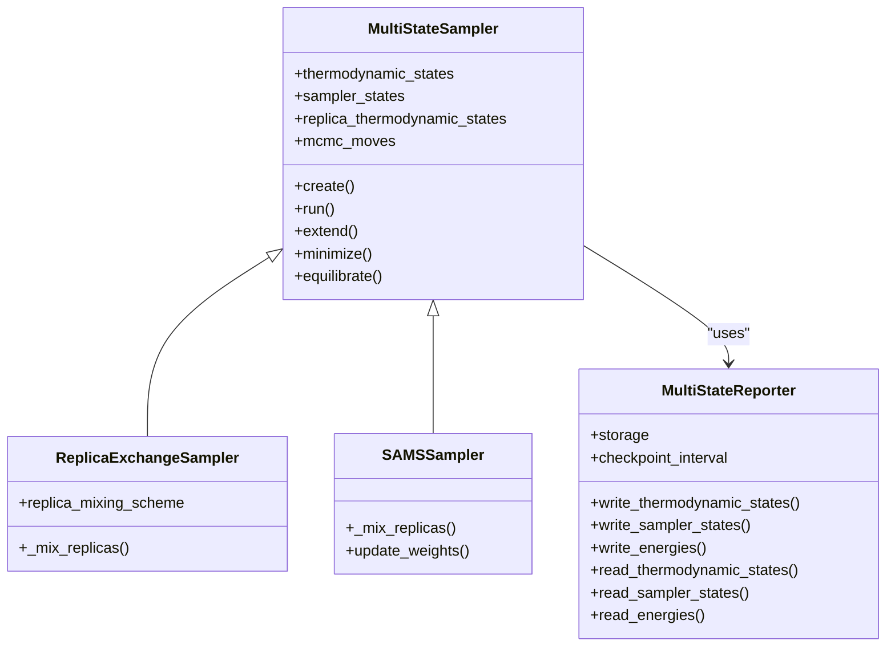
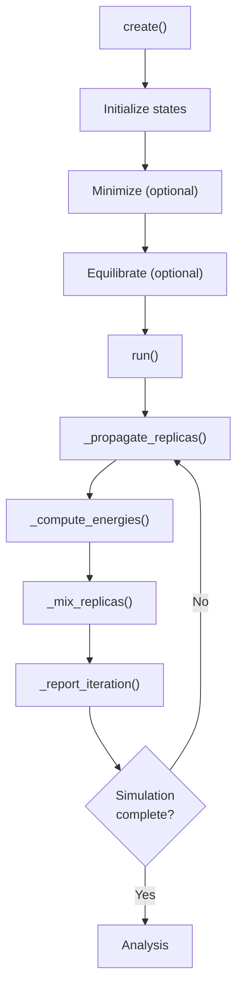
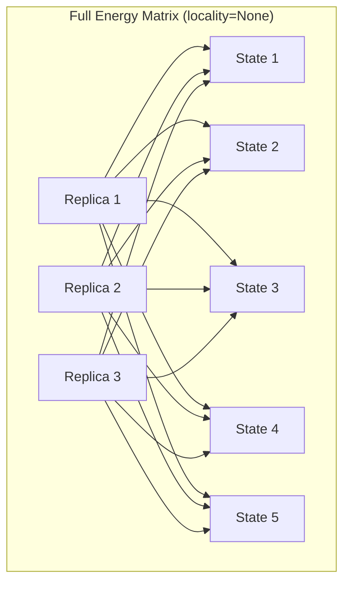
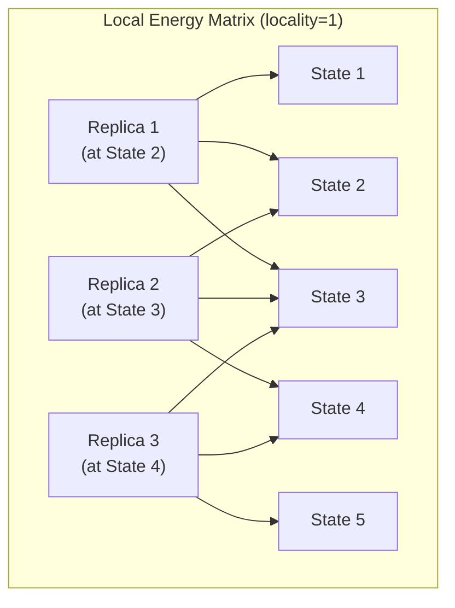
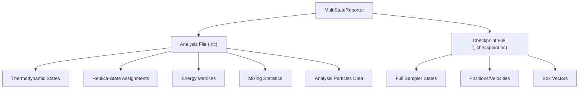

# Multistate Sampling

<details>
<summary>Relevant source files</summary>

The following files were used as context for generating this wiki page:

- [openmmtools/multistate/multistatereporter.py](openmmtools/multistate/multistatereporter.py)
- [openmmtools/multistate/multistatesampler.py](openmmtools/multistate/multistatesampler.py)
- [openmmtools/tests/test_sampling.py](openmmtools/tests/test_sampling.py)

</details>


## Purpose and Scope

This document covers the MultiStateSampler framework in openmmtools, which provides a general infrastructure for enhanced sampling across multiple thermodynamic states. The MultiStateSampler is a base class that enables simulation of multiple thermodynamic states using one or more replicas, storing configurations, energies, swaps, and restart information in a portable NetCDF format.

For specific implementations of multistate sampling, see [Replica Exchange Methods](#4.5) and [Self-Adjusted Mixture Sampling](#4.4).

## Overview of Multistate Sampling

Multistate sampling refers to simulation techniques that enhance conformational sampling by simultaneously simulating a system at multiple thermodynamic states (e.g., different temperatures, pressures, or alchemical parameters). By allowing exchanges between these states based on detailed balance criteria, these methods can overcome energy barriers and sample complex energy landscapes more efficiently than traditional molecular dynamics.

### Key Components



Sources: [openmmtools/multistate/multistatesampler.py:63-188](openmmtools/multistate/multistatesampler.py:63-188), [openmmtools/multistate/multistatereporter.py:63-124](openmmtools/multistate/multistatereporter.py:63-124)

### Core Concepts

1. **Thermodynamic States**: Represent the conditions (temperature, pressure, etc.) under which the system is simulated
2. **Sampler States**: Contain positions, velocities, and box vectors for each replica
3. **Replicas**: Independent copies of the system that can exchange thermodynamic states
4. **MCMC Moves**: Molecular dynamics or Monte Carlo moves that propagate the system

Sources: [openmmtools/multistate/multistatesampler.py:189-196](openmmtools/multistate/multistatesampler.py:189-196)

## MultiStateSampler Base Class

The MultiStateSampler is the foundation for all multistate sampling techniques in openmmtools. It handles the core simulation logic while leaving the replica mixing strategies to be implemented by subclasses.

### Workflow



Sources: [openmmtools/multistate/multistatesampler.py:729-809](openmmtools/multistate/multistatesampler.py:729-809)

### Key Methods

| Method | Description |
|--------|-------------|
| `create()` | Creates a new multistate simulation with specified thermodynamic and sampler states |
| `from_storage()` | Creates a simulation object from previously stored data |
| `minimize()` | Minimizes all replicas |
| `equilibrate()` | Equilibrates all replicas without counting toward iterations |
| `run()` | Runs the simulation for a specified number of iterations |
| `extend()` | Extends the simulation past the original iteration limit |

Sources: [openmmtools/multistate/multistatesampler.py:534-826](openmmtools/multistate/multistatesampler.py:534-826)

### Important Properties

| Property | Description |
|----------|-------------|
| `n_states` | Number of thermodynamic states |
| `n_replicas` | Number of replicas |
| `iteration` | Current iteration of the simulation |
| `mcmc_moves` | The MCMCMoves used to propagate the simulation |
| `sampler_states` | Current sampler states |
| `locality` | Controls which thermodynamic states are evaluated for energy calculations |

Sources: [openmmtools/multistate/multistatesampler.py:364-520](openmmtools/multistate/multistatesampler.py:364-520)

## Energy Calculation and Locality

One important feature of the MultiStateSampler is its support for locality in energy calculations, which can significantly reduce computational cost for systems with many thermodynamic states.

### Locality Concept





Sources: [openmmtools/multistate/multistatesampler.py:1267-1286](openmmtools/multistate/multistatesampler.py:1267-1286)

The `locality` parameter controls which neighboring states have their energies computed. When set to an integer > 0, energies are only computed for states within that distance from the current state of each replica. If `None`, all energies are computed for all states, which is more computationally expensive but allows for global state swaps.

## MultiStateReporter

The MultiStateReporter manages the storage of simulation data across multiple files:

### Storage Structure



Sources: [openmmtools/multistate/multistatereporter.py:272-314](openmmtools/multistate/multistatereporter.py:272-314)

### Key Features

- **Dual file system**: Analysis file contains essential information, while the checkpoint file stores bulkier data
- **Checkpoint interval**: Controls how frequently full system states are saved
- **Position/velocity interval**: Controls how frequently position and velocity data are saved
- **Analysis particles**: Option to store trajectory data for only a subset of particles

Sources: [openmmtools/multistate/multistatereporter.py:124-159](openmmtools/multistate/multistatereporter.py:124-159)

## Online Analysis

MultiStateSampler includes built-in support for online analysis of simulation data, which can be used to monitor convergence and automatically terminate simulations when reaching desired statistical precision.

### Online Analysis Parameters

| Parameter | Description |
|-----------|-------------|
| `online_analysis_interval` | How frequently to perform analysis during simulation |
| `online_analysis_target_error` | Target statistical error (in kT) for termination |
| `online_analysis_minimum_iterations` | Minimum iterations before analysis begins |

Sources: [openmmtools/multistate/multistatesampler.py:89-114](openmmtools/multistate/multistatesampler.py:89-114)

## Usage Example

Here's a basic usage example for creating and running a multistate sampling simulation:

```python
# Import required modules
from openmm import unit
from openmmtools import testsystems, states, mcmc
from openmmtools.multistate import MultiStateSampler, MultiStateReporter

# Create a test system
testsystem = testsystems.AlanineDipeptideImplicit()

# Create thermodynamic states at different temperatures
n_replicas = 3
T_min = 298.0 * unit.kelvin
T_max = 600.0 * unit.kelvin
temperatures = [T_min + (T_max - T_min) * (i / (n_replicas-1)) for i in range(n_replicas)]
thermodynamic_states = [states.ThermodynamicState(system=testsystem.system, temperature=T) 
                      for T in temperatures]

# Create MCMC move
move = mcmc.LangevinDynamicsMove(timestep=2.0*unit.femtoseconds, n_steps=500)

# Initialize simulation
simulation = MultiStateSampler(mcmc_moves=move, number_of_iterations=1000)

# Set up reporter for storing results
reporter = MultiStateReporter('output.nc', checkpoint_interval=10)

# Create the simulation with initial states
simulation.create(thermodynamic_states=thermodynamic_states,
                  sampler_states=states.SamplerState(testsystem.positions),
                  storage=reporter)

# Run the simulation
simulation.run()
```

Sources: [openmmtools/multistate/multistatesampler.py:137-187](openmmtools/multistate/multistatesampler.py:137-187)

## Advanced Usage

### Automatic Convergence Detection

You can use online analysis to automatically terminate a simulation when it reaches a target precision:

```python
# Set up simulation with convergence criteria
simulation = MultiStateSampler(
    mcmc_moves=move,
    number_of_iterations=10000,  # Maximum iterations as fallback
    online_analysis_interval=100,  # Check every 100 iterations
    online_analysis_target_error=0.1  # Target error of 0.1 kT
)
```

Sources: [openmmtools/multistate/multistatesampler.py:89-114](openmmtools/multistate/multistatesampler.py:89-114)

### Minimization and Equilibration

Before production simulation, you can minimize and equilibrate your system:

```python
# After creating the simulation
simulation.minimize()  # Energy minimize all replicas
simulation.equilibrate(n_iterations=100)  # Equilibrate for 100 iterations
simulation.run()  # Run production simulation
```

Sources: [openmmtools/multistate/multistatesampler.py:616-728](openmmtools/multistate/multistatesampler.py:616-728)

### Resuming Simulations

To resume a previously saved simulation:

```python
# Load from storage
reporter = MultiStateReporter('output.nc')
simulation = MultiStateSampler.from_storage(reporter)

# Continue the simulation
simulation.extend(n_iterations=1000)  # Run for 1000 more iterations
```

Sources: [openmmtools/multistate/multistatesampler.py:263-299](openmmtools/multistate/multistatesampler.py:263-299)

## Performance Considerations

### Locality Parameter

Setting the `locality` parameter can significantly improve performance for systems with many thermodynamic states:

```python
# Compute energies only for neighboring states
simulation = MultiStateSampler(mcmc_moves=move, locality=1)
```

Sources: [openmmtools/multistate/multistatesampler.py:116-119](openmmtools/multistate/multistatesampler.py:116-119), [openmmtools/multistate/multistatesampler.py:1267-1286](openmmtools/multistate/multistatesampler.py:1267-1286)

### Context Caching

Set up context caching to improve performance:

```python
from openmmtools import cache
from openmmtools.utils import get_fastest_platform

# Set up unlimited context cache with mixed precision
platform = get_fastest_platform(minimum_precision='mixed')
simulation.energy_context_cache = cache.ContextCache(capacity=None, platform=platform)
simulation.sampler_context_cache = cache.ContextCache(capacity=None, platform=platform)
```

Sources: [openmmtools/multistate/multistatesampler.py:129-186](openmmtools/multistate/multistatesampler.py:129-186)

## Related Classes

For specific implementations of enhanced sampling algorithms based on the MultiStateSampler framework, see the following classes:

- **ReplicaExchangeSampler**: Implements traditional replica exchange (parallel tempering)
- **SAMSSampler**: Implements Self-Adjusted Mixture Sampling for efficient exploration of multiple states
- **ParallelTemperingSampler**: Specialized replica exchange across temperature states

Sources: [openmmtools/tests/test_sampling.py:44-48](openmmtools/tests/test_sampling.py:44-48)

---