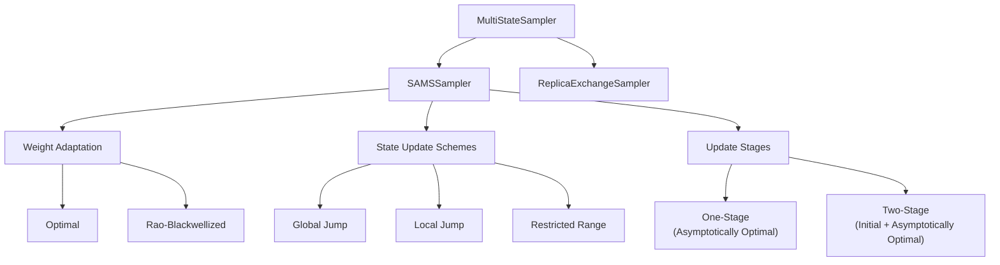
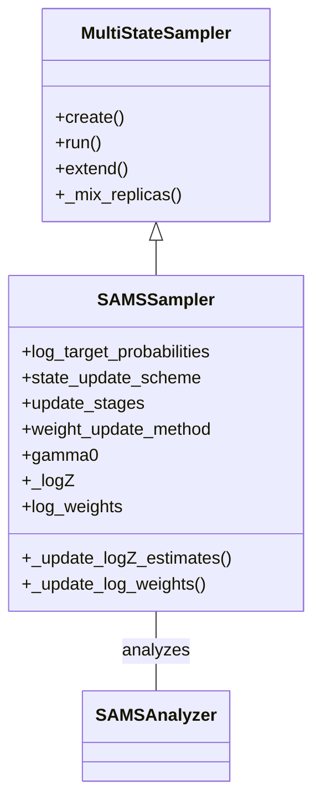
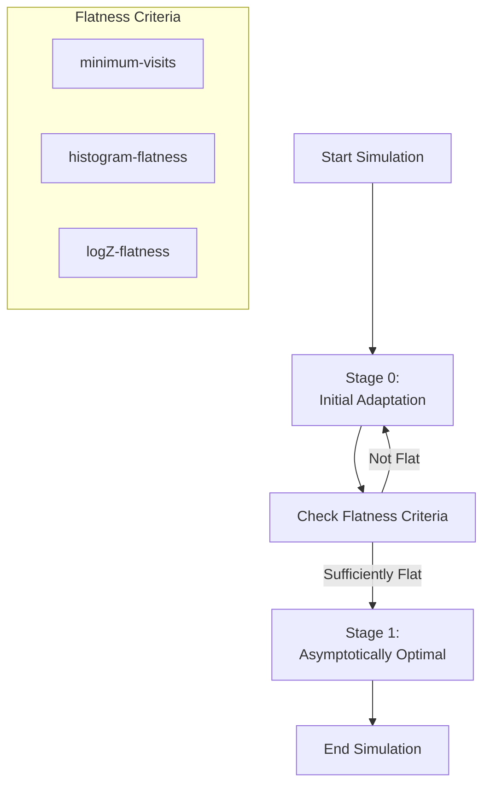
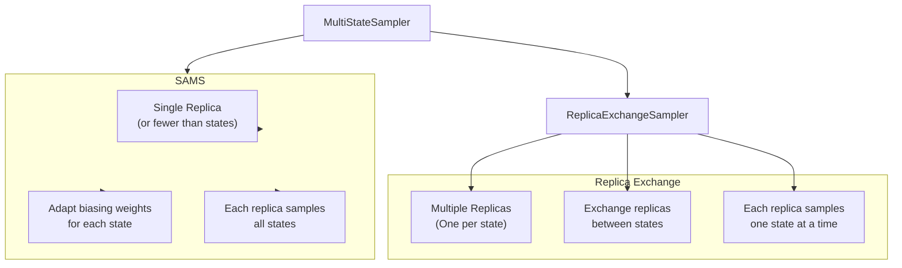

# Self-Adjusted Mixture Sampling

<details>
<summary>Relevant source files</summary>

The following files were used as context for generating this wiki page:

- [openmmtools/multistate/paralleltempering.py](openmmtools/multistate/paralleltempering.py)
- [openmmtools/multistate/replicaexchange.py](openmmtools/multistate/replicaexchange.py)
- [openmmtools/multistate/sams.py](openmmtools/multistate/sams.py)

</details>


Self-Adjusted Mixture Sampling (SAMS) is an enhanced sampling technique implemented in OpenMMTools that enables efficient sampling of multiple thermodynamic states using a single replica. Unlike Replica Exchange methods (see [Replica Exchange Methods](#4.5)), which use multiple replicas each sampling from a different state, SAMS allows a single replica to sample all states by adaptively modifying the weight (bias) of each state during simulation. This approach can be particularly effective for free energy calculations and for systems with high energy barriers between states.

## Overview of SAMS in OpenMMTools



Sources: [openmmtools/multistate/sams.py:43-168](), [openmmtools/multistate/sams.py:169-230]()

## Theoretical Background

SAMS is based on the method of expanded ensembles, allowing a single replica to sample multiple thermodynamic states by dynamically modifying biasing weights. The key features include:

1. **Expanded Ensembles**: Allow transitions between different thermodynamic states within a single replica
2. **On-the-fly Weight Adaptation**: Biasing weights are adjusted during simulation to achieve desired sampling proportions
3. **Optimally-Adjusted Sampling**: Weights are optimized to minimize statistical uncertainty in free energy estimates

SAMS offers significant advantages for systems where multiple thermodynamic states need to be sampled but computational resources are limited.

Sources: [openmmtools/multistate/sams.py:7-24](), [openmmtools/multistate/sams.py:44-76]()

## Core Components



Sources: [openmmtools/multistate/sams.py:43-168](), [openmmtools/multistate/sams.py:694-704]()

## State Update Schemes

SAMS implements different schemes for updating the thermodynamic state of the replica:

| Scheme | Description | Implementation |
|--------|-------------|----------------|
| `global-jump` | Allows jumps between any thermodynamic states | Selects new state with probability proportional to exp(log_weight - reduced_potential) |
| `local-jump` | Only allows transitions to neighboring states | Uses Metropolis criterion for acceptance of neighboring state moves |
| `restricted-range-jump` | Computes probabilities for states in local neighborhood | Increases jump probability between related states |

The current implementation primarily supports the `global-jump` scheme, with others planned for future releases.

Sources: [openmmtools/multistate/sams.py:477-502](), [openmmtools/multistate/sams.py:439-475](), [openmmtools/multistate/sams.py:240-246]()

## Weight Update Methods

SAMS provides two methods for updating the biasing weights:

1. **Optimal**: Updates log free energy estimate for the current state only using integral counts
   ```
   logZ_update = gamma * exp(-log_pi_k[state_index])
   ```

2. **Rao-Blackwellized**: Updates log free energy estimates for all states for which energies were computed
   ```
   logZ_update = gamma * exp(log_P_k[neighborhood] - log_pi_k[neighborhood])
   ```

These update methods adaptively modify the biasing weights to achieve the target state visitation probabilities specified by the user.

Sources: [openmmtools/multistate/sams.py:606-681](), [openmmtools/multistate/sams.py:265-270]()

## Update Stages

SAMS can operate in two different adaptation stages:



The update stages control how quickly weights are adapted:

1. **One-stage**: Uses the asymptotically optimal scheme throughout the entire simulation
2. **Two-stage**:
   - Stage 0: Initial adaptation to achieve flat histograms quickly
   - Stage 1: Switches to asymptotically optimal scheme for precise free energy estimates

The transition between stages is controlled by various flatness criteria including histogram flatness and logZ-based thresholds.

Sources: [openmmtools/multistate/sams.py:291-305](), [openmmtools/multistate/sams.py:564-605](), [openmmtools/multistate/sams.py:253-262]()

## Usage Example

This example demonstrates how to set up a SAMS simulation for alanine dipeptide in implicit solvent at different temperatures:

```python
# Import necessary modules
from openmm import unit
from openmmtools import testsystems, states, mcmc
from openmmtools.multistate import MultiStateReporter, SAMSSampler

# Create the test system
testsystem = testsystems.AlanineDipeptideVacuum()

# Set up temperatures for simulation
n_replicas = 3
T_min = 298.0 * unit.kelvin
T_max = 600.0 * unit.kelvin
temperatures = [T_min + (T_max - T_min) * (math.exp(float(i) / float(n_replicas-1)) - 1.0) / (math.e - 1.0)
                for i in range(n_replicas)]
thermodynamic_states = [states.ThermodynamicState(system=testsystem.system, temperature=T)
                         for T in temperatures]

# Set up MCMC moves
move = mcmc.GHMCMove(timestep=2.0*unit.femtoseconds, n_steps=50)

# Create SAMS sampler
simulation = SAMSSampler(
    mcmc_moves=move,
    number_of_iterations=10000,
    state_update_scheme='global-jump',
    update_stages='two-stage',
    flatness_criteria='logZ-flatness',
    flatness_threshold=0.2,
    weight_update_method='rao-blackwellized'
)

# Set up storage
reporter = MultiStateReporter('sams_simulation.nc', checkpoint_interval=100)

# Initialize and run simulation
simulation.create(
    thermodynamic_states=thermodynamic_states,
    sampler_states=[states.SamplerState(testsystem.positions)],
    storage=reporter
)
simulation.run()
```

Sources: [openmmtools/multistate/sams.py:77-158]()

## Key Parameters

The following parameters control the behavior of SAMS simulations:

| Parameter | Description | Default Value |
|-----------|-------------|---------------|
| `log_target_probabilities` | Target probability for each state (log scale) | Uniform probabilities |
| `state_update_scheme` | How new states are proposed | `'global-jump'` |
| `locality` | Number of neighboring states to consider | `5` |
| `update_stages` | One-stage or two-stage adaptation | `'two-stage'` |
| `flatness_criteria` | Method to determine when to switch stages | `'logZ-flatness'` |
| `flatness_threshold` | Threshold for flatness criteria | `0.2` |
| `weight_update_method` | Method for updating weights | `'rao-blackwellized'` |
| `gamma0` | Initial weight adaptation rate | `1.0` |

Sources: [openmmtools/multistate/sams.py:169-230](), [openmmtools/multistate/sams.py:280-289]()

## Implementation Details

The `SAMSSampler` class inherits from `MultiStateSampler` and implements the following key methods:

1. **`_mix_replicas`**: Updates thermodynamic states according to the specified scheme
2. **`_update_logZ_estimates`**: Updates log free energy estimates based on sampled states
3. **`_update_log_weights`**: Updates log weights based on current logZ estimates
4. **`_update_stage`**: Determines when to switch from initial to asymptotically optimal stage

During simulation, the sampler keeps track of:
- Current logZ estimates for each state
- Current adaptation stage
- Histogram of visited states

Sources: [openmmtools/multistate/sams.py:395-437](), [openmmtools/multistate/sams.py:606-681](), [openmmtools/multistate/sams.py:682-692](), [openmmtools/multistate/sams.py:564-605]()

## Comparison with Replica Exchange



Sources: [openmmtools/multistate/sams.py:43-76](), [openmmtools/multistate/replicaexchange.py:52-104]()

Key differences between SAMS and Replica Exchange:

1. **Number of replicas**:
   - SAMS can use a single replica to sample all states
   - Replica Exchange typically requires one replica per state

2. **State transitions**:
   - SAMS: Single replica transitions between states using biased acceptance
   - Replica Exchange: Pairs of replicas exchange states using Metropolis criterion

3. **Efficiency considerations**:
   - SAMS: More efficient when computational resources are limited
   - Replica Exchange: May achieve better sampling when many parallel resources are available

4. **Implementation complexity**:
   - SAMS: Requires careful tuning of weight adaptation parameters
   - Replica Exchange: Conceptually simpler but may require more total compute resources

Sources: [openmmtools/multistate/sams.py:43-76](), [openmmtools/multistate/replicaexchange.py:52-104](), [openmmtools/multistate/replicaexchange.py:255-292]()

## Analysis with SAMSAnalyzer

The `SAMSAnalyzer` class extends `MultiStateSamplerAnalyzer` and provides facilities for analyzing results from SAMS simulations. Analysis capabilities include:

- Free energy difference calculations between states
- State visitation statistics
- Convergence analysis

Usage example:

```python
from openmmtools.multistate import SAMSAnalyzer

# Load data from completed simulation
analyzer = SAMSAnalyzer(reporter)

# Calculate free energy differences
free_energy_differences, error = analyzer.get_free_energy_differences()

# Generate plots (requires matplotlib)
analyzer.plot_free_energy_differences()
analyzer.plot_state_visitiations()
```

Sources: [openmmtools/multistate/sams.py:694-704]()

---