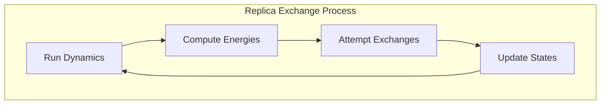
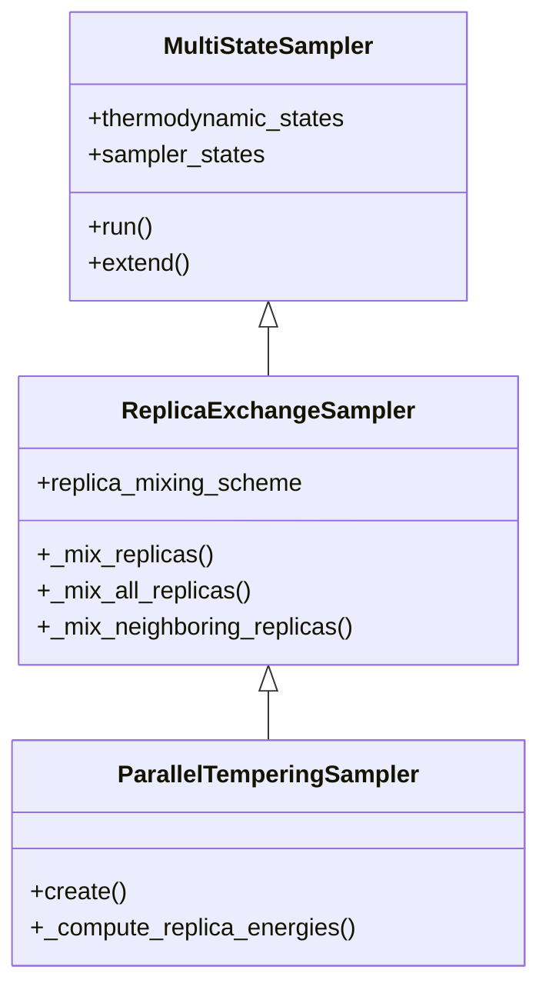
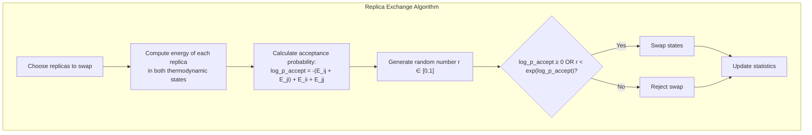
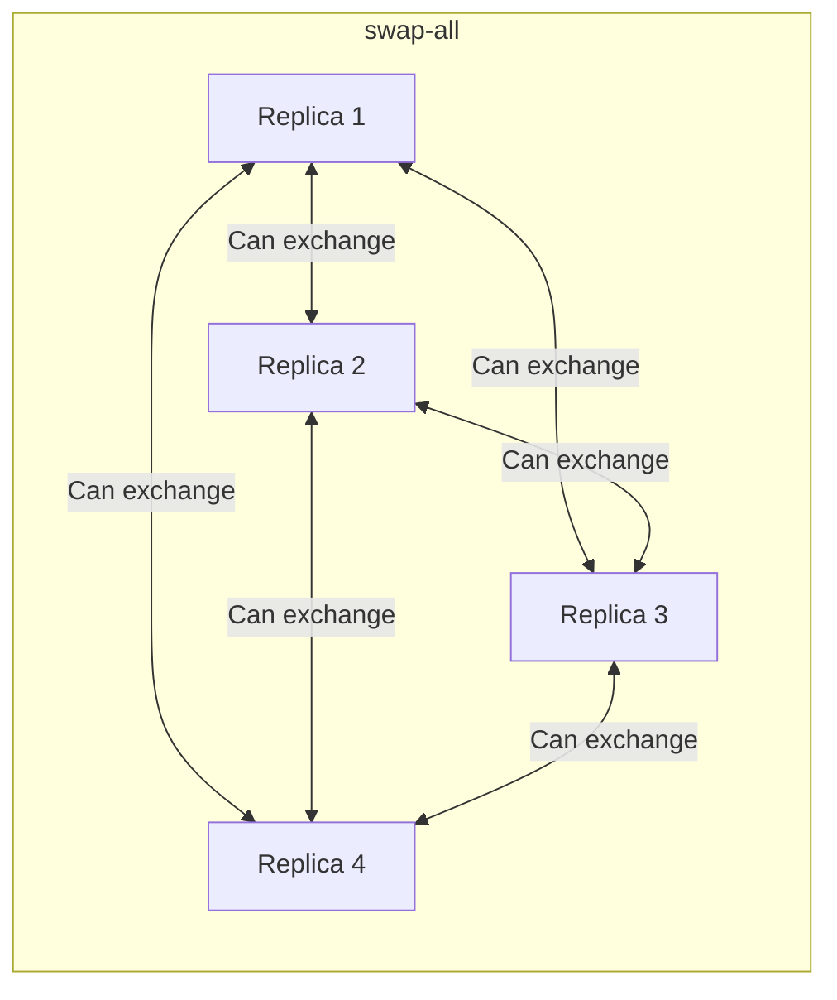
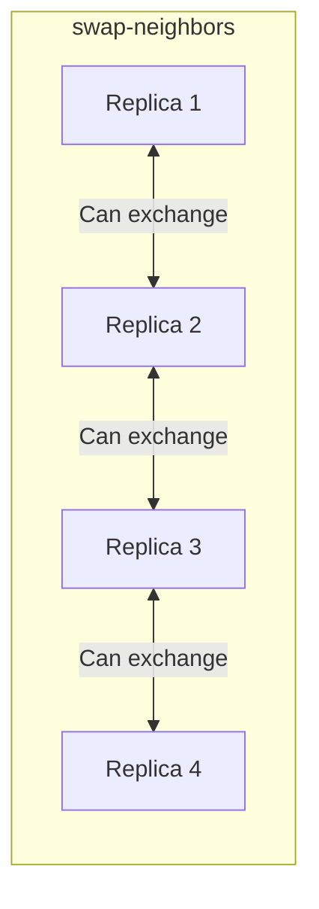
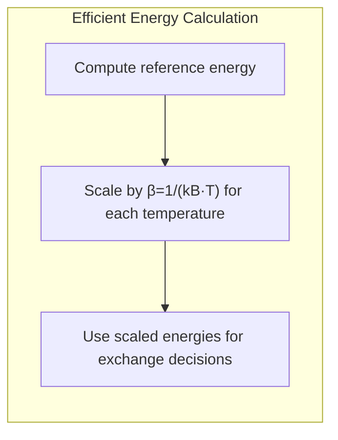
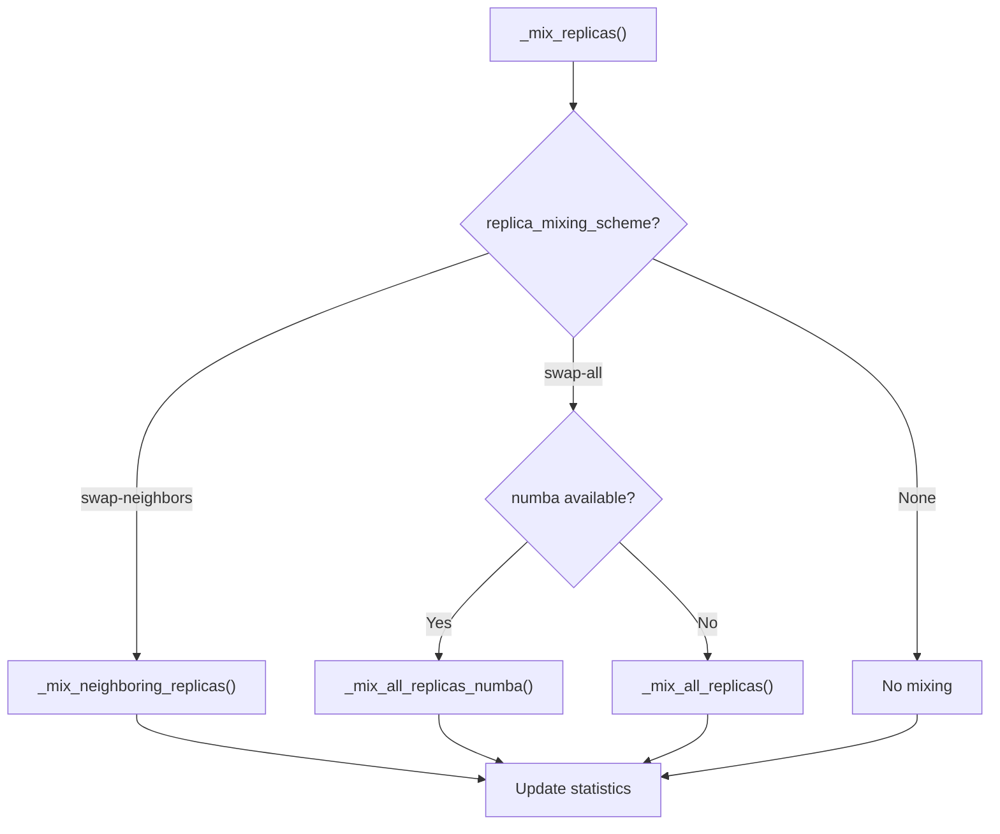
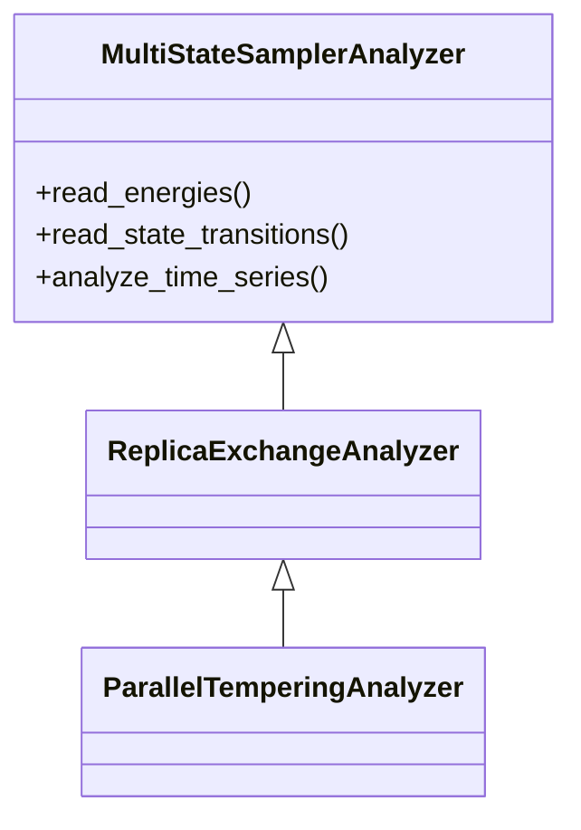

# Replica Exchange Methods

<details>
<summary>Relevant source files</summary>

The following files were used as context for generating this wiki page:

- [openmmtools/multistate/paralleltempering.py](openmmtools/multistate/paralleltempering.py)
- [openmmtools/multistate/replicaexchange.py](openmmtools/multistate/replicaexchange.py)
- [openmmtools/multistate/sams.py](openmmtools/multistate/sams.py)

</details>


Replica Exchange Methods, also known as parallel tempering, are enhanced sampling techniques designed to improve conformational exploration of molecular systems. This page documents the replica exchange implementation in OpenMMTools, focusing on the `ReplicaExchangeSampler` class and its specialized variant `ParallelTemperingSampler`. For self-adjusted mixture sampling, see [Self-Adjusted Mixture Sampling](#4.4).

## Overview of Replica Exchange

Replica exchange simulations run multiple replicas of a system at different thermodynamic conditions (typically different temperatures). Periodically, these replicas attempt to exchange their states according to a Metropolis acceptance criterion, allowing configurations to move between different thermodynamic conditions and overcome energy barriers.



Sources: [openmmtools/multistate/replicaexchange.py:51-208]()

## Core Components

The replica exchange implementation in OpenMMTools is built on the `MultiStateSampler` framework, with two main classes:



Sources: [openmmtools/multistate/replicaexchange.py:52-208](), [openmmtools/multistate/paralleltempering.py:44-108]()

### ReplicaExchangeSampler

The `ReplicaExchangeSampler` class implements the general replica exchange algorithm for any set of thermodynamic states. Key features include:

- Support for arbitrary thermodynamic states (not limited to temperature differences)
- Multiple replica mixing schemes (global or neighbor exchanges)
- Implementation optimized for parallel execution
- Efficient storage and analysis of simulation data

Sources: [openmmtools/multistate/replicaexchange.py:52-208]()

### ParallelTemperingSampler

The `ParallelTemperingSampler` is a specialized subclass optimized for temperature-based replica exchange:

- Takes a single reference `ThermodynamicState` and generates multiple states at different temperatures
- Implements more efficient energy calculations by exploiting the fact that energies are linear in inverse temperature
- Provides convenient methods to specify temperature ladders (linear or exponential spacing)

Sources: [openmmtools/multistate/paralleltempering.py:44-108]()

## Replica Exchange Algorithm

The core of replica exchange is the algorithm for attempting exchanges between replicas:



Sources: [openmmtools/multistate/replicaexchange.py:381-406]()

## Replica Mixing Schemes

The `ReplicaExchangeSampler` supports different schemes for attempting exchanges between replicas:

### Swap-All Scheme

In the "swap-all" scheme, any pair of replicas can attempt exchanges. This maximizes mixing but requires more exchange attempts:



The number of exchange attempts scales as O(n³) where n is the number of replicas.

Sources: [openmmtools/multistate/replicaexchange.py:351-364](), [openmmtools/multistate/replicaexchange.py:294-350]()

### Swap-Neighbors Scheme

In the "swap-neighbors" scheme, only adjacent replicas in the thermodynamic state space attempt exchanges:



This is less efficient for mixing but can be more efficient for very large numbers of replicas.

Sources: [openmmtools/multistate/replicaexchange.py:366-380]()

## Optimizations for Parallel Tempering

For parallel tempering (temperature replica exchange), several optimizations are implemented:

1. **Efficient Energy Calculation**: The `ParallelTemperingSampler` only computes the reference potential energy once and scales it by the appropriate temperature factors.

2. **Logarithmic Temperature Spacing**: The default temperature spacing is logarithmic, which provides better exchange probabilities across a wide temperature range.



Sources: [openmmtools/multistate/paralleltempering.py:175-237]()

## Usage

### Creating a Replica Exchange Simulation

To set up a replica exchange simulation:

1. Define thermodynamic states
2. Create sampler states (initial positions)
3. Initialize the `ReplicaExchangeSampler` with desired parameters
4. Create a reporter for data storage
5. Run the simulation

For parallel tempering specifically:

```python
# Create a reference thermodynamic state
reference_state = ThermodynamicState(system=system, temperature=min_temperature)

# Create sampler state with initial positions
sampler_state = SamplerState(positions=initial_positions)

# Initialize parallel tempering
simulation = ParallelTemperingSampler(mcmc_moves=move)

# Set up simulation with temperature range
simulation.create(reference_state, sampler_state, reporter,
                 min_temperature=min_temp, max_temperature=max_temp, 
                 n_temperatures=n_replicas)

# Run simulation
simulation.run(n_iterations=1000)
```

Sources: [openmmtools/multistate/paralleltempering.py:109-173](), [openmmtools/multistate/replicaexchange.py:113-195]()

## Implementation Details

### Replica Mixing Process

The mixing of replicas happens in the `_mix_replicas` method, which delegates to the appropriate mixing scheme based on configuration:



The Numba-accelerated implementation is used when available for better performance.

Sources: [openmmtools/multistate/replicaexchange.py:255-292]()

### Exchange Acceptance Criterion

The core of the replica exchange method is the acceptance criterion:

```
log_p_accept = -(energy_ij + energy_ji) + energy_ii + energy_jj
```

Where:
- `energy_ij` is the energy of replica i in state j
- `energy_ji` is the energy of replica j in state i
- `energy_ii` is the energy of replica i in state i
- `energy_jj` is the energy of replica j in state j

The exchange is accepted if `log_p_accept ≥ 0` or if a random number `r ∈ [0,1]` is less than `exp(log_p_accept)`.

Sources: [openmmtools/multistate/replicaexchange.py:381-406]()

## Analysis

Simulation results can be analyzed using the `ReplicaExchangeAnalyzer` class:



This allows for:
- Analysis of exchange statistics
- Calculation of free energy differences
- Evaluation of sampling efficiency

Sources: [openmmtools/multistate/replicaexchange.py:427-438](), [openmmtools/multistate/paralleltempering.py:240-251]()

## Comparison with Other Enhanced Sampling Methods

Replica exchange is one of several enhanced sampling methods available in OpenMMTools:

| Method | Class | Description | Best Use Case |
|--------|-------|-------------|---------------|
| Replica Exchange | `ReplicaExchangeSampler` | Exchanges configurations between different thermodynamic states | Broad conformational sampling |
| Parallel Tempering | `ParallelTemperingSampler` | Specialized replica exchange across temperatures | Overcoming energy barriers |
| Self-Adjusted Mixture Sampling | `SAMSSampler` | Adaptively samples from multiple thermodynamic states | Free energy calculations |

Sources: [openmmtools/multistate/replicaexchange.py:52-53](), [openmmtools/multistate/paralleltempering.py:44-52](), [openmmtools/multistate/sams.py:43-44]()

## Best Practices

1. **Temperature Spacing**: For parallel tempering, use an exponential spacing of temperatures for optimal exchange probabilities.

2. **Number of Replicas**: Using more replicas increases the chances of exchanges but adds computational cost. A good rule of thumb is to aim for 20-30% exchange acceptance rate.

3. **Mixing Scheme**: The "swap-all" scheme generally provides better mixing, especially for smaller numbers of replicas (<20).

4. **Exchange Frequency**: Attempt exchanges frequently enough to promote mixing but not so frequently that it dominates the simulation time.

Sources: [openmmtools/multistate/replicaexchange.py:214-218](), [openmmtools/multistate/paralleltempering.py:156-162]()

---