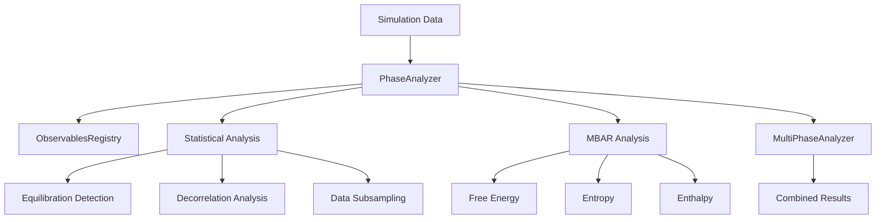
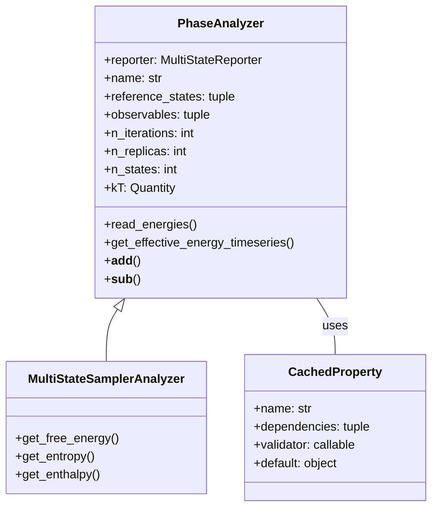
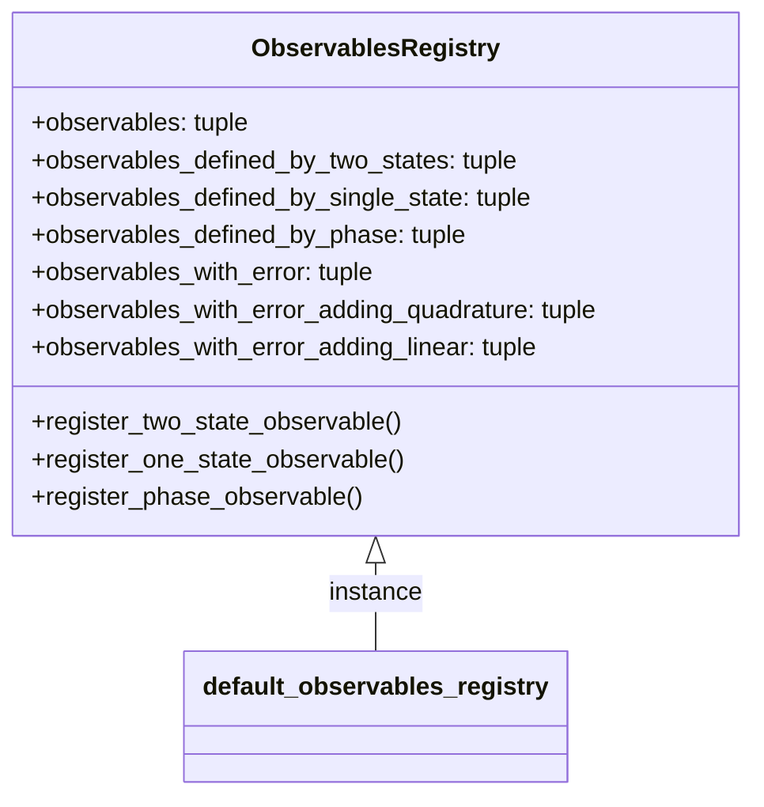
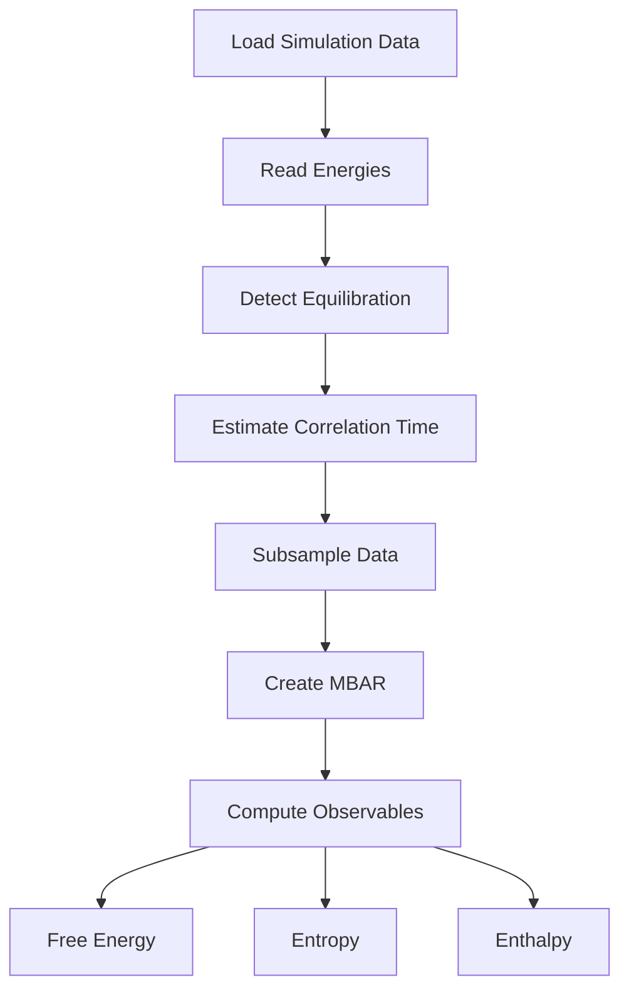
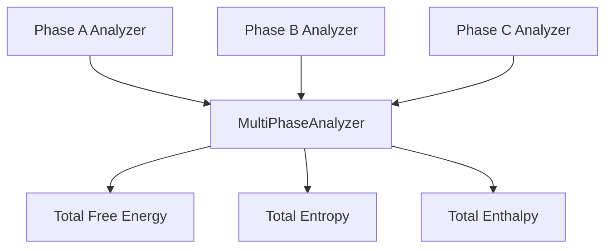
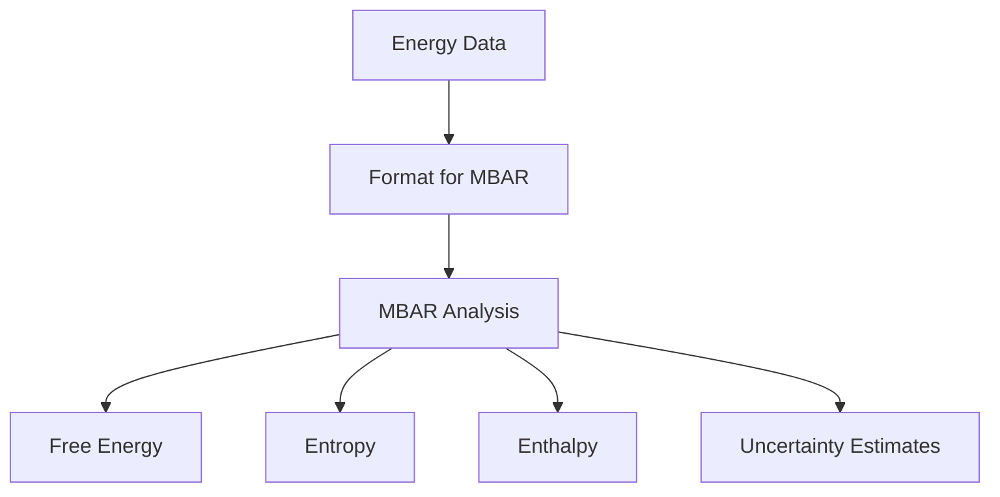
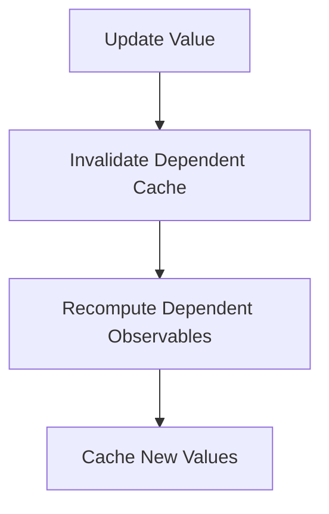

# Analysis Tools

<details>
<summary>Relevant source files</summary>

The following files were used as context for generating this wiki page:

- [.gitignore](.gitignore)
- [openmmtools/multistate/multistateanalyzer.py](openmmtools/multistate/multistateanalyzer.py)
- [openmmtools/multistate/pymbar.py](openmmtools/multistate/pymbar.py)
- [openmmtools/multistate/utils.py](openmmtools/multistate/utils.py)

</details>


The Analysis Tools in OpenMMTools provide a framework for analyzing molecular simulation data, particularly from multistate simulations. These tools focus on statistical mechanics analysis, including free energy calculations, equilibration detection, and uncertainty estimation.

For information about the multistate sampling methods themselves, see [Enhanced Sampling Methods](#4).

## Analysis Framework Overview

The analysis framework consists of several components that work together to process simulation data and extract thermodynamic observables:



Sources: [openmmtools/multistate/multistateanalyzer.py:7-17](), [openmmtools/multistate/multistateanalyzer.py:52-59]()

## Phase Analyzers

The Phase Analyzers serve as the primary entry point for analyzing simulation data:



`PhaseAnalyzer` is an abstract base class for analyzing a single phase of a multistate simulation. `MultiStateSamplerAnalyzer` is a concrete implementation specifically designed for analyzing MultiStateSampler simulations.

Sources: [openmmtools/multistate/multistateanalyzer.py:446-536](), [openmmtools/multistate/multistateanalyzer.py:1137-1138](), [openmmtools/multistate/multistateanalyzer.py:366-439]()

### Key Properties and Methods

| Property/Method | Description |
|-----------------|-------------|
| `reporter` | Reference to the MultiStateReporter for accessing simulation data |
| `name` | Name of the phase |
| `reference_states` | Tuple of states to use as reference for observables |
| `observables` | Tuple of observables that can be computed |
| `n_iterations` | Number of iterations in the simulation |
| `n_replicas` | Number of replicas in the simulation |
| `n_states` | Number of thermodynamic states in the simulation |
| `kT` | Boltzmann constant times temperature |
| `read_energies()` | Extract energies from the simulation data |
| `get_effective_energy_timeseries()` | Generate effective energy timeseries |
| `__add__()`, `__sub__()` | Operators for combining phases |

Sources: [openmmtools/multistate/multistateanalyzer.py:610-702](), [openmmtools/multistate/multistateanalyzer.py:831-988](), [openmmtools/multistate/multistateanalyzer.py:1122-1134]()

## Observable Registry

The Observable Registry tracks which observables can be computed and how they should be handled when combining multiple phases:



The `ObservablesRegistry` categorizes observables based on how they are defined and how their errors should be combined when aggregating results across multiple phases.

Sources: [openmmtools/multistate/multistateanalyzer.py:106-343](), [openmmtools/multistate/multistateanalyzer.py:346-351]()

### Observable Categories

| Category | Description | Examples |
|----------|-------------|----------|
| `defined_by_two_states` | Observables that require two states | Free energy difference |
| `defined_by_single_state` | Observables defined by a single state | Temperature, volume |
| `defined_by_phase` | Observables defined by the phase as a whole | Standard state correction |
| `with_error_adding_quadrature` | Errors add in quadrature: e(A+B) = sqrt(e(A)² + e(B)²) | Free energy, entropy, enthalpy |
| `with_error_adding_linear` | Errors add linearly: e(A+B) = e(A) + e(B) | Some composite observables |

Sources: [openmmtools/multistate/multistateanalyzer.py:234-302]()

## Multistate Analysis Workflow

The typical workflow for analyzing multistate simulations involves:



Sources: [openmmtools/multistate/multistateanalyzer.py:1037-1058](), [openmmtools/multistate/utils.py:97-235]()

### Statistical Analysis Functions

The framework includes several utility functions for statistical analysis:

| Function | Description |
|----------|-------------|
| `get_equilibration_data` | Determine the equilibration point in a timeseries |
| `get_equilibration_data_per_sample` | Compute correlation time and effective samples per sample |
| `get_decorrelation_time` | Compute the decorrelation time for a timeseries |
| `remove_unequilibrated_data` | Remove unequilibrated data from a dataset |
| `subsample_data_along_axis` | Generate a decorrelated version of input data |

Sources: [openmmtools/multistate/utils.py:98-295]()

## MultiPhase Analysis

The `MultiPhaseAnalyzer` class combines multiple `PhaseAnalyzer` instances to compute observables across multiple phases:



This is particularly useful for complex calculations such as binding free energies, which often require multiple simulation phases (e.g., bound state, unbound state).

Sources: [openmmtools/multistate/multistateanalyzer.py:1074-1120]()

### Combining Phases

Phases can be combined using the `+` and `-` operators, which create a `MultiPhaseAnalyzer` instance:

```python
# Compute binding free energy
complex_analyzer = MultiStateSamplerAnalyzer(complex_reporter)
solvent_analyzer = MultiStateSamplerAnalyzer(solvent_reporter)
binding_analyzer = complex_analyzer - solvent_analyzer

# Get binding free energy
binding_free_energy, uncertainty = binding_analyzer.get_free_energy()
```

Sources: [openmmtools/multistate/multistateanalyzer.py:1122-1134](), [openmmtools/multistate/utils.py:60-95]()

## PYMBAR Integration

The Analysis Tools make extensive use of the PYMBAR library for statistical analysis, particularly for free energy calculations using the Multistate Bennett Acceptance Ratio method.



The integration with PYMBAR enables robust statistical analysis of multistate simulation data, including free energy differences between states, entropy and enthalpy estimates, and uncertainty quantification.

Sources: [openmmtools/multistate/multistateanalyzer.py:23-48](), [openmmtools/multistate/pymbar.py:1-56](), [openmmtools/multistate/multistateanalyzer.py:993-1036]()

## Data Analysis Utilities

### Energy Reformatting

The `reformat_energies_for_mbar` function converts energy data from a [replica, state, iteration] format to the [state, total_iteration] format required by MBAR:

```python
def reformat_energies_for_mbar(u_kln, n_k=None):
    """
    Convert [replica, state, iteration] data into [state, total_iteration] data
    
    Parameters
    ----------
    u_kln : array of shape (K, L, N')
        K = number of replicas, L = number of states, N' = iterations per replica
    n_k : array of shape K or None
        Number of samples from each replica
        
    Returns
    -------
    u_ln : array of shape (L, N)
        L = number of states, N = sum of samples across all replicas
    """
```

Sources: [openmmtools/multistate/multistateanalyzer.py:994-1036]()

### Equilibration Detection

The framework provides functions to detect equilibration in simulation data:

```python
def get_equilibration_data_per_sample(timeseries_to_analyze, fast=True, max_subset=100):
    """
    Compute correlation time and effective samples per time point
    
    Returns
    -------
    i_t : array of int
        Indices of analyzed timepoints
    g_i : array of float
        Statistical inefficiency at each timepoint (1 + 2τ)
    n_effective_i : array of float
        Number of effective samples at each timepoint
    """
```

Sources: [openmmtools/multistate/utils.py:107-192]()

## Example Usage

Here's an example of how to use the Analysis Tools:

```python
from openmmtools.multistate import MultiStateSamplerAnalyzer, MultiStateReporter

# Create a MultiStateSamplerAnalyzer for a single phase
reporter = MultiStateReporter('output.nc')
analyzer = MultiStateSamplerAnalyzer(reporter)

# Compute free energy differences
free_energy, f_error = analyzer.get_free_energy()

# Compute entropy
entropy, s_error = analyzer.get_entropy()

# Compute enthalpy
enthalpy, h_error = analyzer.get_enthalpy()
```

For multi-phase analyses:

```python
# Create analyzers for each phase
reporter1 = MultiStateReporter('phase1.nc')
analyzer1 = MultiStateSamplerAnalyzer(reporter1, name='phase1')

reporter2 = MultiStateReporter('phase2.nc')
analyzer2 = MultiStateSamplerAnalyzer(reporter2, name='phase2')

# Combine phases
combined_analyzer = analyzer1 + analyzer2

# Compute overall free energy difference
free_energy, f_error = combined_analyzer.get_free_energy()
```

Sources: [openmmtools/multistate/multistateanalyzer.py:446-536]()

## Advanced Features

### Cached Properties

The `PhaseAnalyzer` class uses a caching system with dependencies to ensure that computations are performed efficiently:



The `CachedProperty` descriptor manages these dependencies automatically, invalidating derived values when their dependencies change.

Sources: [openmmtools/multistate/multistateanalyzer.py:366-439](), [openmmtools/multistate/multistateanalyzer.py:724-802]()

### Online Analysis Data

The analyzers can utilize online analysis data (computed during the simulation) to hot-start the post-simulation analysis, potentially saving significant computation time:

```python
analyzer = MultiStateSamplerAnalyzer(
    reporter,
    use_online_data=True  # Use online analysis data if available
)
```

Sources: [openmmtools/multistate/multistateanalyzer.py:537-541](), [openmmtools/multistate/multistateanalyzer.py:1060-1068]()

## Summary

The Analysis Tools in OpenMMTools provide a comprehensive framework for analyzing molecular simulation data, with a focus on statistical mechanics and free energy calculations. The tools are designed to handle the complexity of multistate simulations, including equilibration detection, decorrelation analysis, and uncertainty estimation.

The framework is extensible, allowing users to define custom observables and analysis methods, and it integrates seamlessly with the PYMBAR library for robust statistical analysis.

Sources: [openmmtools/multistate/multistateanalyzer.py:7-17](), [openmmtools/multistate/utils.py:7-13]()

---