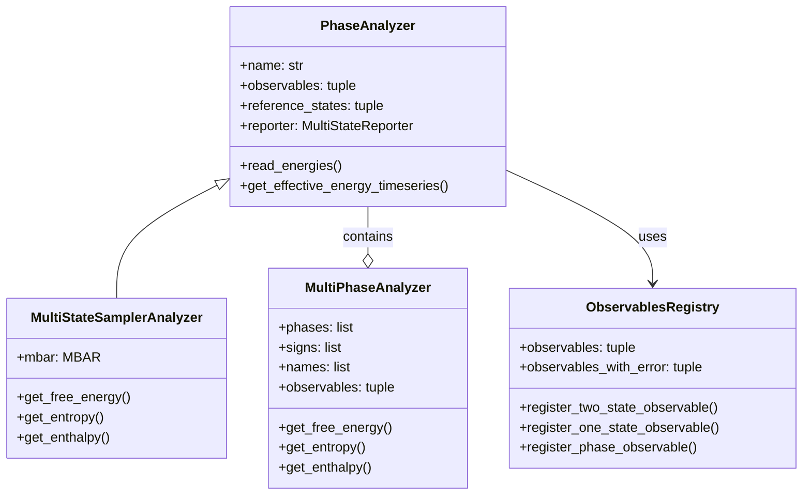
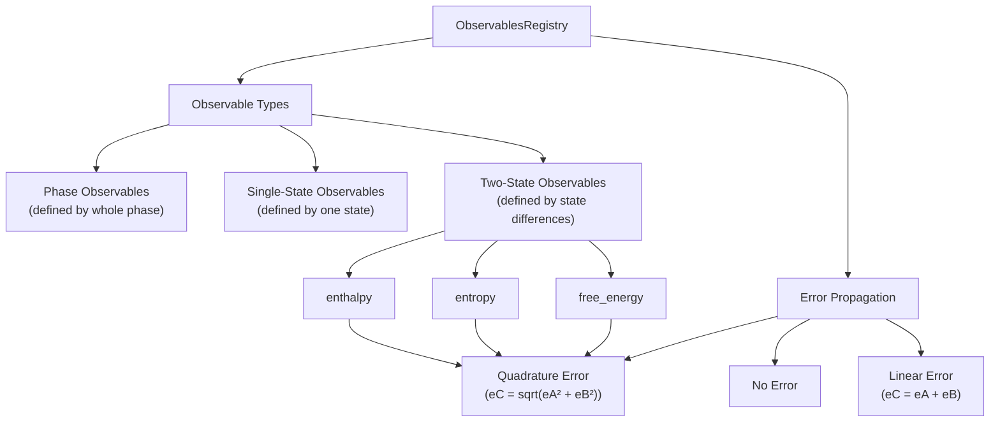
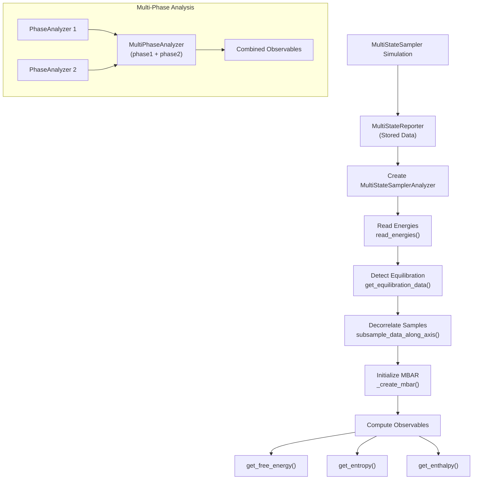

# Multistate Analysis

<details>
<summary>Relevant source files</summary>

The following files were used as context for generating this wiki page:

- [.gitignore](.gitignore)
- [openmmtools/multistate/multistateanalyzer.py](openmmtools/multistate/multistateanalyzer.py)
- [openmmtools/multistate/pymbar.py](openmmtools/multistate/pymbar.py)
- [openmmtools/multistate/utils.py](openmmtools/multistate/utils.py)

</details>


This page documents the analysis tools and methods available for processing data from multistate sampling simulations in OpenMMTools. These analysis components allow you to extract thermodynamic quantities such as free energies, entropies, and enthalpies from simulation data, with automated handling of equilibration detection, decorrelation, and statistical uncertainty estimation.

For information about performing multistate sampling simulations, see [Multistate Sampling](#4.3).

## Overview of Multistate Analysis Framework

The multistate analysis system provides a modular and extensible framework for analyzing data from multistate simulations. It is designed to support best practices in statistical analysis of molecular simulation data, including automatic equilibration detection, decorrelation of time series, and proper error propagation.



**Class Hierarchy in Multistate Analysis System**

Sources: [openmmtools/multistate/multistateanalyzer.py:446-1137](), [openmmtools/multistate/multistateanalyzer.py:1137-1432]()

## Core Components

### PhaseAnalyzer

`PhaseAnalyzer` is the abstract base class for analyzing a single phase of a multistate simulation. It defines the common interface and core functionality that all analyzers must implement:

- Reading and processing energy data from a reporter
- Automatic detection of equilibration and decorrelation
- Computation of observables with error estimation
- Combination of multiple phases for complex thermodynamic cycles

The class uses a sophisticated caching system to avoid redundant computations and efficiently invalidate dependent cached values when inputs change.

Key methods and properties:
- `read_energies()`: Extracts energy data from the reporter
- `get_effective_energy_timeseries()`: Computes timeseries for equilibration detection
- `observables`: Lists all available observables that can be computed
- `reference_states`: Defines reference states for computing observables between states

Sources: [openmmtools/multistate/multistateanalyzer.py:446-1137]()

### MultiStateSamplerAnalyzer

`MultiStateSamplerAnalyzer` extends `PhaseAnalyzer` with specialized functionality for analyzing simulations from the `MultiStateSampler`. It implements:

- MBAR (Multistate Bennett Acceptance Ratio) analysis for free energy estimation
- Automated equilibration detection
- Time series decorrelation
- Computation of thermodynamic observables (free energy, entropy, enthalpy)

Sources: [openmmtools/multistate/multistateanalyzer.py:1137-1432]()

### MultiPhaseAnalyzer

`MultiPhaseAnalyzer` allows combining multiple phase analyzers to perform analysis across multiple simulation phases. This is essential for complex thermodynamic calculations like binding free energies that involve multiple simulation legs.

It provides:
- Algebraic operations to combine phases (`+` and `-` operators)
- Consistent error propagation across phases
- Unified interface for accessing observables from multiple phases

Sources: [openmmtools/multistate/multistateanalyzer.py:2214-2664]()

### ObservablesRegistry

The `ObservablesRegistry` is a key component that manages the registration and classification of observables. It provides a structured way to define:

- What observables can be computed
- How observables are defined (by phase, single state, or two states)
- How errors are propagated when observables are combined



**Observable Classification and Error Propagation**

Sources: [openmmtools/multistate/multistateanalyzer.py:106-351]()

## Analysis Workflow

The typical workflow for analyzing multistate simulation data follows these steps:



**Multistate Analysis Workflow**

Sources: [openmmtools/multistate/multistateanalyzer.py:959-987](), [openmmtools/multistate/utils.py:97-194]()

## Equilibration and Decorrelation

The analysis system includes utilities for automatically detecting equilibration and calculating the statistical inefficiency of time series data:

- `get_equilibration_data_per_sample()`: Identifies the equilibration time in a simulation
- `get_decorrelation_time()`: Computes the statistical inefficiency (decorrelation time)
- `subsample_data_along_axis()`: Subsamples data to generate uncorrelated samples

These functions ensure that the statistical analysis properly accounts for correlations in the simulation data, which is essential for accurate uncertainty estimation.

Sources: [openmmtools/multistate/utils.py:97-194](), [openmmtools/multistate/utils.py:238-295]()

## Integration with PyMBAR

The multistate analysis system integrates with the PyMBAR library for statistical analysis of multistate data. It provides a compatibility layer to work with different versions of PyMBAR, adapting to API changes between versions:

- MBAR (Multistate Bennett Acceptance Ratio) for free energy calculations
- Statistical inefficiency estimation for time series analysis
- Error estimation for computed observables

The wrapper in `pymbar.py` ensures consistent behavior across PyMBAR versions 3.x and 4.x.

Sources: [openmmtools/multistate/pymbar.py:1-56]()

## Default Observables

The system comes with several pre-registered observables:

| Observable | Type | Error Propagation |
|------------|------|-------------------|
| free_energy | Two-state | Quadrature |
| entropy | Two-state | Quadrature |
| enthalpy | Two-state | Quadrature |

These observables can be computed directly from a `PhaseAnalyzer` or `MultiPhaseAnalyzer` instance using the corresponding methods (e.g., `get_free_energy()`).

Sources: [openmmtools/multistate/multistateanalyzer.py:346-351]()

## Caching System

The analysis system uses a sophisticated caching mechanism through the `CachedProperty` descriptor. This enables:

- Efficient recomputation when inputs change
- Automatic invalidation of dependent cached values
- Lazy evaluation of expensive computations

The caching system maintains a dependency graph to track which cached properties depend on others, ensuring that changes propagate correctly.

Sources: [openmmtools/multistate/multistateanalyzer.py:366-440](), [openmmtools/multistate/multistateanalyzer.py:728-802]()

## Example Usage

A typical example of using the multistate analysis system:

```python
# Create an analyzer for a phase
analyzer = MultiStateSamplerAnalyzer(reporter)

# Compute free energy differences between states
free_energy, delta_f_ij = analyzer.get_free_energy()

# Combine with another phase for a thermodynamic cycle
combined_analyzer = analyzer1 - analyzer2

# Compute the overall free energy change for the cycle
cycle_free_energy = combined_analyzer.get_free_energy()
```

## Using Online Analysis Data

The analysis system can leverage online analysis data computed during the simulation to hot-start the analysis:

- Faster analysis by using pre-computed quantities
- Option to use or ignore online data via the `use_online_data` parameter
- Automatic fallback to full analysis if online data is not available

This can be particularly useful for large datasets where the full analysis would be computationally expensive.

Sources: [openmmtools/multistate/multistateanalyzer.py:586-722]()

---