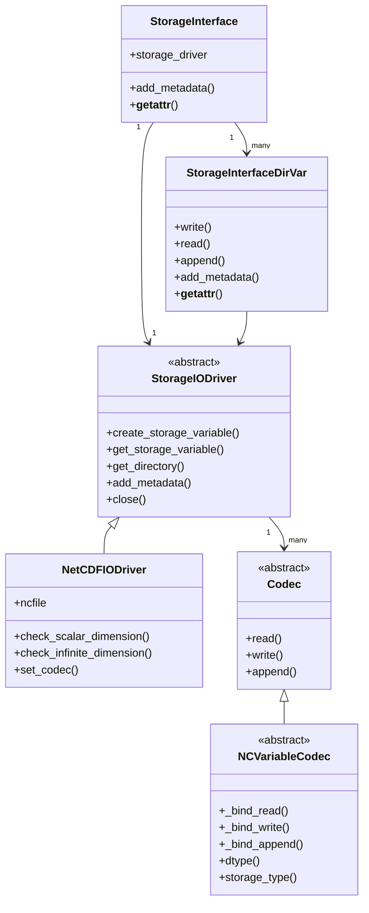
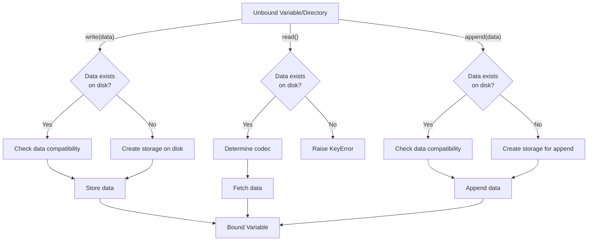
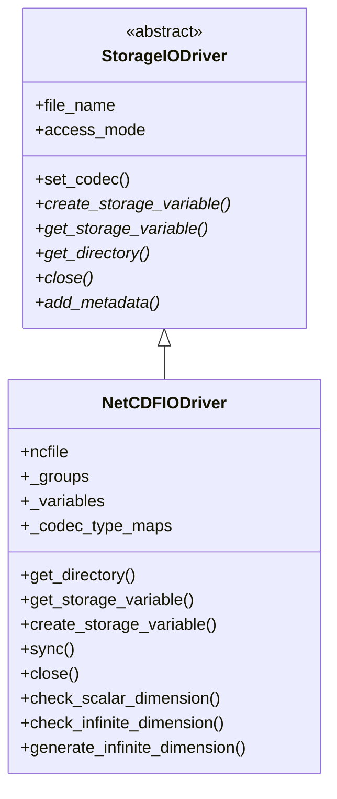
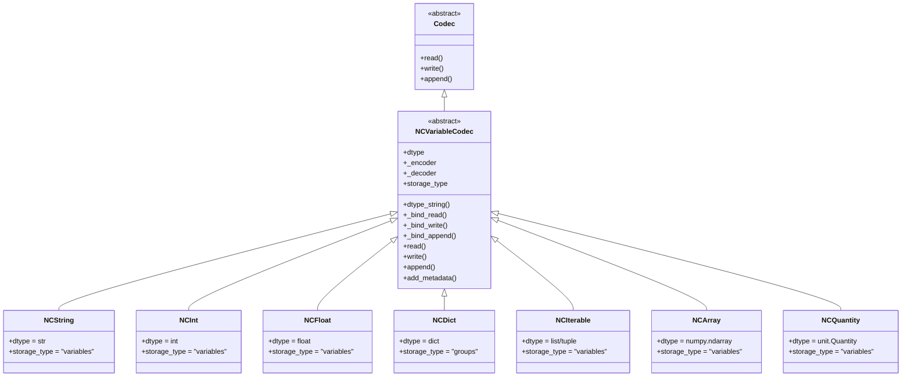
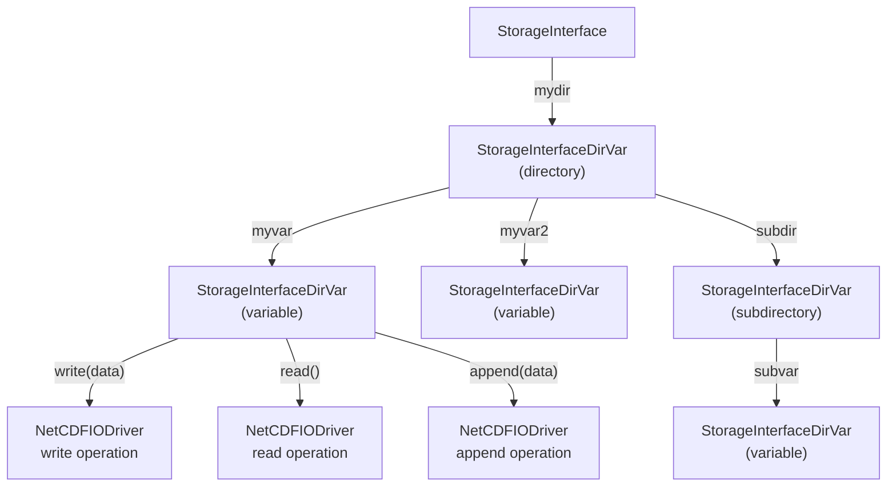
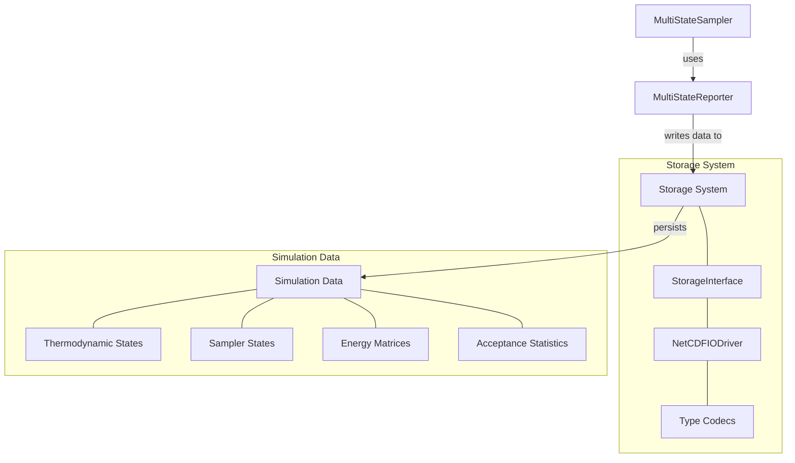

# Storage System

<details>
<summary>Relevant source files</summary>

The following files were used as context for generating this wiki page:

- [docs/storage.rst](docs/storage.rst)
- [openmmtools/storage/__init__.py](openmmtools/storage/__init__.py)
- [openmmtools/storage/iodrivers.py](openmmtools/storage/iodrivers.py)
- [openmmtools/storage/storageinterface.py](openmmtools/storage/storageinterface.py)
- [openmmtools/tests/test_forcefactories.py](openmmtools/tests/test_forcefactories.py)
- [openmmtools/tests/test_storage_interface.py](openmmtools/tests/test_storage_interface.py)
- [openmmtools/tests/test_storage_iodrivers.py](openmmtools/tests/test_storage_iodrivers.py)

</details>


## Purpose and Scope

The Storage System in OpenMMTools provides a flexible, efficient interface for persisting simulation data to disk. It is primarily designed to work with NetCDF files but is architected to be extensible to other storage formats. The system enables storage of various Python data types including primitives, collections, NumPy arrays, and OpenMM-specific types such as units.Quantity objects.

This page describes the storage architecture, components, and usage patterns. For information about using the Storage System with multistate analysis, see [Multistate Analysis](#5.1).

Sources: [openmmtools/storage/__init__.py:1-71]()

## Architecture Overview

The Storage System is built around a layered architecture that separates the user interface from the underlying storage implementation. This design provides flexibility and extensibility while maintaining a simple API for users.



The system consists of three main components:

1. **StorageInterface**: High-level user-facing API that provides dynamic property access
2. **StorageIODriver**: Abstract base class defining storage operations, extended by format-specific implementations
3. **Codec System**: Type-specific encoder/decoders that handle conversion between Python objects and storage format

Sources: [openmmtools/storage/__init__.py:6-71](), [openmmtools/storage/storageinterface.py:26-124](), [openmmtools/storage/iodrivers.py:98-239]()

## Binding Mechanism

A key concept in the Storage System is the "binding" mechanism, which determines when variables interact with the disk. All variables and directories start in an "unbound" state, and only interact with the disk when a read/write/append operation is first requested. This lazy-binding approach minimizes I/O operations.



The binding process follows these steps:

1. **Read operation**:
   - If data exists on disk: Determine appropriate codec and fetch data
   - If no data exists: Raise error

2. **Write operation**:
   - If data exists: Verify compatibility and overwrite
   - If no data exists: Create storage and write data

3. **Append operation**:
   - If data exists: Verify compatibility and append
   - If no data exists: Create storage with append dimensions and store data

Once bound, variables maintain their codec type and enforce appropriate data types for future operations.

Sources: [openmmtools/storage/__init__.py:32-51](), [openmmtools/storage/storageinterface.py:150-168](), [openmmtools/storage/storageinterface.py:169-192]()

## StorageIODriver

The `StorageIODriver` is the abstract base class that defines the interface for storage operations. It manages the connection to the storage medium and provides methods for creating and accessing variables and directories.

### Key Components



The `NetCDFIODriver` is the concrete implementation for NetCDF file operations using the `netCDF4` library. It:

1. Manages the NetCDF file connection
2. Creates and accesses groups (directories) and variables
3. Maps Python types to appropriate codec classes
4. Handles dimension creation and management
5. Provides metadata management

Sources: [openmmtools/storage/iodrivers.py:98-239](), [openmmtools/storage/iodrivers.py:244-533]()

## Type Codec System

The Storage System includes a sophisticated codec system for encoding and decoding different Python data types to/from the storage format.



Each codec handles a specific Python type and defines how to:
1. Encode the type for storage
2. Decode the stored data back to the Python type
3. Handle metadata and type information
4. Manage scalar, vector, and array shapes

Supported types include:
- Basic types: `int`, `float`, `str`
- Collections: `list`, `tuple`, `dict`
- Scientific data: `numpy.ndarray`, `unit.Quantity`

Sources: [openmmtools/storage/iodrivers.py:538-607](), [openmmtools/storage/iodrivers.py:609-968](), [openmmtools/storage/iodrivers.py:518-532]()

## StorageInterface

The `StorageInterface` provides a high-level, user-friendly API for the Storage System. It uses dynamic attribute access to create a hierarchical structure of variables and directories.



### StorageInterfaceDirVar

The `StorageInterfaceDirVar` (SIDV) is a versatile class that represents both directories and variables within the storage hierarchy. It determines its role (directory or variable) based on how it's accessed:

- If accessed with a write/read/append method, it becomes a variable
- If accessed via attribute (dot notation), it becomes a directory containing other SIDVs

Key methods:
- `write(data, at_index=None)`: Write data to disk, optionally at a specific index for appendable variables
- `read()`: Read data from disk
- `append(data)`: Append data to an existing variable or create a new appendable variable
- `add_metadata(name, data)`: Add metadata to the variable or directory

Sources: [openmmtools/storage/storageinterface.py:28-377](), [openmmtools/storage/storageinterface.py:383-499]()

## Usage Patterns

The Storage System is designed for intuitive, Pythonic usage. Here are common usage patterns:

### Basic Storage Operations

```python
# Create storage interface
from openmmtools.storage import NetCDFIODriver, StorageInterface

# Initialize with a file name
driver = NetCDFIODriver('simulation_data.nc')
storage = StorageInterface(driver)

# Write various data types
storage.temperature.write(300.0)                # Store a float
storage.parameters.tolerance.write(1e-5)        # Nested directories
storage.trajectory.append(positions)            # Append data to a trajectory
storage.metadata.add_metadata('author', 'User') # Add metadata
 
# Read data
temp = storage.temperature.read()
positions = storage.trajectory.read()           # For append variables, returns a list
```

### Working with Different Data Types

The Storage System handles many Python and OpenMM data types:

| Data Type | Write Example | Read Result |
|-----------|---------------|-------------|
| int | `storage.count.write(42)` | `42` |
| float | `storage.energy.write(123.45)` | `123.45` |
| str | `storage.name.write("simulation1")` | `"simulation1"` |
| list/tuple | `storage.params.write([1, 2, 3])` | `[1, 2, 3]` |
| numpy.ndarray | `storage.coords.write(np.array([[1,2,3]]))` | `array([[1,2,3]])` |
| unit.Quantity | `storage.temp.write(300*unit.kelvin)` | `300*unit.kelvin` |
| dict | `storage.config.write({"steps": 1000})` | `{"steps": 1000}` |

### Appending Data and Trajectories

For time-series or trajectory data, the append method is particularly useful:

```python
# Store a trajectory of positions
for step in range(n_steps):
    positions = simulate_step()
    storage.trajectory.append(positions)

# Read the entire trajectory
all_positions = storage.trajectory.read()  # Returns a list of all frames

# Overwrite a specific frame
storage.trajectory.write(new_positions, at_index=5)  # Replaces frame 5
```

Sources: [openmmtools/storage/storageinterface.py:394-420](), [openmmtools/tests/test_storage_interface.py:64-104](), [openmmtools/tests/test_storage_iodrivers.py:177-256]()

## Integration with Other OpenMMTools Components

The Storage System is utilized by other components in OpenMMTools, particularly for storing simulation data in multistate sampling methods:



The Storage System provides the infrastructure for:
1. Checkpointing simulation progress
2. Storing trajectory data for later analysis
3. Recording energy matrices for multistate analysis
4. Preserving sampling statistics and diagnostics

Sources: [openmmtools/storage/__init__.py:1-71]()

## Best Practices

When working with the Storage System, consider these recommendations:

1. **Close files properly**: Always ensure that files are properly closed using `storage_driver.close()` when finished to prevent data corruption.

2. **Metadata usage**: Use metadata to document your data:
   ```python
   storage.add_metadata('created', date_string)
   storage.trajectory.add_metadata('timestep', '2.0 fs')
   ```

3. **Directory organization**: Organize your data logically using directories:
   ```python
   storage.system.parameters.write(params)
   storage.simulation.trajectory.append(positions)
   storage.analysis.rmsd.append(rmsd_value)
   ```

4. **Type consistency**: Maintain consistent types when appending data; the system will enforce this but planning ahead helps.

5. **Access mode selection**: When opening existing files, consider using `access_mode='r'` for read-only operations to prevent accidental modifications.

Sources: [openmmtools/storage/iodrivers.py:481-489](), [openmmtools/tests/test_storage_interface.py:168-181]()

---