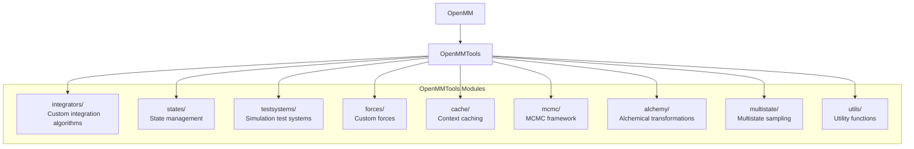
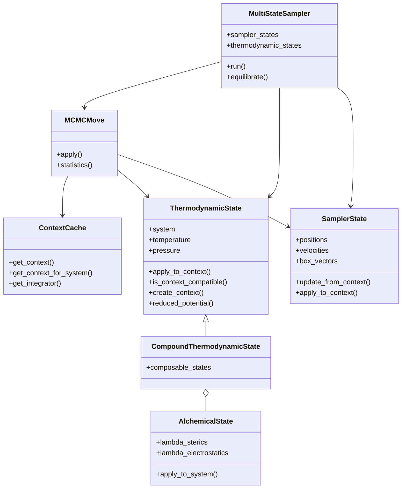
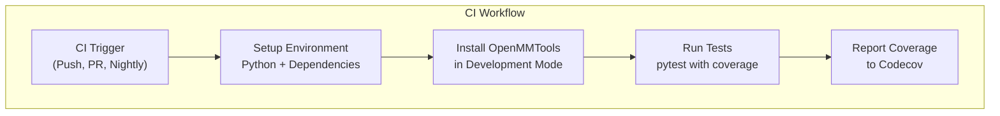
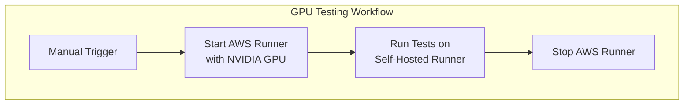

# Developer Guide

<details>
<summary>Relevant source files</summary>

The following files were used as context for generating this wiki page:

- [.github/workflows/CI.yml](.github/workflows/CI.yml)
- [.github/workflows/gpu-runner.yaml](.github/workflows/gpu-runner.yaml)
- [devtools/conda-envs/test_env.yaml](devtools/conda-envs/test_env.yaml)
- [docs/releasehistory.rst](docs/releasehistory.rst)

</details>


## Purpose and Scope

This guide provides comprehensive information for developers who want to contribute to the OpenMMTools codebase. It covers development environment setup, coding conventions, testing procedures, and the release process. For specific details about the testing framework, see [Testing Framework](#7.1), and for the release history, see [Release History](#7.2).

## Development Environment Setup

### Dependencies

OpenMMTools requires several dependencies for development. The core dependencies are listed below:

| Category | Dependencies |
|----------|--------------|
| **Core** | OpenMM, NumPy, SciPy, NetCDF4, PyYAML, Numba |
| **Parallelization** | mpiplus |
| **Trajectory Analysis** | MDTraj |
| **Statistical Analysis** | PyMBAR (v3 or v4) |
| **Testing** | pytest, pytest-cov, pytest-xdist, pytest-rerunfailures |
| **Documentation** | Sphinx, numpydoc, sphinx-rtd-theme, sphinxcontrib-bibtex |

Sources: [devtools/conda-envs/test_env.yaml]()

### Setting Up a Development Environment

The recommended way to set up a development environment is using conda/mamba:

1. Clone the repository:
   ```bash
   git clone https://github.com/choderalab/openmmtools.git
   cd openmmtools
   ```

2. Create a conda environment using the provided environment file:
   ```bash
   conda env create -f devtools/conda-envs/test_env.yaml
   conda activate openmmtools-test
   ```

3. Install OpenMMTools in development mode:
   ```bash
   pip install -e .
   ```

This will install OpenMMTools in editable mode, allowing you to modify the code and see the changes without reinstalling.

Sources: [devtools/conda-envs/test_env.yaml](), [.github/workflows/CI.yml:71-75]()

## Project Architecture

The OpenMMTools codebase is organized into several modules, each with specific responsibilities:



Sources: [OpenMMTools System Architecture Overview]()

### Core Components Relationship



Sources: [OpenMMTools System Architecture Overview]()

## Coding Conventions and Guidelines

### Python Style

- Follow PEP 8 for Python code style
- Use NumPy-style docstrings for documentation
- Use meaningful variable and function names
- Include unit tests for new functionality

### Pull Request Workflow

1. Fork the repository and create a feature branch
2. Implement your changes with appropriate tests
3. Ensure all tests pass locally
4. Submit a pull request to the main repository
5. Address any review comments

## Testing Framework

OpenMMTools uses pytest for unit testing. The test suite covers various aspects of the codebase:

### Running Tests Locally

To run the tests locally:

```bash
# Run all tests
pytest -v openmmtools/tests/

# Run tests in parallel (faster)
pytest -n logical -v openmmtools/tests/

# Run tests with coverage
pytest -n logical -v --cov=openmmtools openmmtools/tests/
```

### Continuous Integration

OpenMMTools uses GitHub Actions for continuous integration. The CI pipeline:

1. Tests on multiple operating systems (Linux, macOS, Windows)
2. Tests with different Python versions (3.10, 3.11, 3.12)
3. Tests with different OpenMM versions (8.1.2, 8.2.0)
4. Tests with different PyMBAR versions (3.x, 4.x)



Sources: [.github/workflows/CI.yml]()

### GPU Testing

OpenMMTools also has a separate workflow for testing on GPU hardware using AWS:



Sources: [.github/workflows/gpu-runner.yaml]()

## Release Process

### Versioning Scheme

OpenMMTools follows semantic versioning (MAJOR.MINOR.PATCH):

- MAJOR: Incompatible API changes
- MINOR: Backwards-compatible feature additions
- PATCH: Backwards-compatible bugfixes

### Creating a Release

1. Update version number in appropriate files
2. Update release history in `docs/releasehistory.rst`
3. Create a pull request for the release
4. After merging, tag the release on GitHub
5. CI will automatically build and upload the package to conda-forge

### Release History Documentation

For each release, the following information should be documented:

- Version number and title
- New features
- Enhancements
- Bug fixes
- API changes
- Deprecations

Example from a recent release:

```
0.24.2 - Numpy 2 support and FIRE minimization improvements
===========================================================

Enhancements
------------
- Add AWS Tags
- Migrate to new OMSF start/stop runners
- Disable the barostat during FIRE minimization

Bug Fixes
---------
- Fixes for numpy 2.0
```

Sources: [docs/releasehistory.rst:1-20]()

## Contributing New Features

When developing new features for OpenMMTools, consider how they fit into the existing architecture:

1. **Integrators**: New integration algorithms should be added to the `integrators` module
2. **Forces**: Custom force implementations go in the `forces` module
3. **State Management**: Anything that extends thermodynamic or sampler states should build on the existing classes
4. **MCMC Framework**: New Monte Carlo moves should inherit from the `MCMCMove` base class
5. **Alchemical Transformations**: Extensions to alchemical functionality go in the `alchemy` module
6. **Multistate Sampling**: Enhanced sampling methods extending the multistate framework

For each new feature:
- Add appropriate unit tests
- Update documentation
- Consider backward compatibility
- Benchmark performance if applicable

## Debugging and Troubleshooting

### Common Issues

1. **Platform Selection**: OpenMM can use different platforms (CUDA, OpenCL, CPU), which can cause reproducibility issues
2. **Precision Differences**: Different precision modes (single, mixed, double) can affect numerical results
3. **Random Seeds**: Many algorithms use random numbers; set seeds for reproducibility
4. **Context Caching**: Context reuse can lead to unexpected behavior if not managed properly

### Using the Context Cache

The `ContextCache` is a critical performance component that manages OpenMM Context objects:

```python
# Example of proper ContextCache usage
from openmmtools.cache import ContextCache
cache = ContextCache()

# Get a cached context
context = cache.get_context(thermodynamic_state)

# Properly handle cleanup
try:
    # Use context
    pass
finally:
    # Return context to cache
    cache.return_context(context)
```

## Additional Resources

- OpenMM Documentation: http://docs.openmm.org/
- OpenMMTools Issues: https://github.com/choderalab/openmmtools/issues
- Choderalab Discourse Forum: https://discourse.choderalab.org/

For specific questions about the Testing Framework or Release History, see [Testing Framework](#7.1) and [Release History](#7.2).

---