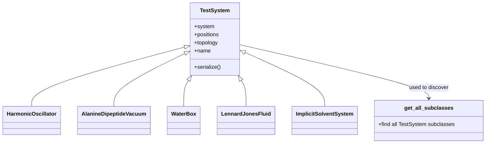
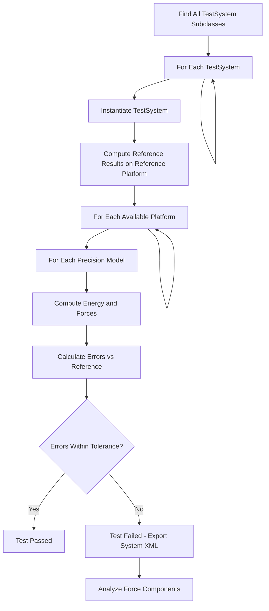
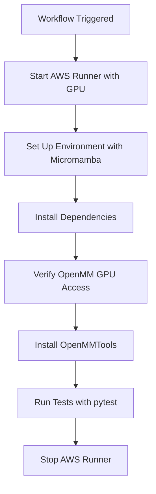

# Testing Framework

<details>
<summary>Relevant source files</summary>

The following files were used as context for generating this wiki page:

- [.github/workflows/gpu-runner.yaml](.github/workflows/gpu-runner.yaml)
- [openmmtools/scripts/test_openmm_platforms.py](openmmtools/scripts/test_openmm_platforms.py)
- [openmmtools/utils/__init__.py](openmmtools/utils/__init__.py)
- [openmmtools/utils/equilibration.py](openmmtools/utils/equilibration.py)
- [openmmtools/utils/utils.py](openmmtools/utils/utils.py)

</details>


## Purpose and Scope

This page documents the testing framework used in OpenMMTools, including how to run tests, testing utilities, and platform compatibility testing. The documentation is intended for developers who want to contribute to OpenMMTools or understand how the codebase is tested to ensure reliability across different platforms and configurations.

Sources: [openmmtools/scripts/test_openmm_platforms.py:3-30]()

## Running Tests

OpenMMTools uses the pytest framework for testing. Tests can be run from the command line with various options to control verbosity, parallelism, and coverage reporting.

### Basic Test Commands

```bash
# Run all tests with verbosity
pytest -v

# Run tests with multiple processes for faster execution
pytest -n 4 -v 

# Run tests with coverage reporting
pytest -v --cov=openmmtools --cov-report=term

# Run tests and show the 10 slowest test functions
pytest -v --durations=10
```

The GitHub Actions workflow file shows these commands in action, particularly for GPU testing.

Sources: [.github/workflows/gpu-runner.yaml:76-78]()

## Test Organization

### Test System Architecture

The OpenMMTools testing framework utilizes a hierarchy of TestSystem classes which provide standard molecular systems that can be instantiated for testing algorithms across platforms.



The test framework uses utility functions like `get_all_subclasses()` to dynamically discover all available test systems derived from the base `TestSystem` class. This makes it easy to add new test systems without modifying the testing code.

Sources: [openmmtools/scripts/test_openmm_platforms.py:310-332]()

## Platform Testing

OpenMMTools provides a specialized script for testing compatibility and consistency across different OpenMM platforms (CPU, CUDA, OpenCL, HIP, Reference). This is crucial since different hardware and implementations can produce slightly different numerical results.

### Cross-Platform Testing Flow



The platform testing script compares potential energy and forces across platforms, ensuring differences are within specified tolerances. If discrepancies are found, the system is analyzed component by component to identify the source of the problem.

Sources: [openmmtools/scripts/test_openmm_platforms.py:337-536]()

## Testing Utilities

OpenMMTools includes utility functions to facilitate testing. These utilities handle platform detection, temporary directory management, timing, and more.

### Platform Utilities

Functions for determining available platforms and their capabilities:

```python
# Detect platforms supporting specific precision
get_available_platforms(minimum_precision='mixed')

# Check if platform supports a precision mode
platform_supports_precision(platform, precision)

# Get the fastest available platform
get_fastest_platform(minimum_precision='mixed')
```

Sources: [openmmtools/utils/utils.py:517-601]()

### Context Managers and Timing

```python
# Safe creation of temporary directories for tests
with temporary_directory() as tmp_dir:
    # Test code that needs a temporary directory
    pass  # Directory is automatically cleaned up

# Timing test operations
with time_it('operation name'):
    # Code to time
    pass  # Elapsed time is logged
```

Sources: [openmmtools/utils/utils.py:47-185]()

## Error Tolerance and Precision

OpenMMTools testing framework has specific tolerance values for comparing results across platforms. This is necessary because different hardware implementations (especially GPU vs CPU) can produce slightly different floating-point results.

```python
# Energy difference tolerance
ENERGY_TOLERANCE = 0.06*units.kilocalories_per_mole

# Per-particle force root-mean-square error tolerance  
FORCE_RMSE_TOLERANCE = 0.06*units.kilocalories_per_mole/units.angstrom
```

Sources: [openmmtools/scripts/test_openmm_platforms.py:154-156](), [openmmtools/scripts/test_openmm_platforms.py:158-184]()

## GPU Testing

OpenMMTools has specialized support for GPU testing through GitHub Actions workflows.

### GPU Test Workflow



The self-hosted runner uses an AWS g4dn.xlarge instance with NVIDIA GPU support to run tests on GPU hardware, ensuring compatibility with GPU platforms.

Sources: [.github/workflows/gpu-runner.yaml:1-100]()

## Benchmarking and Performance Testing

The testing framework includes utilities for measuring performance and timing code execution:

```python
# Create a timer
timer = Timer()
timer.start('benchmark')
# Code to benchmark
timer.stop('benchmark')
timer.report_timing()

# Decorator for timing functions
@with_timer('operation name')
def some_function():
    pass
```

Sources: [openmmtools/utils/utils.py:65-184]()

## Testing Equilibration

OpenMMTools provides utilities for testing equilibration protocols, which are important for preparing systems for production simulations.

The `run_gentle_equilibration` function performs a multi-stage equilibration process that can be used in tests to prepare systems. It supports different equilibration modes (minimization, MD, temperature interpolation) and ensembles (NVT, NPT).

Sources: [openmmtools/utils/equilibration.py:12-164]()

## Best Practices for Contributors

When contributing to OpenMMTools, keep these testing best practices in mind:

1. Add tests for any new functionality
2. Ensure tests run across all supported platforms
3. Use appropriate tolerances when comparing numerical results
4. Add new test systems to the `testsystems` module when needed
5. Check that tests run with both single and double precision

## Troubleshooting Tests

Common test failures include:

1. Numerical discrepancies between platforms exceeding tolerance thresholds
2. Tests failing on specific platforms but not others
3. Tests passing individually but failing when run as a group

When a test fails with platform discrepancies, the framework exports XML files of the system to aid in debugging:

```python
# Exporting failed test system to XML files
logger.info("Writing failed test system to '%s'.{system,state}.xml ..." % testsystem.name)
[system_xml, state_xml] = testsystem.serialize()
```

Sources: [openmmtools/scripts/test_openmm_platforms.py:451-459]()

---