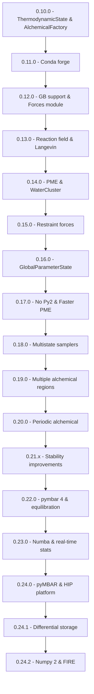
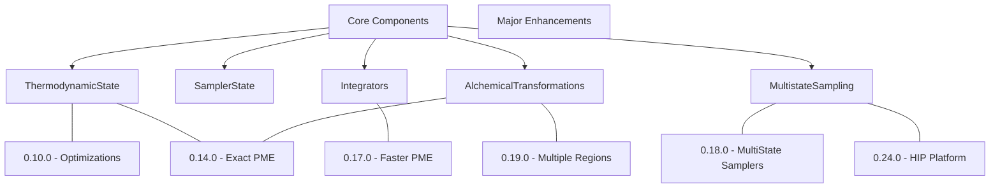

# Release History

Relevant source files

The following files were used as context for generating this wiki page:

- [.github/workflows/CI.yml](.github/workflows/CI.yml)
- [devtools/conda-envs/test_env.yaml](devtools/conda-envs/test_env.yaml)
- [docs/releasehistory.rst](docs/releasehistory.rst)

## Introduction

This document provides a comprehensive record of OpenMMTools version releases, detailing new features, enhancements, bugfixes, and API changes. For information about the OpenMMTools components and architecture, see [Overview](#1).

## OpenMMTools Version Evolution

### Timeline of Major Releases

The diagram below shows the evolution of OpenMMTools through its major releases, highlighting key features introduced in each version.

Sources: [docs/releasehistory.rst:1-219]()

### Dependency Support Evolution

The following diagram illustrates how OpenMMTools support for various Python versions and dependencies has evolved over time.

```mermaid
graph TD
    py["Python Versions"]
    py2["Python 2.7 (until v0.17.0)"]
    py35["Python 3.5 (until v0.20.0)"]
    py36["Python 3.6+ (from v0.17.0)"]
    py310["Python 3.10+ (Current CI)"]
    
    dep["Key Dependencies"]
    omm7["OpenMM 7.x (until v0.21.0)"]
    omm8["OpenMM 8.x (from v0.21.0)"]
    pymbar3["pymbar 3.x (Supported)"]
    pymbar4["pymbar 4.x (Preferred)"]
    numpy1["numpy 1.x (until v0.24.2)"]
    numpy2["numpy 2.x (from v0.24.2)"]
    
    py --> py2
    py --> py35
    py --> py36
    py --> py310
    
    dep --> omm7
    dep --> omm8
    dep --> pymbar3
    dep --> pymbar4
    dep --> numpy1
    dep --> numpy2
```

Sources: [.github/workflows/CI.yml:25-45](), [devtools/conda-envs/test_env.yaml:1-32]()

## Current Release Details

### 0.24.2 - Numpy 2 support and FIRE minimization improvements

This release enables numpy 2 support and makes the FIRE minimization more stable by disabling the barostat during the minimization.

**Enhancements:**
- Added AWS Tags (PR #766)
- Migrated to new OMSF start/stop runners (PR #775)
- Disabled the barostat during FIRE minimization (PR #773)

**Bug Fixes:**
- Fixed issues for numpy 2.0 compatibility (ruff NPY201) (PR #777)

Sources: [docs/releasehistory.rst:4-20]()

### 0.24.1 - Differential storage of positions and velocities

**Enhancements:**
- `MultiStateReporter` now accepts variable position and velocity checkpointing intervals. When resuming simulations, users need to respecify keyword arguments for the reporter.

Sources: [docs/releasehistory.rst:21-28]()

### 0.24.0 - pyMBAR Behavior Changes + HIP Platform Added

**Bug Fixes:**
- Updated docstring default for `alchemical_pme_treatment`

**Behavior Changes:**
- Now using `robust` solver for `pyMBAR` by default, improving convergence performance

**Enhancements:**
- Added OpenMM's "HIP" platform as a selectable platform for compatible AMD GPUs
- Added `effective_length` to `MultiStateSamplerAnalyzer`
- Created `alchemy` subpackage

**Testing:**
- Testing framework overhauled to use pytest with automatic re-run of flaky tests
- Now using OMSF's `gha-runner` to test on GPUs

Sources: [docs/releasehistory.rst:30-73]()

## Component Evolution in Major Releases

The diagram below shows key improvements to core components across major releases.

Sources: [docs/releasehistory.rst:30-219]()

## Historical Releases

### 0.23.x Series

#### 0.23.1 - Bugfix release
- Fixed issue with `None` for `online_analysis_interval` causing errors

#### 0.23.0 - latest numba support and real time stats enhancements
**API Breaking Change:** To ensure consistency when appending real time stats, `online_analysis_interval` of `MultiStateSampler` must match `checkpoint_interval` of `MultiStateReporter`.

**Enhancements:**
- Warning when running with NVIDIA GPUs in Exclusive Process mode
- Real time statistics YAML file now appends instead of being overwritten when extending/resuming simulations

**Bugfixes:**
- Fixed metadata for netcdf files by specifying openmmtools for the `program` metadata
- Fixed error when resuming simulations with numba 0.57 by avoiding `numpy.MaskedArray` during deserialization

Sources: [docs/releasehistory.rst:74-98]()

### 0.22.x Series

#### 0.22.1 - Bugfix release
- Fixed issue with case-insensitive error message checking from OpenMM

#### 0.22.0 - pymbar 4 support and gentle equilibration
**Enhancements:**
- Support for both Pymbar 3 and 4 versions
- Added gentle equilibration protocol utility function in `openmmtools.utils.gentle_equilibration`
- Timing information for multiple state sampler now reported by default

**Bugfixes:**
- Warnings now raised when exceptions are caught during dynamics
- Fixed deserialization of MCMC moves objects from versions <=0.21.4
- Improved documentation and readthedocs generation
- Added support for newer NetCDF versions (1.6 branch)

Sources: [docs/releasehistory.rst:99-123]()

### 0.21.x Series

#### 0.21.5 - Bugfix release
**Changed behaviors:**
- `LangevinDynamicsMove` now uses `openmm.LangevinMiddleIntegrator` (BAOAB) instead of `openmm.LangevinIntegrator` (OBABO)

**Bugfixes:**
- Fixed incorrect velocity updates when resuming simulations
- Fixed several bugs in equilibration detection
- Fixed deserialization from `openmmtools<0.21.3` versions
- Fixed `PermissionError` when writing real-time analysis files

**Enhancements:**
- `LangevinDynamicsMove` now allows `constraint_tolerance` parameter
- Platform is now reported in logs in DEBUG mode

Sources: [docs/releasehistory.rst:124-144]()

#### 0.21.4 - Bugfix release
- Fixed bug in statistical inefficiency computation
- Fixed bug in estimated performance in realtime yaml file
- Fixed potential bug in MPI context by explicitly updating and broadcasting thermodynamic states
- Fixed bug in handling unsampled states in realtime/offline analysis

**Enhancements:**
- DHFR test system no longer requires `parmed` dependency
- `MultiStateSamplerAnalyzer` now allows manual specification of parameters

Sources: [docs/releasehistory.rst:145-159]()

#### 0.21.3 - Bugfix release
- Fixed bug in replica mixing in MPI multi-GPU runs
- Fixed velocities storage in checkpoint files to eliminate "cold restart" issues
- Fixed documentation building via CI
- Fixed failing Windows CI

**Enhancements:**
- Real-time MBAR analysis and timing information now in YAML format
- Added logging of available CUDA devices
- Replica exchanges now attempted during equilibration phase
- Added example of resuming a MultiStateSampler simulation

Sources: [docs/releasehistory.rst:160-177]()

#### 0.21.2 - Bugfix release
- Fixed UnboundLocalError when using a string to specify platform in `platform_supports_precision`

#### 0.21.1 - Bugfix release
- More streamlined context cache usage using instance attributes
- Improved docstring and examples for `MultiStateSampler` object

#### 0.21.0 - Bugfix release
- Fixed TestAbsoluteAlchemicalFactory.test_overlap NaNs
- Fixed windows test issues
- Updated to Python versions following NEP 29
- Updated to handle the new OpenMM 7.6 package namespace
- Context cache usage cleanup to avoid memory issues

**Known issues:**
- Correctly raises an error when a `CustomNonbondedForce` made by OpenMM's `LennardJonesGenerator` is detected

**Enhancements:**
- Use of CODATA 2018 constants from OpenMM 7.6.0
- Using new way of importing OpenMM >= 7.6
- Removed logic for missing file when retrying to open a dataset

Sources: [docs/releasehistory.rst:178-218]()

### 0.20.x Series

#### 0.20.3 - Bugfix release
- Fixed silent failure of GPU contexts to enable 'mixed' precision
- Corrected reporting of available precisions

#### 0.20.2 - Bugfix release
- Removed leftover support for Python 2.7

#### 0.20.1 - Bugfix release
**Enhancements:**
- Added precision filtering to `get_available_platforms()` and `get_fastest_platform()`

**Bugfixes:**
- Replaced Cython-accelerated `all-swap` replica mixing with Numba implementation
- Fixed incorrect temperature spacing in `ParallelTemperingSampler`
- Improved precision by doing unit conversion first

**Misc:**
- Resolved NumPy 1.20 deprecation warnings

#### 0.20.0 - Periodic alchemical integrators
**Enhancements:**
- Added `PeriodicNonequilibriumIntegrator`, extending `AlchemicalNonequilibriumLangevinIntegrator` for periodic protocols

Sources: [docs/releasehistory.rst:219-253]()

### 0.19.x Series

#### 0.19.1 - Bugfix release
- Fixed crash during restraint unbiasing with unexpected atom order

#### 0.19.0 - Multiple alchemical regions
**New features:**
- Added support for multiple independent alchemical regions in `AbsoluteAlchemicalFactory`
- Added support for anisotropic and membrane barostats in `ThermodynamicState`
- Added platform properties support in ContextCache for mixed and double precision CUDA

**Bugfixes:**
- Changed multistate samplers to issue API warnings via `logger.warn()` instead of `warnings.warn()`
- Fixed return value in `states.reduced_potential_at_states`

**Known issues:**
- Using parallel MPI processes causes poor mixing of odd thermodynamic states

Sources: [docs/releasehistory.rst:254-288]()

### Earlier Releases

For details on earlier releases (0.18.x and older), please refer to the [release history file in the repository](https://github.com/choderalab/openmmtools/blob/main/docs/releasehistory.rst).

## Current Development

The current development version of OpenMMTools supports:
- Python 3.10, 3.11, and 3.12
- OpenMM 8.1.2 and 8.2.0
- pymbar 3.x and 4.x (with 4.x preferred)
- numpy 2.x

Testing is performed on multiple platforms (macOS, Linux, Windows) using GitHub Actions workflows.

Sources: [.github/workflows/CI.yml:25-45](), [devtools/conda-envs/test_env.yaml:1-32]()

## Release Strategy

OpenMMTools follows a semantic versioning strategy:
- **Major versions** (X.0.0): Significant API changes and feature additions
- **Minor versions** (0.X.0): New features, enhancements, and backward-compatible API changes
- **Patch versions** (0.0.X): Bug fixes and minor enhancements without API changes

The project maintains backward compatibility where possible, with deprecation warnings issued before major API changes.