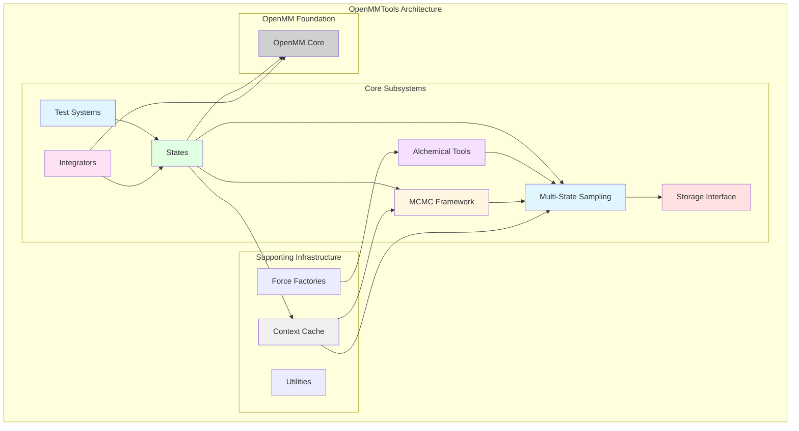
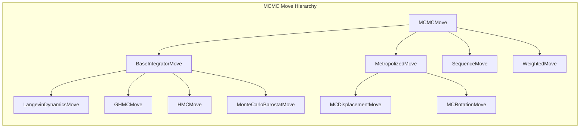

OpenMMTools is a comprehensive Python library layer that extends the **OpenMM molecular simulation engine** with a collection of production-ready tools for building full-featured molecular simulation packages. Built on top of OpenMM's GPU-accelerated foundation, it provides a batteries-included toolkit that significantly reduces development time for molecular dynamics simulations, free energy calculations, and enhanced sampling methods.

The library serves as an intermediate abstraction layer between OpenMM's low-level APIs and high-level simulation workflows, offering reusable components for **test systems, advanced integrators, state management, MCMC frameworks, alchemical transformations, and storage interfaces**.

Sources: [README.md](README.md#L1-L50), [docs/index.rst](docs/index.rst#L1-L73)

## Architecture Overview

The architecture follows a modular design with clear separation of concerns across seven major subsystems. Each subsystem can be used independently or combined to build sophisticated simulation workflows.



Sources: [openmmtools/__init__.py](openmmtools/__init__.py#L1-L19)

## Key Features

### High-Quality Integrators

OpenMMTools provides advanced integrators not natively available in OpenMM, with configurable **splitting schemes** for optimal performance:

| Integrator Category | Key Classes | Use Case |
|---------------------|-------------|----------|
| **Langevin Splittings** | `LangevinIntegrator`, `BAOABIntegrator`, `VVVRIntegrator`, `GeodesicBAOABIntegrator` | Equilibrium MD with configurable error properties |
| **Hamiltonian MC** | `HMCIntegrator`, `GHMCIntegrator` | Large conformational changes with Metropolis acceptance |
| **Nonequilibrium** | `AlchemicalNonequilibriumLangevinIntegrator`, `PeriodicNonequilibriumIntegrator` | Free energy calculations via nonequilibrium switching |
| **Thermostats** | `AndersenVelocityVerletIntegrator`, `NoseHooverChainVelocityVerletIntegrator` | Alternative temperature control schemes |
| **Minimization** | `GradientDescentMinimizationIntegrator`, `FIREMinimizationIntegrator` | Energy landscape optimization |

> [!TIP]
> The splitting parameter (e.g., `"V R O R V"` for BAOAB) directly controls the integrator's properties—choose BAOAB for minimal configurational error in equilibrium sampling, or VVVR for improved sampling efficiency in some systems.

Sources: [integrators.py](openmmtools/integrators.py#L6-L30), [README.md](README.md#L1-L50)

### State Management System

The **ThermodynamicState** and **SamplerState** classes provide a clean abstraction for managing simulation conditions:

- **ThermodynamicState**: Encapsulates the OpenMM System with temperature, pressure, and surface tension parameters, automatically managing thermostat and barostat configuration
- **SamplerState**: Tracks microscopic state variables including positions, velocities, box vectors, and energies
- **Compound States**: Allows composable state modifications through the `IComposableState` interface

This design enables efficient **context caching** and rapid switching between thermodynamic conditions without recreating OpenMM Context objects.

Sources: [states.py](openmmtools/states.py#L7-L40), [gettingstarted.rst](docs/gettingstarted.rst#L1-L100)

### MCMC Framework

The extensible **Markov Chain Monte Carlo framework** allows composition of complex sampling strategies:



The framework supports **sequential move application** (`SequenceMove`) and **probabilistic move selection** (`WeightedMove`), enabling sophisticated hybrid sampling strategies that combine MD-based moves with pure Monte Carlo proposals.

Sources: [mcmc.py](openmmtools/mcmc.py#L27-L143), [mcmc.py](openmmtools/mcmc.py#L143-L220)

### Alchemical Free Energy Calculations

The **AbsoluteAlchemicalFactory** system enables creation of alchemically-modified systems for absolute and relative free energy calculations:

- **Lambda-based control**: Separate control over steric, electrostatic, bond, angle, and torsion interactions
- **Multiple force types**: Supports NonbondedForce, CustomNonbondedForce, AMOEBA, GBSA, and CustomGBForce
- **Region-based modification**: Specify alchemical regions with precise control over which interactions to modify
- **State management**: `AlchemicalState` composable state integrates seamlessly with the thermodynamic state system

This architecture enables **nonequilibrium candidate Monte Carlo (NCMC)** and rapid equilibrium free energy calculations.

Sources: [alchemy/alchemy.py](openmmtools/alchemy/alchemy.py#L1-L53), [alchemy/alchemy.py](openmmtools/alchemy/alchemy.py#L496-L640)

### Multi-State Enhanced Sampling

The **MultiStateSampler** provides a foundation for advanced sampling methods:

- **Replica Exchange**: Temperature or Hamiltonian replica exchange (REMD, HREMD)
- **Self-Adjusted Mixture Sampling (SAMS)**: Adaptive sampling for optimizing simulation efficiency
- **Online/Offline Analysis**: Real-time free energy estimation using MBAR
- **Storage Integration**: Seamless checkpointing and data persistence

The framework supports **locality-based replica mixing** for efficient parallel execution on heterogeneous computing resources.

Sources: [multistate/multistatesampler.py](openmmtools/multistate/multistatesampler.py#L1-L55), [multistate/multistatesampler.py#L63-L200)

## Test Systems

OpenMMTools includes a comprehensive suite of **test systems** spanning from analytically solvable models to biomolecular systems:

### Analytic Systems
- `HarmonicOscillator`, `PowerOscillator`, `Diatom`: Analytically tractable for validation
- `IdealGas`, `LennardJonesCluster`: Simple fluids with known thermodynamics

### Molecular Fluids
- `LennardJonesFluid`, `DiatomicFluid`, `DipolarFluid`: Model solvents
- `WaterBox`, `FlexibleWaterBox`, `PMEWaterBox`: Various water models

### Biomolecular Systems
- `AlanineDipeptideVacuum/Implicit/Explicit`: Standard peptide test case
- `HostGuestVacuum/Implicit/Explicit`: Binding thermodynamics
- `LysozymeImplicit`, `SrcImplicit`, `DHFRExplicit`: Protein systems

### Alchemical Systems
- `AlchemicalWaterBox`, `AlchemicalAlanineDipeptide`: Pre-configured for free energy calculations
- `CB7-Viologen`, `CB7-B2`: Host-guest complexes

All test systems provide `system`, `positions`, and `topology` attributes, plus analytical properties where applicable.

Sources: [testsystems.py](openmmtools/testsystems.py#L1-L42), [testsystems.py](openmmtools/testsystems.py#L448-L630)

## Performance Optimization

The library includes sophisticated caching mechanisms for optimal performance:

| Cache Type | Purpose | Key Features |
|------------|---------|--------------|
| **ContextCache** | Reuse OpenMM Context objects | LRU eviction, TTL-based expiration, platform selection |
| **LRUCache** | General-purpose caching | Capacity limits, expiration tracking |
| **global_context_cache** | Shared cache across operations | Minimizes Context creation overhead |

> [!TIP]
> The global context cache is automatically used by MCMC moves, providing significant performance gains when simulating multiple replicas or thermodynamic states. Configure `cache.global_context_cache.platform` before starting simulations to target specific hardware.

Sources: [cache.py](openmmtools/cache.py#L7-L34), [cache.py](openmmtools/cache.py#L214-L378)

## Storage and Analysis

The storage system provides a **unified interface** for simulation data persistence:

- **StorageInterface**: Abstract API for NetCDF-based storage
- **Multi-State Reporters**: Track replica exchanges, energies, and free energies
- **Analysis Framework**: Online MBAR analysis with configurable error targets
- **Checkpointing**: Automatic state serialization for long-running simulations

The system supports both **online analysis** (during simulation) and **offline analysis** (post-processing) with automatic error estimation.

Sources: [storage/storageinterface.py](openmmtools/storage/storageinterface.py#L7-L28), [multistate/multistatesampler.py](openmmtools/multistate/multistatesampler.py#L1505-L1670)

## Visual Project Structure

```
openmmtools/
├── 🧪 testsystems.py          # 50+ ready-to-use molecular systems
├── ⚙️ integrators.py          # Custom OpenMM integrators with splitting schemes
├── 🌡️ states.py               # ThermodynamicState and SamplerState management
├── 🎲 mcmc.py                 # MCMC move framework and move implementations
├── ⚗️ alchemy/
│   └── alchemy.py             # Alchemical factories and state management
├── 📊 multistate/
│   ├── multistatesampler.py   # Base class for multi-state sampling
│   ├── paralleltempering.py   # REMD implementation
│   ├── sams.py                # Self-adjusted mixture sampling
│   └── pymbar.py              # Free energy analysis integration
├── 💾 storage/
│   ├── storageinterface.py   # Storage abstraction layer
│   └── iodrivers.py          # NetCDF storage drivers
├── 🔋 cache.py                # Context caching for performance optimization
└── 🔧 utils/                  # Supporting utilities
```

Sources: [README.md](README.md#L1-L50), [openmmtools/__init__.py](openmmtools/__init__.py#L1-L19)

## Typical Use Cases

1. **Method Development**: Rapidly prototype new sampling algorithms using test systems
2. **Free Energy Calculations**: Compute binding affinities or solvation free energies using alchemical methods
3. **Enhanced Sampling**: Implement replica exchange or SAMS for efficient conformational sampling
4. **Integration Testing**: Validate OpenMM-based codes with analytically tractable systems
5. **Benchmarks**: Compare performance across different algorithms or hardware platforms

Sources: [README.md](README.md#L1-L50), [docs/index.rst](docs/index.rst#L1-L73)

## Next Steps

Now that you understand the high-level architecture, you're ready to dive deeper:

- **[Quick Start](2-quick-start)**: Get hands-on with a simple simulation example
- **[Installation Guide](3-installation-guide)**: Set up OpenMMTools on your system
- **[Introduction to Test Systems](4-introduction-to-test-systems)**: Learn about available test systems
- **[Thermodynamic and Sampler States](5-thermodynamic-and-sampler-states)**: Master state management
- **[Langevin Integrators and Splitting Schemes](7-langevin-integrators-and-splitting-schemes)**: Explore advanced integration methods