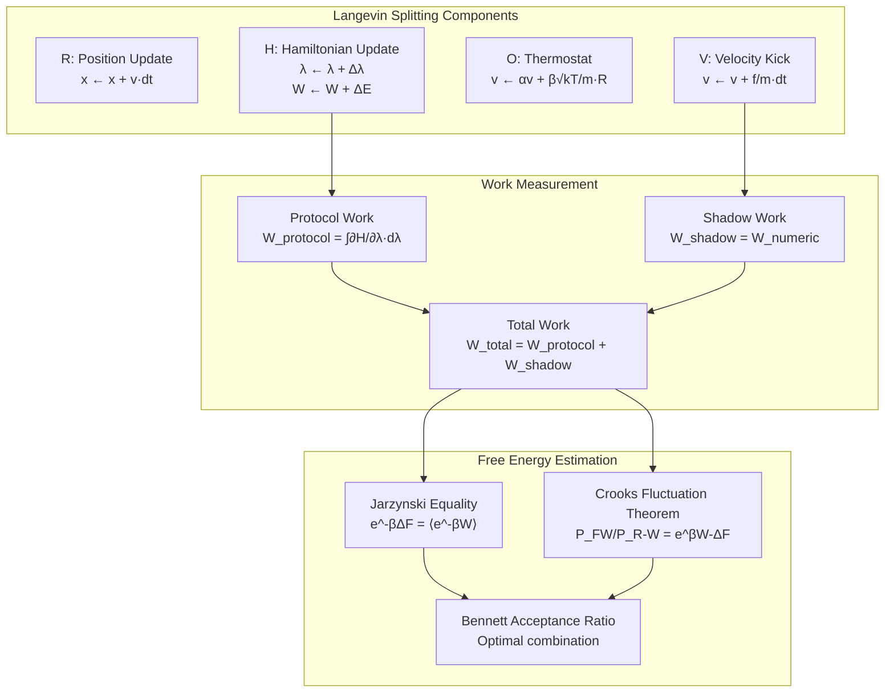
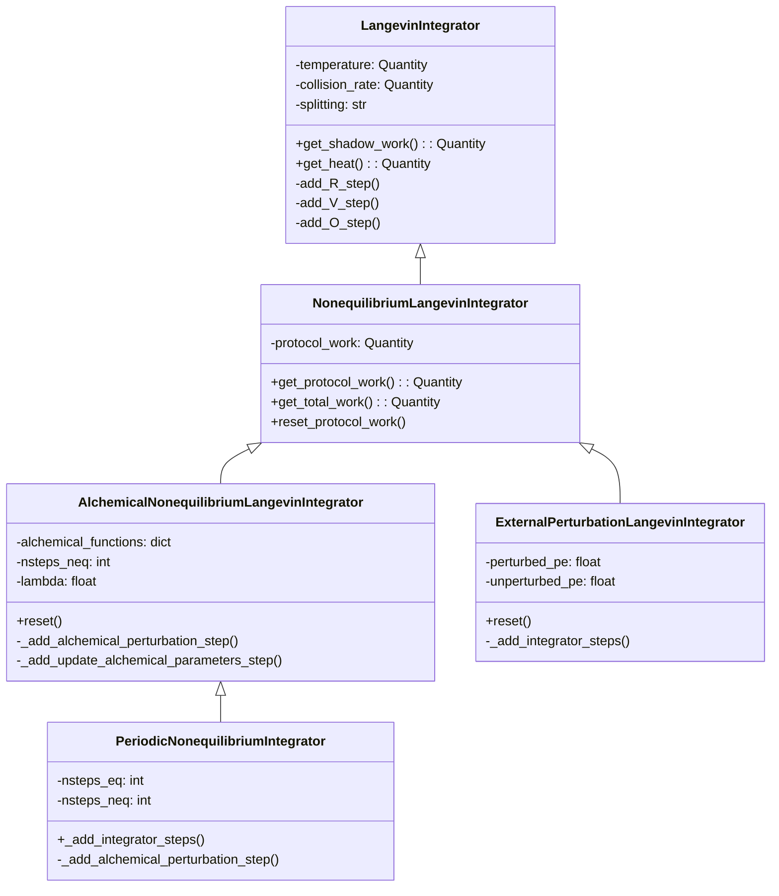

## Overview

OpenMMTools provides a sophisticated framework for nonequilibrium free energy calculations through specialized Langevin integrators that track work during parameter switching processes. These integrators implement **Nonequilibrium Candidate Monte Carlo (NCMC)** protocols and support both alchemical transformations and external perturbations, with accurate measurement of protocol work, shadow work, and total work for use with fluctuation theorem-based free energy estimators.
Sources: [integrators.py](openmmtools/integrators.py#L1560-L1654), [integrators.py](openmmtools/integrators.py#L1655-L1913)

The nonequilibrium integrator framework extends the standard Langevin splitting approach with additional Hamiltonian update steps that accumulate work during system parameter changes. This enables efficient computation of free energy differences through both **forward and reverse nonequilibrium switching** protocols, with theoretical guarantees provided by the Jarzynski equality and Crooks fluctuation theorem.

## Theoretical Foundation

Nonequilibrium free energy calculations rely on driving a system away from equilibrium by changing Hamiltonian parameters according to a predefined protocol. When a system undergoes transformation from initial state A to final state B over time τ, the **work performed** W follows a probability distribution P(W). The **Jarzynski equality** states that ⟨exp(-βW)⟩ = exp(-βΔF), where β = 1/(kBT) and ΔF is the free energy difference. Similarly, the **Crooks fluctuation theorem** relates forward and reverse work distributions: P_F(W)/P_R(-W) = exp[β(W-ΔF)].
Sources: [integrators.py](openmmtools/integrators.py#L1655-L1728)

OpenMMTools implements this theory through Langevin splitting integrators where the propagator is divided into exactly solvable components: **R** (position drift), **V** (velocity kick), **O** (Ornstein-Uhlenbeck thermostat), and **H** (Hamiltonian update). The H step performs alchemical parameter updates and accumulates protocol work, enabling the framework to capture both the deterministic work from parameter changes and stochastic work from numerical integration artifacts.



## Architecture of Nonequilibrium Integrators

### Class Hierarchy

The nonequilibrium integrator framework follows a well-defined inheritance hierarchy that progressively adds functionality for work measurement and alchemical switching. At the base lies **LangevinIntegrator**, which provides flexible Trotter splitting with support for multiple force groups and optional Metropolization. **NonequilibriumLangevinIntegrator** extends this with protocol work tracking capabilities, while specialized subclasses implement specific switching protocols.
Sources: [integrators.py](openmmtools/integrators.py#L1016-L1560)



> [!TIP]
> The architecture uses the **Strategy pattern** for work measurement - all nonequilibrium integrators share the same protocol work tracking interface, while subclasses implement different switching strategies. This design allows you to easily swap between instantaneous, finite-time, and periodic protocols without changing free energy analysis code.

## Core Nonequilibrium Integrator Classes

### NonequilibriumLangevinIntegrator

This base class provides the foundation for protocol work tracking. It extends LangevinIntegrator with a **protocol_work** global variable that accumulates the energy difference caused by Hamiltonian changes. When combined with shadow work measurement (enabled via `measure_shadow_work=True`), it provides the **total work** needed for fluctuation theorem-based free energy calculations.
Sources: [integrators.py](openmmtools/integrators.py#L1560-L1654)

The class automatically initializes the protocol work accumulator to zero and provides convenient properties for accessing work values with or without units. The **reset_protocol_work()** method allows you to reset work accumulation between independent switching protocols, which is essential for collecting multiple work samples needed for statistical analysis.

**Key Methods:**
- `get_protocol_work(dimensionless=False)`: Retrieve accumulated protocol work, optionally in kT units
- `get_total_work(dimensionless=False)`: Retrieve total work (protocol + shadow), optionally dimensionless
- `reset_protocol_work()`: Reset protocol work accumulator to zero
- `reset()`: Reset all statistics including protocol work and shadow work

### AlchemicalNonequilibriumLangevinIntegrator

This is the workhorse for **alchemical free energy calculations**, implementing a lambda parameter that transitions from 0 to 1 over the switching protocol. The class accepts a dictionary of **alchemical functions** that specify how global context parameters depend on lambda, enabling arbitrary complex alchemical transformations.
Sources: [integrators.py](openmmtools/integrators.py#L1655-L1913)

The integrator uses a default splitting of `"O { V R H R V } O"`, where the **H step** performs the Hamiltonian update. Each H step increments lambda by 1/n_lambda_steps and accumulates the protocol work by computing the energy difference before and after the parameter update. The braces `{ }` indicate Metropolization, which improves acceptance for finite-time protocols by occasionally rejecting unfavorable work values.

**Constructor Parameters:**

| Parameter | Type | Default | Description |
|-----------|------|---------|-------------|
| `alchemical_functions` | dict | `{}` | Mapping of context parameters to Lepton expressions of lambda |
| `splitting` | str | `"O { V R H R V } O"` | Langevin splitting sequence (must contain at least one 'H') |
| `nsteps_neq` | int | 100 | Number of nonequilibrium switching steps |
| `temperature` | Quantity | 298 K | Simulation temperature |
| `collision_rate` | Quantity | 91 ps⁻¹ | Langevin collision rate |
| `timestep` | Quantity | 1 fs | Integration timestep |
| `measure_shadow_work` | bool | False | Whether to track shadow work |

**Usage Example:**

```python
from openmmtools import testsystems, integrators
import openmm
from openmm import unit

# Create test system
testsystem = testsystems.HarmonicOscillator()

# Define alchemical transformation
alchemical_functions = {
    'testsystems_HarmonicOscillator_x0': 'lambda'  # Move center from 0 to 1
}

# Create integrator with 100 switching steps
integrator = integrators.AlchemicalNonequilibriumLangevinIntegrator(
    temperature=300*unit.kelvin,
    collision_rate=1.0/unit.picoseconds,
    timestep=1.0*unit.femtoseconds,
    alchemical_functions=alchemical_functions,
    splitting="O { V R H R V } O",
    nsteps_neq=100,
    measure_shadow_work=True
)

# Create context and run protocol
context = openmm.Context(testsystem.system, integrator)
context.setPositions(testsystem.positions)
integrator.step(100)

# Retrieve work values
protocol_work = integrator.protocol_work
total_work = integrator.total_work

# Reset for next protocol
integrator.reset()
```

### PeriodicNonequilibriumIntegrator

This specialized class implements **periodic forward/reverse switching** with equilibration phases, useful for studying time-dependent properties and for protocols that benefit from dwell time at endstates. The protocol cycles through four phases: **equilibrate at λ=0**, **switch λ: 0→1**, **equilibrate at λ=1**, **switch λ: 1→0**.
Sources: [integrators.py](openmmtools/integrators.py#L1915-L2058)

The periodic approach is particularly valuable when the **relaxation time** of the system is comparable to the switching time. By allowing equilibration at each endstate, the system can recover from nonequilibrium perturbations, potentially reducing variance in work measurements and improving convergence of free energy estimates.

**Constructor Parameters:**

| Parameter | Type | Default | Description |
|-----------|------|---------|-------------|
| `alchemical_functions` | dict | `{}` | Mapping of context parameters to lambda-dependent functions |
| `nsteps_eq` | int | 1000 | Equilibration steps at λ=0 and λ=1 |
| `nsteps_neq` | int | 100 | Nonequilibrium switching steps for each direction |
| `splitting` | str | `"V R H O R V"` | Langevin splitting sequence |
| Other parameters | - | - | Same as AlchemicalNonequilibriumLangevinIntegrator |

**Usage Example:**

```python
# Create periodic integrator with equilibration
integrator = integrators.PeriodicNonequilibriumIntegrator(
    temperature=300*unit.kelvin,
    collision_rate=1.0/unit.picoseconds,
    timestep=1.0*unit.femtoseconds,
    alchemical_functions=alchemical_functions,
    splitting="V R H O R V",
    nsteps_eq=500,  # 500 steps equilibration at each endstate
    nsteps_neq=100  # 100 steps for each switching phase
)

# Calculate total steps per period
nsteps_per_period = 2*500 + 2*100  # 1200 steps

# Run multiple periods
for cycle in range(10):
    integrator.step(nsteps_per_period)
    work = integrator.protocol_work
    # Process work sample...
    integrator.reset()
```

### ExternalPerturbationLangevinIntegrator

This integrator tracks work from **externally applied parameter perturbations** rather than internal alchemical switching. It's designed for cases where parameters are modified directly via `context.setParameter()` between integration steps, which is common in workflows like **protonation state changes** or **ion mutations**.
Sources: [integrators.py](openmmtools/integrators.py#L2059-L2125)

The integrator accumulates protocol work by comparing the potential energy before and after external perturbations. It stores both `perturbed_pe` (energy after perturbation) and `unperturbed_pe` (energy before perturbation), computing the difference at each step to build up the total work. This approach is particularly useful for **compound integrator** workflows where different integrators handle equilibrium sampling and nonequilibrium switching.

**Usage Example:**

```python
# Create external perturbation integrator
integrator = integrators.ExternalPerturbationLangevinIntegrator(
    temperature=300*unit.kelvin,
    collision_rate=1.0/unit.picoseconds,
    timestep=1.0*unit.femtoseconds
)

context = openmm.Context(testsystem.system, integrator)
context.setPositions(testsystem.positions)

# Equilibration step
integrator.step(1)

# External perturbation
context.setParameter('testsystems_HarmonicOscillator_x0', 0.1)

# Work is accumulated during this step
integrator.step(1)

# Retrieve accumulated protocol work
protocol_work = integrator.protocol_work
```

## Work Measurement Mechanisms

### Protocol Work

**Protocol work** represents the deterministic work performed by changing Hamiltonian parameters according to the switching protocol. For alchemical transformations, this is computed as the integral ∫(∂H/∂λ)(dλ/dt)dt. In the discrete implementation, each H step computes the energy difference before and after the lambda update: ΔW_protocol = E_new(λ+Δλ) - E_old(λ). This work accumulates regardless of whether the system has equilibrated to the new parameter values.
Sources: [integrators.py](openmmtools/integrators.py#L1846-L1869)

The protocol work is stored in the **protocol_work** global variable and can be accessed in energy units (typically kJ/mol) or dimensionless units (kT) by specifying `dimensionless=True` when calling `get_protocol_work()`. The dimensionless form is convenient for direct use in fluctuation theorem formulas.

> [!TIP]
> Protocol work alone is insufficient for free energy calculations with finite-time switching. You must also track shadow work to obtain the total work, or use Metropolized protocols where shadow work is eliminated through accept/reject steps. The choice between these approaches depends on your system and required accuracy.

### Shadow Work

**Shadow work** arises from numerical errors in the symplectic integrator steps. Unlike exact dynamics, which conserves the Hamiltonian, discrete time-stepping introduces energy errors that accumulate over the trajectory. In the Langevin splitting framework, shadow work is computed from the kinetic energy difference between the exact Ornstein-Uhlenbeck solution and the discrete approximation.
Sources: [integrators.py](openmmtools/integrators.py#L1174-L1217)

Shadow work measurement is enabled by setting `measure_shadow_work=True` during integrator construction. The integrator then tracks the **shadow_work** global variable, accumulating the energy errors from each splitting step. This measurement is crucial for understanding the numerical accuracy of the protocol and for applying corrections to free energy estimates.

**Total work** combines both contributions: W_total = W_protocol + W_shadow. The fluctuation theorems apply to total work, making it the fundamental quantity for free energy calculations. However, for Metropolized integrators (indicated by braces in the splitting string), shadow work is periodically reset through accept/reject decisions, effectively making the protocol work alone sufficient for free energy estimation.

## Advanced Usage Patterns

### Compound Integrator Workflows

**Nonequilibrium integrators are typically used within CompoundIntegrator** frameworks where separate integrators handle equilibrium sampling and nonequilibrium switching. This pattern separates concerns: an equilibrium integrator (e.g., GHMC or g-BAOAB) generates canonical ensembles, while a nonequilibrium integrator performs the switching protocol and accumulates work.
Sources: [test_integrators.py](openmmtools/tests/test_integrators.py#L895-L1045)

```python
# Create compound integrator workflow
equilibrium_integrator = integrators.GHMCIntegrator(
    temperature=300*unit.kelvin,
    collision_rate=1.0/unit.picoseconds,
    timestep=1.0*unit.femtoseconds
)

nonequilibrium_integrator = integrators.AlchemicalNonequilibriumLangevinIntegrator(
    temperature=300*unit.kelvin,
    collision_rate=1.0/unit.picoseconds,
    timestep=1.0*unit.femtoseconds,
    alchemical_functions=alchemical_functions,
    splitting="O { V R H R V } O",
    nsteps_neq=100,
    measure_shadow_work=True
)

# Create compound integrator
compound_integrator = openmm.CompoundIntegrator()
compound_integrator.addIntegrator(equilibrium_integrator)  # Index 0
compound_integrator.addIntegrator(nonequilibrium_integrator)  # Index 1

# Run workflow
context = openmm.Context(system, compound_integrator, platform)

for sample in range(n_samples):
    # Equilibration sampling
    compound_integrator.setCurrentIntegrator(0)
    equilibrium_integrator.step(thinning_steps)
    
    # Nonequilibrium switching
    compound_integrator.setCurrentIntegrator(1)
    nonequilibrium_integrator.reset()
    compound_integrator.step(nsteps_neq)
    
    # Collect work
    work[sample] = nonequilibrium_integrator.get_total_work(dimensionless=True)
```

> [!TIP]
> When using CompoundIntegrator, always cache the Python integrator objects rather than retrieving them via `getIntegrator()`. OpenMM's CompoundIntegrator only returns SWIG-wrapped base objects, losing access to Python-specific methods like `get_protocol_work()`. This limitation is documented in the warning at the top of the integrators documentation.

### Multiple-Temperature Replica Exchange with Nonequilibrium Switching

The framework supports advanced protocols combining **temperature replica exchange** with nonequilibrium alchemical switching. This approach can significantly improve sampling efficiency for complex free energy calculations by enabling replicas to explore different regions of phase space alongside alchemical coordinates.
Sources: [multistate/paralleltempering.py](openmmtools/multistate/paralleltempering.py)

### Free Energy Analysis Integration

Collected work samples can be analyzed using multiple methods. For bidirectional work samples (forward and reverse protocols), the **Bennett Acceptance Ratio (BAR)** method provides optimal statistical efficiency. For unidirectional samples, the **Jarzynski equality** can be applied with exponential averaging, though this method suffers from poor convergence when work distributions are broad. The framework's work measurement API is designed to integrate seamlessly with these analysis packages, including **pymbar** and **alchemical-analysis**.

## Performance Considerations

### Splitting Scheme Selection

The choice of **Langevin splitting** significantly impacts both accuracy and computational efficiency. The default `"O { V R H R V } O"` splitting provides good balance, but alternatives may be preferable depending on your goals:

| Splitting | Properties | Best For |
|-----------|------------|----------|
| `"O { V R H R V } O"` | Metropolized, symmetric | General use, accurate free energies |
| `"V R H O R V"` | Non-metropolized, efficient | Quick estimates, large systems |
| `"R V O V R H"` | Position updates before thermostat | Configurational sampling |
| `"{ V R O R V }"` | Metropolized without explicit H step | Systems requiring frequent Metropolization |

> [!TIP]
> The splitting string must contain at least one 'H' step for AlchemicalNonequilibriumLangevinIntegrator, or you'll receive a ValueError. The H step is where lambda updates and protocol work accumulation occur. For systems requiring multiple force groups (e.g., fast/slow force splitting), use V0, V1, etc. instead of plain V.

### Protocol Duration and Step Count

The **nsteps_neq** parameter controls the duration of the nonequilibrium protocol, which represents a trade-off between computational cost and variance. Longer protocols reduce variance (making work distributions narrower) but require more computational effort. For typical alchemical transformations, 100-1000 steps provide a reasonable balance, though the optimal value depends on system complexity and the energy gap between endstates.

For alchemical transformations with **large energy barriers**, consider using gradual protocols with more steps. For smooth transformations with small energy differences, fewer steps may be sufficient. The periodic integrator's **nsteps_eq** parameter can help systems recover from large perturbations by allowing equilibration at endstates before reverse switching.

## Best Practices and Common Pitfalls

### Initialization and Reset Procedures

Always call **reset()** before collecting each work sample, even when starting from initial conditions. The reset method clears accumulated work statistics and resets lambda to zero, ensuring each switching protocol starts from a clean state. This is particularly important when running multiple protocols in a loop for statistical averaging.
Sources: [integrators.py](openmmtools/integrators.py#L1648-L1652)

### Work Value Verification

After running a nonequilibrium protocol, verify that lambda has progressed from 0 to 1 (for forward switching) and that the expected number of steps have been executed. The test suite provides examples of these sanity checks, which help catch configuration errors early in development.
Sources: [test_integrators.py](openmmtools/tests/test_integrators.py#L958-L987)

### CompoundIntegrator State Management

When switching between integrators in a CompoundIntegrator, ensure the correct integrator is selected via `setCurrentIntegrator()` before calling `step()`. Calling step on the wrong integrator leads to undefined behavior and corrupts work measurements. The test suite demonstrates this pattern clearly in compound integrator workflows.
Sources: [test_integrators.py](openmmtools/tests/test_integrators.py#L946-L956)

### Platform Compatibility

Nonequilibrium integrators are tested on Reference, CPU, and CUDA platforms. However, for production calculations with large systems, prefer CUDA or OpenCL platforms for better performance. Ensure consistent platform choice when comparing work values across different protocols, as floating-point precision differences between platforms can introduce small variations in work measurements.

## Next Steps

For deeper understanding of the theoretical foundations, explore [Langevin Integrators and Splitting Schemes](7-langevin-integrators-and-splitting-schemes) and [Advanced Integrator Splittings (BAOAB, VVVR, g-BAOAB)](8-advanced-integrator-splittings-baoab-vvvr-g-baoab). To implement practical alchemical transformations, refer to [Alchemical Nonequilibrium Switching](11-alchemical-nonequilibrium-switching) and [Alchemical State Management](20-alchemical-state-management). For enhanced sampling protocols, see [Replica Exchange Molecular Dynamics (REMD)](16-replica-exchange-molecular-dynamics-remd).
