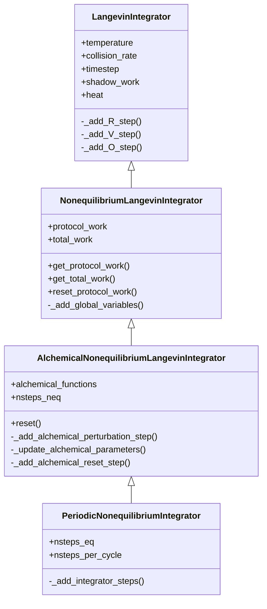

Alchemical nonequilibrium switching provides a powerful framework for computing free energy differences through directed perturbations of the system Hamiltonian. This document explains the architecture, implementation details, and practical usage of openmmtools' nonequilibrium switching integrators for advanced free energy calculations.

Sources: [integrators.py](/openmmtools/integrators.py#L1560-L2058), [alchemy.py](/openmmtools/alchemy/alchemy.py#L65-L200)

## Architecture Overview

The alchemical nonequilibrium switching system is built on a hierarchical class structure that extends the Langevin integrator framework with protocol work tracking and alchemical parameter control. The design separates concerns between work accumulation (base mixin), alchemical switching (core implementation), and specialized protocols (extensions).



The integrator system operates on the principle that alchemical transformations can be driven by systematically varying a coupling parameter λ from 0 to 1 (or vice versa) over a specified number of dynamics steps. During this process, the work performed on the system is accumulated and can be used to estimate free energy differences through statistical mechanical relationships.

Sources: [integrators.py](/openmmtools/integrators.py#L1655-L1735), [integrators.py](/openmmtools/integrators.py#L1915-L1970)

## Core Integrator Classes

### NonequilibriumLangevinIntegrator Mixin

The `NonequilibriumLangevinIntegrator` serves as a foundational mix-in class that adds protocol work tracking capabilities to the Langevin integrator. This class introduces the essential bookkeeping machinery for nonequilibrium switching without specifying the details of how system parameters should change.

The mixin extends the base LangevinIntegrator by introducing two critical global variables: `protocol_work` (accumulated work from parameter changes) and methods to query and reset this quantity. The protocol work represents the cumulative change in potential energy resulting from systematic modifications to the system's Hamiltonian parameters during a nonequilibrium trajectory.

Key properties include the ability to retrieve both protocol work and total work (protocol work plus shadow work) in either physical units or dimensionless form (kT). The total work is particularly important because it accounts for all irreversible processes during the switching process and provides the work value needed for free energy estimation via the Crooks fluctuation theorem or Jarzynski equality.

Sources: [integrators.py](/openmmtools/integrators.py#L1560-L1654)

### AlchemicalNonequilibriumLangevinIntegrator

The `AlchemicalNonequilibriumLangevinIntegrator` represents the core implementation for alchemical nonequilibrium switching. This class orchestrates the entire switching process by coordinating Langevin dynamics steps with alchemical parameter updates and work accumulation.

At initialization, the integrator accepts a dictionary of alchemical functions that specify how each global system parameter should vary as a function of the switching parameter λ. For example, one might specify `{'lambda_sterics': 'lambda**2', 'lambda_electrostatics': '2*lambda - lambda**2'}` to create a nonlinear switching protocol where steric interactions turn on more slowly than electrostatic interactions.

The switching process is controlled by the `nsteps_neq` parameter, which specifies how many Langevin integration steps constitute the complete transformation from λ=0 to λ=1. During each step of the integration, the integrator executes a splitting scheme (specified by the `splitting` parameter) that may include R (position update), V (velocity/force update), O (Ornstein-Uhlenbeck stochastic update), and H (Hamiltonian/alchemical update) steps. The H step is particularly important as it performs the alchemical perturbation and accumulates the corresponding protocol work.

The implementation maintains several global variables for tracking progress:
- `lambda`: current coupling parameter (0 to 1)
- `lambda_step`: counter for tracking progress through the switching protocol
- `n_steps_neq`: total steps in the protocol
- `Eold` and `Enew`: potential energy before and after perturbation (for work calculation)

The core alchemical perturbation step works by storing the potential energy before updating λ, incrementing λ by 1/n_lambda_steps, updating all dependent alchemical parameters according to their functional forms, computing the new potential energy, and accumulating the difference as protocol work. This process is repeated at each H step in the splitting scheme.

Sources: [integrators.py](/openmmtools/integrators.py#L1655-L1913), [integrators.py](/openmmtools/integrators.py#L1845-L1870)

### PeriodicNonequilibriumIntegrator

The `PeriodicNonequilibriumIntegrator` extends the base functionality to support cyclic switching protocols that dwell in equilibrium states between switching phases. This is particularly useful for applications like enhanced sampling or when one wishes to collect work values from multiple switching cycles while allowing the system to relax between cycles.

The periodic protocol follows the pattern: equilibrate at λ=0 for `nsteps_eq` steps → switch λ from 0 to 1 over `nsteps_neq` steps → equilibrate at λ=1 for `nsteps_eq` steps → switch λ from 1 to 0 over `nsteps_neq` steps. This pattern can repeat indefinitely, collecting forward and reverse work values that can be combined to improve free energy estimates.

The implementation modifies the base alchemical perturbation logic to include conditional logic that determines whether λ should be incremented (during forward switching), decremented (during reverse switching), or held constant (during equilibration phases). This is accomplished through Heaviside step functions that check the current step number relative to the phase boundaries.

Sources: [integrators.py](/openmmtools/integrators.py#L1915-L2058)

## Alchemical Parameter System

### AlchemicalState and AlchemicalFunction

The alchemical parameter system relies on the `AlchemicalState` class from `openmmtools.alchemy`, which manages the collection of lambda parameters that control different aspects of the system Hamiltonian. Common parameters include `lambda_sterics` (controlling Lennard-Jones interactions), `lambda_electrostatics` (controlling charge interactions), `lambda_bonds`, `lambda_angles`, and `lambda_torsions`.

Each lambda parameter can either be set to a fixed value or expressed as an `AlchemicalFunction`—a mathematical expression in terms of one or more alchemical variables. This enables complex switching protocols where different force components follow different schedules. For example, a two-stage protocol might scale electrostatics after sterics have fully turned on.

The `AlchemicalState` integrates with the `CompoundThermodynamicState` system, allowing alchemical parameters to be controlled alongside thermodynamic parameters like temperature and pressure. This ensures that when an alchemical state is applied to a Context, all relevant global parameters are updated consistently.

Sources: [alchemy.py](/openmmtools/alchemy/alchemy.py#L90-L200), [alchemy.py](/openmmtools/alchemy/alchemy.py#L65-L89)

### Integration with AbsoluteAlchemicalFactory

The `AbsoluteAlchemicalFactory` creates OpenMM System objects that support alchemical modifications. It adds custom forces with energy expressions that depend on the lambda parameters, enabling smooth interpolation between fully interacting and non-interacting states. The factory handles the complex task of modifying all relevant force types—nonbonded forces, bonded forces, torsion forces—so that they respond appropriately to the alchemical parameters.

When creating an alchemical system, the factory identifies which atoms belong to the alchemical region and ensures that interactions involving these atoms are appropriately scaled. It also handles edge cases like straddling interactions (where an atom in the alchemical region interacts with an atom outside the region) and ensures energy conservation and smoothness properties needed for reliable free energy calculations.

Sources: [alchemy.py](/openmmtools/alchemy/alchemy.py#L496-L640)

## Work Measurement and Free Energy Estimation

### Protocol Work vs. Shadow Work

The nonequilibrium switching framework distinguishes between two types of work that accumulate during a switching trajectory:

**Protocol work** represents the thermodynamic work done by changing the system's Hamiltonian parameters. This is the quantity that, according to the Jarzynski equality or Crooks fluctuation theorem, can be used to estimate free energy differences. Protocol work is computed by accumulating the instantaneous change in potential energy at each alchemical perturbation step: W_protocol = Σ[E(λ_i+1) - E(λ_i)].

**Shadow work** arises from numerical discretization errors in the integrator. Even with exact parameter changes, the finite timestep used in molecular dynamics introduces errors that cause the system to deviate from the exact continuous-time trajectory. The shadow work quantifies this deviation and can be used to assess the accuracy of the integration scheme.

**Total work** combines both contributions: W_total = W_protocol + W_shadow. For free energy estimation, the total work is typically used when employing fluctuation theorems, as it accounts for all irreversible processes during the switching process.

Sources: [integrators.py](/openmmtools/integrators.py#L1602-L1654)

### Fluctuation Theorems and Free Energy Estimation

The work values accumulated by the nonequilibrium integrators can be used with statistical mechanical fluctuation theorems to estimate free energy differences. The two most common approaches are:

**Jarzynski Equality**: exp(-βΔF) = ⟨exp(-βW)⟩, where the average is taken over many nonequilibrium switching trajectories. This gives an exponentially-weighted average that converges to the exact free energy difference in the limit of infinite samples, though in practice it can be dominated by rare low-work trajectories.

**Bennett Acceptance Ratio (BAR)**: Uses both forward and reverse work distributions to optimally estimate ΔF. BAR typically provides better convergence than Jarzynski, especially when the forward and reverse work distributions have significant overlap.

The test suite includes validation that the alchemical nonequilibrium switching integrator can accurately recover the analytical free energy difference for a harmonic oscillator deformation problem, demonstrating that the implementation correctly implements the theoretical framework.

Sources: [test_integrators.py](/openmmtools/tests/test_integrators.py#L895-L1044)

## Splitting Schemes and Integration Steps

### Langevin Splitting Components

The alchemical nonequilibrium integrators are built on Langevin splitting schemes that decompose the dynamics into analytically solvable components. Each component is represented by a character in the splitting string:

- **R** (position update): x ← x + v·dt. This moves particles according to their current velocities while respecting constraints.
- **V** (velocity update): v ← v + (f/m)·dt. This updates velocities using forces from the current potential energy surface. Forces can be evaluated from specific force groups (e.g., V0, V1) or all forces (V).
- **O** (Ornstein-Uhlenbeck): v ← a·v + b·√(kT/m)·ξ. This applies stochastic velocity updates that couple the system to a heat bath. The coefficients a = exp(-γ·dt) and b = √[1 - exp(-2γ·dt)] depend on the collision rate γ.
- **H** (Hamiltonian update): This is the alchemical perturbation step that updates λ and accumulates protocol work.

Splitting schemes are specified as strings like "O { V R H R V } O", where braces indicate optional metropolization blocks that improve sampling by accepting or rejecting moves based on total work.

Sources: [integrators.py](/openmmtools/integrators.py#L1665-L1685)

### Recommended Splitting Schemes

Different splitting schemes have different properties regarding accuracy, stability, and work measurement:

| Splitting Scheme | Properties | Recommended Use Cases |
|-----------------|------------|----------------------|
| **V R O R V** | Symplectic, good energy conservation | General purpose, moderate timesteps |
| **O { V R H R V } O** | Includes metropolization, rigorous sampling | When detailed balance is critical |
| **V R H O R V** | Alchemical update before thermostat | Periodic switching with BAOAB dynamics |
| **O V R H R V O** | Standard OVRVO with alchemical step | General nonequilibrium switching |

The choice of splitting scheme affects how shadow work accumulates and how accurately the protocol work reflects true thermodynamic work. Schemes that place the H step after force updates tend to give more accurate work measurements for slowly-varying parameters.

Sources: [integrators.py](/openmmtools/integrators.py#L1655-L1735)

## Practical Usage Examples

### Basic Nonequilibrium Switching

The following example demonstrates how to set up and run a basic alchemical nonequilibrium switching calculation:

```python
from openmmtools import testsystems
from openmmtools.alchemy import AbsoluteAlchemicalFactory, AlchemicalRegion
from openmmtools.integrators import AlchemicalNonequilibriumLangevinIntegrator
import openmm
from openmm import unit

# Create reference system
testsystem = testsystems.AlanineDipeptideVacuum()

# Define alchemical region
alchemical_region = AlchemicalRegion(alchemical_atoms=range(22))

# Create alchemically modified system
factory = AbsoluteAlchemicalFactory(consistent_exceptions=False)
alchemical_system = factory.create_alchemical_system(
    testsystem.system, alchemical_region
)

# Define alchemical functions for switching
alchemical_functions = {
    'lambda_sterics': 'lambda',
    'lambda_electrostatics': 'lambda'
}

# Create nonequilibrium integrator
nsteps_neq = 100
integrator = AlchemicalNonequilibriumLangevinIntegrator(
    temperature=300*unit.kelvin,
    collision_rate=1.0/unit.picoseconds,
    timestep=1.0*unit.femtoseconds,
    alchemical_functions=alchemical_functions,
    splitting="O { V R H R V } O",
    nsteps_neq=nsteps_neq,
    measure_shadow_work=True
)

# Create context and run switching
context = openmm.Context(alchemical_system, integrator)
context.setPositions(testsystem.positions)
integrator.step(nsteps_neq)

# Extract work values
protocol_work = integrator.protocol_work
total_work = integrator.total_work
```

Sources: [integrators.py](/openmmtools/integrators.py#L1686-L1735), [test_alchemy.py](/openmmtools/tests/test_alchemy.py#L1802-L1858)

### Periodic Switching for Enhanced Sampling

The periodic integrator is useful for applications requiring continuous cycling between states:

```python
from openmmtools.integrators import PeriodicNonequilibriumIntegrator

integrator = PeriodicNonequilibriumIntegrator(
    alchemical_functions=alchemical_functions,
    nsteps_eq=1000,  # Equilibration steps at each endpoint
    nsteps_neq=100,  # Switching steps
    splitting="V R H O R V",
    temperature=300*unit.kelvin,
    collision_rate=1.0/unit.picoseconds,
    timestep=1.0*unit.femtoseconds,
    measure_shadow_work=True
)

# Calculate steps per complete cycle
nsteps_per_cycle = 2*1000 + 2*100  # 2200 steps total

# Run multiple cycles and collect work
context = openmm.Context(alchemical_system, integrator)
context.setPositions(testsystem.positions)

for cycle in range(10):
    integrator.step(nsteps_per_cycle)
    work = integrator.protocol_work
    print(f"Cycle {cycle+1}: Work = {work}")
    integrator.reset()  # Reset for next cycle
```

Sources: [integrators.py](/openmmtools/integrators.py#L1915-L2058)

### Custom Alchemical Functions

Complex switching schedules can be implemented using mathematical expressions:

```python
from openmmtools.alchemy import AlchemicalFunction, AlchemicalState
from openmmtools.states import CompoundThermodynamicState, ThermodynamicState

# Create two-stage switching protocol
alchemical_state = AlchemicalState()
alchemical_state.set_alchemical_variable('lambda', 0.0)
alchemical_state.lambda_sterics = AlchemicalFunction('min(2.0*lambda, 1.0)')
alchemical_state.lambda_electrostatics = AlchemicalFunction('max(2.0*lambda - 1.0, 0.0)')

# This scales sterics from 0 to 1 over lambda = 0 to 0.5,
# and electrostatics from 0 to 1 over lambda = 0.5 to 1.0

# Integrate with thermodynamic state
thermo_state = ThermodynamicState(
    system=alchemical_system,
    temperature=300*unit.kelvin
)
compound_state = CompoundThermodynamicState(
    thermodynamic_state=thermo_state,
    composable_states=[alchemical_state]
)
```

Sources: [alchemy.py](/openmmtools/alchemy/alchemy.py#L90-L200), [test_alchemy.py](/openmmtools/tests/test_alchemy.py#L2883-L2913)

## Reset and Multiple Trajectory Management

The integrators provide robust reset mechanisms for running multiple independent switching trajectories from the same starting conditions. The `reset()` method clears all accumulated statistics and resets alchemical parameters to their initial values (typically λ=0).

For the basic `AlchemicalNonequilibriumLangevinIntegrator`, resetting involves clearing protocol work, shadow work, heat accumulators, and returning λ to zero. The method also triggers a special internal step (step = -1) that updates all context parameters before beginning the next trajectory.

The periodic integrator modifies this behavior to account for its cycling nature, resetting the step counter and λ values while preserving the cyclic structure of the protocol. This allows continuous collection of forward and reverse work values without reinitialization.

Sources: [integrators.py](/openmmtools/integrators.py#L1803-L1812), [integrators.py](/openmmtools/integrators.py#L1904-L1910)

## Performance Considerations and Best Practices

### Step Count and Timestep Selection

The number of switching steps (`nsteps_neq`) and the integration timestep must be chosen carefully to balance accuracy and computational efficiency. More switching steps generally yield lower dissipation and more Gaussian work distributions, improving convergence of free energy estimates. However, each additional step increases computational cost.

For most molecular systems, switching protocols of 100-1000 steps with timesteps of 1-2 femtoseconds provide good compromises. Systems with stiff constraints or fast degrees of freedom may require smaller timesteps, while systems dominated by slow degrees of freedom can often use larger timesteps.

A useful diagnostic is to examine the distribution of work values from multiple trajectories. Narrow distributions with minimal skewness indicate that the protocol is sufficiently quasi-equilibrium. Highly skewed distributions suggest that the switching is too fast and irreversible.

> [!TIP]
> When optimizing switching protocols, start with a moderate number of steps (e.g., 100-200) and increase until the work distribution stabilizes. The marginal benefit of additional steps diminishes once the protocol approaches the quasi-equilibrium regime.

### Force Group Optimization

For large systems, computational efficiency can be improved by splitting forces into groups and updating them at different frequencies. For example, fast-fluctuating bonded forces might be evaluated every step, while slower nonbonded forces might be evaluated every other step.

The splitting scheme syntax supports this through indexed V steps: "V0 V1" would evaluate force groups 0 and 1 in sequence. When designing alchemical switching protocols, consider placing alchemical forces in separate groups so that they can be updated only when λ changes, avoiding unnecessary recomputation of unchanged interaction terms.

Sources: [integrators.py](/openmmtools/integrators.py#L1426-L1467)

### Work Accumulation Precision

Work accumulation can be subject to numerical precision issues, particularly for large systems where energy differences are small compared to total energies. The integrator accumulates work in double precision by default, but users should be aware of potential precision loss for very long switching trajectories or systems with very small free energy differences.

For highest accuracy, consider running switching trajectories in both directions (forward and reverse) and using Bennett Acceptance Ratio (BAR) to estimate free energies. BAR exploits information from both work distributions and provides optimal weighting for minimum variance.

> [!TIP]
> When comparing results across different platforms or precision settings, note that numerical differences in force computation can lead to small but systematic differences in accumulated work. Use the same platform and precision settings for all trajectories in a given free energy calculation.

## Testing and Validation

The test suite provides comprehensive validation of the alchemical nonequilibrium switching implementation. Key tests include:

- **Harmonic oscillator validation**: Compares the free energy estimated from switching trajectories against analytical results for a harmonic oscillator with varying center position. This test verifies that the Jarzynski equality and BAR give consistent results within statistical uncertainty.

- **Protocol work accumulation**: Verifies that protocol work is correctly accumulated for various system types including harmonic oscillators, water boxes, and systems with barostats. These tests ensure that work calculations are accurate across different force fields and system configurations.

- **Reset functionality**: Confirms that the reset() method correctly clears all accumulated statistics and returns the system to its initial state, enabling reliable collection of multiple independent trajectories.

- **Platform compatibility**: Validates that work calculations give consistent results across different OpenMM platforms (Reference, CPU, CUDA, OpenCL), ensuring portability of results.

Sources: [test_integrators.py](/openmmtools/tests/test_integrators.py#L432-L830), [test_integrators.py](/openmmtools/tests/test_integrators.py#L895-L1044)

## Next Steps

The alchemical nonequilibrium switching framework integrates closely with other components of the openmmtools ecosystem. For deeper understanding and practical application, consider exploring:

- **[Alchemical State Management](20-alchemical-state-management)**: Detailed coverage of AlchemicalState configuration and advanced parameter control strategies
- **[Alchemical Factory System Design](21-alchemical-factory-system-design)**: Architecture and usage of the AbsoluteAlchemicalFactory for creating alchemically-modified systems
- **[Creating Alchemically-Modified Systems](22-creating-alchemically-modified-systems)**: Practical guide for setting up alchemical systems for specific applications
- **[Nonequilibrium Integrators for Free Energy Calculations](10-nonequilibrium-integrators-for-free-energy-calculations)**: Broader context on nonequilibrium methods beyond alchemical switching
- **[Langevin Integrators and Splitting Schemes](7-langevin-integrators-and-splitting-schemes)**: Foundation for understanding the splitting schemes used in alchemical switching