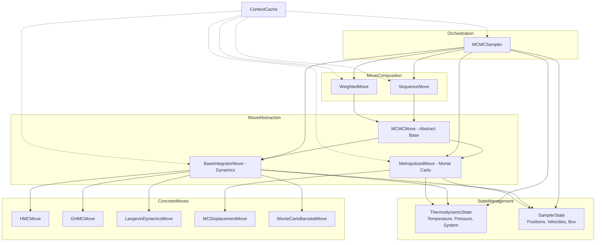

The MCMC move abstraction in openmmtools provides a **flexible, composable framework** for implementing Markov chain Monte Carlo sampling in molecular simulations. This architecture enables developers to create, combine, and apply various sampling moves while maintaining clean separation between move logic, state management, and OpenMM context handling. The framework supports both dynamics-based moves (like HMC, GHMC, Langevin dynamics) and pure Monte Carlo moves (like displacement, rotation, barostat moves) through a unified interface.

Sources: [openmmtools/mcmc.py](openmmtools/mcmc.py#L27-L106)

## Core Architecture Overview

The MCMC framework is built around three fundamental abstractions that work together to provide equilibrium sampling from thermodynamic states. At the foundation lies the **ThermodynamicState** and **SamplerState** pair (from the states module) which represent respectively the macroscopic conditions (temperature, pressure, system parameters) and microscopic configuration (positions, velocities, box vectors) of the simulation system. These states are manipulated by **MCMCMove** objects, which define specific sampling algorithms. The **MCMCSampler** orchestrates the iteration over moves to generate a Markov chain trajectory.



This architecture enables **modular composition** of sampling strategies. For example, you can combine dynamics-based moves with Monte Carlo barostat moves for NPT ensemble simulations, or create weighted probabilistic selection between different move types to explore conformational space more efficiently. The context cache system provides efficient management of OpenMM contexts across moves, reducing the overhead of context creation and platform initialization.

Sources: [openmmtools/mcmc.py](openmmtools/mcmc.py#L143-L150), [openmmtools/mcmc.py](openmmtools/mcmc.py#L216-L277)

## The MCMCMove Abstract Base Class

The **MCMCMove** class serves as the foundation for all sampling moves in the framework. It defines the minimal interface that any MCMC move must implement through the abstract `apply()` method. This method takes a thermodynamic state and sampler state as input, applies the move to modify one or both states, and uses an optional context cache for efficient OpenMM context management. The move can track internal statistics such as acceptance rates, number of attempts, or other move-specific metrics through a `statistics` property.

A critical design evolution is the deprecation of storing context cache as an attribute of MCMCMove objects. Instead, the cache is now passed as a parameter to the `apply()` method, providing more flexible control over context sharing across different move types and sampling scenarios. This change enables per-call specification of whether to use a global cache, a local cache, or no caching at all (using `DummyContextCache`).

Sources: [openmmtools/mcmc.py](openmmtools/mcmc.py#L143-L209)

> [!TIP]
> When creating custom MCMCMove classes, always implement the `apply()` method signature exactly as defined in the base class: `apply(self, thermodynamic_state, sampler_state, context_cache=None)`. This ensures compatibility with move composition classes and the MCMCSampler orchestration framework.

## The MCMCSampler Orchestrator

The **MCMCSampler** class provides the high-level interface for running MCMC simulations. It takes a thermodynamic state, sampler state, and a move (or move set) as initialization parameters. The sampler maintains deep copies of the input states to ensure the original states remain unchanged, which is crucial for reproducibility and when running multiple independent simulations. The `run()` method iterates a specified number of times, applying the move to update the sampler state at each iteration.

The sampler also provides a `minimize()` method that uses OpenMM's `LocalEnergyMinimizer` to optimize the current configuration before starting sampling. This is particularly useful for relaxing test systems or removing steric clashes that could cause integration failures. The minimizer respects the same context cache interface as moves, enabling efficient use of cached contexts.

The move parameter to MCMCSampler can be either a single MCMCMove object or a composite move (SequenceMove or WeightedMove). This flexibility allows for sophisticated sampling strategies ranging from simple single-move schemes to complex multi-move ensembles with probabilistic selection.

Sources: [openmmtools/mcmc.py](openmmtools/mcmc.py#L216-L344)

## Move Composition: SequenceMove and WeightedMove

The framework provides two composition classes that enable combining multiple MCMC moves into sophisticated sampling schemes. These classes implement the MCMCMove interface, so they can be used anywhere a single move is expected, including as components in other composition operations.

**SequenceMove** executes a fixed sequence of moves in order at each iteration. This is particularly useful for sampling schemes that require specific move ordering, such as performing a dynamics move followed by a Monte Carlo barostat move for NPT ensemble simulations. The class maintains references to the underlying moves and aggregates their statistics into a list that can be accessed through the `statistics` property.

**WeightedMove** randomly selects one move from a set of moves at each iteration, with selection probabilities given by associated weights. The weights are normalized internally, so they can be specified in any convenient scale. This enables probabilistic sampling schemes where different move types are attempted with different frequencies. For example, one might attempt HMC moves 70% of the time and Langevin dynamics moves 30% of the time, with the selection happening independently at each iteration.

Both composition classes support serialization through `__getstate__()` and `__setstate__()` methods, enabling checkpointing and resuming of long-running simulations. They also support iteration protocols, allowing easy inspection and manipulation of the constituent moves.

| Feature | SequenceMove | WeightedMove |
|---------|--------------|-------------|
| Move Selection | Deterministic order | Probabilistic selection |
| Parameter | `move_list` (list of MCMCMove) | `move_set` (list of tuples with weights) |
| Use Case | Ordered multi-step procedures | Probabilistic move selection |
| Statistics Aggregation | List of move statistics | List of move statistics |
| Iteration Protocol | Yields moves in order | Yields (move, weight) tuples |

Sources: [openmmtools/mcmc.py](openmmtools/mcmc.py#L350-L531)

## BaseIntegratorMove: Foundation for Dynamics-Based Moves

The **BaseIntegratorMove** class provides a specialized base for MCMC moves that use OpenMM integrators to propagate dynamics. This includes moves like Hamiltonian Monte Carlo (HMC), Generalized Hybrid Monte Carlo (GHMC), and Langevin dynamics. The class handles the complex workflow of context management, integration, error detection, and state updates, leaving subclasses to only specify which integrator to use.

The class implements a robust **restart mechanism** for handling numerical instabilities. If integration produces NaN energies (which can occur with large forces or improper timestep choices), the move can automatically restart multiple times with different random seeds. If all restart attempts fail, the move raises an `IntegratorMoveError` with detailed diagnostic information. This mechanism prevents silent simulation failures and helps identify problematic configurations or parameters.

The workflow in `apply()` follows these steps:
1. Create integrator via abstract `_get_integrator()` method
2. Obtain OpenMM context from the cache
3. Apply current sampler state to the context
4. Optionally reassign velocities from Maxwell-Boltzmann distribution
5. Call `_before_integration()` hook for subclass customization
6. Perform integration steps with NaN detection and restart logic
7. Call `_after_integration()` hook for subclass customization (e.g., statistics collection)
8. Update sampler state with new positions, velocities, and collective variables

Subclasses typically only need to implement `_get_integrator()` to return the appropriate OpenMM integrator. Optionally, they can override `_before_integration()` and `_after_integration()` hooks to customize behavior at specific points in the workflow, such as reading shadow work or heat measurements for analysis.

Sources: [openmmtools/mcmc.py](openmmtools/mcmc.py#L603-L802)

> [!TIP]
> The BaseIntegratorMove automatically handles the optimization of fetching state information from the Context. It retrieves positions, velocities, and energy in a single call, then performs a two-phase update to efficiently handle both standard state data and collective variables that are only available in the Context.

## MetropolizedMove: Foundation for Monte Carlo Moves

The **MetropolizedMove** class provides a base for pure Monte Carlo moves that accept or reject proposals using the Metropolis criterion. This includes coordinate displacement moves, rotation moves, and any other move that proposes a new configuration and evaluates the energy change. The class implements the standard Metropolis acceptance logic, tracking acceptance statistics for monitoring sampling efficiency.

The `apply()` method follows the classic Metropolis algorithm:
1. Compute initial reduced potential energy of current configuration
2. Call abstract `_propose_positions()` to generate new candidate positions
3. Compute reduced potential energy of proposed configuration
4. Accept proposal if energy decreases or with probability exp(-Δu)
5. If rejected, restore original positions
6. Update acceptance statistics

The class supports the `atom_subset` parameter, which allows moves to act on only a subset of atoms in the system. This is useful for moves that target specific regions of a molecule (e.g., ligand displacement moves) or for implementing localized sampling strategies. The subset can be specified as a list of atom indices or as a slice object.

Subclasses must implement the `_propose_positions()` abstract method, which takes the initial positions and returns proposed new positions. The implementation can be any stochastic or deterministic proposal mechanism, with the complexity of the proposal affecting the acceptance rate and sampling efficiency.

Sources: [openmmtools/mcmc.py](openmmtools/mcmc.py#L810-L970)

## Move Statistics and Serialization

All MCMC move implementations maintain internal statistics through a `statistics` property that returns a dictionary. For `MetropolizedMove`, this includes `n_accepted` and `n_proposed` counts. For `BaseIntegratorMove` subclasses like `GHMCMove`, the statistics may include acceptance rates and other move-specific metrics. These statistics can be reset by reassigning the `statistics` property or through move-specific methods like `reset_statistics()` in `GHMCMove`.

Serialization support through `__getstate__()` and `__setstate__()` methods enables saving and restoring move configurations, including their accumulated statistics. This is essential for:
- Checkpointing long simulations
- Moving simulations between compute resources
- Saving optimal move parameters found during tuning
- Debugging by reproducing specific simulation states

The serialization handles both simple data types (integers, floats, booleans) and complex objects like OpenMM integrators. For moves with complex internal state, careful serialization design ensures that all relevant information is preserved.

Sources: [openmmtools/mcmc.py](openmmtools/mcmc.py#L862-L870), [openmmtools/mcmc.py](openmmtools/mcmc.py#L1422-L1434)

## Custom Move Development Guide

Creating custom MCMC moves involves selecting the appropriate base class and implementing required abstract methods. The choice depends on whether your move uses dynamics (inherit from `BaseIntegratorMove`) or performs pure Monte Carlo proposals (inherit from `MetropolizedMove`).

For dynamics-based moves:
```python
class CustomIntegratorMove(BaseIntegratorMove):
    def __init__(self, timestep, n_steps, **kwargs):
        super(CustomIntegratorMove, self).__init__(n_steps, **kwargs)
        self.timestep = timestep
        
    def _get_integrator(self, thermodynamic_state):
        # Return appropriate OpenMM integrator
        return CustomIntegrator(self.timestep)
        
    def _after_integration(self, context, thermodynamic_state):
        # Optionally read data for statistics
        pass
```

For Monte Carlo moves:
```python
class CustomMonteCarloMove(MetropolizedMove):
    def __init__(self, proposal_parameter, **kwargs):
        super(CustomMonteCarloMove, self).__init__(**kwargs)
        self.proposal_parameter = proposal_parameter
        
    def _propose_positions(self, positions):
        # Generate and return proposed positions
        displacement = self._generate_displacement(positions)
        return positions + displacement
```

The framework provides several built-in moves that serve as references: `GHMCMove`, `HMCMove`, `LangevinDynamicsMove`, `MonteCarloBarostatMove`, `MCDisplacementMove`, and `MCRotationMove`. Examining these implementations provides practical examples of move development patterns.

Sources: [openmmtools/mcmc.py](openmmtools/mcmc.py#L634-L659), [openmmtools/mcmc.py](openmmtools/mcmc.py#L832-L854)

## Architecture Summary and Design Patterns

The MCMC move abstraction demonstrates several key software design patterns:

**Strategy Pattern**: Different MCMC moves represent alternative sampling strategies that can be interchanged through the common MCMCMove interface. This enables runtime selection and comparison of different sampling algorithms.

**Template Method Pattern**: Base classes like `BaseIntegratorMove` and `MetropolizedMove` define the skeleton of the move application algorithm while allowing subclasses to customize specific steps through hook methods like `_get_integrator()` and `_propose_positions()`.

**Composite Pattern**: `SequenceMove` and `WeightedMove` treat individual moves and groups of moves uniformly, enabling tree-like composition structures that can be arbitrarily nested.

**Decorator Pattern**: The context cache system decorates moves with efficient context management without requiring changes to move implementations.

This architecture balances **flexibility** (through composition and abstraction) with **performance** (through efficient context caching and restart mechanisms). It supports both simple single-move workflows and complex multi-move schemes while maintaining clean interfaces and clear separation of concerns.

For detailed information about specific move implementations and their parameters, continue to [Dynamics-Based Moves (Langevin, HMC, GHMC)](13-dynamics-based-moves-langevin-hmc-ghmc). For information on creating advanced custom moves, see [Creating Custom MCMC Moves](28-creating-custom-mcmc-moves).
