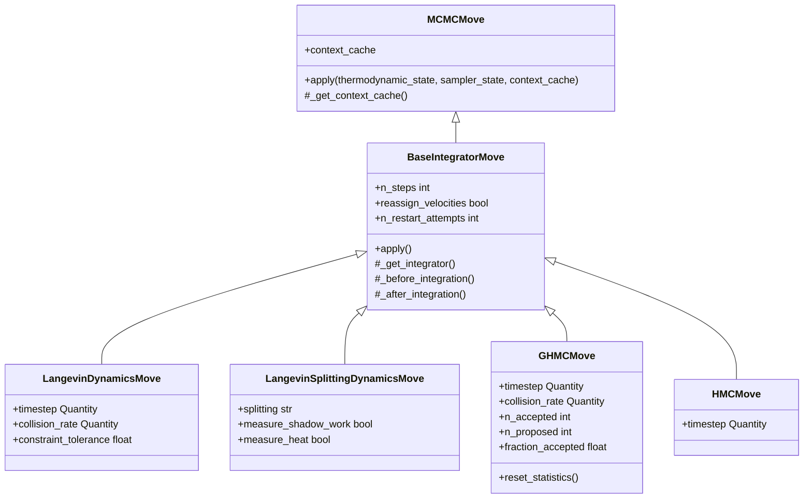

Dynamics-based moves combine molecular dynamics integration with Markov chain Monte Carlo (MCMC) principles to generate efficient sampling proposals. These moves leverage OpenMM's integrators to propagate phase space trajectories, with varying approaches to ensuring correct statistical sampling. The framework provides three primary dynamics-based moves: Langevin dynamics (pseudo-Monte Carlo), Hybrid Monte Carlo (HMC), and Generalized Hybrid Monte Carlo (GHMC), each offering different trade-offs between computational efficiency and sampling accuracy.

## Architecture Overview

The dynamics-based moves system is built upon a unified inheritance hierarchy centered on `BaseIntegratorMove`, which provides the common workflow for all integrator-based sampling moves. This architecture enables code reuse while allowing customization of integration schemes.



The `BaseIntegratorMove` abstract class implements a robust integration workflow with automatic restart capabilities when numerical instabilities occur [mcmc.py#L603-L800](openmmtools/mcmc.py#L603-L800). When potential energy becomes NaN during integration, the move automatically restarts up to `n_restart_attempts` times, with the final attempt triggering a Context reinitialization before raising an `IntegratorMoveError` if the issue persists.

## BaseIntegratorMove: The Foundation

`BaseIntegratorMove` serves as the abstract base class for all dynamics-based moves, providing a template method pattern that subclasses customize by implementing specific integrators. The core `apply()` method orchestrates the complete move workflow:

1. **Integrator Creation**: Subclasses implement `_get_integrator()` to return the appropriate OpenMM integrator
2. **Context Management**: Retrieves a cached context or creates a new one via `context_cache`
3. **Velocity Assignment**: Optionally reassigns velocities from Maxwell-Boltzmann distribution
4. **Integration Hook**: Calls `_before_integration()` before dynamics and `_after_integration()` after
5. **State Updates**: Updates `SamplerState` with new positions, velocities, and collective variables

Sources: [mcmc.py#L668-L793](openmmtools/mcmc.py#L668-L793), [mcmc.py#L603-L667](openmmtools/mcmc.py#L603-L667)

> [!TIP]
> The restart mechanism in `BaseIntegratorMove` is critical for production simulations. When integration produces NaN energies, the move automatically restarts with a fresh random seed up to `n_restart_attempts` times (default: 4). On the final attempt before failure, it attempts a slower Context reinitialization as a last-resort recovery strategy.

## LangevinDynamicsMove: Pseudo-Monte Carlo Dynamics

`LangevinDynamicsMove` implements a **non-Metropolized** Langevin dynamics segment as a pseudo-Monte Carlo move. This move assumes that discretization errors are negligible compared to other sources of error in the simulation.

### Key Characteristics

- **Integrator**: Uses OpenMM's `LangevinMiddleIntegrator`, which implements the BAOAB splitting scheme [mcmc.py#L1167-L1170](openmmtools/mcmc.py#L1167-L1170)
- **No Metropolization**: The move does not apply acceptance/rejection, meaning timestep-dependent errors remain uncorrected
- **Performance**: Faster than Metropolized moves since no energy calculations are required for acceptance testing
- **Warning**: Not suitable for precise thermodynamic sampling; use at your own risk for production calculations

### Configuration Parameters

| Parameter | Type | Default | Description |
|-----------|------|---------|-------------|
| `timestep` | Quantity | 1 fs | Integration timestep |
| `collision_rate` | Quantity | 10 ps⁻¹ | Thermostat coupling strength |
| `n_steps` | int | 1000 | Number of integration steps per move |
| `reassign_velocities` | bool | False | Redraw velocities from Maxwell-Boltzmann at start |
| `constraint_tolerance` | float | 1e-8 | Constraint solver tolerance |

### Usage Example

```python
from openmm import unit
from openmmtools import testsystems
from openmmtools.mcmc import LangevinDynamicsMove
from openmmtools.states import ThermodynamicState, SamplerState

# Create test system
test = testsystems.AlanineDipeptideVacuum()
sampler_state = SamplerState(positions=test.positions)
thermodynamic_state = ThermodynamicState(system=test.system, 
                                         temperature=298*unit.kelvin)

# Create and apply Langevin move
move = LangevinDynamicsMove(timestep=0.5*unit.femtoseconds,
                           collision_rate=20.0/unit.picoseconds, 
                           n_steps=1000)
move.apply(thermodynamic_state, sampler_state)
```

Sources: [mcmc.py#L1023-L1173](openmmtools/mcmc.py#L1023-L1173)

## LangevinSplittingDynamicsMove: Advanced Langevin Schemes

`LangevinSplittingDynamicsMove` extends `LangevinDynamicsMove` to support **custom operator splitting schemes** through the `LangevinIntegrator`. This enables advanced integration strategies like BAOAB, VVVR, and geodesic-BAOAB with optional Metropolization.

### Splitting Scheme Syntax

The splitting string defines the sequence of operations per timestep using three fundamental operators:

- **V**: Velocity "kick" - deterministic velocity update using forces: `v ← v + (f/m)dt`
- **R**: Position "drift" - deterministic position update: `x ← x + v·dt`
- **O**: Ornstein-Uhlenbeck - stochastic velocity update simulating heat bath: `v ← a·v + b·√(kT/m)·R`

| Splitting Scheme | String | Description |
|------------------|--------|-------------|
| BAOAB | `"V R O R V"` | Balanced configuration sampling |
| VVVR | `"O V R V O"` | Velocity Verlet with velocity randomization |
| g-BAOAB (K_r=3) | `"V R R R O R R R V"` | Geodesic BAOAB with three position half-steps |
| Metropolized GHMC | `"O { V R V } O"` | GHMC with Metropolization of inner symplectic steps |

### Advanced Features

- **Force Groups**: Supports multi-timestep integration with force groups (e.g., `"V0 V1 R R O R R V1 R R O R R V1 V0"` for solvent-solute splitting)
- **Metropolization**: The `{` and `}` delimiters mark regions for Metropolization based on shadow work
- **Energy Measurement**: Optional tracking of `shadow_work` and `heat` for analysis and debugging

> [!TIP]
> When using custom splittings with Metropolization (e.g., `"O { V R V } O"`), the framework automatically enables shadow work measurement. The Metropolis acceptance probability is computed as `min(1, exp(-W_shadow/kT))` where W_shadow is the accumulated shadow work during the bracketed symplectic steps.

### Configuration Parameters

| Parameter | Type | Default | Description |
|-----------|------|---------|-------------|
| `splitting` | str | `"V R O R V"` | Operator splitting sequence |
| `measure_shadow_work` | bool | False | Accumulate shadow work in `shadow_work` variable |
| `measure_heat` | bool | False | Accumulate heat in `heat` variable |
| *(inherited)* | | | All `LangevinDynamicsMove` parameters |

Sources: [mcmc.py#L1175-L1322](openmmtools/mcmc.py#L1175-L1322), [integrators.py#L1016-L1160](openmmtools/integrators.py#L1016-L1160)

## GHMCMove: Metropolized Langevin Dynamics

`GHMCMove` implements **Generalized Hybrid Monte Carlo**, a Metropolized variant of Langevin dynamics that ensures exact sampling from the correct target distribution. This combines the thermostatting benefits of Langevin dynamics with the error-correction of Metropolis-Hastings.

### Algorithm Overview

1. **O Step**: Apply Ornstein-Uhlenbeck stochastic velocity update
2. **Inner Symplectic Steps**: Execute bracketed V/R/V steps using velocity Verlet
3. **Metropolization**: Accept/reject based on shadow work accumulated during inner steps
4. **O Step**: Apply final Ornstein-Uhlenbeck velocity update

The splitting scheme `"O { V R V } O"` ensures that the stochastic thermostat operates both before and after the deterministic symplectic trajectory, while the middle trajectory is Metropolized to correct discretization errors [integrators.py#L2243-L2289](openmmtools/integrators.py#L2243-L2289).

### Acceptance Statistics

`GHMCMove` tracks detailed acceptance statistics for monitoring sampling efficiency:

| Property | Type | Description |
|----------|------|-------------|
| `n_accepted` | int | Number of accepted proposals |
| `n_proposed` | int | Total number of proposals |
| `fraction_accepted` | float | Acceptance ratio (nan if 0 proposals) |
| `statistics` | dict | Dictionary containing `n_accepted` and `n_proposed` |

These statistics can be accessed, reset, or serialized for checkpointing [mcmc.py#L1410-L1435](openmmtools/mcmc.py#L1410-L1435).

### Configuration Parameters

| Parameter | Type | Default | Description |
|-----------|------|---------|-------------|
| `timestep` | Quantity | 1 fs | Integration timestep |
| `collision_rate` | Quantity | 20 ps⁻¹ | Thermostat coupling (higher than Langevin default) |
| `n_steps` | int | 1000 | Number of integration steps per move |
| *(inherited)* | | | All `BaseIntegratorMove` parameters |

### Usage Example

```python
from openmmtools.mcmc import GHMCMove

# Create GHMC move with acceptance tracking
move = GHMCMove(timestep=1.0*unit.femtosecond,
               collision_rate=20.0/unit.picoseconds,
               n_steps=1000)

# Apply move and check acceptance
move.apply(thermodynamic_state, sampler_state, context_cache=context_cache)
print(f"Acceptance rate: {move.fraction_accepted:.2%}")

# Reset statistics for next simulation segment
move.reset_statistics()
```

Sources: [mcmc.py#L1323-L1492](openmmtools/mcmc.py#L1323-L1492), [integrators.py#L2243-L2289](openmmtools/integrators.py#L2243-L2289)

## HMCMove: Hybrid Monte Carlo

`HMCMove` implements **Hybrid Monte Carlo**, combining Hamiltonian dynamics with Metropolis-Hastings acceptance. Unlike GHMC, HMC uses deterministic symplectic integration (velocity Verlet) with velocity randomization at the start of each trajectory.

### Algorithm Overview

1. **Velocity Assignment**: Draw velocities from Maxwell-Boltzmann distribution at temperature T
2. **Energy Storage**: Compute and store initial Hamiltonian H = K + V
3. **Symplectic Integration**: Execute `n_steps` of velocity Verlet
4. **Metropolization**: Accept/reject based on ΔH = H_new - H_old
5. **State Update**: Keep new state if accepted, revert if rejected

The `HMCIntegrator` handles this complete workflow within OpenMM's CustomIntegrator framework [integrators.py#L886-L1014](openmmtools/integrators.py#L886-L1014).

### Key Differences from GHMC

| Feature | HMC | GHMC |
|---------|-----|------|
| Thermostat | Velocity randomization (start) | Ornstein-Uhlenbeck (continuous) |
| Integration | Pure velocity Verlet | Langevin dynamics within inner steps |
| Splitting | Deterministic only | Stochastic + deterministic |
| Exploration | Better global exploration | Better local mixing |
| Default collision rate | N/A | 20 ps⁻¹ |

### Configuration Parameters

| Parameter | Type | Default | Description |
|-----------|------|---------|-------------|
| `timestep` | Quantity | 1 fs | Velocity Verlet timestep |
| `n_steps` | int | 1000 | Number of symplectic steps per proposal |
| *(inherited)* | | | All `BaseIntegratorMove` parameters (velocity reassignment always True for HMC) |

### Usage Example

```python
from openmmtools.mcmc import HMCMove

# Create HMC move
move = HMCMove(timestep=0.5*unit.femtoseconds,
              n_steps=1000)

# Apply move
move.apply(thermodynamic_state, sampler_state, context_cache=context_cache)

# Access acceptance statistics via integrator
integrator = move._get_integrator(thermodynamic_state)
print(f"HMC acceptance rate: {integrator.acceptance_rate:.2%}")
```

Sources: [mcmc.py#L1493-L1596](openmmtools/mcmc.py#L1493-L1596), [integrators.py#L886-L1014](openmmtools/integrators.py#L886-L1014)

## Performance Comparison and Selection Guidelines

Choosing the appropriate dynamics-based move requires understanding the trade-offs between computational efficiency, sampling accuracy, and exploration characteristics.

### Move Comparison Table

| Move | Exact Sampling | Metropolized | Computational Cost | Exploration | Use Cases |
|------|----------------|--------------|-------------------|-------------|-----------|
| **LangevinDynamicsMove** | No | No | Lowest | Local mixing | Quick testing, preliminary calculations |
| **LangevinSplittingDynamicsMove** | Optional | Optional | Low-Medium | Tunable | Custom splitting schemes, analysis of integration errors |
| **GHMCMove** | Yes | Yes | Medium | Local mixing | Production MD, accurate thermodynamics |
| **HMCMove** | Yes | Yes | Medium | Global exploration | Rugged energy landscapes, rare events |

### Selection Guidelines

**Use LangevinDynamicsMove when**:
- You need rapid prototyping or testing
- Discretization errors are acceptable relative to other approximations
- Maximum speed is required and exact thermodynamics is not critical

**Use LangevinSplittingDynamicsMove when**:
- You want to experiment with advanced integration schemes (BAOAB, VVVR, g-BAOAB)
- You need to measure shadow work or heat for research on integration errors
- You want optional Metropolization with custom splitting

**Use GHMCMove when**:
- You require exact sampling from the target distribution
- You want good mixing with a thermostat
- You're performing production calculations with accurate thermodynamics
- Your system has smooth energy landscapes

**Use HMCMove when**:
- You need to overcome large energy barriers
- Your energy landscape is rugged with multiple minima
- You want global exploration without continuous thermostatting
- You can tune timestep and trajectory length for optimal acceptance (target: ~60-80%)

### Tuning Recommendations

1. **Timestep Selection**: Start at 1 fs for hydrogen-containing systems. For GHMC, increase until acceptance drops below 50%. For HMC, target 60-80% acceptance.
2. **Trajectory Length**: Longer trajectories improve proposal quality but increase computational cost. GHMC typically uses fewer steps (100-500) than HMC (500-2000).
3. **Collision Rate**: GHMC default of 20 ps⁻¹ provides good mixing. Increase for faster decorrelation, decrease for more efficient exploration of each basin.
4. **Convergence Monitoring**: Track acceptance rates and energy autocorrelation times to ensure efficient sampling.

## Integration with MCMC Framework

Dynamics-based moves integrate seamlessly with the broader MCMC framework through composition and state management.

### Working with Sampler and Thermodynamic States

All dynamics-based moves operate on `SamplerState` and `ThermodynamicState` objects:

```python
from openmmtools.mcmc import MCMCSampler, GHMCMove
from openmmtools import cache

# Configure context cache
cache.global_context_cache.platform = openmm.Platform.getPlatformByName('CUDA')
cache.global_context_cache.time_to_live = 50

# Create sampler with GHMC move
ghmc_move = GHMCMove(timestep=1.0*unit.femtosecond, n_steps=50)
sampler = MCMCSampler(thermodynamic_state, sampler_state, move=ghmc_move)

# Minimize and run
sampler.minimize()
sampler.run(n_iterations=1000)

# Access move statistics
print(f"GHMC acceptance: {ghmc_move.fraction_accepted:.2%}")
```

### Combining Moves in Sequences

Dynamics-based moves can be composed with other MCMC moves using `SequenceMove` or `WeightedMove`:

```python
from openmmtools.mcmc import SequenceMove, WeightedMove

# Sequential moves: first explore locally with GHMC, then attempt HMC jumps
ghmc_move = GHMCMove(n_steps=100, collision_rate=20.0/unit.picoseconds)
hmc_move = HMCMove(n_steps=500)

# Fixed sequence
sequence_move = SequenceMove([ghmc_move, hmc_move])

# Random selection with weights
weighted_move = WeightedMove([(ghmc_move, 0.7), (hmc_move, 0.3)])
```

Sources: [mcmc.py#L27-L105](openmmtools/mcmc.py#L27-L105), [mcmc.py#L350-L530](openmmtools/mcmc.py#L350-L530)

## Next Steps

To deepen your understanding of dynamics-based sampling:

- **Langevin Integration Theory**: Review [Langevin Integrators and Splitting Schemes](7-langevin-integrators-and-splitting-schemes) for mathematical foundations of operator splitting methods
- **Advanced Schemes**: Study [Advanced Integrator Splittings (BAOAB, VVVR, g-BAOAB)](8-advanced-integrator-splittings-baoab-vvvr-g-baoab) for detailed analysis of different splitting strategies
- **Move Composition**: Learn about [Composing MCMC Moves (SequenceMove, WeightedMove)](14-composing-mcmc-moves-sequencemove-weightedmove) for building complex sampling protocols
- **Creating Custom Moves**: See [Creating Custom MCMC Moves](28-creating-custom-mcmc-moves) to extend the framework with your own dynamics-based proposals

The dynamics-based moves framework provides a flexible foundation for building sophisticated sampling strategies that balance computational efficiency with statistical accuracy. By understanding the strengths and limitations of each move type, you can design effective sampling protocols tailored to your specific research questions.