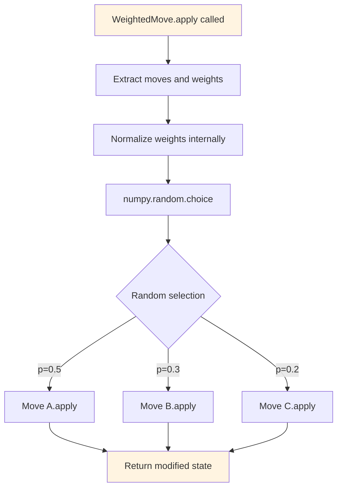

This page provides an in-depth architectural analysis of openmmtools' move composition framework, focusing on how complex sampling strategies can be constructed from elementary MCMC operations. The `SequenceMove` and `WeightedMove` classes serve as compositional primitives that enable sophisticated sampling schemes through deterministic and stochastic combination of atomic moves, while maintaining clean integration with the context caching system and providing unified statistics tracking across composite operations.

## Architectural Foundation: The MCMCMove Abstraction

Both composition classes inherit from the `MCMCMove` abstract base class, which defines the contract that all moves must implement through the `apply()` method. This method accepts a thermodynamic state, a sampler state, and an optional context cache parameter [openmmtools/mcmc.py](openmmtools/mcmc.py#L156-L175). The compositional classes follow the same interface, enabling them to be nested arbitrarily—complex moves can contain other moves, creating hierarchical sampling strategies that mirror the structure of your simulation protocol.

The framework employs a centralized context cache resolution strategy through `_get_context_cache()`, which determines whether to use a provided cache, the global cache, or creates a new one as needed [openmmtools/mcmc.py](openmmtools/mcmc.py#L184-L209). This design ensures that composite moves propagate context cache configuration consistently to all child moves, enabling efficient reuse of OpenMM Context objects across the entire move hierarchy.

## SequenceMove: Deterministic Move Composition

`SequenceMove` executes a predefined list of MCMC moves in strict sequential order, making it ideal for implementing deterministic sampling protocols where each move serves a specific purpose in the sampling cycle. The class maintains a `move_list` attribute containing ordered move instances, each of which is applied exactly once during each `apply()` call [openmmtools/mcmc.py](openmmtools/mcmc.py#L385-L387). This pattern is particularly valuable in NPT ensemble simulations where you might want to perform several dynamics steps followed by a Monte Carlo barostat move.

```mermaid
flowchart TD
    A[SequenceMove.apply called] --> B[Resolve context cache]
    B --> C[Initialize iteration counter]
    C --> D[move_list[0].apply]
    D --> E[move_list[1].apply]
    E --> F[move_list[n].apply]
    F --> G[Return completed sequence]
    
    style A fill:#e1f5ff
    style G fill:#e1f5ff
```

The statistics aggregation mechanism provides a unified view of acceptance rates across all moves in the sequence. The `statistics` property returns a list where each element corresponds to the statistics dictionary of the corresponding move in `move_list`, gracefully handling moves that don't implement statistics tracking by returning empty dictionaries [openmmtools/mcmc.py](openmmtools/mcmc.py#L389-L404). This design enables comprehensive monitoring of each component's performance without requiring manual statistics aggregation.

**Context cache propagation** ensures that all moves in a sequence share the same cache instance by default. When `apply()` is called, the SequenceMove resolves the cache once and passes the same instance to each child move's `apply()` method [openmmtools/mcmc.py](openmmtools/mcmc.py#L418-L422). The test suite verifies this behavior with `test_context_cache_sequence_apply()`, which confirms that a local cache receives exactly two access counts when a sequence of two moves is applied [openmmtools/tests/test_mcmc.py](openmmtools/tests/test_mcmc.py#L323-L339).

Serialization support enables distributed computing workflows. The `__getstate__()` method serializes each move using the `utils.serialize()` utility, storing them in a dictionary structure that preserves the sequence order [openmmtools/mcmc.py](openmmtools/mcmc.py#L430-L432). Deserialization through `__setstate__()` reconstructs the move list, maintaining the original sequence [openmmtools/mcmc.py](openmmtools/mcmc.py#L434-L436). The test suite validates this functionality for SequenceMove instances alongside primitive move types [openmmtools/tests/test_mcmc.py](openmmtools/tests/test_mcmc.py#L463-L484).

*Table: SequenceMove Configuration Options*

| Parameter | Type | Description | Default |
|-----------|------|-------------|---------|
| `move_list` | list-like of MCMCMove | Ordered sequence of moves to apply | Required |
| `context_cache` | ContextCache | Optional cache passed to apply() | None (uses global) |

## WeightedMove: Probabilistic Move Selection

`WeightedMove` implements stochastic move composition by selecting one move from a weighted set at each application, enabling adaptive sampling strategies that explore different proposal mechanisms. The initialization accepts `move_set`, a list of tuples where each tuple contains a move instance and its associated probability weight [openmmtools/mcmc.py](openmmtools/mcmc.py#L444-L476). At runtime, `apply()` uses `numpy.random.choice()` with the provided weights to select which move to execute, then applies only that single move to the current state [openmmtools/mcmc.py](openmmtools/mcmc.py#L510-L514).



The statistics tracking mechanism maintains individual statistics for each potential move in the set. The `statistics` property returns a list aligned with `move_set`, containing the statistics dictionary for each move even when that move was not selected in the current iteration [openmmtools/mcmc.py](openmmtools/mcmc.py#L478-L487). This design enables tracking of how often each move type is attempted and accepted, providing visibility into the random selection distribution and its impact on sampling efficiency.

> [!TIP]
> WeightedMove does not enforce that weights sum to 1.0 internally. The numpy.random.choice function normalizes weights automatically, so you can specify weights as relative proportions. However, be aware that extremely small weights may lead to underflow or numerical instability in rare cases, and zero weights will permanently disable that move from selection.

Serialization of WeightedMove separates the move instances from their weights, storing moves in a serialized form and weights as a parallel list [openmmtools/mcmc.py](openmmtools/mcmc.py#L516-L519). During deserialization, the class reconstructs the tuple structure by zipping the deserialized moves with their original weights, preserving the probability distribution across pickling cycles [openmmtools/mcmc.py](openmmtools/mcmc.py#L521-L525). The test suite includes WeightedMove in the comprehensive serialization test to verify this behavior [openmmtools/tests/test_mcmc.py](openmmtools/tests/test_mcmc.py#L477).

*Table: SequenceMove vs WeightedMove Comparison*

| Feature | SequenceMove | WeightedMove |
|---------|--------------|--------------|
| **Execution Pattern** | Deterministic, all moves in order | Probabilistic, one move per apply |
| **Use Case** | Protocol-driven sampling | Adaptive/exploratory sampling |
| **Statistics** | All moves tracked every iteration | Individual move tracking across selections |
| **Parallelization** | Inherently sequential | Naturally parallelizable across replicas |
| **State Modification** | Cumulative across sequence | Single move impact per iteration |
| **NPT Ensemble** | Ideal (dynamics + barostat) | Possible but less conventional |

## Context Cache Integration and Propagation

Both composition classes implement identical context cache propagation logic, ensuring that the cache resolution occurs once per composite move application. The `_get_context_cache()` static method handles three scenarios: when `None` is provided (use global cache), when a `ContextCache` instance is provided (use that instance), or when an invalid type is provided (raise ValueError) [openmmtools/mcmc.py](openmmtools/mcmc.py#L202-L209). This centralized behavior guarantees consistent cache usage throughout the move hierarchy and prevents accidental cache duplication.

The `test_context_cache_compatibility()` test demonstrates how compatible moves in a sequence can share a single cached Context. When four `LangevinDynamicsMove` instances are composed in a SequenceMove and applied with a cache capacity of 10, the test verifies that only one Context is created and reused across all four moves [openmmtools/tests/test_mcmc.py](openmmtools/mcmc.py#L342-L359). This optimization is critical for GPU-based simulations where Context creation is expensive.

Similarly, `test_context_cache_local_vs_global()` validates isolation between local and global caches. A SequenceMove with two different move types is applied first with a local cache (verifying global cache remains unchanged at size 0, local grows to size 2), then with the global cache (verifying local stays at size 2, global grows to size 2) [openmmtools/tests/test_mcmc.py](openmmtools/mcmc.py#L362-L386). This isolation enables parallel replica exchange simulations where each replica maintains independent context caches.

> [!TIP]
> When constructing complex move hierarchies, be aware that context cache isolation is maintained at the cache instance level, not at the move level. If you pass the same ContextCache instance to multiple independent SequenceMove objects, they will share cached Contexts across the entire application scope. This can be beneficial for memory efficiency but may cause unexpected cache eviction behavior under high-throughput parallel sampling.

## Practical Patterns and Use Cases

The canonical NPT ensemble simulation pattern combines dynamics propagation with Monte Carlo barostat moves in a deterministic sequence. This approach ensures that configurational sampling through molecular dynamics is periodically interspersed with volume adjustments to maintain correct pressure statistics:

```python
# NPT ensemble: alternating dynamics and barostat moves
sequence_move = SequenceMove([
    GHMCMove(timestep=1.0*unit.femtosecond, n_steps=50),
    MonteCarloBarostatMove(n_attempts=5)
])
```

This pattern is documented in the SequenceMove docstring with a Lennard-Jones fluid example [openmmtools/mcmc.py](openmmtools/mcmc.py#L366-L383).

For enhanced configurational exploration, a weighted combination of different proposal mechanisms can prevent sampling from becoming trapped in local minima. The WeightedMove docstring demonstrates combining HMC and Langevin dynamics moves with equal probability [openmmtools/mcmc.py](openmmtools/mcmc.py#L454-L472):

```python
# Mixed proposal strategies for improved mixing
weighted_move = WeightedMove([
    (HMCMove(n_steps=10), 0.5),
    (LangevinDynamicsMove(n_steps=10), 0.5)
])
```

Nested composition enables hierarchical sampling strategies. A SequenceMove can contain other SequenceMove or WeightedMove instances, creating complex protocols like "perform short Langevin dynamics, then either GHMC with 50% probability or additional Langevin steps with 50% probability, then barostat move." The framework's uniform interface ensures that any MCMCMove subclass can participate in arbitrary nesting.

*Table: Common Composition Patterns*

| Pattern | Composition Structure | Typical Application |
|---------|----------------------|---------------------|
| **NPT Protocol** | SequenceMove([Dynamics, Barostat]) | Pressure-controlled simulations |
| **Mixed Proposal** | WeightedMove([(HMC, p), (Langevin, 1-p)]) | Enhanced configurational sampling |
| **Replica Exchange** | Independent weighted moves per replica | Parallel tempering/REMD |
| **Hierarchical** | SequenceMove([SequenceMove(...), WeightedMove(...)]) | Multi-stage protocols |
| **Multi-Algorithm** | SequenceMove([IntegratorMove1, MetropolizedMove]) | Hybrid dynamics/MC schemes |

## Statistics Aggregation and Monitoring

Both composition classes implement getter and setter interfaces for the `statistics` property, enabling introspection and restoration of move statistics across runs. The aggregation pattern iterates through all contained moves, collecting their individual statistics into a list structure that mirrors the move composition [openmmtools/mcmc.py](openmmtools/mcmc.py#L389-L404). This design enables saving and loading complete statistics snapshots for composite moves, facilitating long-running simulations with checkpoint/resume capabilities.

The setter interface enables statistics restoration from serialized state, which is particularly valuable for replica exchange simulations where moves may be transferred between replicas or restarted from checkpoints. The implementation checks each move for the presence of a `statistics` attribute before attempting assignment, gracefully handling moves that don't track statistics [openmmtools/mcmc.py](openmmtools/mcmc.py#L400-L404) [openmmtools/mcmc.py](openmmtools/mcmc.py#L489-L493).

When monitoring complex composite moves, developers should examine the statistics list structure. For a SequenceMove with N child moves, `statistics` returns a list of length N. For a WeightedMove with M weighted options, `statistics` returns a list of length M. Each element is either a statistics dictionary (for moves that implement tracking) or an empty dictionary (for moves that don't).

## Advanced Integration with Multi-State Sampling

The composition framework integrates seamlessly with replica exchange and other multi-state sampling algorithms. Each replica in a parallel tempering simulation can maintain its own move composition strategy, with different temperature-dependent proposals optimized for specific temperature ranges. The context cache isolation ensures that replicas don't interfere with each other's Context objects, even when running concurrently on different GPU devices.

When combined with the `MCMCSampler` driver class, composite moves enable sophisticated sampling protocols where each iteration of the sampler applies the entire composite move. The sampler's `run()` method repeatedly calls the move's `apply()` method, passing the same thermodynamic and sampler states while allowing the internal move composition to decide how to modify the system [openmmtools/mcmc.py](openmmtools/mcmc.py#L285-L303).

For developers extending the framework, creating custom composite moves involves subclassing `MCMCMove` and implementing the `apply()` method with whatever composition logic your sampling strategy requires. The existing `SequenceMove` and `WeightedMove` implementations serve as templates for deterministic and stochastic composition respectively, and both demonstrate proper context cache propagation and statistics aggregation patterns.

## Next Steps

Understanding move composition is essential for building sophisticated sampling protocols. After mastering this page, consider exploring:

- [MCMC Move Abstraction and Base Classes](12-mcmc-move-abstraction-and-base-classes) - Understand the fundamental interfaces that all moves implement
- [Dynamics-Based Moves (Langevin, HMC, GHMC)](13-dynamics-based-moves-langevin-hmc-ghmc) - Learn about the atomic move types you can compose
- [Metropolized Monte Carlo Moves](15-metropolized-monte-carlo-moves) - Explore MC-based moves that complement dynamics proposals
- [Creating Custom MCMC Moves](28-creating-custom-mcmc-moves) - Build specialized moves for your specific sampling needs

The modular composition architecture demonstrated by SequenceMove and WeightedMove provides the foundation for designing advanced sampling strategies that combine multiple proposal mechanisms in sophisticated ways, enabling efficient exploration of complex molecular systems.