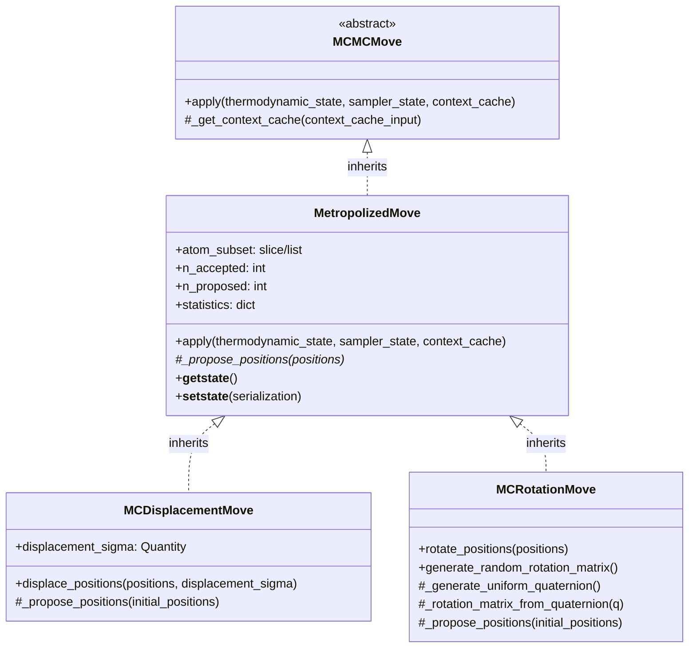

Metropolized Monte Carlo moves represent a family of proposal mechanisms that combine deterministic perturbation strategies with stochastic Metropolis acceptance criteria to ensure detailed balance in equilibrium sampling. In openmmtools, these moves provide a flexible framework for performing configurational sampling without requiring integration of equations of motion, making them particularly useful for systems where energy evaluation costs dominate or where specific degrees of freedom need targeted sampling strategies.

Sources: [openmmtools/mcmc.py](openmmtools/mcmc.py#L810-L970), [openmmtools/mcmc.py](openmmtools/mcmc.py#L27-L47)

## Architectural Foundation

The MetropolizedMove architecture implements a **template method pattern** that separates proposal generation from acceptance decision. This design enables developers to create new move types by implementing only the `_propose_positions()` method while inheriting the complete Metropolis-Hastings acceptance machinery, statistics tracking, and context management infrastructure.

The class hierarchy places MetropolizedMove as an intermediate abstraction between the base MCMCMove interface and concrete implementations like MCDisplacementMove and MCRotationMove. This positioning allows MetropolizedMove to provide domain-specific functionality for position-based proposals while maintaining compatibility with the broader MCMC framework's composition primitives (SequenceMove, WeightedMove).

Sources: [openmmtools/mcmc.py](openmmtools/mcmc.py#L810-L820), [openmmtools/mcmc.py](openmmtools/mcmc.py#L143-L175)

## Core MetropolizedMove Implementation

### Template Method Pattern

The MetropolizedMove class implements the complete acceptance/rejection workflow through its `apply()` method. The algorithm follows these steps:

1. **Energy Evaluation**: Compute the reduced potential of the current configuration using the ThermodynamicState's reduced_potential() method
2. **Proposal Generation**: Delegate to the abstract `_propose_positions()` method to generate candidate positions
3. **Energy Comparison**: Evaluate the energy of the proposed configuration
4. **Metropolis Decision**: Accept if ΔU ≤ 0 or with probability exp(-ΔU) for ΔU > 0
5. **State Update**: Apply the new positions on acceptance, restore original positions on rejection
6. **Statistics Tracking**: Increment n_accepted and n_proposed counters

The implementation handles edge cases including NaN energy detection, which causes automatic rejection, and supports flexible atom_subset specification using either slice objects or index lists. For single-atom subsets, the code automatically converts to slice notation to maintain consistent 2D array shapes throughout the proposal pipeline.

Sources: [openmmtools/mcmc.py](openmmtools/mcmc.py#L872-L941)

### Statistics and Serialization

MetropolizedMove instances track two fundamental statistics: `n_accepted` (number of accepted proposals) and `n_proposed` (total number of attempted moves). These are exposed through the `statistics` property as a dictionary, enabling persistent tracking across serialization boundaries. The class implements Python's `__getstate__()` and `__setstate__()` methods to ensure that both configuration parameters and accumulated statistics survive pickling operations, which is essential for checkpointing and distributed sampling workflows.

Sources: [openmmtools/mcmc.py](openmmtools/mcmc.py#L862-L950)



## Concrete Metropolized Move Implementations

### MCDisplacementMove: Random Translation

MCDisplacementMove implements a simple yet powerful proposal mechanism where atoms are displaced by random vectors drawn from a multivariate normal distribution with zero mean and isotropic standard deviation specified by `displacement_sigma`. The displacement vector is applied uniformly to all atoms in the atom_subset, making this move particularly effective for:
- Exploring local configurational space
- Sampling small-scale rearrangements
- Systems with translational degrees of freedom

The implementation ensures unit consistency by converting the user-specified displacement_sigma to the same units as the positions before generating the random displacement vector. This allows flexible specification (e.g., nanometers, angstroms) while maintaining internal numerical stability.

Sources: [openmmtools/mcmc.py](openmmtools/mcmc.py#L1704-L1771)

### MCRotationMove: Uniform Random Rotation

MCRotationMove implements a uniform random rotation of atom subsets around their center of geometry. The mathematical sophistication of this implementation deserves particular attention:

**Uniform Quaternion Generation**: The class implements Shoemake's algorithm for generating uniformly distributed quaternions on the 3-sphere S³. Given three independent uniform random variables u₁, u₂, u₃ ∈ [0,1], the algorithm generates:
```
q₀ = √(1-u₁)sin(2πu₂)
q₁ = √(1-u₁)cos(2πu₂)  
q₂ = √(u₁)sin(2πu₃)
q₃ = √(u₁)cos(2πu₃)
```

This ensures that the resulting rotation matrices are uniformly distributed over SO(3), preventing any rotational bias that would violate detailed balance.

**Quaternion-to-Rotation Matrix Conversion**: The implementation efficiently converts quaternions to 3×3 rotation matrices using the standard formula:
```
R = [1-2(y²+z²)    2(xy-zw)      2(xz+yw)  ]
    [  2(xy+zw)   1-2(x²+z²)     2(yz-xw)  ]
    [  2(xz-yw)      2(yz+xw)   1-2(x²+y²) ]
```

The rotation is applied relative to the center of geometry of the atom subset, ensuring that the move only affects orientation rather than translation of the selected atoms.

Sources: [openmmtools/mcmc.py](openmmtools/mcmc.py#L1777-L1911), [openmmtools/mcmc.py](openmmtools/mcmc.py#L1887-L1907)

## Move Configuration and Parameters

### Parameter Comparison

| Parameter | MCDisplacementMove | MCRotationMove | Type | Default |
|-----------|-------------------|----------------|------|---------|
| `atom_subset` | ✓ | ✓ | slice/list[int] | None (all atoms) |
| `displacement_sigma` | ✓ | ✗ | Quantity | 1.0 nm |
| `n_accepted` | ✓ | ✓ | int | 0 (auto-incremented) |
| `n_proposed` | ✓ | ✓ | int | 0 (auto-incremented) |

### Atom Subset Specification

Both moves support flexible atom selection through the `atom_subset` parameter:

- **None**: Apply to all atoms in the system (default)
- **slice object**: Python slice notation for contiguous index ranges
- **list of int**: Explicit atom indices for non-contiguous selections
- **Single-element list**: Automatically converted to slice for shape consistency

This flexibility enables targeted sampling of specific molecular regions, such as side-chain rotamers, solvent shells, or ligand binding sites, while keeping the remainder of the system fixed. The implementation handles deep copying of initial positions to ensure proper restoration on rejection, even when working with slice objects that normally return views rather than copies.

Sources: [openmmtools/mcmc.py](openmmtools/mcmc.py#L856-L860), [openmmtools/mcmc.py](openmmtools/mcmc.py#L903-L920)

## Integration with Context Cache System

Metropolized moves leverage the ContextCache infrastructure to minimize OpenMM Context creation overhead. The `apply()` method accepts an optional `context_cache` parameter that defaults to the global `cache.global_context_cache`. This design enables:

- **Resource Efficiency**: Reuse of GPU contexts across multiple move applications
- **Platform Flexibility**: Easy switching between CPU, CUDA, and OpenCL platforms
- **Cache Isolation**: Local caches for independent sampling workflows

The cache integration is handled through the `_get_context_cache()` method inherited from MCMCMove, which provides a centralized point for cache management and validation. For metropolized moves, the Context is used exclusively for energy evaluations—no integrator is required since these moves don't involve dynamics.

Sources: [openmmtools/mcmc.py](openmmtools/mcmc.py#L892-L896), [openmmtools/cache.py](openmmtools/cache.py#L214-L378)

> [!TIP]
> When using atom_subset with ContextCache, be aware that the cached Context still contains the full System. Energy computations for subsets require setting all positions in the Context before evaluation, which the MetropolizedMove.apply() method handles automatically through sampler_state.apply_to_context() calls.

## Practical Usage Examples

### Basic Displacement Sampling

```python
from openmm import unit
from openmmtools import testsystems, states, mcmc, cache

# Create system and states
test = testsystems.AlanineDipeptideVacuum()
thermodynamic_state = states.ThermodynamicState(
    system=test.system, 
    temperature=298*unit.kelvin
)
sampler_state = states.SamplerState(positions=test.positions)

# Configure displacement move with modest step size
displacement_move = mcmc.MCDisplacementMove(
    displacement_sigma=0.1*unit.angstrom,  # Small step for high acceptance
    atom_subset=range(10)  # Apply to first 10 atoms only
)

# Apply move and check statistics
displacement_move.apply(thermodynamic_state, sampler_state)
print(f"Acceptance rate: {displacement_move.n_accepted / displacement_move.n_proposed}")
```

### Rotation-Enhanced Sampling

```python
from openmmtools import mcmc

# Create rotation move for entire molecule
rotation_move = mcmc.MCRotationMove()

# Combine displacement and rotation in a weighted scheme
combined_move = mcmc.WeightedMove([
    (mcmc.MCDisplacementMove(displacement_sigma=0.05*unit.angstrom), 0.7),
    (mcmc.MCRotationMove(), 0.3)
])

# Create sampler and run
sampler = mcmc.MCMCSampler(
    thermodynamic_state, 
    sampler_state, 
    move=combined_move
)
sampler.run(n_iterations=100)
```

Sources: [openmmtools/mcmc.py](openmmtools/mcmc.py#L833-L853), [openmmtools/mcmc.py](openmmtools/mcmc.py#L439-L472)

## Composition with Other Move Types

Metropolized moves integrate seamlessly with openmmtools' move composition primitives, enabling sophisticated sampling strategies:

### Sequential Move Application

```python
# Sequential combination with dynamics-based moves
from openmmtools import mcmc

sequence = mcmc.SequenceMove([
    mcmc.GHMCMove(timestep=2.0*unit.femtosecond, n_steps=50),  # Exploration
    mcmc.MCDisplacementMove(displacement_sigma=0.2*unit.angstrom),  # Local refinement
    mcmc.MonteCarloBarostatMove(n_attempts=3)  # Volume sampling
])
```

### Probabilistic Move Selection

```python
# Weighted selection between different proposal strategies
adaptive_scheme = mcmc.WeightedMove([
    (mcmc.MCDisplacementMove(displacement_sigma=0.1*unit.angstrom), 0.4),
    (mcmc.MCRotationMove(), 0.3),
    (mcmc.GHMCMove(timestep=1.0*unit.femtosecond, n_steps=100), 0.3)
])
```

The statistics property provides aggregated acceptance data for each component move, enabling runtime optimization of move selection probabilities based on observed acceptance rates.

Sources: [openmmtools/mcmc.py](openmmtools/mcmc.py#L350-L438), [openmmtools/mcmc.py](openmmtools/mcmc.py#L439-L531)

## Performance Considerations

### Acceptance Rate Tuning

The displacement_sigma parameter directly controls proposal step size and acceptance rate. Optimal acceptance rates for Metropolis sampling depend on system dimensionality but typically target 20-50% acceptance for efficient exploration. The statistics tracking enables systematic tuning:

```python
# Adaptive tuning loop
move = mcmc.MCDisplacementMove(displacement_sigma=0.5*unit.angstrom)
for iteration in range(10):
    move.apply(thermodynamic_state, sampler_state)
    acceptance_rate = move.n_accepted / move.n_proposed
    if acceptance_rate < 0.2:
        move.displacement_sigma *= 0.9  # Reduce step size
    elif acceptance_rate > 0.5:
        move.displacement_sigma *= 1.1  # Increase step size
```

> [!TIP]
> MCRotationMove does not require step size tuning since uniform rotations over SO(3) inherently preserve detailed balance. However, for large molecules, consider applying rotations to smaller subsets to avoid excessive energy penalties from steric clashes.

### Computational Efficiency

Metropolized moves require two energy evaluations per application (initial and proposed configurations). For systems with expensive force calculations, consider:
- Using larger atom subsets to amortize energy evaluation overhead
- Combining with dynamics-based moves (GHMC, Langevin) that generate correlated proposals through trajectory integration
- Leveraging ContextCache with appropriate capacity/time-to-live settings

Sources: [openmmtools/mcmc.py](openmmtools/mcmc.py#L898-L927), [openmmtools/mcmc.py](openmmtools/mcmc.py#L1735-L1757)

## Testing and Validation

The test suite verifies correct implementation through multiple validation strategies:

### Statistical Tests

The `test_metropolized_moves()` function systematically validates both MCDisplacementMove and MCRotationMove by:
- Dynamically adjusting atom_subset size to probe different acceptance/rejection regimes
- Verifying that accepted moves actually modify positions (not rejected)
- Ensuring that rejected moves restore original positions exactly
- Confirming that both acceptance and rejection events occur during sampling

This testing approach validates the detailed balance implementation by ensuring the acceptance/rejection logic produces statistically correct behavior across different proposal magnitudes.

Sources: [openmmtools/tests/test_mcmc.py](openmmtools/tests/test_mcmc.py#L544-L580)

### Serialization Tests

Moves are validated for correct pickle serialization to ensure statistics and configuration survive serialization boundaries:

```python
def test_moves_serialization():
    # Test cases include MCDisplacementMove and MCRotationMove
    test_cases = [
        MCDisplacementMove(),
        MCRotationMove(),
        SequenceMove([MCDisplacementMove(), MCRotationMove()]),
    ]
    for move in test_cases:
        serialized = utils.serialize(move)
        deserialized = utils.deserialize(serialized)
        assert pickle.dumps(move) == pickle.dumps(deserialized)
```

Sources: [openmmtools/tests/test_mcmc.py](openmmtools/tests/test_mcmc.py#L463-L485)

## Next Steps

For developers seeking to extend the metropolized move framework:

1. **Custom Proposal Development**: Create new move types by inheriting from MetropolizedMove and implementing `_propose_positions()`. See [MCMC Move Abstraction and Base Classes](12-mcmc-move-abstraction-and-base-classes) for detailed guidance.

2. **Enhanced Sampling Integration**: Combine metropolized moves with replica exchange or self-adjusted mixture sampling. Refer to [Replica Exchange Molecular Dynamics (REMD)](16-replica-exchange-molecular-dynamics-remd) and [Self-Adjusted Mixture Sampling (SAMS)](17-self-adjusted-mixture-sampling-sams).

3. **Alchemical Applications**: Use metropolized moves for alchemical coordinate perturbations in free energy calculations. See [Alchemical State Management](20-alchemical-state-management) for integration patterns.

4. **Performance Optimization**: Explore ContextCache configuration for GPU-accelerated systems. Review [Context Caching Architecture](6-context-caching-architecture) for platform-specific tuning guidelines.
