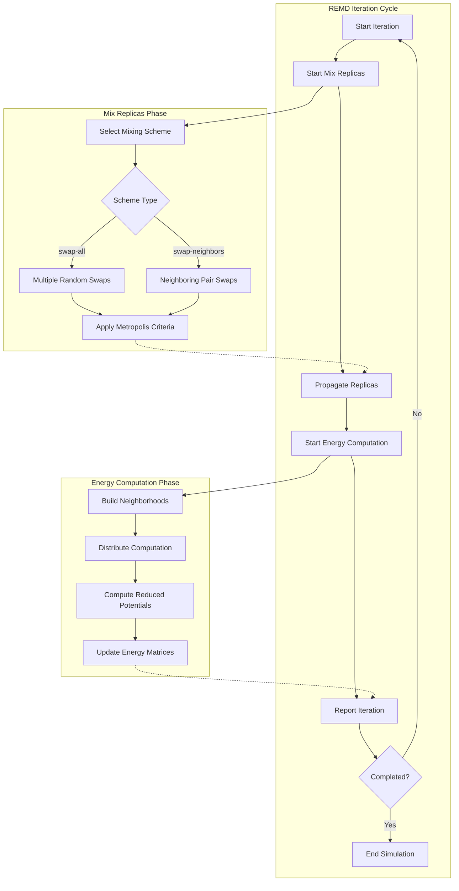
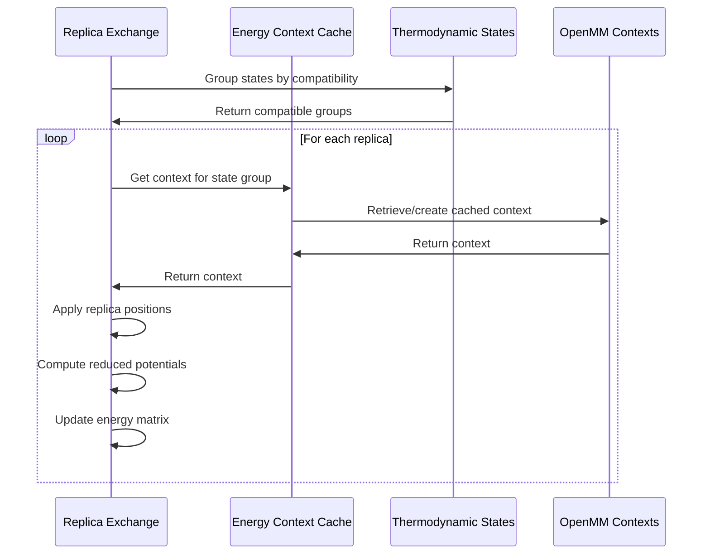

Replica Exchange Molecular Dynamics (REMD) is an enhanced sampling technique that improves the exploration of conformational space by running multiple replicas at different thermodynamic states and periodically attempting to swap configurations between them. In openmmtools, REMD is implemented through the `ReplicaExchangeSampler` class, which builds upon the `MultiStateSampler` base architecture to provide an efficient Gibbs sampling framework for crossing energy barriers that would otherwise trap individual simulations in local minima.

Sources: [replicaexchange.py](openmmtools/multistate/replicaexchange.py#L52-L53), [multistate.rst](docs/multistate.rst#L43-L54)

## Architectural Foundation

The REMD implementation in openmmtools extends the `MultiStateSampler` base class, which provides the fundamental infrastructure for managing multiple thermodynamic states and their associated replicas. The key architectural components work together to orchestrate the replica exchange process across iterations, with each iteration consisting of four phases: replica mixing (state swapping), MCMC propagation, energy computation across all states, and data storage.

Sources: [multistatesampler.py](openmmtools/multistate/multistatesampler.py#L63-L64), [multistatesampler.py](openmmtools/multistate/multistatesampler.py#L767-L786)



The architecture leverages MPI parallelization through the `mpiplus` module, distributing replica propagation and energy computation across available compute nodes. This design allows efficient scaling for simulations with many replicas, particularly important for systems requiring large numbers of thermodynamic states to achieve adequate overlap.

Sources: [multistatesampler.py](openmmtools/multistate/multistatesampler.py#L1288-L1313), [multistatesampler.py](openmmtools/multistate/multistatesampler.py#L1418-L1438)

## Mathematical Foundations

The REMD algorithm implements a Gibbs sampling scheme for thermodynamic state space, where proposed swaps between configurations at states i and j follow the Metropolis acceptance criterion based on reduced potentials. The acceptance probability for swapping configurations between two thermodynamic states is computed from the energy matrix, where each entry represents the reduced potential of a specific replica's configuration evaluated at a specific thermodynamic state.

Sources: [multistate.rst](docs/multistate.rst#L52-L60), [replicaexchange.py](openmmtools/multistate/replicaexchange.py#L382-L406)

For a proposed swap between states i and j with configurations xᵢ and xⱼ, the acceptance probability is:

```
P_accept(i, x_i, j, x_j) = min[1, exp(Δu_ji(x_i) + Δu_ij(x_j))]
```

where Δu represents the change in reduced potential when evaluating a configuration at a different thermodynamic state. This detailed balance condition ensures the sampler generates correct equilibrium sampling across the state ensemble.

Sources: [multistate.rst](docs/multistate.rst#L52-L60), [replicaexchange.py](openmmtools/multistate/replicaexchange.py#L389-L393)

## Replica Mixing Schemes

The `ReplicaExchangeSampler` provides two mixing schemes that determine how replica exchange attempts are organized during each iteration, with important implications for mixing efficiency and computational cost.

Sources: [replicaexchange.py](openmmtools/multistate/replicaexchange.py#L214-L234)

| Mixing Scheme | Description | Complexity | Use Case |
|--------------|-------------|-----------|----------|
| `swap-all` | Attempts multiple random swaps between all replica pairs (default: n³ attempts) | O(n³) | Most thorough mixing, recommended for general use |
| `swap-neighbors` | Swaps only adjacent thermodynamic states in alternating pairs | O(n) | Required when using locality constraints, lower overhead |

Sources: [replicaexchange.py](openmmtools/multistate/replicaexchange.py#L266-L283), [replicaexchange.py](openmmtools/multistate/replicaexchange.py#L366-L380)

The `swap-all` scheme implements the improved Gibbs sampling approach described by Chodera and Shirts, attempting many swaps to generate approximately uncorrelated samples of the state permutation matrix. This dramatically improves mixing compared to traditional neighboring-only schemes, reducing correlation times and total samples needed. The implementation uses numba-accelerated code when available for performance, with a Python fallback for compatibility.

Sources: [replicaexchange.py](openmmtools/multistate/replicaexchange.py#L269-L280), [replicaexchange.py](openmmtools/multistate/replicaexchange.py#L294-L350)

> [!TIP]
> When using `swap-all`, the numba-accelerated implementation provides significant speedup for large replica counts (16+). The implementation automatically falls back to Python if numba is unavailable or encounters errors, but this incurs substantial performance penalties.

## Energy Computation and Context Caching

After each replica exchange attempt, the system computes the complete energy matrix where each entry E[i,j] represents the reduced potential of replica i's configuration evaluated at thermodynamic state j. This O(n²) computation forms the bottleneck of REMD performance, necessitating optimization through context caching and neighborhood restriction.

Sources: [multistatesampler.py](openmmtools/multistate/multistatesampler.py#L1419-L1438), [multistatesampler.py](openmmtools/multistate/multistatesampler.py#L1440-L1476)

The computation leverages `states.group_by_compatibility()` to batch thermodynamic states that can share OpenMM Contexts, reducing the number of expensive context creations. Each replica's energy is computed by applying its positions to cached contexts and evaluating reduced potentials across its neighborhood of thermodynamic states. For unrestricted simulations (locality=None), this includes all states, enabling MBAR analysis for free energy estimation.

Sources: [multistatesampler.py](openmmtools/multistate/multistatesampler.py#L1458-L1473)



> [!TIP]
> For alchemical systems where thermodynamic states differ only by lambda parameters, context compatibility grouping can reduce context creation by up to 90% compared to naive implementations, dramatically accelerating the energy computation phase.

## Core Implementation Details

The `ReplicaExchangeSampler` class extends `MultiStateSampler` by overriding the `_mix_replicas()` method to implement state exchange logic. The initialization accepts a `replica_mixing_scheme` parameter that controls the exchange strategy, with validation ensuring compatibility with locality settings.

Sources: [replicaexchange.py](openmmtools/multistate/replicaexchange.py#L214-L253), [multistatesampler.py](openmmtools/multistate/multistatesampler.py#L1482-L1485)

The `_attempt_swap()` method implements the core exchange logic: it retrieves the thermodynamic states for two replicas, computes the acceptance probability from the energy matrix, and conditionally swaps the state assignments while maintaining swap statistics in tracking matrices. These statistics (stored in `_n_accepted_matrix` and `_n_proposed_matrix`) provide valuable diagnostics for analyzing simulation behavior and tuning temperature schedules.

Sources: [replicaexchange.py](openmmtools/multistate/replicaexchange.py#L382-L406)

## Parallel Tempering Specialization

The `ParallelTemperingSampler` class provides a specialized implementation for the common case where thermodynamic states differ only in temperature. By accepting a single reference `ThermodynamicState` and a temperature schedule, it simplifies setup while providing an optimized O(n) energy computation that exploits the mathematical relationship between reduced potentials at different temperatures.

Sources: [paralleltempering.py](openmmtools/multistate/paralleltempering.py#L44-L53), [paralleltempering.py](openmmtools/multistate/paralleltempering.py#L109-L173)

The optimization works by computing the reduced potential once at a reference temperature, then scaling by the ratio of inverse temperatures (beta factors) to obtain energies at all other temperatures. This eliminates the need for multiple context evaluations, providing substantial speedup for temperature-only replica exchange simulations.

Sources: [paralleltempering.py](openmmtools/multistate/paralleltempering.py#L175-L237)

## Initialization and Configuration

Setting up a REMD simulation requires creating appropriate thermodynamic states, initializing sampler states for each replica, and configuring the mixing scheme. The sampler requires equal numbers of thermodynamic states and sampler states, distributing any provided sampler states in a round-robin fashion if fewer are provided than states.

Sources: [replicaexchange.py](openmmtools/multistate/replicaexchange.py#L239-L253)

```python
from openmmtools.multistate import ReplicaExchangeSampler
from openmmtools import states, testsystems, mcmc

# Create thermodynamic states (e.g., alchemical lambda values)
testsystem = testsystems.AlanineDipeptideImplicit()
thermodynamic_states = [states.ThermodynamicState(
    testsystem.system, temperature=300*unit.kelvin)
    for lambda_val in np.linspace(0.0, 1.0, 16)]

# Initialize sampler states
sampler_states = [states.SamplerState(testsystem.positions) 
                  for _ in thermodynamic_states]

# Create sampler with swap-all mixing scheme
repex = ReplicaExchangeSampler(
    mcmc_moves=mcmc.LangevinDynamicsMove(timestep=2.0*unit.femtosecond,
                                         collision_rate=5.0/unit.picosecond,
                                         n_steps=500),
    replica_mixing_scheme='swap-all'
)

# Create simulation
repex.create(thermodynamic_states, sampler_states, storage='repex.nc')
repex.minimize()
repex.run()
```

Sources: [replicaexchange.py](openmmtools/multistate/replicaexchange.py#L214-L218), [multistatesampler.py](openmmtools/multistate/multistatesampler.py#L538-L612)

## Analysis and Diagnostics

The `ReplicaExchangeAnalyzer` extends `MultiStateSamplerAnalyzer` to provide analysis capabilities specific to replica exchange simulations. The swap statistics matrices track the acceptance rates between all state pairs, enabling visualization of the exchange acceptance matrix which serves as a key diagnostic for temperature/parameter schedule quality.

Sources: [replicaexchange.py](openmmtools/multistate/replicaexchange.py#L427-L439), [replicaexchange.py](openmmtools/multistate/replicaexchange.py#L261-L292)

Typical acceptance rates of 20-30% between neighboring states indicate good overlap. Significantly lower or higher acceptance suggests poor state spacing that should be adjusted. The `_display_citations()` method ensures proper attribution to the Chodera and Shirts 2011 paper describing the Gibbs sampling approach used by the `swap-all` scheme.

Sources: [replicaexchange.py](openmmtools/multistate/replicaexchange.py#L408-L424)

## Performance Considerations

The computational cost of REMD scales primarily with the energy computation phase (O(n²) for n replicas) and the mixing phase (O(n³) for `swap-all`, O(n) for `swap-neighbors`). Context caching through the global cache dramatically reduces overhead by reusing OpenMM Contexts across replicas and iterations.

Sources: [multistatesampler.py](openmmtools/multistate/multistatesampler.py#L1737-L1744)

For large simulations (48+ replicas), the dominant cost is often energy evaluation rather than molecular dynamics propagation. Strategies for optimization include: using restricted locality to reduce the energy evaluation neighborhood, leveraging the `ParallelTemperingSampler` for temperature-only simulations, and ensuring numba is available for accelerated `swap-all` mixing.

Sources: [multistatesampler.py](openmmtools/multistate/multistatesampler.py#L1264-L1287), [replicaexchange.py](openmmtools/multistate/replicaexchange.py#L272-L280)

## Next Steps

For deeper understanding of the REMD architecture, explore the [Multi-State Sampler Architecture](18-multi-state-sampler-architecture) documentation which provides details on the base classes. To understand how free energies are extracted from REMD simulations, see [Online and Offline Free Energy Analysis](19-online-and-offline-free-energy-analysis). For temperature-only simulations, the [Parallel Tempering](17-self-adjusted-mixture-sampling-sams) approach offers an optimized implementation.