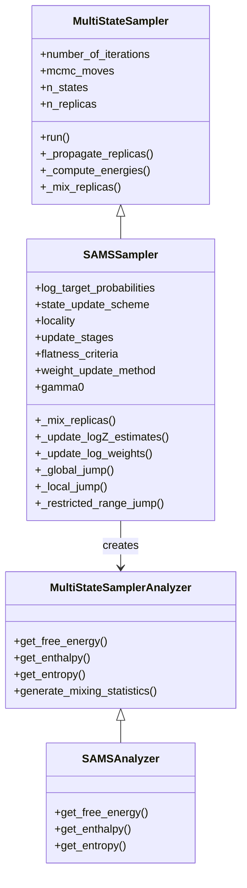
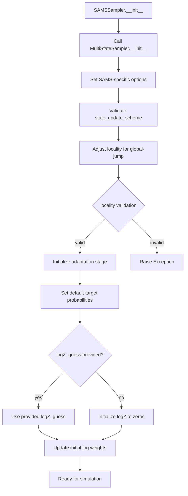
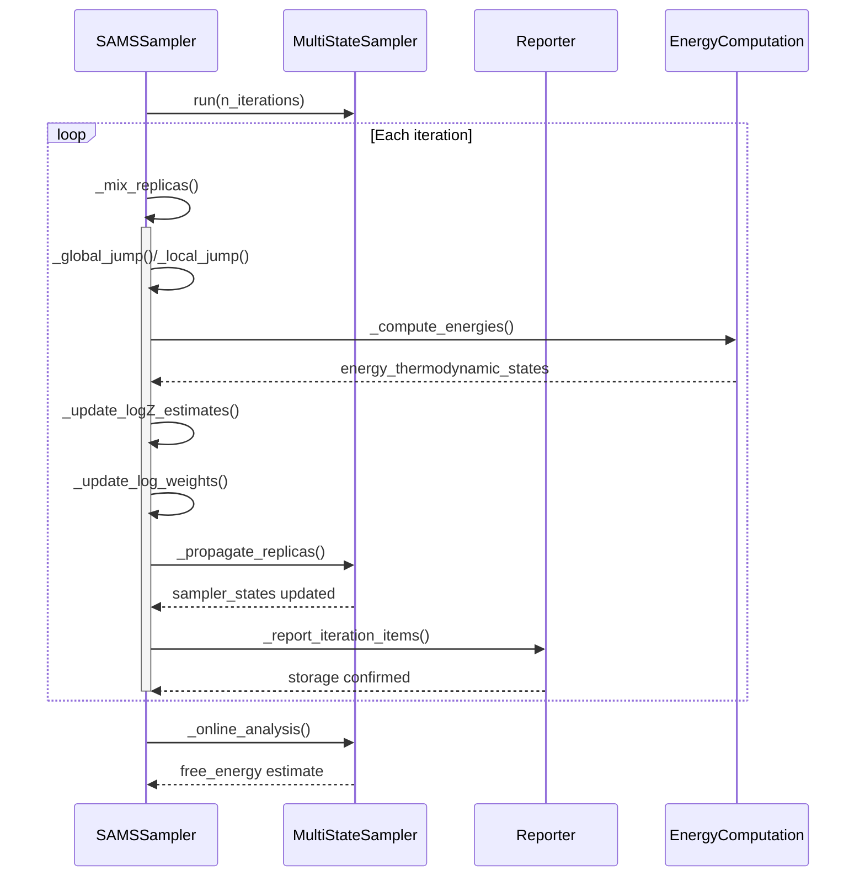

Self-Adjusted Mixture Sampling (SAMS), also known as optimally-adjusted mixture sampling, is an advanced enhanced sampling technique that combines replica-based sampling across thermodynamic states with asymptotically optimal weight updates for rapid online free energy computation. This method uses stochastic approximation to adaptively adjust sampling weights, enabling efficient exploration of alchemical pathways while providing continuous free energy estimates throughout the simulation.

## Core Concept and Mathematical Foundation

SAMS operates by allowing one or more replicas to sample from an expanded ensemble of thermodynamic states, where the state update mechanism follows a probability distribution that is continuously refined through stochastic approximation. Unlike replica exchange which relies on pairwise swap attempts, SAMS allows replicas to transition between states according to weighted probabilities that converge to optimal values for uniform sampling across states of interest.

The mathematical foundation rests on the Wang-Landau-like weight update scheme where free energy estimates are refined each iteration according to an attenuation factor γ(t). For a two-stage adaptation scheme (recommended), the attenuation factor evolves as follows:

- **Stage 0 (initial heuristic)**: γ = γ₀ × min(π*, t^(-β)) where β = 0.8
- **Stage 1 (asymptotically optimal)**: γ = γ₀ × min(π*, (t - t₀ + t₀^β)^(-1))

Here, π* represents the minimum target probability, t is the current iteration, and t₀ marks the transition to the asymptotically optimal phase when histogram flatness criteria are satisfied [sams.py](openmmtools/multistate/sams.py#L629-L635). The weight update methods differ in how information is utilized: the **optimal** method updates only the current state's estimate, while the **Rao-Blackwellized** method updates all states in the neighborhood for which energies were computed, typically providing faster convergence [sams.py](openmmtools/multistate/sams.py#L643-L662).

Sources: [sams.py](openmmtools/multistate/sams.py#L7-L24), [multistate.rst](docs/multistate.rst#L67-L76)

## Architecture Overview

SAMS extends the `MultiStateSampler` base class architecture, inheriting core functionality for replica management, energy computation, and storage while introducing specialized methods for adaptive weight updates and state transitions. The architecture follows the iteration pattern: state mixing (where replicas update thermodynamic states), replica propagation (MCMC sampling), energy computation (evaluating reduced potentials), and analysis (updating free energy estimates).



The `SAMSSampler` class introduces eleven specialized parameters controlling adaptation behavior and state transition mechanics. These parameters are validated through custom stored property validators that ensure configuration consistency before simulation begins [sams.py](openmmtools/multistate/sams.py#L280-L289).

Sources: [sams.py](openmmtools/multistate/sams.py#L43-L69), [multistatesampler.py](openmmtools/multistate/multistatesampler.py#L63-L182)

## State Update Schemes

SAMS provides three distinct mechanisms for transitioning replicas between thermodynamic states, each with different computational characteristics and convergence properties:

### Global-Jump Scheme (Recommended)

The global-jump scheme allows replicas to transition to any thermodynamic state based on computed Boltzmann-weighted probabilities. This method is described after Equation 3 in the reference implementation and provides the most efficient mixing across the full state space. The transition probability for a replica currently in state L to move to state j is proportional to exp(g[j] - u_k[j]), where g represents the current log weights and u_k represents the reduced potentials [sams.py](openmmtools/multistate/sams.py#L477-L496).

### Local-Jump Scheme (Experimental)

The local-jump scheme restricts proposals to states within a defined neighborhood (controlled by the `locality` parameter). This method computes transition probabilities only for states in the current neighborhood and accepts or rejects using a Metropolis-like criterion that accounts for the non-symmetric proposal distribution. While potentially reducing computational cost per iteration, rejection rates may be high for systems with large free energy differences between adjacent states [sams.py](openmmtools/multistate/sams.py#L439-L476).

### Restricted-Range-Jump Scheme (Experimental/Disabled)

The restricted-range-jump scheme proposes new states from the local neighborhood but computes acceptance probabilities using log-sum-exp operations over both forward and reverse neighborhoods. The implementation currently contains a known bug requiring energy computation for the proposed neighborhood, and this method is marked as disabled pending resolution [sams.py](openmmtools/multistate/sams.py#L503-L540).

> [!TIP]
> For most applications, use the global-jump scheme as it provides the best mixing and convergence properties. The local-jump and restricted-range-jump schemes are experimental and should only be used for research purposes with careful validation.

| Scheme | Mixing Efficiency | Computational Cost | Status | Use Case |
|--------|-------------------|-------------------|---------|----------|
| global-jump | Excellent | Higher | Stable | Most applications |
| local-jump | Moderate | Lower | Experimental | Large state counts with computational constraints |
| restricted-range-jump | Unknown | Moderate | Disabled | Not recommended |

Sources: [sams.py](openmmtools/multistate/sams.py#L395-L540), [multistate.rst](docs/multistate.rst#L78-L96)

## Two-Stage Adaptation Mechanism

The two-stage adaptation scheme is the recommended approach for SAMS simulations, balancing rapid initial exploration with asymptotically optimal convergence. This mechanism monitors histogram flatness and transitions between stages when predefined criteria are met.

### Stage 0: Heuristic Adaptation

The initial stage uses aggressive weight updates (γ ∝ t^(-0.8)) to rapidly achieve uniform sampling across thermodynamic states. This stage continues until one of the flatness criteria is satisfied or a manually-specified transition iteration t₀ is reached. The histogram flatness can be assessed through three methods:

- **minimum-visits**: Advances when every state has been visited at least a specified minimum number of times (default 1)
- **histogram-flatness**: Computes relative error between empirical visitation frequencies and target probabilities, advancing when all relative errors fall below `flatness_threshold` (default 0.2)
- **logZ-flatness**: Monitors accumulated free energy estimates per state, advancing when |logZ/γ₀| exceeds `flatness_threshold` for all states [sams.py](openmmtools/multistate/sams.py#L564-L605)

### Stage 1: Asymptotically Optimal

Once the histogram is deemed flat, the sampler transitions to the asymptotically optimal stage with attenuated weight updates (γ ∝ (t - t₀ + t₀^β)^(-1)). This stage provides the theoretical optimality guarantees for SAMS and continues until simulation completion. The transition time t₀ is automatically recorded to maintain continuity of the attenuation schedule [sams.py](openmmtools/multistate/sams.py#L630-L635).

> [!TIP]
> The logZ-flatness criterion is particularly effective for systems where the free energy landscape varies significantly between states, as it directly monitors the accumulation of statistical information rather than relying solely on visitation counts.

Sources: [sams.py](openmmtools/multistate/sams.py#L291-L297), [sams.py](openmmtools/multistate/sams.py#L564-L605)

## Configuration and Initialization

Proper configuration of SAMS parameters is critical for achieving efficient free energy convergence. The initialization process handles default value assignment, parameter validation, and preparation of adaptive weight structures.

### Essential Parameters

**log_target_probabilities**: Array specifying the log of target visitation probabilities for each thermodynamic state. When `None`, uniform probabilities (-log(n_states)) are assigned, meaning each state should be sampled equally in the converged distribution [sams.py](openmmtools/multistate/sams.py#L170-L172).

**state_update_scheme**: String specifying the transition mechanism ('global-jump', 'local-jump', or 'restricted-range-jump'). The global-jump scheme is recommended for most applications [sams.py](openmmtools/multistate/sams.py#L173).

**locality**: Integer defining the neighborhood size for local update schemes. When positive, the neighborhood spans indices [k - locality, k + locality]. For global-jump, this parameter is overridden to `None` [sams.py](openmmtools/multistate/sams.py#L174).

**update_stages**: String controlling adaptation behavior ('one-stage' or 'two-stage'). The two-stage scheme is recommended as it achieves initial flatness before switching to asymptotically optimal updates [sams.py](openmmtools/multistate/sams.py#L175).

**flatness_criteria**: String specifying the method for determining stage transition ('logZ-flatness', 'minimum-visits', or 'histogram-flatness'). The logZ-flatness criterion typically provides the most robust performance [sams.py](openmmtools/multistate/sams.py#L176).

**weight_update_method**: String controlling how free energy estimates are updated ('optimal' or 'rao-blackwellized'). The Rao-Blackwellized method updates all states in the computed neighborhood and generally converges faster [sams.py](openmmtools/multistate/sams.py#L177).

**gamma0**: Float specifying the initial weight adaptation rate. This controls the aggressiveness of early adaptation and may require tuning for specific systems [sams.py](openmmtools/multistate/sams.py#L179).

**logZ_guess**: Array providing initial free energy estimates for all states. When available, providing accurate initial guesses can accelerate convergence [sams.py](openmmtools/multistate/sams.py#L180).

### Initialization Sequence



The initialization process ensures that all parameters are consistent before simulation begins. Special handling is applied for the global-jump scheme, which automatically sets locality to `None` to indicate that all states are accessible [sams.py](openmmtools/multistate/sams.py#L315-L320).

Sources: [sams.py](openmmtools/multistate/sams.py#L169-L289), [sams.py](openmmtools/multistate/sams.py#L291-L365)

## Iteration Cycle and Energy Computation

Each SAMS iteration follows a well-defined sequence of operations that integrates state transitions, configuration sampling, energy evaluation, and weight updates. This cycle is designed to maintain detailed balance while efficiently exploring the thermodynamic state space.

### Iteration Workflow



The iteration begins with replica mixing, where thermodynamic states are updated according to the configured scheme. For each replica, the method computes transition probabilities across the accessible state space and samples new state assignments [sams.py](openmmtools/multistate/sams.py#L395-L436).

Following state mixing, energy computation evaluates the reduced potential of each replica configuration at multiple thermodynamic states. For SAMS with Rao-Blackwellized updates, energies are computed for all states in each replica's neighborhood to maximize information utilization [sams.py](openmmtools/multistate/sams.py#L478-L492).

### Weight Update Process

The logZ estimates are updated using stochastic approximation with the attenuation factor computed according to the current adaptation stage. For the Rao-Blackwellized method:

```
logZ[neighborhood] += γ × exp(log_P_k[neighborhood] - log_pi_k[neighborhood])
```

where log_P_k contains the normalized probabilities of occupying each neighborhood state and log_pi_k contains the log target probabilities [sams.py](openmmtools/multistate/sams.py#L643-L662). After updating all replicas, the logZ values are normalized by subtracting logZ[0] to prevent numerical overflow in the asymptotically optimal stage [sams.py](openmmtools/multistate/sams.py#L665-L667).

The log weights used for state transitions are then updated as:

```
log_weights = log_target_probabilities - logZ
```

This ensures that states with higher free energy barriers receive higher weights, promoting uniform visitation across the target states [sams.py](openmmtools/multistate/sams.py#L683-L688).

Sources: [sams.py](openmmtools/multistate/sams.py#L395-L436), [sams.py](openmmtools/multistate/sams.py#L606-L688), [multistatesampler.py](openmmtools/multistate/multistatesampler.py#L1418-L1440)

## Analysis and Free Energy Estimation

SAMS provides both online free energy estimates during simulation and post-simulation analysis through the SAMSAnalyzer class. The analysis framework leverages the continuously updated logZ estimates stored at each iteration to compute free energies, enthalpies, and entropies across the thermodynamic state space.

### SAMSAnalyzer

The `SAMSAnalyzer` extends `MultiStateSamplerAnalyzer`, inheriting comprehensive analysis capabilities for multi-state simulations. While the current implementation is a direct extension with no SAMS-specific methods added, it provides access to all standard analysis tools including free energy computation, mixing statistics generation, and observable extraction [sams.py](openmmtools/multistate/sams.py#L694-L705).

Key analysis methods available include:

- **get_free_energy()**: Returns free energy differences between thermodynamic states, computed using MBAR on the stored energy matrices
- **get_enthalpy()**: Computes enthalpy estimates from energy-weighted averages
- **get_entropy()**: Derives entropy from the relationship G = H - TS
- **generate_mixing_statistics()**: Provides detailed statistics on state transitions and acceptance rates
- **show_mixing_statistics()**: Displays formatted mixing statistics with configurable cutoffs

### Online vs Offline Analysis

SAMS uniquely supports both online and offline analysis paradigms. During simulation, the `MultiStateSampler._online_analysis()` method continuously updates free energy estimates using the accumulated energy matrices and current logZ estimates [multistatesampler.py](openmmtools/multistate/multistatesampler.py#L1607-L1658). For SAMS specifically, the `_update_logZ_estimates()` method updates logZ values each iteration using the chosen weight update method and current stage attenuation factor [sams.py](openmmtools/multistate/sams.py#L606-L688).

Post-simulation analysis can leverage the full trajectory data to refine free energy estimates using the MBAR estimator, which provides statistically optimal estimates and error bars. The `SAMSAnalyzer.read_energies()` method retrieves the energy matrices from storage, which can then be analyzed using the inherited MBAR infrastructure [multistateanalyzer.py](openmmtools/multistate/multistateanalyzer.py#L831-L896).

> [!TIP]
> For production calculations, use both online monitoring to assess convergence and offline MBAR analysis for final free energy estimates. The online logZ estimates provide a rapid approximation, while MBAR on the full dataset yields optimal statistical efficiency and rigorous uncertainty quantification.

Sources: [sams.py](openmmtools/multistate/sams.py#L694-L705), [multistateanalyzer.py](openmmtools/multistate/multistateanalyzer.py#L1137-L2211), [multistatesampler.py](openmmtools/multistate/multistatesampler.py#L1607-L1658)

## Usage Example

The following example demonstrates typical SAMS usage for alchemical free energy calculations:

```python
from openmmtools import testsystems, states, mcmc, multistate

# Create alchemical states
from openmmtools.alchemy import AbsoluteAlchemicalFactory
factory = AbsoluteAlchemicalFactory(testsystem)
alchemical_states = factory.get_alchemical_states(lambda_values)

# Initialize sampler
sampler = multistate.SAMSSampler(
    number_of_iterations=10000,
    state_update_scheme='global-jump',
    update_stages='two-stage',
    flatness_criteria='logZ-flatness',
    flatness_threshold=0.2,
    weight_update_method='rao-blackwellized',
    gamma0=1.0
)

# Define MCMC moves (Langevin dynamics)
mcmc_moves = mcmc.LangevinDynamicsMove(
    timestep=2.0*unit.femtoseconds,
    collision_rate=1.0/unit.picoseconds,
    n_steps=500
)

# Create and run simulation
sampler.create(alchemical_states, [sampler_state], storage='sams.nc')
sampler.minimize()
sampler.run()

# Analyze results
analyzer = multistate.SAMSAnalyzer.from_storage('sams.nc')
free_energy = analyzer.get_free_energy()
print(f"Free energy: {free_energy:.3f} kT")
```

This example creates alchemical states using the factory system, initializes a SAMS sampler with recommended parameters, configures Langevin dynamics for propagation, and performs analysis post-simulation. The global-jump scheme ensures efficient mixing, while the two-stage adaptation with Rao-Blackwellized updates provides rapid convergence.

Sources: [sams.py](openmmtools/multistate/sams.py#L169-L240), [test_sampling.py](openmmtools/tests/test_sampling.py#L1-L50)

## Performance Considerations and Best Practices

Several factors significantly impact the efficiency and reliability of SAMS simulations. Understanding these considerations enables optimal configuration for specific applications.

### Computational Efficiency

The computational cost per iteration scales with the number of replicas, states, and neighborhood size. For global-jump schemes, energy computation costs O(n_replicas × n_states) per iteration. Using local update schemes with reduced locality can decrease this cost to O(n_replicas × locality), but at the expense of mixing efficiency and requiring more iterations to achieve comparable convergence.

The Rao-Blackwellized weight update method typically provides faster convergence despite slightly higher per-iteration cost because it updates free energy estimates for all states in the computed neighborhood rather than just the current state. For most applications, this trade-off is favorable [sams.py](openmmtools/multistate/sams.py#L643-L662).

### Convergence Monitoring

Effective convergence monitoring is critical for SAMS simulations. Recommended monitoring includes:

1. **State visitation histograms**: Should approach uniformity for systems with equal target probabilities
2. **LogZ evolution**: Should stabilize in the asymptotically optimal stage
3. **Free energy estimates**: Online estimates should plateau with decreasing variance
4. **Mixing statistics**: Acceptance rates between neighboring states should be reasonable (typically 20-40%)

The `generate_mixing_statistics()` method provides detailed transition statistics that can identify poor mixing between specific state pairs [multistateanalyzer.py](openmmtools/multistate/multistateanalyzer.py#L1243-L1304).

### Parameter Tuning Guidelines

| Parameter | Default | Recommended Range | Tuning Considerations |
|-----------|---------|-------------------|----------------------|
| gamma0 | 1.0 | 0.5 - 5.0 | Higher values accelerate early adaptation but may increase early variance |
| flatness_threshold | 0.2 | 0.1 - 0.5 | Lower values require longer stage 0 but provide better initial uniformity |
| locality | 5 | 1 - 10 (for local schemes) | Balance between computational cost and mixing efficiency |
| update_stages | 'two-stage' | 'two-stage' | One-stage is rarely recommended due to slow convergence |

For systems with large free energy barriers between adjacent states, consider increasing the number of intermediate states or using Hamiltonian replica exchange to improve mixing before applying SAMS analysis.

Sources: [sams.py](openmmtools/multistate/sams.py#L606-L688), [multistateanalyzer.py](openmmtools/multistate/multistateanalyzer.py#L1243-L1304)

## Integration with Multi-State Sampler Architecture

SAMS is fully integrated into the openmmtools multi-state sampler architecture, sharing common infrastructure with replica exchange and parallel tempering methods. This integration enables consistent storage formats, analysis tools, and workflow patterns across enhanced sampling methods.

### Storage and Checkpointing

SAMS uses the same NetCDF-based storage system as other multi-state samplers, recording:

- Replica thermodynamic state indices at each iteration
- Energy matrices (reduced potentials)
- Online analysis data including logZ estimates and gamma values
- Sampler configurations for checkpointing

The storage format enables seamless resumption of interrupted simulations and facilitates post-simulation analysis. The `_report_iteration_items()` method handles SAMS-specific data writing, while the base `_report_iteration()` method manages common storage operations [sams.py](openmmtools/multistate/sams.py#L383-L393).

### Restoration from Storage

SAMS simulations can be restored from storage using the `from_storage()` class method inherited from `MultiStateSampler`. The restoration process reconstructs the sampler object with all saved parameters and states, enabling continuation from the exact iteration where the simulation was stopped [multistatesampler.py](openmmtools/multistate/multistatesampler.py#L264-L300).

### MPI Parallelization

SAMS leverages the same MPI-based parallelization framework as other multi-state samplers, distributing replica propagation across available computational resources. The state mixing and weight update operations are performed on the master node (rank 0) and broadcast to all workers, ensuring consistent sampler state across the parallel environment [sams.py](openmmtools/multistate/sams.py#L395-L396).

Sources: [multistatesampler.py](openmmtools/multistate/multistatesampler.py#L264-L300), [sams.py](openmmtools/multistate/sams.py#L366-L393)

## Next Steps

For deeper understanding of SAMS and its integration with the broader openmmtools framework:

- **[Multi-State Sampler Architecture](18-multi-state-sampler-architecture)**: Learn about the base class architecture that SAMS extends and the common patterns shared across enhanced sampling methods
- **[Replica Exchange Molecular Dynamics (REMD)](16-replica-exchange-molecular-dynamics-remd)**: Compare SAMS with replica exchange, understanding when each method is preferable
- **[Online and Offline Free Energy Analysis](19-online-and-offline-free-energy-analysis)**: Explore the analysis frameworks available for extracting free energies and uncertainties from SAMS simulations
- **[Alchemical State Management](20-alchemical-state-management)**: Understand how to create and manage the thermodynamic states used in SAMS calculations
